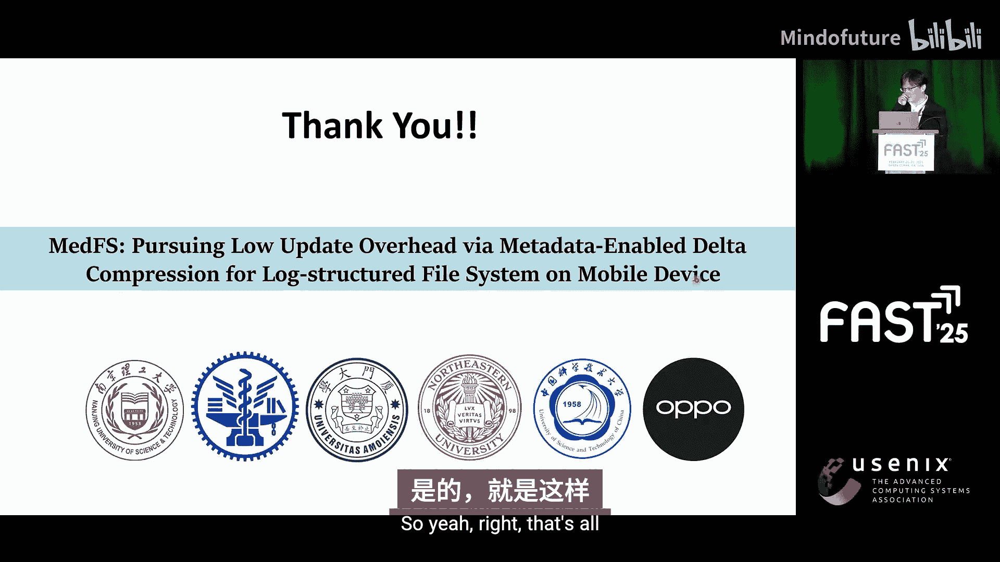
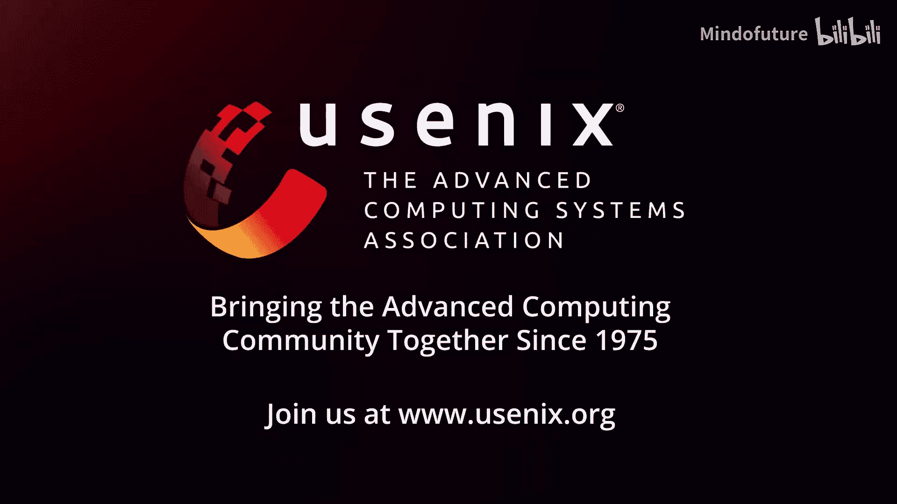

# FAST25存储大会-｜-USENIX-Conference-on-File-and-Storage-Technologies-p30-P30-MedFS---Pursuing-Low-Update-Overhead-via-Metadata-Enabled-Delta-Compression--BV1HmVXzME4J_p30-

。

So this work is about deelta compression for mobile files systems。Yeahm Li pin from NYCU， Taiwan。So。

Local applications， they are， they are becoming more and more intensive。 So on the left hand side。

 you can see the I structure of。啊。Enjoy systems。Okay， so the applications。

 they generate a lot of right IO requests to the mobile storage。

 and we know that the mobile storage is based on flash memory and flash memory has limited lifetime。

 that means it can endure only a limited cycle count of program and erase cycle， okay。哦。

So that brings a serious concern about the fresher lifespan。 and the problem is getting worse。On。

 on your right right hand side， it shows that manufacturers， they are trying to。

Migrate to high density， flashing memory。Okay， so for example， here I。

 I show T O C and the Q O C here。And for QL C， the P cycle con limit is just 1000。Okay。

 so if we combine the two factors。This is really a serious concern about the fresh lifespan， okay。So。

 the motivation of this work is。We are thinking about transparent。Rice stress or reduction。Okay。

 so if we can do that， that could be a win win because mobile applications。

 they can continue to be very intensive。But the manufacturers， they。

They could be highly confident to switch their flash storage to hydro density， cheaper and larger。

Such as curiosity。 okay， that is the motivation of this work。So based on this。

 let us look at the mobile file system， F2 FS， so it is basically a log structured file system。

And we are in particular， interested in the Iino structure as shown here， okay。So as you can see。

 there is an inline area in the Iode okay， and this area occupy a very large proportion of the Iode space。

 as you can see here。😊，And but according to our analysis， this area is often underutilized。

 and there are many free space， much free space here。So our approach is on deelta compression。

 So our basic idea is to utilize this unus area to store the tiny delta here to reduce the right stress。

 okay。So before I。Introduce our。A method let us review existing method for right stress reduction for F2 F S。

 So the first method is in life files。O。So if the file is small enough。

Then we can directly store the data into the in area of an i。 So by this way。

 we can combine an I know and。Data block。We can combine the two into one single file。 I know。 Okay。

 to reduce the right count。But the problem here is only a small number of files are qualified for this optimization。

 okay。And for the second method， that is， of course， we can use regular data compression on F to F S。

 So here we shows five blocks and they are compressed and pack into one single block。Okay。

 so we can reduce the right IO count。But the problem here is。Delta data compression。

 not not delta yet。 Okay， data compression， regular data compression。

 its compression ratio depends on the data pattern。Okay。

 so oftentimes the compression ratio is not good。O。

 now limited the limits the usefulness of compression。

Compression also increases the system design complexity and increase the I O overhead for renderry and right render right。

 okay。So now we， we analyze the mobile I workload。 And yeah， based on this result。

 we have a few observation。The first is。About 90% of all files。

They do not use all the pointers in the in area。Okay。

 that means these files have some free space in their in my area。ok。And the second observation is。

About 80% of all rights are up。And。The third observation is pretty important that this updates only。

They only have small changes to the existing content。 Okay， the delta are tiny。

 as you can see the number here， okay。So啊。So we are thinking that deelta compression might might be a good way to go。

Okay， we further analyzed the file type of IO rights。

 and we found that SQl light and the temporary files they contribute to the majority of I rights。

 and they are the source of tiny updates。On the right hand side， we further observe the。

In line area usage。Here， to our surprise， about more than 80% and 90% of the in area is unused。Okay。

 that means the file only have a one or two pointer to data block， okay。

And then we also found that I note in the patch catch。It， it catches really well。That means we can。

Append multiple small delta to the in the in area before。

 before the iod is actually flushed to storage。So。Okay。

 so this figure shows the architecture of our proposal。And basicallyly， it， it is， it。

 it is based on F 2 F S， but we include the two major components， D C I and DC C M。

D C I is deelta in lining。So， Huiin。When we generate a block right。D C I， first， check。

If it is an update， if it is update。 So D C I also check how large is the deelta。 Okay。

 if the delta is small， then DC C I insert the delta into the inline area of the i note okay。啊。

But because the I， I know size is still limited。 Okay， so。

 so it is possible that the in line area overflow。 So in this case， selected。

Delta will be evicted from the in area， and the evicted delta will be handle by DM。

 D CM will store the evic delta using deelta blocks， regular blocks。 Okay。

 that is overall architecture of our approach。 So this shows how D C I works。 So on update。

D C I first compare the base original data with the incoming data to， to produce the the delta。

 So the comparison is based on X O R。So as， as shown this example， because the change is small。The X。

 O， R result contain a lot of0 here。So we can use a lightweight encoding such as run lens encoing or L Z O to transfer to。

 to convert the delta into a very small unit。 and then。Ebed the small delta to the in line。

Area I know。 Okay， that is how the Z I works。Msically。Let me emphasize that because this。

 this is deelta compression。 So for regular deelta compression。

 it is possible that we have a deta on deelta and on deelta and on Delta， okay。

So that will increase the re overhead。 But in this work， we limit the。

 the largest number that a base block can have to one。 Okay， only one delta。

 That means on every update， we create a new delta to replace the old one。So。As I mentioned earlier。

The in line area， the size is still limited。 So how about when the in area overflow。 So basically。

 we will do deelta replacement。Here。So there are several cases to consider。

 The first is if the file is growing， then we， that means we add new pointer here。ok。

But if the in area becomes full。We replace existing deltas here in the first in first hour manner。ok。

And there are other cases。We are doing update。 Okay， so there are actually。

 there are some details here。 You can check the papers of me。 But but the concept here is。

 if we replace。And existing delta here。 If the replacement give us a better long term I O efficiency。

 then we do it。O。That is a basic principle here。So， on replacement。And selected the。

Delta will be evicted。From the in area and the e deelta will be handled by DC CM。So， now， let me。

brieflyefly explain how TM works。So， DC M accept。The evicted deelta。Basically。

 DC C M store deelta in， in regular block， just as we store data in blocks。Okay， it use a meta page。

 made block and the compact block here to store the evicted datata。 But by one thing， I want to。

Bension is。DC M only handles re cold right hard5。 Why is that because。Delta compression。

 when you read the data， we had you have to read the base， read the deelta。 Okay。

 so that means the rate overhead is increased。 So D CM only accept。啊。I mean， if you。

 if you are updating a file， D CM only accept evicted delta from the file If the file is really cold and right hard。

 okay。So that that， that is based on a clustering algorithm to identify recallha files。

So so once again， you can check the paper for， for details。

So now this is our consistency and recovery because our approach introduce B and delta。

 So we must enforce new right ordering。 So， So there are two rules here。

 and let me explain the first。啊。So， for the first rule， Facebook must be written before Delta box。

Rriten means persist， flush to storage， okay。And then before I know。That is to avoid dangling deelta。

So that Delta is during recovery。 We found a delta， but we cannot find the base。Okay。

 so that is an error。 We can avoid this error by enforcing this right ordering。

And this is another ordering。 But anyway， based on this and based on the original recovery logic of F 25 F Fs。

 we can guarantee the data consistency。🤧嗯。Yeah， right。 So we conducted experiment on a smartphone。

 and we compare。With the original F2 F S。F 2 F， S with radio data compression and our M F S。嗯。

So this is the main result。 So as you can see， on average。

 we reduce the right traffic by more than one half。More than 50%。 that is really。

 really considerable， right， and。This， this can translate into a lifetime expansion by more than 100%。

So the reason why。Delta compression works so well because we are focused on change。

 and the change is tiny。I especially for mobile I O。 okay， but for regular compression， its。

 its compression ratio depends on the data pattern。 Okay， and the compression ratio。

 oftentimes it is not， not good， okay。So this is a user perceive latency limits made up a little bit。

 So it， it， it improves the the execution time for right intensive scenarios。So this is I latency。

 So we reduce the right I latency。By about 30%。And on the right hand side， it is。

 It is a little bit interesting that we also improve the relatency。😊，Okay。

 that is because we decrease significantly decrease the right I O count。

 And this further allevid the contention for the schedule I O Q。

 That is why read I O latency is also improved。嗯。Okay， so this is my conclusion。Mile applications。

 they generate a lot of tiny changes。Okay， so based on this， we propose using deelta compression。

 So our proposal include DC C I， DC C M。 We utilize the inline area。

 And if the inline area over the flow， we store deelta in regular blocks， okay。

So the reason why deelta compression is works well because。The， the change is tiny。 okay。

 and in comparison to compression， sometimes it does not compress well， because， for example。

 if this is a multimedia file， then it is， it is not compressible， okay。So， yeah， right。 That's all。

 Thank you。

