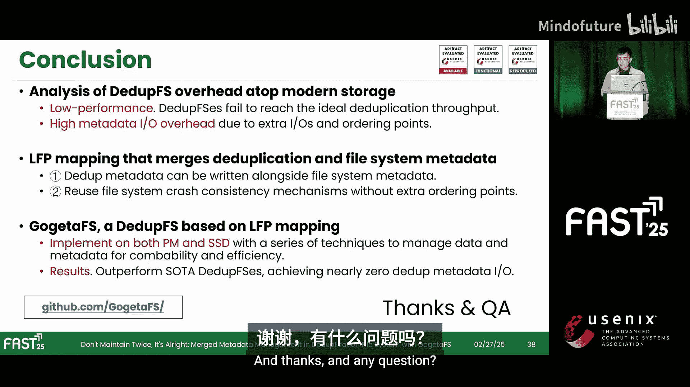

# FAST25存储大会-｜-USENIX-Conference-on-File-and-Storage-Technologies-p31-P31-Dont-Maintain-Twice,-Its-Alright---Merged-Metadata-Management-in-Deduplicati--BV1HmVXzME4J_p31-

。

Hello， everyone。 It's our honor to present our work in the fast conference。 Don't maintain twice。

 It's al right。And I'm Yan Chi from the Harbin Institute of Technology， Shenzhen。Re years。

 data du has been widely used across a range of scenarios to reduce storage costs such as archive。

 storage controller and cloud。And with accelerated storage device。

 such as persistent memory and the improved dedu algorithm， duplication is getting much faster。😊。

And this makes deduplication file system becomes popular。

 and there has been many dejuplication file systems proposed these days。

 such as Lidupe in ATC and NVDdupe in TOC。Despite their popularity， one question arises。

How these duplication file systems perform。And to study this。

 we stress4 duplication file systems using F I O on the 5% duplication ratio。

 with block size ranging from 4 k to 2 MB。And in this experiment。

 the ideal deduop file system is the upper bound of the deduplicationcation file system。

 and it only computes fingerprint and identify duplicates。

We also include other state of the art duplication file systems， such as lightdu。

These results show that state of the art duplication file systems can suffer more than 13% performance loss。

 and this indicates that the dediplication file system still has high overhead。

And to study the reason behind this formula， we break down the duplication I will pass under2 MBby block aisle size。

And we find that distribution equation metadata maintenance can incur 19% to 33% overhead in its I O pass。

And this can leave lead to even higher overhead than duplicate identify process。

This result suggests that the seemingly incent duplication metadata maintains can be a considerable performance penalty。

😊，So we wonder why metadata maintenances suffers such high overhead。And to answer this question。

 we first understand what are the displication file system met data。

So theplication file systems leverages two key data structures to remove duplicate data。

The first one is the logical to physical table， or L to P table。

This table maintains the mapping from the logical blocks， to the physical blocks。And consequently。

 multiple logic blocks can share the same physical block for duplication。

And this table is maintained by file system。The second table is the fingerprint to physical table。

And this table maintains a mapping from the fingerprint to its pointed physical block。

 together with a reference count， indicating that how many logic blocks share this same physical block。

And this table is maintained by duplication。So now let's take a close look on how deation file systems works with these data structures。

First， lets assume， write a unique data block at logic block 1。

And duplication file system first identifies duplicates by calculating the input data's fingerprint and searching the fingerprint in the F P to P table。

 And now we find that there are no matched fingerprints。

And this indicates that the input data block is not duplicate。

So the duplication file system now simply allocates and writes the data block。And after that。

 duplication file system persists a new F P to P entry。😊。

This entry records the mapping from its fingerprint to the real block position。

 together with the reference count equals to one to indicate this block is unique。And finally。

 theplication file system persists a new L2 P entry mapping from the logic block 1 to the written physical block1。

😊，And now， further access to the written block can be done according to the mapping in this L to P entry。

Next， we assume we write a duplicate data block at logic block 2。Similarly。

 we calculate the fingerprint and search the F2 P table。

 and we find that they are exactly one record matches。

 and this indicate that the input data block is duplicate。So in this case。

 the duplication file system increases the reference count of this found F P2 P entry。And finally。

 the duplication file system persists a new L to P entry mapping from the logical block 2 to the written physical block。

😊，And so further access to either logical block 1 or logical block 2 are redirected to the same physical block。

 and thereby， we achieve du duplication。Now we can summarize the reason for de duplication file systems deficiency。

As we can see in the previous analysis， whether we write a unique or duplicate data block。

 we must to maintain the F P to P table。 and maintaining this table introduces actual I O and ordering points。

These I O and auto points ensure that the basic functionality and consistency of deation file systems。

However， the extra Is lead to right amplification， and the aing point reduces I concurrency。

 and these two points harm performance significantly。😊，However。

 we find that the independent FP2 P table maintenance is even not necessary。

Our insight is that as both file system L2 P entry and disification FP2 P entry map to the same phase block number。

 so they can be naturally merged for a single IO。And look at this figure at the right。

We simply incorporate the fingerprint into existing file systems， L to P entry。

And we call this merged metadata as logical fingerprint， physical mapping or LF mapping， LFP mapping。

 in short。Such merged metadata introduces three benefits。First。

 divification metada can be embedded into file system metadata。 and as a result。

 no extra metadata I O is required。Second， the crash consistency of the merged metadata is naturally guaranteed by the file system。

 So no actual ordering point is required。Third， the merge metada can reuse existing file system all pass。

 so development complexity is reduced。So， we based on this。LFP mapping design。

 we propose the Gota F S to achieve high performance certification。Overall。

 Gocha Tface has four goals。The first goal is generic。

Gauch F S is compatible with traditional file system I O pass。

 and we leverage the overflow fingerprint table to achieve this end。The second is effective。

Gauch Ts can provide fine grid block identification and fast duplicate identify。To achieve fast。

 efficient education， this is achieved by global LFP table。

The third and fourth are memory efficient and configurable。

Gchi Tface can adapt to various scenarios under different memory requirements。

 and the duplication can be enabled or disabled without affecting the original file systems functionality or efficiency。

In this talk， we focus on how Gochita F S achieves generic and effective and for the remaining part。

 can see of paper。First， let's talk about generic。So the challenge towards the generic is the incompatible data management due to LFP mapping。

Specifically， as we show in this figure， file system L to P entry can map from a continuous range of logic blocks to physical blocks。

And in this figure， the first L2 P entry maps a total of 10 blocks from logic block 1 to 10 to physical block 1 to 10。

However， F P2 P entry only maps a single fingerprint to a single physical block number for fine grade block level du duplication。

This， as a result， can lead to variable L2 P entry size。For example。As also in this figure。

 the first L2 P entry contains 10 fingerprints， while the second only contains one fingerprint to achieve an LFP entry。

Consequently， this can affects file system layout and complicates file system all pass。

 and thus is not generic and if not practical。To address this challenge， we use a simple solution。

We store fingerprints for such continuous blocks into an extra space。

 This space is called overflow fingerprint table。 For this blocks。

 we store an empty fingerprint in their corresponding LFP entries。😊。

And this table resides in the storage， nearly maps finger physical block numbers to the fingerprint。

And consequently， if we find that an LFP entry has an empty fingerprint。

 Gch F S can quickly locate its real fingerprint by accessing the table according to their physical block numbers。

Next we talk about the effective disification。So the challenge towards the effective is that the incompatible method management due to the L FP mapping。

Specifically， file system organize its L to P entries by logical block numbers for fast file indexing。

However， F P to P entries should be organized by fingerprints for fast lookup， or otherwise。

 the duplication must perform expensive linear scans to look up a fingerprint。For example。

 in this figure to find that if fingerprint 15 is already existed， if we use file system index。

 Go type F must first scan the first 10 fingerprints inside the first LFP entries。

And this is extremely low efficient。To address this challenge。

 we introduce an in memory table to organize LFP entries by fingerprints。

 We call this table as global LFP table。This table first converts the LP entry to the FP to P entries。

 and we insert them into a dynamic hash table。We use the RCU lock and per bucket lock to ensure safe concurency。

And with this table， Go F S can quickly identify whether the fingerprint exists and perform fast duplicate identification。

To summarize， with overflow fingerprint table and global OFP table。

 Go type S can perform generic and effective duplication atop the LFP mapping design。😊。

We now present the evaluation results。 We many evaluate Go typefa atop Intel persistent memory。

 and we compare it with the Mdu， Lidupe Nova Here。 Nova is our base file system。😊。

So we first perform the basic performance evaluation using FIO。

We first measure the performance using 4 kB I size。 And here the X axis denote the three numbers。

 while the Y axis shows the throughput。We show the performance under 0，15 and 75% duplication ratio。

 and other ratios has a similar results。Under this sittinging。

 Gotyface is 9% to 32% faster than lightD dupe， and it can greatly outperform ND dupe。😊，Moreover。

 we can see that under the zero duplication ratio， we find that Go typeface even has a similar performance compared to our base file system No。

 thanks to the reduced met data overhead。😊，We then measure Gota F S under continuous2 MBby I O。

And in this setting， Go F S also shows a similar performance improvement as the previous one。😊。

And performing 8 to 35% faster than La dupe and greatly outperformed video dupe。😊。

We also observe an interesting formula that gotty F can even outperform Nova under the zero duplication ratio。

😊，We find that this is mainly because that fingerprint computation can overlap with the internal persistent memory iOs。

 And moreover， this computation， a slightly computation latency。

 can reduce persistent memory buffer contention by reducing the I O issue frequency。😊。

And we further break down the I O pass of2 MB block I O。 And in this figure。

 the X axis is the time proportion。 was Y axis shows different file system and different F I O workloads。

This breakdown results shows that the improvement does come from the reduced met data overhead。

And specifically， Gta F S can reduce de duplication metadata maintenance by overhead by 75% to 92%。

 thanks to the FP mappings。As we can see， Gochita FS still has some metadata overhead。

And this overhead is mainly caused by the maintenance of our proposed tables。

 such as overflow fingerprint table。But fortunately， this overhead is minor and can be ignored。

We also measure the extendability of Gota F S。We poured Gota F S to F to F S。

 and we perform F I O experiment atop the female Z SSSD platform。😊。

We compare Goch TFS with F2 FS and other state of the A SSD file system， de duplication file system。

And route， this result is similar shows that Go type F can significantly outperformance other duplication file system and has a similar performance compared to F2 F S。

This is mainly thanks to the reduced duplication metadata overhead。

And we show that Gota F has good extendability on different file systems and on different storage devices。

For other results， please refer to our paper。To summarize。

 these results all show that Gta F S achieves nearly zero met datata I overhead。

 thanks to its merge met datata management。 And this， as a result。

 makes F S performing the best among state of the art file system。So here comes our conclusion。

Our work reveals that disification metadata I overhead can be high due to its extra Is and ordinary points。

And we introduce the LFP mapping that merges the duplication metadata and the file system metadata to eliminate this actual overhead。

The OFP entry reuses file systems， mature I pass and crash consistency without introducing actual I and auditing points。

And finally， we show that Gochi T F， an LFP based duplication file system can outperform state of the art duplication file systems and achieving nearly zero duplication metadata overhead。

😊，And thanks and any question？

