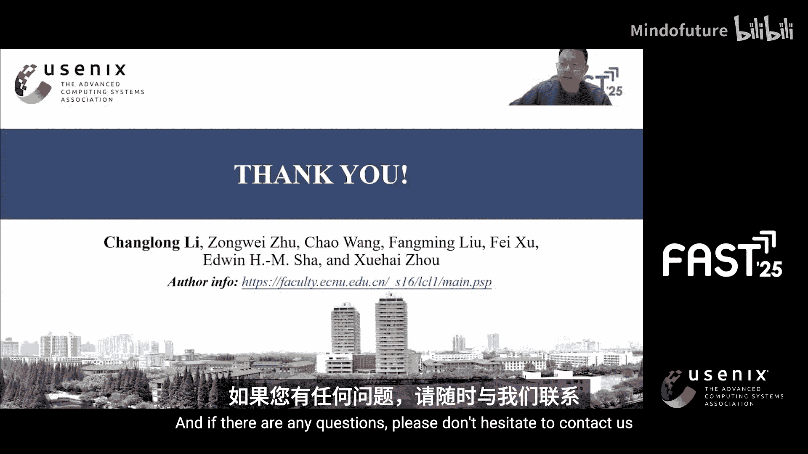

# FAST25存储大会-｜-USENIX-Conference-on-File-and-Storage-Technologies-p32-P32-Archer---Adaptive-Memory-Compression-with-Page-Association-Rule-Awareness-fo--BV1HmVXzME4J_p32-

。

Hello， everyone。 We are very appreciate to give a presentation on fast 2025。Our work is A。

 adaptive memory compression with page association rule awareness for high speed response of mobile devices。

Now， let us。First， introduce the background and motivation of our work。As we know， nowadays。

 people are spending more and more time on mobile devices。

The mobile devices include many kinds of equipments， as shown in the left side of the figure。

 like the smartphones。Autonomous vehicles， Us。We are all M devices， robots and so on。

On these devices， a large amount of emerging applications run， like transformer based AI model。

We are all MR services。Camera based services on vehicles and Us。

Mobile games and short videos on smartphones。These applications are memory intensive。

 but unfortunately， the memory resources on these mobile devices are scarce。To address this issue。

Memory compression is widely adopted in mobile devices。However。

 we find that the page compression is inefficient。This problem negatively affects the user experience。

Specifically， we started the launching speed of popular mobile apps in Google App Store。

 measured the efficiency of continuous camera shooting and evaluated the frame rate of short videos。

Even though the memory space is successfully saved。

 we can see from the figure that the AP launching latency is increased by about 68。

7% when enabling memory compression。😊，Also， we can see from the sub figure B。

That the response time of the continuous camera shooting is prolonged by 1。6。😮。

Times when the memory is on pressure。 also， we can see from the subfi sea。

That the frame rate of short video playing and scraping reduced from around 50 F S to about 27 F S on average。

As shown in the right side figure， the software stack of memory compression is in the Linux kernel can block the execution of the main thread。

This is also the root cause of the observed。Use experience degradation。

So our further analysis shows that one of the key reasons behind this performance。

Degradation is the think reclamation mechanism， called director clear。Directory claim is a。

Fundamental memory claim feature in the Linux kernel。

 It harms the performance because any page allocation must wait for the compression process to finish。

As a result， the main task of the。Foreground app is suspended until its memory demand is met。

Even though， the key。The kernel thread case Web D can compress a thinly。

The bud system may still get stuck in a loop before enough space is released。

We need to know that it is reasonable to compress pages individually， but by doing so。

 read amplification is eliminated。For example， if we compress 10 pages together。

But only access one of them in the future。The O S also needs to decompress all the 10 pages。

So we can see it is unreasonable， right。Okay， so in this paper， we show a fundamental question。

Can we do large grain compression， for example， comp 10 pages in batch。

 but without increasing read amplification。So this is a fundamental question。 and the answer is， yes。

This is based on an interesting observation。 that is 26。

3% of anonymous pages are strongly associated with others。

This internal association between pages have not been aware in earlier studies。

Like the relationship between bear and diaper， many pages are always accessed together。

The association is implicit， but can be mine。If the system is aware of these highly associated pages and does large grain compression on them。

The performance has the potential to be significantly improved。And further。

 the aforementioned user experience issue can be addressed。Now， let us introduce our design。

In this paper， we propose occur。By association room mining on anonymous pages。

 That is the he dataator。The memory compression efficiency can be significantly improved。

It is not easy to mine the page association role in the system layer。

 since many fundamental challenges。I will discuss the challenges later。To tackle the challenges。

 Arc is designed with three normal components。That is F， S G， F T list and A C R。F。

 S T is a footprint stream generator。F T list is a frequent patentry list structure。

And A CR is an adaptive compression region。So now we introduce these three。Tey companies，1 by one。

The first component is F， SG。As we know， traditional association Roman algorithms like Apple and F G growth。

This algorithms is useful in mining a static transaction data set。However， in mobile systems。

 page access occurs continuously during run time。Aker should be able to update the page association information。

 as pages are accessed。Motivated by this Arch collect page。

Acc patterns during run time and generates a footprint stream。AndSpecifically。

 F SG maintains a sliding window to generate footprint stream and mine the association rules dynamically。

The second component is F T list。As we know， traditional L U list in the Linux kernel is not suit to support the page Association room money。

So in this work， we co design L R U with F P tree and propose a new structure called F P list。

By Co design L you with F3 the F P list。Can manage and mine。Memory， anonymous pages。

Online and the efficient is very high。Okay， so the third component is A C R。

We should also know that page compression should not be totally abandoned。 I mean。

 page size compression。 it is also reasonable。 This is because there are also many pages。

 have not association。So there， so there should not be a batch， batch compressed。

Even for the associated pages， the association scale is not a fixed value。 For example。

 page A correlated with three with three pages， while page B may correlatedre with 10。Hence。

 Aer should adaptively compress the pages in practice。To support this feature。

 this paper further proposes A A R an adaptive compression region。A C。

R is implemented based on the original Z region in the Linux kernel In A C R。

 Hes compressed together are indexed with a virtual handle。 see the right see the left figure。

We have conducted evaluations on real life mobile devices。 So now let us introduce our evaluation。

ARe and the benefit of the user user experience。Specifically。

 we conducted our evaluations on three platforms。 That is Google Pixel 6。

 Google Pixel 3 and Huawei P 20。On these platforms， three typical scenarios are evaluated include。

A P， P launching speed， photographic performance and frame rate。As shown in the figure。

 we can see both cold launching and hot launching speed are improved。Here。

 hot launching means we launch an app that have been page in the background。

 and cold launching means we。Launch an app that has not been cached in the background。

So the the launching process is different between these two kinds of AP launching style， okay。So the。

 we can see the average speed of cold launching with increased by。About 37。2% on Pix 3。30 point。

6% on P 20 and 32。9% on Pixel 3 here。 This results is compared to the original compression。

Magnism in the Android。 That is the Z Ram。屋企。Furthermore。

 the average hot launching speed on the three platforms is enhanced by。55。3%，47% and 29%。

 respectively。The average photographic speed and frame rate increases by 1。2。F times， and 1。3 times。

Please see the A sub figure， A and B。And besides average performance improvement， more importantly。

We also evaluated the tail latency。 And from the figure， we can see that the tail latency of the。

Haasted scenarios are significantly。Reduced， and this means the worst case can be effectively avoided。

In addition to the above scenario。We should say that Aer also evaluated transformer。

This is an an emerging memory intensive application。

 It requires a large amount of memory during inference due to the quadratic scaling of self attention and high dimension embedding。

As as we evaluated， the average latency of transformer is 7。3 times higher than C N。 However。

 when enabling occur， the la is reduced by 39。2% on Pixel 6。Okay， so in summary。

 this paper shows that page compression is not suit for memory intensive applications in mobile scenarios。

呃，And the key insight of our work is that by mining the page association rule。

 we proved that large grain compression is feasible in。Mobile systems。

This issue has not been taking attention in earlier works。And inspired by our observation， And to。

Tackle the technical challenges these paper proposes occur。So， a is an。As we know。

 it's an adaptive memory compression with pet association rule awareness for a high speed response of mobile devices。

Okay， this is our work。 And if there are any questions， please don't hesitate to contact us。 Okay。

 so thank you。

