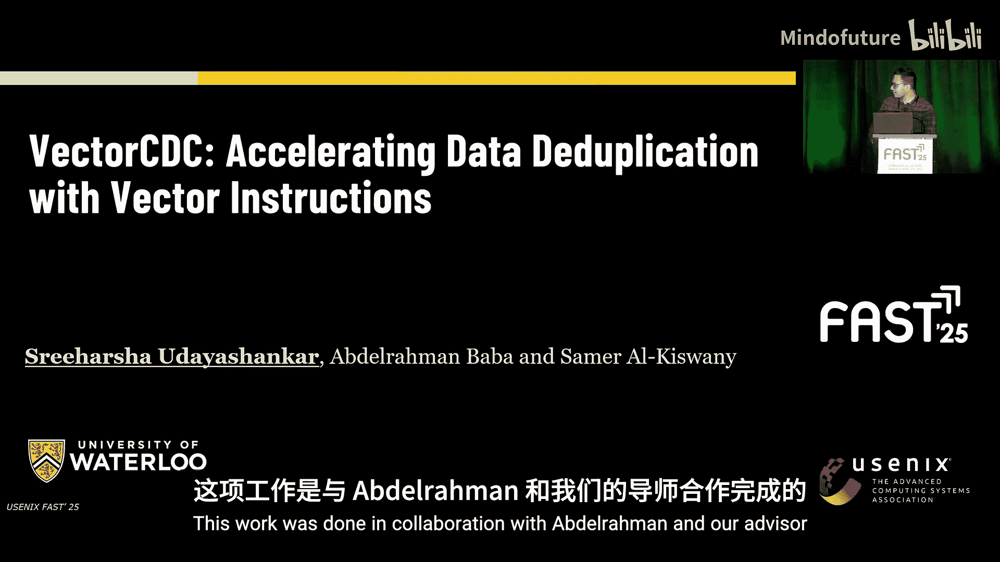
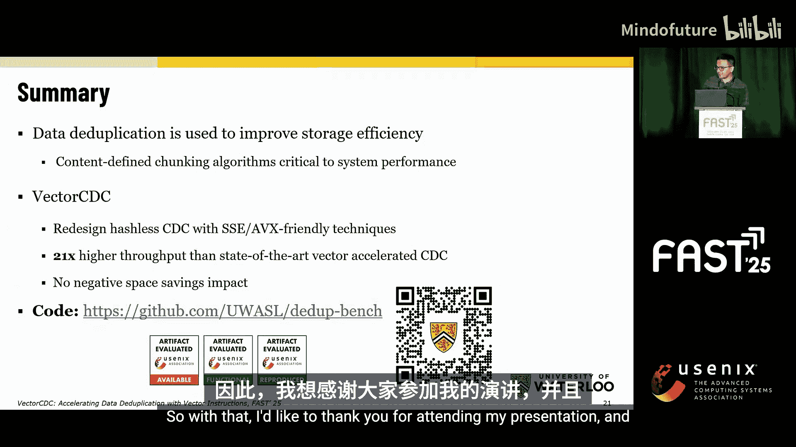
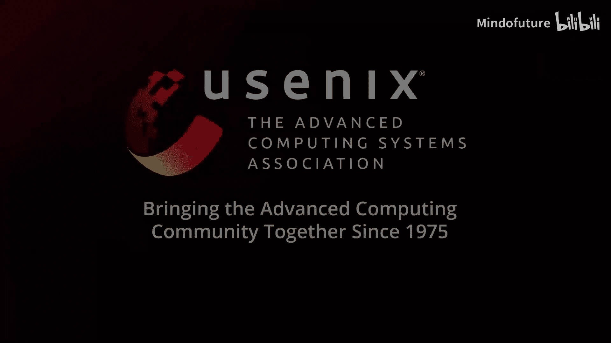

# FAST25存储大会-｜-USENIX-Conference-on-File-and-Storage-Technologies-p33-P33-VectorCDC---Accelerating-Data-Deduplication-with-Vector-Instructions--BV1HmVXzME4J_p33-

。

Hi everyone， I'm Hasha， thank you for the introduction I am a fourthopD student at Waterloo。

 I'll be presenting our paper vector CDC， accelerating data D duplication with vector instructions。

This work was done in collaboration with Abdul Rahman and our advisor。

 Professor Samuel Keswani at the University of Floridaville。

Okay， so the amount of data generated and stored on the cloud is growing at an explosive rate。

Cloud storage providers such as AWS， Google and H are relying on numerous mechanisms to support this data influx。

Some of these mechanisms are distributed file systems， novel storage architectures。

 and data data application。So what is deupplication？

Dupplication is a mechanism that is used to identify and eliminate duplicate data to conserve network and storage costs。

It consists of numerous phases that a lot of the authors before me have talked about and explained very well。

 so I'm just going to speed through this with an example。

So here's the interaction between a client and a server。

 both of whom want to store files in a D fashion。The client first takes its file。

 divides it into chunks， and hashees them to get fingerprints。It then asked the server。

 have you seen any of these finger prints H1 to H3 before？In this case， the server has't。

 so it says nope， send me all the fingerprints as well as their corresponding chunks。

 which the client does。When the next client comes along with another file and repeats the same process to end up with fingerprints H1 and H4 you see that H1 has already been seen before by the server so when it askeds the server have you seen H1 and H4 the server says yep I already have the chunk for fingerprint H1 just send me the chunk for fingerprint H4 and this way you're eliminating the duplicate part between both the files which is the chunk for fingerprint H1 and you're only storing the nonduplicate part。

Now， as we can see， one of the critical phases here is dividing files into chunks。

 and as you can imagine， there are numerous algorithms to divide files into chunks。

They can be classified into two families， hash based algorithms and hashless algorithms。Now。

 this file division or content defined chunking is a very computationally intensive process。

And our idea with this paper is to accelerate it with SIMD that is AVX or SSE CPU instructions。

Now there is an existing approach to do this and they accelerated hash based algorithms with AVx5well instructions this graph here shows you speed on the y axis and chunk sizes on the x axis and the pattern bars are accelerated versions of the solid bars for example CRC's accelerated version with AVx5well instructions is SS CRC。

You will notice that the speed ups that are achieved despite using AVx 5 12 instructions are pretty low。

 they are able to achieve 1。2 to 1。8 tax at maximum right and why is this？

This is because hash based algorithms are inherently hard to parallellyze。

They have dependencies between a JSN bys， so many of you may be familiar with Rabin's chunking and you slide a window over the source data and recompute hashes。

 but as the window moves the new hash value is a function of the old hash value。

 the outgoing byte and the incoming byte so you see that there is a dependency between a GSN pipes。

To work around this， the paper I just talked about processes different regions of the file in using one SIMD instruction。

But to do this， they need to resort to using expensive scatter and gather instructions。

 which causes the low speed ups I just showed you in the previous slide。So what do we do differently？

In vector CDC， we choose to accelerate the other family of CDC algorithms。

 which is hashless CDC algorithms。We use AV externally three basedase search and pack scanning methods。

 which I'll talk about later today to accelerate these algorithms。

We are compatible with a wide range of existing approaches。And using our methods。

 we were able to achieve 21 times higher throughput over SSCDC， the method I just talked about。

And most importantly， accelerating hashless algorithms with our method has no negative impact on de duplication space savings。

😊，Okay， so now that I did my sales pitch， let's talk a bit about the background both in terms of Hahless CDC as well as vector instructions and then move ahead to the design and evaluation of our paper。

😊，So what is hashless CDC there are multiple CDC algorithms that can be classified as hashless。

 some examples are shown here， let's look at RAM and see how it works。😊。

So the main objective is to divide files into chunks。And to do this。

 Ram first begins by picking a fixed size window at the beginning of each chunk。

 identifying the maximum value in this window， which is AF in this case。

After this it starts scanning right outside this window so it takes the byte a2 and compares it against this byte value AF it checks to see if a2 is greater than or equal to AF in this case it is not so scanning moves ahead to the next byte which is f 4 when we repeat the comparison we see that F4 actually satisfies this condition so our chunk boundary is inserted here。

And we repeat this process throughout the entire file to divide it into chunks。Okay。

 so the remaining hashless algorithms I showed here also work using similar principles。

 but there are slight variations。Okay， so what are vector instructions。

 the other piece of vector CDC， these are special CPU instructions with SIMD capabilities。

 and they have previously been used in math and multimedia applications。

So they rely on special CPU vector registers which come in multiple sizes 128 to 5， 12 bits wide。

 and depending on which size you use， your instruction can be classified as one of these families。So。

 let's say I have four integers I want to add to four other integers now in the regular world what I would do is use four separate integer addition operations to the first to add 10 plus 10 the second to add 11 plus 11 and so on。

But if I load them into a vector register， I can use one single vector edition operation to get the results back into another vector register so instead of using four teacher operations you are now using one vector operation。

So how do we use these to build vector CDC？Here's a look at our design。

In vector CDC we identified two common phases among all hasley CDC algorithms。

 the first is the extreme bite search phase and the second is the rain scan phase。

In the extreme byte search phase， you are basically looking for an extreme by in a data region。

 an extreme byte can be a maximum or a minimum value。

To do this we first begin by packing bytes into vector registers。

 so let's say we can fit three bytes into this vector register here。

 we would load the next three into another one and so on。So in step one。

 we run one vector max or Vmax operation between these registers to obtain the resulting pairwise maximums。

So， for example， the maximum between byte value 10 and 51 is value 51。

 which goes to the resulting register。And we repeat this process for the rest of the region to get another resulting register as well。

Now， in step2， we run a Vmax operation between these registers and we keep repeating this process to build a tree。

Now we keep repeating this process until we are left with only one register which contains the maximum values from the entire region which we sequentially scan to determine its value in this case it is FF。

So this is the first phase。The other phase we accelerate is called rain scans。

Another phase in hasless algorithms is where you serially compare bytes from a data region against a target value using a conditional comparator。

To do this we load the target value into its own vector register by repeating it and we also load bytes from the data region using pack load similar to before we run one vector compare operation to see if any of them satisfy our condition and if not we slide ahead and load the next bunch of bytes and we keep repeating this process until we either find a match or we run out of bytes in the data region。

So now this might sound a little bit alien， but let me tie it back to the algorithms I just talked about earlier right so if you remember how RA works the first part of it was to identify the maximum value in a fixed size window which is nothing but an extreme by search。

And the second phase was to compare byte serially against this maximum value。

 which is nothing but a rain scan。So， in the vector CDC universe。

 RA is nothing but an extreme by search phase followed by a rain scan phase。

 and similarly the other hashless algorithms I talked about can be redesigned using vector CDC's phases。

So what are the advantages of rebuilding these algorithms using these AVX frontal methods？To do that。

 we need to look at our evaluation。For our Eval， we use a bunch of diverse dataset sets such as rust backups。

 VM backups， Red database backups， Linuxux kernel code similar to existing literature。

We evaluate space savings efficiency， we evaluate speed and throughput and backwards compatibility today I'll just be looking at speed。

And we compare a whole range of alternatives both hashless and hash based。

 all of these are CDC algorithms and the majority of them are not vector accelerated except SS CDC。

 which I showed you at the beginning of today's talk which is vector accelerator。

So what do our results look like？For this experiment。

 we use our VM backup data set and we use 8 kilobyte chunks。

The X axis shows you different CDC algorithms and the y axis shows you speed。From the graph here。

 we see that the fastest variant is fast CDC， which hits close to 2 GB。

And note that unacceellerated algorithms are represented using solid bars and vector accelerated ones are represented using pattern bars。

So yeah， fastDC is the fastest and it is still faster than many of the vector accelerated algorithms and we have the details about why this is so in our paper。

😊，From the graph， we also see that VRAM， which is our vector CDC accelerated RA， hits 25 GB。

 which is orders of magnitude faster than all the remaining alternatives out there。In fact。

 we are 12 to 15 times faster than any other alternative。

And this is not just specific to this data set， this result also holds on the other data sets that we've looked at such as Redis backups。

So these are the absolute throughput numbers， but what about speedups？

I began today's talk by showing you how SSCDC achieves low speedups on randomized data and the same trend holds when we look at real data sets as well。

 SSCDC manages to achieve 1。2 to 1。7 times speedup。But vector CDC， on the other hand。

 when we compare it to RA， which is its unaccelllerated counterpart。

 we see that we achieve a 16 time speedup when using vector instructions。

Note that the y axis on both these graphs are different and this will become important just in a little bit。

So yeah， vector CDC achieves much higher speed ups than SS CDC， and as the axes are different。

 we see that VRA is 21 times as fast as SS gear。😊，Okay， so to summarize。

Data Gupplication is used to improve storage efficiency and CDC algorithms are a critical aspect of Gupplication dictating both space savings as well as into end system throughput。

😊，We presented vector CDC where we redesign hasless CDC with AVX friendly techniques to achieve 21 times higher throughput than the state of that。

 and most importantly， as I've been saying， accelerating these hashless algorithms with vector CDC does not have any negative impact on the radio application space savings。

Our code is publicly available on GitHub and can be found either via the URL or the QR code in my slides。

And finally， we've been through the art evaluation process and received all the badges。 So with that。

 I'd like to thank you for attending my presentation。

 and I'm open to answering any questions you may have。😊。

