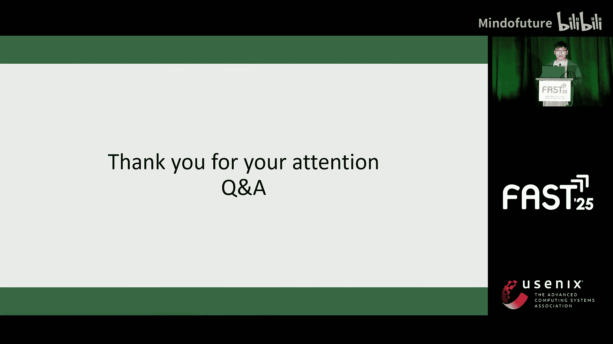

# FAST25存储大会-｜-USENIX-Conference-on-File-and-Storage-Technologies-p34-P34-Oasis---An-Out-of-core-Approximate-Graph-System-via-All-Distances-Sketches--BV1HmVXzME4J_p34-

。

Hi， everyone。 So my name is Ta Youngang。 So I'm happy to be here to share a paper。

 which is called the Oasis and of core approximate graph system via the a sketch。

 So this is a joint work by the Cha University of Hong Kong and the University of Texas and Dallas。😊。

So this is today's outline， so we will begin with the introduction。

So to begin with that the graphs are an incredibly powerful data structure that can express a wide range of the real world relationship。

 and they do this by solvingoring the entity as a and the connection between entities as addresss。

But what really set the graph apart from the other data structure is the concept of the neighborhood。

 So in other words， is that how a vertex is connected to the others vertex in the graph and can actually provide some crucial information。

So many important applications rely on the neighborhood information。For example。

 like the social network analysis， we will often need to understand the user relationship to identify the influencers。

In the recommendation system， we will also like to find some similar use or items that with some share connections。

 and in the navigation planning， we also need to determine we often need to determine the shortest path from location A for similar location A to location B。

So to tackle this graph application that one approach。

 one direct approach is to use the memory graph processing。

 So where we will store the entire graph inside the memory and try to process the graph。

 So this method is efficient， but it can be expensive， especially for the large scale graph。

 another approach is of core graph processing， which will keep the graph data in the storage and we only load a small part of them into the memory when needed。

 So this is more cost， but you also where you often limited by the slow I open with。

So due to the trade off between the in memory and outcome group processinging。

 So we start to looking at another direction called the approximate group processinging。

 So the key insight behind this exploration is that in many real world application that the exact answers are not always necessary。

 So this actually offer us a room of to leverage the approximate method to break this the trade off that we are talking about in the previous slide。

And。Among those approximate approach， we found that the all decent sketch。

 or which is simply called it as the ADS， so the ADS has em recentlyly emerged as a promising scheme that can capture the name information and to be more specific。

 the ADS is probabilistic data structure that defined for each vertex and it's a sketch that to summarize how a verx U is connected to other vertex in the graph。

And to be more precisely。And ideas of a vers U， they will contain the distance of the U connected to other landmark veres。

So according to an existing study， the A D S is the only sketching scheme that combined following three characteristics。

 So the first one is the multi functionality， which means that it can be deployed for various applications。

 And the second one is the controllable and guaranteed accuracy。

It means that the user user can adjust the parameters。

Of the ideas S to control the error bound when they try to do the estimation。

And the final one is scalability， which means that the space and the time complexity for using A S will grow nearly。

 nearly with the graph scale。So however， despite the fact that the ADS is well developed in the theory。

 there is still a wide gap from its practical use in the real world cases because most because of it it require excessively high memory consumption。

So here we leave some key challenges。 So first is that the recent effort in the ADS。

 they will mainly focus on their theory perspective and they propose algorithm with all in memory environment。

 However， the state of the scheme based on our study that can the state of last scheme that can efficiently construct AS of overtes they will require an enormous amount of memory and this amount of memory can be up to like 5 times larger than the grow itself so。

Yeah， they will they will actually require have a very high memory overhead。

And the second is that since the managing A S is more complex。

 So most of technique from the existing of choreograph system is actually ineffective for the AS scenario。

So if we just simply run the running the A B S construction on the traditional of system。

 they will often lead to a very poor performance。So due to this challenging， we proposed the Oasis。

 an upcore approximate growth system that try to bring the ADS technique into practical use by leveraging the strategy effectively。

So for the next part of the slide， we will talk about the background of the AS。So this slide。

 we briefly go through the theory of the ADS。 So given the graph G。

 the As are defined with an integral parameter K and a random assignsi function R to over verta system。

So the K is the parameter that can decide the trade off between the sketch size and estimation accuracy。

 So if we， if we set the K to be a larger number， then the sketch size will also become larger。

 but then estimation accuracy can also be higher。Well R is a rank function that will where the R of V is will be mapped to a value between 0 to1 for any vertex that belong to the graph。

And the following three formula， they will shows the details about how the A D S will select the landmark purchases。

But， but we're not going into too many details in here。 So what important is the form of the A S。

 So it it can be show in the last formula here。 So in the last formula， each A S is an。

 we can see that H A S is actually in an array and each element in an array there content of red V。

Which is the landmark vertex and also the distance from U to the B， the landmark vertex。

 So the size of A D S is about big of K log V。So the total size of an A S is B times K log B。

 So it can so this size is actually can be much larger than the greater itself。

 If we set the K to be a larger number。 And for the real replication that the K is usually。

Pants or even like a few hundred。So， yeah， So at least like shows the the workflow of using the ideas。

The A D S， it will involve two main steps， which are the A S construction and A D S estimation。So。

The first step。 So when we have a rule graph， we will first go into the first step that is the A is consumption。

 You will try to produce the A S based on the real graph and also depend on the K value。

And after we have the produced A D， S， the the S will use the produced A D S to estimate approximate answers。

So since the A S is only a a data structure。 So we still， so there are many existing research。

 there are many existing effort that try to propose some methods to they will study how we can actually calculate the approximation answer by using the element of A D S。

 So for this method， we will often refer to them as the A S estimators。 So in general。

 the A S construction。They only need to be performed once for graph。

 and we can estimate various graph graph graph properties and application multiple times through those ideas。

 So these capability are crucial for the application that require a substantial computational workload or those that need the quick interactive responses such as the drill the drill down analytics。

So for the next part， we' will introduce our system， the Oasis。

 and so this figure shows the ci architecture and the workflow of the Oasis。

So we will come so you many content accounts。呃。Con of two main module。

 the A construct module and the estimation module。So the first。

 the user will provide to input the K value and a available amount of memory that can be used by the Oasis。

So these two will go in goes into the AS construction module。

 So the next oasis will process the raw graph and generate the AS while storing them inside the storage。

 So once the A S are ready， the user will supply their aS estimator to our est module。 And finally。

 this module will take over the estim module will take over and try to optimize the process of loading the necessary AS and running the estimator to generate approximate answer。

So for the A the o aS construction， the first and most important challenge that we face right now is to reduce the memory consumption。

 So to take all this， we will use a partitioning based approach to help to manage the limited memory while ensuring the local access。

 So partitioning is a well established technique in the traditional of progress systems。

 So the key idea is we can divide the data into a multiple destroying partitions。

 So this allow us to process only one or two。 we can only process one or two partition at a time。

 So which can effectively keep our memory usage load。So given that the A D S are large。

 So the partitioning is actually a natural fit for the oasis。

And because we also use the partitioning。 So this means that the user can adjust the number of partition based on their machine memory capacity。

 making it possible to run the graph of different scale with the oass。

But to make the thing more efficient， we further break and aggregate grid into multiple equal sized blocks and each block we're holding a destroy set of the destination ver Texas。

 So by doing this way， the different threat can process a different block and because they were holding a this set of a destination of ver。

 So which means that we can prevent them from updating the standard As at the same time。

 as we thought that there will be no need for log to handle the conflicts。

 we can keep the process smooth and efficient by using this block design。

So since the AS is the largest data structure during the construction。

So how we can minimize our amount of loading A D S is crucial。And active data separation。 So。

 and we propose the active data separation as a technique that we can try to minimize the。

Loing for the active ideas S。 So the active ideas， it means that the set of the ideas that require processing in the current iterations。

 So let figure， we show a very simple example。 The we have the update X that will push from the ver A to the ver B and where it gets added to the A D S of B。

So in the next iteration， we were also。The the update X will continue to move forward。

 They were getting push from the ver B to the ver C。But with the traditional method。

 we have to load the entire AS and search for active AS。

 but this can be very inefficient because we only have a small portion that it we needed。

So the active so the active data separation is proposed to tackle this issue。

 We duplicate the active A D S and store them in a separated file。

 which contain the active ads S only。So so in the next iteration。

 we don't need to directly read the data from the original adsS file。

 but we can just directly read the separate file that hold the active A only。

 So we can use this one to save the I O。 So the process active A can be delete in bulk in the file because the construction they will produce a new active in the next iterations。

So the next we have so the next， for the next technique， we have the selected A S accessing。

 So this technique is。Further to design to reduce the unnecessary A S read by loading the only the A S that actually receive update。

 So we also look at this simple example。 So suppose that the only new update in the entire graph is X in the ver speed。

So instead of blinding， loading all the A D S， this approach will first strengthen some extra I O read on the edge data to get the neighbor information。

 So by doing this one， we can identify which vertex are truly needed and load only。Those of A D S。

 So in the example， we can see that we only need to load the AFC C and A F D。

So it's important to know that because the edge data is usually much smaller than the A S。

 So spending some actual re for edge data is actually worth it because compared to the I O saving from reducing the A D S rate。

So in this slide， we will discuss。Okay， so previous。

 so these are all the design that try to optimize these A S construction。

 So this slide we show the framework of our o S AS estimations。 So we will discuss the O S A。

 will content to So in many content2 components。 The first one is the A S estimator。

 They are provided by the users and also there query query queue。

 The query queue is also filled by the also to indicate which AS is going to be loaded into the memory。

So each query in the queue content information of the targetver ID。

Which means that the I D that the A， the A S needs to be loaded and estimated and also the pointer。

 So you will point to the correct A S estimator。 So if the user can fill up the the A S estimator and query queue。

 then our Ois will automatically process this query and try to optimize the performance。

 when we try to do the estimation。And the main of the nation in this frameworkangle is how we can assign the cus to the different threat。

And this kind of tech assignment will largely affect the overall performance。 For example。

 like if we have a thread that we assign with a merit query requiring the same A D S。

 then the thread will only need to load A D S once and we can serve many queries。

 So this will can significantly improve eye retaliations。So for this purpose。

 we have a proposed two different methods that try to improve utilization utilization。

But due to the time limit， I will not go into too much detail of this one。 So if you are interested。

 please refer to the papers。So for the final， part we will talking about innovationation。

So we compare our os against the two imagery scheme。 we call it the basic and the so。

 So the basic is a straightforward implementation of the A S formula directly。

 You will perform the graph traveral from the A V vertex and。And。

 and the number of air travel so is high。 It will actually require a bigger over V times E。

And it on the other hand。Is proposed to achieve significantly lower time complexity。It has a special。

 it is pretty special because it try to run on the transpose graph。

 So the so can perform the bounded graph travel。 So different from the original graph tra so let need to travel the entire graph。

 the bounded graph travel so they can be， they can be trained the travel so when needed。

 So the number of air travelvero is only bigger of E E kilo V。

Which is much less than the basic skill。 So our。Our Oasis A S construction is to come is try to combinefin the solar scheme with the part technology to reduce ordinary consumption。

 And we also propose other organization that try to improve the overall A S construction efficiency。

And for the following experiment I present， we will use the 16。 We。

 we divide a graph into 16 partition by default。 Well， of course。

 if we try to divide a graph into more part， then。We can have。A lowerer。

 we have a lower memory consumption， but。But longer e in time。So due to a time limit。

 I will try to quickly go quickly go through this simulation result。 So basically。

 our oasis scheme is actually。 So the first row shows the extreme time and the second row shows the memory consumption。

 So we can see that and the the purple one is our oasis scheme。 So we can see that。

Our oasis scheme is actually still worse than the sota scheme， because if they are the all in memory。

啊。All in will assume process all in memory， even about two times longer。

 But when we come to the memory consumption， which is the second role， we can see that our。

Oass can require about 1010 times less memory overhead。

 So we believe this is a worth deal because the considerable amount of memory saving。

 they were which they will enable A technique with the reasonable cost。

So this slide shows the desired choice of the ADS， those the desired choice of this OS is AS construction。

 So the most effective one is the active data separation and then the a block and then the selective ADS accessing。

So this slide shows the conclusion， which is where we introduce a system called Oasis。

And we try to manage the ideas with a low， with the low memory overhead head and high efficiency。

And that's all for my presentation today。 and thank you for your attention。

