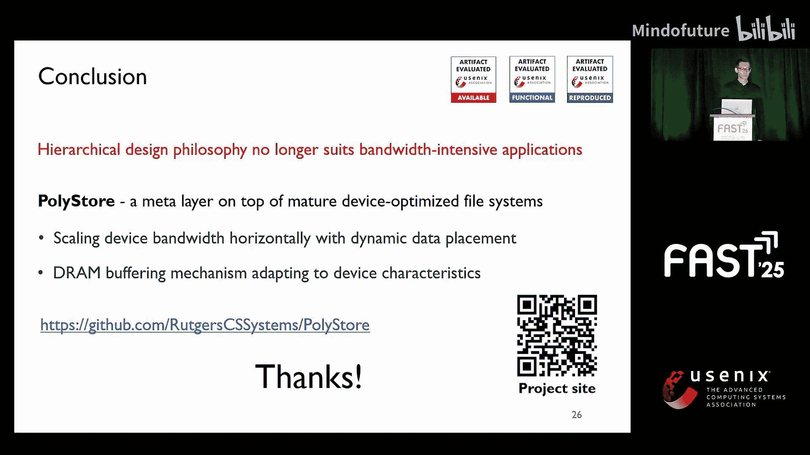
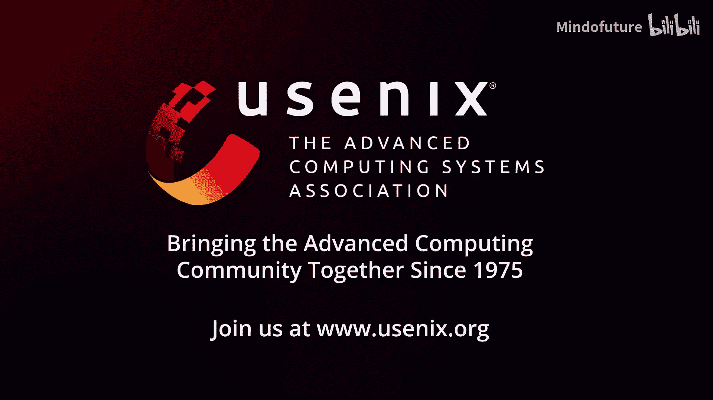

# FAST25存储大会-｜-USENIX-Conference-on-File-and-Storage-Technologies-p35-P35-PolyStore---Exploiting-Combined-Capabilities-of-Heterogeneous-Storage--BV1HmVXzME4J_p35-

。

Good morning， everyone。 Today， I'm presenting our work Postore。

 a new system designed to rip the combined capability of heterogeneous storage devices for bandwidth with intensive applications。

 This is a joint work from Rugers University， A PF L and Samsung memoryory So La。😊。

Over the past few decades， the scale of data to persist on storage devices have been growing rapidly。

 even on the standal alone machine for a wide range of applications。More importantly。

 they are requiring more and more storage bandwidth from around 100 megabytes per second to up to tenth0s of gigabytes per second nowadays。

Along with the growing demands for storage bandwidth from applications。

 the storage hardware has been growing fast in the past two years from NM SSDs to by addressable persistent memory with low latency and ultra fast NM SSD with higher bandwidth。

To fully exploit their hardware features， developers have been dedicated to developing new file systems。

Toring their hardware characteristics， as well as retrofiing existing five systems。

With emerging storage media by adding new features。With such versaneity。

Using them in a collaborative way has a great potential to reduce cost while retaining the performance。

😊，Due to the performance， cost and capacity gap between storage devices。

It is natural to organize them in a hierarchical manner to high latency for slower devices。

Such design philosophy has to two classic ways。The first one is caching。

New right requests are added to low latency devices。

And the storage system asynchronuously evict data from low device to high devices。

 And we denote them as faster and slower devices， respectively。For the rate operations。

The stories when the myth happens in the fast storage。

And the system admit data from slower storage to faster work in a prompt manner。The second hearing。

Similar to caching tiing also buffers data in a low laser device， which is a faster device。 However。

 it moves data between faster and slower device in a cost green manner。 In both design。

 they use faster storage device to absorb right to request of new data。However。

 existing heterogeneous storage systems suffered from several pitfalls and failed to exploit both hardware and software potential。

The first one is the inability to utilize combined bandwidth of heterogeneous stories。

Because they put the device in a hierarchical layout。

So when multiple thread are writing to the fast device at the same time。

Leaving the bandwidth of the device on the bottom， not utilized at all。

Takeing an example of using persistent memory and NVM SSD。

 we use a multi thread benchmark to see if they can actually utilize the combined storage bandwidth。

 So for random right workload， neither caching and tiing approach can even approach the bandwidth limit。

 as well as the read workload。Because such hierarchical design circumvents the utilization of cumulative storage bandwidth。

Secondly， existing systems lacks flexible DM buffer cash mechanism for storage heterogeneity。

Storage system we know use DM buffer to stage right request into DM and keep frequently access the data in DM to high latency。

However， existing system heavily rely on the Linux page cache。

 which cannot efficiently handle the device heterogeneity。So firstly。

 the OS page cache bypasses some devices by default like persistent memory and cannot differentiate the asymmetrical performance of Read and write operations。

Moreover， it cannot provide a flexible admission and eviction control between the devices to consider their heterogeneity。

Because they lack a mechanism of a holistic view on top of heterogeneous storage devices。Lastly。

 in the system design aspect， existing systems do not consider reusing mature device optimized5 systems。

For example， some approaches propose tiered file systems for certain types of devices with data placement decisions encoded in the P systems。

Whilehy some approaches manage devices in a block layer， but with one5 system。As we can see。

 both of these designs leaves mature hardware optimized file system under utilized。

The key insight in their system design is that they couple data placement decisions within the software stack。

One might argue that wouldn't it be a more straightforward solution to use ray 0 by striping data across devices to utilize the。

The device bandwidth to consider the performance difference between them。However。

 as mentioned previously， this approach still encodes the data placement decision in the block layer and hide the device heterogeneity from the upper layer。

Like the pitfall mentioned just now， as a result。Because the block layer expose a logical device and higher heterogeneity。

 They cannot not。 It cannot capitalize on device optimized by systems。

 as well as providing device specific D buffer policies for admission and eviction control。

So we argue that our idea system for managing storage Heity should first utilize the combined bandwidth of multiple storage devices。

 And the most important thing is it should decouple the data placement decisions and put it above the storage software stack。

So in this way， it can naturally reduce the matified system tailored for each individual storage devices with effort in the past few years。

 and as well as providing flexible D buffer cash eviction and emission policies。

To avoid those pitfalls， we proposed and designed poly store a metal layer on top of device optimized the kernel level 5 systems。

Polystore comprises two components， a user level run time with data placement decisions for utilizing device bandwidth and OS S components that handles sharing across processes。

 resource fairness and security。Now， let me break down the components and design philosophy of Postore。

 starting with the data indexing structure。To attain combined bandwidth of heterogeneous storage devices。

The first step is to distribute data across those devices。 At the same time。

 we know that large files over gigabytes， such as data streaming files and database files are bandwidth sensitive。

As a result， Postore tries to distribute data blocks of a polystore logical file to the underlying physical files on each individual file system。

Which is a profile range tree data structure where each node in this data structure represents a range of blocks placed in a corresponding storage device。

More importantly， this data structure also encode the data placement and access pattern information across heterogeneous storage devices。

 which is the key structure for the bandwidth utilization and flexible policy for DM buffer cash。

 which I will introduce shortly。Next， let me introduce our dynamic data placement mechanism to squeeze the combined bandwidth。

Maximizing combined bandwidth of heterogeneous storage devices is not trivial。

Because it is important to map I O requests from application threats to the storage devices properly。

The challenge lies into the following two aspects。First。As illustrated in the right figure。

 storage media have diverse characteristics in terms of delivering throughput for applications。

 as illustrated previously。Moreover， identified the optimal mapping of IO requests from multiple threats to the storage devices。

In a static way， cannot adapt to workload changes。This indicates that we need a dynamic data placement mechanism to maximize the storage bandwidth utilization。

To overcome the above challenge， we propose an epoC based through monitoring and dynamic data placement mechanism。

Let me illustrate with the example。Initially， Po store divide the application I O thread into two groups。

 They are writing data to persistent memory and NVNE respectively。

 We either split them based on some heuristic information from divisibles sheetet from vendors or divide them evenly。

Polystore start moving a thread from NME group to processing memory group because we want to saturate the device with higher bandwidth first。

If such reassignment improves the combined bandwidth。

We move another thread from the NVM group to the persistent memory group to see if keeps improving the bandwidth utilization。

 However， if it's not the case， it means the persistent memory bandwidth is oversaturated。

 and then we revert to the previous configuration。Eventually。

 Po store converts to a local maximum configuration that can effectively utilize the combined storage bandwidth。

😊，Then let me introduce the DM buffer cache design in Postore。

 leveraging the diverse characteristics of heterogeneous devices。As mentioned previously。

 storage systems used your to storage devices。To hide the latency。

We're using Dran buffer on top of the Hegeneous storage devices。

 considering the performance asymmetry across them is crucial to use the Dran buffer cache more efficiently to orchestrate between those devices。

Because as mentioned previously， Postore already provide an indexing structure that encodes the data placement information of which data ranges are placed on which device。

On top of this investing data structure， Postore can adaptively allocate D buffer cash with device specific policies for admission and eviction control。

Take the case of using persistent memory and NVN E SSD。As mentioned previously。

 persistent memory read is very fast， though it is lower than the D， but still at the same order。

Therefore， Postore gives direct access to read only data on precise memory without allocating additional D buffer。

However， the right performance in process memory is much slower than read。As a result。

When data blocks are modified by the application， Postore allocate D buffer for persistent memory。

Only when it is modified。In addition to the data placement information encoded。

 the indexing structure in Postore can also facilitate the data migration across devices。

Because such index structure can also track the data harnessness and codeness as it is on the critical path for each data plane operations like Read and write operation。

To illustrate， let's say a range of frequently accessed data need to be evicted from DM buffer due to the memory pressure。

Instead of traditional buffer cash， during buffer cash。

 where data need to be evicted to its original location in slower devices。In poststore。

 because we have a holistic view on top of different storage devices as a result。

Poly store can flush hot data on third device to faster device if space permit。

 So next time when this range of blocks be accessed， it will be faster。😊，And finally。

 Postore do garbage collection for the original data blocks on slower device。

As designed as a metal layer on top of device optimize file system in the O S kernel。

 Postore brings some challenges in providing crash consistency across different file system because they all present different and diverse atity and durability guarantees。

 as well as providing sharing security and fairness across processes。

Please check out more technical details in our paper。

We now evaluate the design of Postore by answering the following two questions。 First。

 can Postore utilize the combined bandwidth， And second。

 can Postore provide a benefit of real applications。In our experiments setup。

 we use persistent memory plus NVME SSD as our heterogeneous storage configuration。

 and we use Nova and EXE4 as our5 system for persistent memory and NVME respectively for Postore。

We also compare poly store with state of the art systems with hierarchical design philosophy。

 which are caching design with authors and tiing design with S P F S。

 We also evaluate more heterogene storage system configuration and more combination of using different file system and more state of the art system compared。

 Please refer the detail in our paper。😊，We first started the ability of utilizing combined device bandwidth with multiple multi thread benchmark accessing private filess。

 and we try to see if it can saturate the storage bandwidth。

We start with the sequential append workload to study the data placement impact on bandwidth utilization。

As we see in the figure， neither caching nor tearing。

Can even approach the bandwidth limit due to their hierarchical design。However。

 Po store can achieve up to 6。1 x over those approaches and effectively saturate 90% of the available combined bandwidth。

For the RE workload， Postore can also achieve up to 3。3 x bandwidth with more than those systems。

Because Postore provides scalable indexing mechanism and dynamic data placement mechanism to spread data across both devices simultaneously。

😊，Now， let me take a further step to break down and analyze with sequential pen workload on 32 benchmark thread。

With only static core green data placement without our epoc based dynamic approach。Initially。

 benchmark thread are divided into two groupss， writing data to process memory and LVME respectively。

However， one the threat groups using persistent memory finishes。

And the persistent memory bandwidth becomes idle due to the lack of dynamic data mechanism。

 Postore cannot dynamically remps I request to use PM， leaving its bandwidth unutilized。

As we can see here， though the static approach can， to some extent， achieve the combined bandwidth。

 However， it cannot adapt to workload changes。Now， let's see when enabling dynamic data magazine Postore。

In the initial phase， there's no much difference。Later。

 when the persistent memory bandwidth becomes idle and the threat groups using persistent memory have finished。

 Po store starts moving threads from the NVME group to persist memory。

 aiming to optimize the combined bandwidth utilization as a result。

 with such dynamic data placement mechanism， Po store can distribute data across from logical fire to physical files in a dynamic fashion。

 thereby saturate more storage bandwidth。😊，We finally studied whether Postore can benefit the real world applications。

 and we use Ro CBB with YCSB workload。😊，For evaluating end to end performance delivered to application。

 we enable DM buffer cash for all of the systems。As justified previously。

 the O S page cache cannot handle the device characteristic and their heterogeneity。

Take an example of YCSP work F workload with 50% of read modified write workload。

Let's see whether Po store can benefit。 First， if we only use OS page cash for Postore。

It only shows marginal benefit because Ro DB is not doing our request all the time。

 and O S page cache cannot efficiently handle the device heterogeneity for data admission and e control for D buffer。

However， if enable such flexible control with Po store D buffer cache mechanism。

 it can effectively alleviate the right performance for the persistent memory and adapt adaptively migrate data from N to persistent memory as described previously。

😊，As a result， Postore can achieve up to 1。7 S compared with state of the art hierarchical design systems。

To conclude， as the storage bandwidth keeps increasing。

 the hierarchical design philosophy no longer suits bandwidth intensive applications。

Existing heterogeneous storage systems suffer from design pitfalls of hierarchical philosophy。

 as well as their inherent inability to explore device。

 optimized fight system and heterogeneity where D buffer policies。To this end， we propose Poor。

A mental layer on top of mature device specialized by systems with a dynamic data placement to scale data horizontally across multiple devices。

 as well as different buffer mechanism， handling the device heterogeneity。

We open source our artifacts。Please feel free to try。Thanks for listening。

 I am happy to take any questions。

