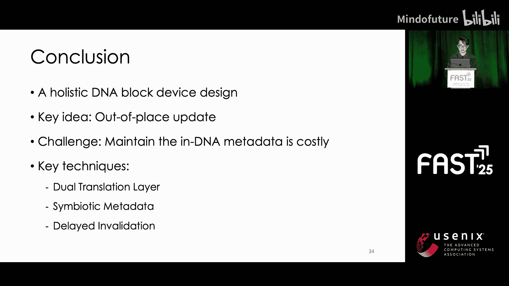
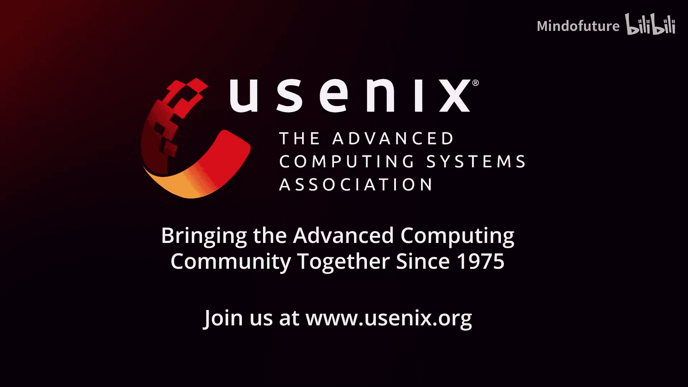

# FAST25存储大会-｜-USENIX-Conference-on-File-and-Storage-Technologies-p36-P36-Liquid-State-Drive---A-Case-for-DNA-Block-Device-for-Enormous-Data--BV1HmVXzME4J_p36-

。

Hello， everyone。 I'm Jiazhou from Shanghai Zhouong University iPad lab。 today。

 I'm glad to share with share my work。 liquidqui stage drive a case for DNA block device for enormous data。

😊，Let's start from the D storage basics。DNA， which consists of four different nucleotides。

 A TC and G is well known as the carrier of the genetic information Today。

 with the advances of biotechnology。 DNA can also carry universal information， specifically。

 each DNA strand has its corresponding nucleotide sequence。

 So we use this nucleotide sequence to present information。 Furthermore。

 DNA synthesize technology enables us to synthesize DNA of a specified sequence。

 and DNA sequence sequencing technology enables us to read the nucleotide sequence of a DNA strand。

 with these two techniques， we can store and retrieve information in DNA。😊，As the storage medium。

 DNA has two entic advantages， high density and long lifespan。 First。

 the DNA storage denities tends to the 18th power base per cubic millimeter。

 which is about8 orders of magnitude than hard disk and five orders of magnitude than flash。 Second。

 the DNA lasts for centuries， while SD and H Ds last for about five years。

 Besides the DNA storage evolves at the pace， reveing more slow。

Dna storage hardware consists of multiple chips， where each chip is a spot matrix。

 A spot is a test tube in which a large number of DNA strand are stored。

The DNA strand is divided into four parts。 The primer at the beginning and the end and the index and payload。

 We use the payload area to store data and use the primer and index to index the strand。Specifically。

 we use the primer to index the strand collection。 An essay is a collection of strand that have a same primer in one spot。

 and all strand in the essay are sequenced simultaneously。

To distinguish between DNA strands that has simultaneously sequenced within the same S。

 we encode each strand's unique identifier within the index region。

The DNA storage hardware supports three operation， right， read and eras for right operation。

 we first encode the binary data into nuclearcleotide sequence。

Then synthesize the DNA strand with the corresponding nucleotide sequence and finally store the strand into the spot。

😊，For read operation， we first sequence all the DNA strand in an S C to get the nucleotide sequence。

 and then we decode the nucleotide sequence into binary data。😊。

Due to the immaturity of the DNA modification technique， we need to erase before right。

 just like flash SSD。For an erase operation， we clear ordinary strength in the spot。

After recover the DNA storage basics， a question arises how to integrate DNA storage into current storage system。

 Our work focus on building a DNA block device。The block interface is one of the most crucial interfaces in storage systems。

It it is simple and enable us to random access data at the fixed sized block granularity。

 Additionally， the block interface is general， iss widely deployed in various scenarios。

 including AI， cloud storage and archive storage。 So we propose to build a DNA block device to integrate DNA storage into existing storage system。

😊，We start by examining a naive DNAN block design and this problem。For a naive design。

 we first part the storage space into blocks。 First， we map consecutive strength into a block。

 Then we assign physical block address to each block。

Supporting block operations straightforward for reading the read granularity of DNA storage hardware is an S C containing about 1 million strand to read a block。

 We have to read all blocks within the S C。For writing the right granity of hardware is a strand to write a block。

 We just write the strand of the block。For updating a block due to the erase before right。

 we need to perform erase operation。 The era granularity is a spot containing about 2000 essay。

 So to update a block， we first to read all essays in the spot。 and then we erase the whole spot。

 Finally， we write the new and other blocks in the spot。 for updating a block。

 we need to read and write 12 million blocks is extremely costly。😊，To mitigate the update cost。

 like just like SSD， a straightforward approach is employ out of place update to reduce the update cost。

We provide the logical block address to users and employer translation table。

 which translate the LBA into PBA to realize out of place update。

The auto place update brings garbage， which requires to be collected periodically。

To facilitate garbage collection， we typically record some GC metadata。

 including the reverse translation table， which translates the PBA back into LBA and also the valid bit map。

 which records the validity of a physical block。However。

 because of the E B scale data stored in the DNA block device， the metal data。

 including the translation table， reverse translation table and valid bit mapap， are also in P。

 B scale。As a result， metadata is difficult to stored in traditional storage device such as SSDs and need to be stored in DNA。

However， storing the metadata in DNA brings challenge， which。

 which is maintaining the Indian metadata， reintroduces costly DNA update。 specifically。

 for each right， we need to update the translation table entry。

 update the reverse translation table entry and invalid the old block。 These three processes。

 brings the costly DNA update back。 to solve these challenges we propose liquid state drive。 Firstly。

 we employ dual translation layer to avoid updating the translation table。 Second。

 we reintrod symbiotic metadata to avoid updating the G metadata。 Third。

 we employ delayed validation to mitigate the cost of maintaining the valid bit map。Next。

 we further examine the design details of Liacity。We propose do a translation layer to reduce the cost of updating the translation table entry。

 specifically， we also out of place updated the translation table。 Therefore。

 we introduce another layer to supporting out of place update in the translation layer。

 And now we got two layers。 The L0 and L 1 DNA translation layer。

 The L 0 detail is used to index the address of the L1 detail entry in DNA。

 and the L 1 detail entry is used to translate the LB into PB。 What's more。

 the L 0 detail is in G B scale， which means it can be stored in the fast SSD。

 So the updating cost of L 0 detail is negligible。We propose the symbiotic metadata to reduce the maintaining cost of the GC metadata。

First， we observed the G C metadata is always accessed with the block data。Second。

 we observed that the physical block is out of place updated。

 So there is no DNA update for physical block。Based on this observation。

 we store the G metadata with physical blocks symbolically to eliminate the DNA updates。Specifically。

 for a physical block。We leverage the unused area of the last strand to store the entry of the reverse translation table。

 which means we store the LBA of the physical block into in its unused area。 Additionally。

 we add an extra strand to represent the validity of this block， we called it the invalid strand。

 The physical block is invalid， If the invalid strength has been written。

 and it is valid if the invalid strand has not been written。With symbiotic metadata。

 the G C metadata is updating， along with the physical block data in an out of place update manner。

 So we eliminate the DNA update operation when maintaining the G C metadata。Last。

 we introduced delayed invalid to further reduce the overhead of updating blocks。

In block updating operation， we need to invalid the old block。

So we need to first read the translation table to get the old P， B A。

 Then we write the invalid strand to the old P， A to invalid the old physical block。

This read operation is， is on the critical path of updating a block。 As we mentioned before。

 the read granularity is much larger than that of right。

 So the read operation greatly increase the updating cost。To solve this。

 we delayed the invalidation to reading a block and hence remove this DNA read operation from the critical path of updating a block。

For more details， please refer to our paper。Next， let's move on to the evaluation。 In evaluation。

 we implement the system based on our simulator。 There are three main compared systems。

The leak SD is our system。 The cross detail is a block device which has 24 MB block size。

 and its detail is small enough to be stored in the SSDs。

 The no detail is the naive design mentioned before。

We use three metrics to measure the performance of systems。

The read or write amplification is the ratio of the requested read or write volume to the actual read or write volume。

 The actual read ratio is the ratio of the requested read volume。

 which is caused by right to the actual right volume。In microcro benchmarkchmark。

 Li can reduced rate amplification up to seven orders of magnitude times compared to the no detail design。

The extra re of Li D is almost 0。 Additionally， Li D reduce the right redempplification up to 6000 times compared to the no detail design。

In real world traces， LikaD reduced the right amplification up to 3000 times compared to cross detail design。

 Additionally， Lika reduced the redampplification up to seven times compared to the cross detail design。

We also evaluate the performance of different block size from 4 k to 24 MBby。 General。

 a block size of 4 k achieves the best read and write performance in real world traces。😊，In summary。

 we propose a holistic DNA block device design。 The key idea is out of place update。

 The challenge is maintaining the Indian metadata is costly。

 and the key techniques is are dual transition layer， symmbiotic metadata and delayed invalidization。

 Thank you。 Any questions。

