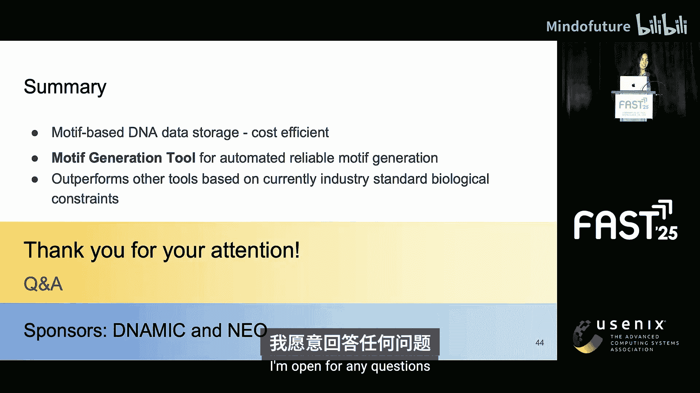
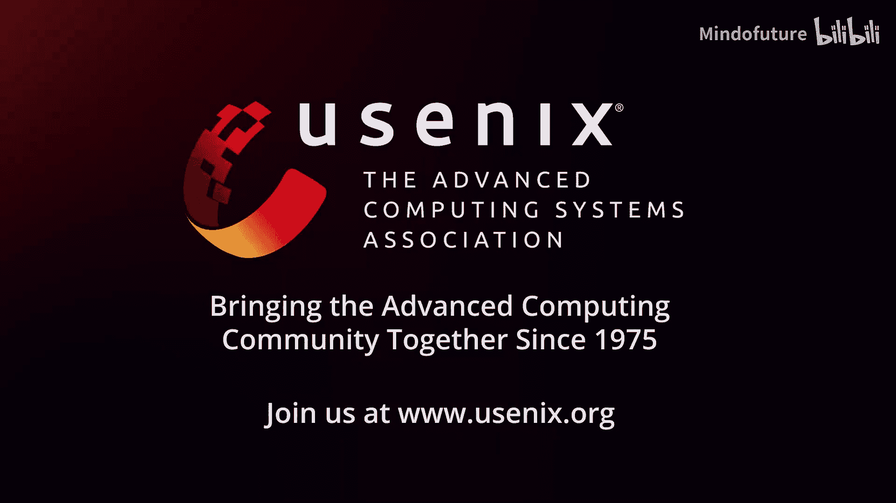

# FAST25存储大会-｜-USENIX-Conference-on-File-and-Storage-Technologies-p37-P37-DNA-data-storage---A-generative-tool-for-Motif-based-DNA-storage--BV1HmVXzME4J_p37-

。

My name is Samamira， and I'll be talking about a generative tool for Mo based DNA data storage。

This is a joint work with Omarsa and Thomas Highness from Imperial College， London。

The importance of data storage has been made clear in the last few years。

 as there has been an exponential demand for digital data storage。

 and digital storage mediums are constantly evolving to meet this demand。However。

 current storage mediums of devices such as memory cards and chips have a limited lifespan and must therefore be replaced every few years。

Moreover， world data centers currently consume yearly more than the total energy consumption of the United Kingdom。

 So it is clear that the new method of storing data is required。

DNA has shown to be a potential solution to these issues。

It allows for storage of large amounts of data in a microscopic volume in an order of magnitude of up to 10 to the 18 B per millimeter cubed。

Moreover， DNA has a half life of 500 years， and in the right conditions。

 it can store information for up to 2000 years。Even though DNA data storage is a relatively new technology。

 current advances in DNA technologies have made it possible to store the entirety of the English Wikipedia in a single test tube。

So now how do we actually store data in DNA DNA is a molecule which consists of a sequence of four chemicals also called bases。

 These bases can be referred to as A， T， C， and G。Now。

 the way DNA data storage works is just like how DNA stores genetic information of our bodies。

 it can be used to store synthetic information by constructing a sequence using these four bases， AT。

C， and G， similar to how computers arrange bytes。So we just saw how we can encode our data to DNA。

 but now we need to actually construct the DNA strands， which is called synthesis。

Then we can store the DNA。 We can access back the data in the DNA， which is called sequencing。

 And finally， we can decode the data to get back the original information。However， in those steps。

 there are few limitations。 So especially for the synthesis step due to current technological constraints。

 we cannot synthesize stable DNA strand of length greater than 200 basis。 But most importantly。

 the synthesis cost is very high。 It is currently at around $400 million per  TB。

 And so storing new data is really expensive and is not really commercially viable。

So for this solution has been proposed， it's an approach to storing data。

 which is called motive based DNA data storage。In this approach。

 the synthesis cost is no longer proportional to the amount of data you want to store。

 but it is now fixed， so the way it works is that in Mo-based DNA data storage。

 you have a fixed number of short DNA sequences also called motives。

 which you need to synthesize only once at the beginning。

Then these motives can be replicated in a cost efficient way。

 and they can be assembled to form new sequences。Now the way they can be assembled is by using a method called the Gibson assemblymbly method。

To illustrate this， I simplified it by just showing two motives here。 So we have Moif 1 and Mo 2。

 And the way you can assemble them is that they will have an overlapping region。

This overlapping region will allow them to bind to each other。

And then all of the missing bases can be filled in， and you end up with a new sequence。

 which consists of the two motives that we had。So this overlapping region is called key。

So this leads us now to the motive structure， so we just saw that we need keys to assemble the motive。

 so we would like our motive structure to have keys on each end of our strand。

 and then in the middle we can have the payload where we have the actual information。Now。

 since keys are used for assembly， that means they cannot be present anywhere else in the sequence。

 and since they're unique， they can be used to actually access the data as well。

So we just saw the motive structure。 but now not every motive can be considered to be a good motive。

 There can be sets of motives which can store your data in a more reliable way than other motives。

 And that is because because DNA is error prunne。😊，There can be insertion。Deletion。

And substitution of base which can occur。 And this will impact the reliability of the store data。

And these errors these errors are directly related to biological constraints related to DNA。

So in our work， we focus on three of them， which are homopolymerre， hairpins and G C content。

Homopolymerre is the consecutive repetition of a single base。

 So we are trying to avoid having homopolymeres because homopolymers will increase the likelihood of having errors in our sequence。

Then we have hairpins where under some conditions， since the DNA strand is flexible。

 it can fold on itself and then bind to itself， and that makes the accessing of the data more difficult。

So we're also trying to avoid hairpins。And GC content is the percentage of GNC bases that are in our sequence。

 and we're trying to keep those currently between around 20 to 60% to ensure a stable DNA strand。

So what do we actually want， We are trying to store our data in a cost efficient way。

 So using motive based in data storage， but we also want to ensure that our data is stored in a reliable way。

 so that means that we want to conform to these biological constraints。

And this is where we are introducing our tool。 This tool allows us to do exactly that。

 And we called our tool， the motivetive generation tool。😊。

This tool takes us input information on the motives。

 such as payload length and the number of motives you would like to have。

 as well as constraints on homopolyre， hairpins and G content。

It is important that these can be given as input because due to advances in DNA。

 these constraints on homopolymerre hairpins and G C content will change over time。

 So as they change， the user will be able to reuse the tool and update the constraints and then get a new set of motives。

And then it's also important to give， to allow the user to give information on the motives。

 such as the number of motives， so that they can customize their motives for their use case。Now。

 our tool will output a set of motives conforming to these constraints， so in other words。

 you can store your data in a cost efficient and reliable way。

But how do we actually generate such a set of motives？ Well。

 we were thinking that were trying to generate sequences。

 which is kind of similar to wanting to generate text。

 But instead of using the 26 letters of the alphabet， we only have four letters this time。 A T。

 C and G。 Now， in the context of text generation， we have Markov chains。

 which have been proven to be quite efficient。 So we also use Markov chains in our context。

So were using it to construct our motives base by base。

So in this example here we start with a base here in this example is the base A。

 and then we want to add the next base to it。 So either A T， C or G。

 So now how do we move from a current state where we have only one base to the next state where we have two bases。

Well， that is using probabilities。And these probabilities are called transition probabilities。

 These probabilities are directly related to whether adding that base to our sequence violates a constraint or not。

 So， for example， if adding the base A to our sequence violates a constraint。

 we're trying to avoid adding that base。 or not we don't want to go to that state。

 the probability to move to that state will be a lot lower than moving to any of the other states。

So this slide is a bit more technical。 But what you can take from that is that transition probability。

 which is the equation at the bottom， takes into account the score。

 and the score that you can see at the top takes into account all of the constraints that we had mentioned previously。

 So the score for homopolymerre， Hpin G content and the fact that we don't want to have the key in our payload for the assembly。

And then we're also using log scores instead of scores。

 and that is because multiplying small numbers can be difficult to compute with computers。

 And so we use log scores instead。So in order for you to have a better understanding of what these scores look like。

 I will just take you through the score for homomopolyre。So for the homopolymer log score。

 we will already have our current sequence， which is in blue here。

 and now we're trying to give a log score to adding a base to it， in this case， the base A。

 so what should be the log score， we're trying to avoid having homopolymeres because the longer the homopolymerre we have than the higher the chances are that you're finding errors in your sequence。

So the idea is if adding that base increases your homopolymer length， the log score should go down。

 should be lower。So this is the kind of shape we would like to see in this curve。

 you can see in the x axis， you have the homopolymeral length。 and you can see that when it's0。

 the homopolymer log score is a lot higher than if it's 5， for example。Now。

 the equation that we found， which has this kind of shape that we are wanting is the following。

 This equation takes into account the current homopolymer length。 So in our example here。

 it's the homopolymer length 5。And then it also takes into account the constraint given by the user。

 So what is the maximal allowed homopoly error， which ensures having less errors in our sequence。

As well as a hyperparmeter， which controls the shape of our curve。

 because we're not really sure what our log score should look like。

 So this is a hyperparameter which can be tuned to optimize the output for each use case。

So now that we have our tool， how can we actually evaluate whether this is a good tool or not？

For this， we decided to compare a tool to other existing sequence generation tools。

 which are DNA fountain by early Hi al， finite states machine encoding byceate al。

 the shortmer combbinnatorial encoding scheme by Prost al。

 and finally randomly generated DNA sequences。The first three tools have already their own methods to overcome the biological constraints that I mentioned previously。

 while the randomly generated DNA sequences just randomly generates it without actually taking it into account。

Now for the actual evaluation， we decided to evaluate it in two different scenarios。

 the first being for each constraint separately， and then in a case study where we combined all of the constraints and then we compared the time it took for each of these tools to actually return a set of motives。

So now for each constraint separately， we have three graphs here。 So on the top left。

 we have the G content on the right， we have homopolymeres， and on the bottom， we have hairpins。

 and then we're comparing the time it took which you can see in the Y axis to compute a set of motives of varying lengths。

 which you can see in the X axis。You might notice that not all of the tools I mentioned in the previous slide are actually on these graphs。

 so the ones by Cateal and Perceal are not on any of these constraints graphs because the time they took to generate sequences was way higher than any of the other tools。

 taking up to several minutes compared to milliseconds for these tools。So from these graphs。

 you can already see that the Mo generation tool which is displayed in blue。

 is outperforming the tools by cellate al pertal as well as the DNA fountain。

 which is in yellow here。In all of these three different constraints。

 it also outperforms randomly generated sequences in the constraints for homopolyomeres and hairpins as the sequence length increases。

 And so as the complexity of the problem increased。You might notice that for GC content。

 the randomly generated sequence time is constant and close to zero。

 and that is because the expected GC content for randomly generated sequences is already 50%。

 which is within our constraints range already。So now that we saw how these tools perform for each constraint separately。

 we can move on to actually try to see how they perform when we combine all of these constraints。

 which is actually more interesting because current companies for DNA data storage are having specifications for all of these constraints to ensure having a stable and reliable DNA strand。

😊，So this is exactly what we did for our case study。 For a case study。

 we looked at what current DNA synthesis companies such as IDT are using as their constraints on homopolyre。

 hairpins and GC content。 For example， Hopolymeres。

 they don't allow having homopolymeres of length greater than5 and the G content needs to be within a range of 25 to 65%。

So for these real real world values， we got the evaluation here where we saw that the Mo generation tool managed to return a set of sequences。

 motives conforming to all of these constraints in less than three seconds。

 while for all of the other tools， we were not able to get any set of motives conforming to these constraints within a threshold of five minutes。

 which was the threshold we used for our evaluation。So in this real case study， we saw that， again。

 the Mo generation tool outperformed all other tools。So to summarize。

 we we decided to focus on motive based DNA data storage because it allows for a cost efficient storage of your data。

 and we， we we created a motive generation tool， which allows for the automation of motive generation and ensures that you can store it in a reliable way。

😊，And our tool outperforms other tools based on currently applicable biological constraints。

So with this tool， we hope that we will contribute to a more accessible and affordable usage of DNA data storage in the future。

😊，So thank you for your attention and open for any questions。

