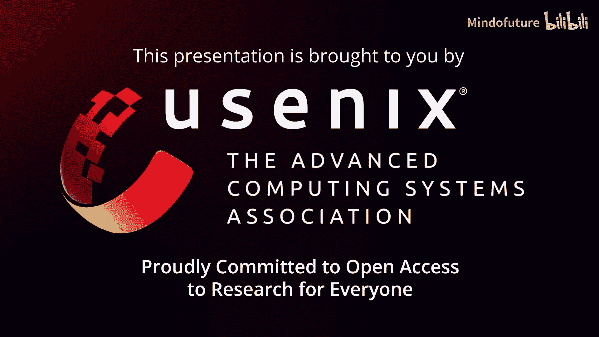
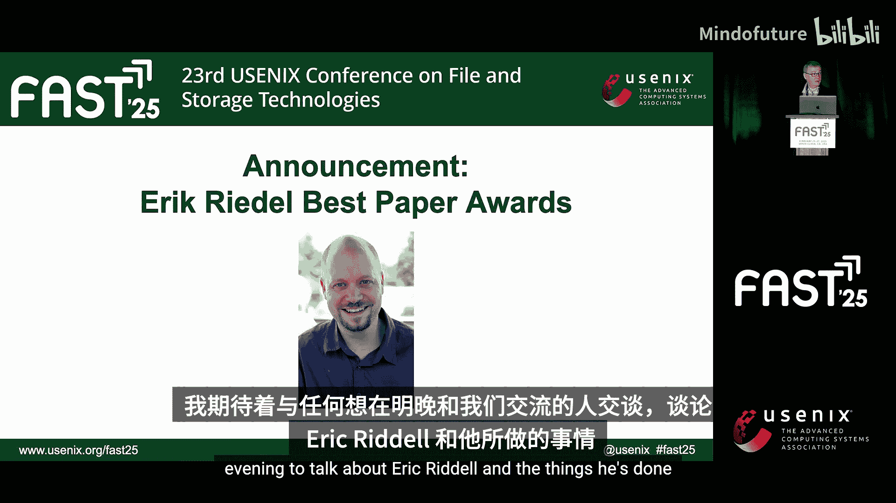
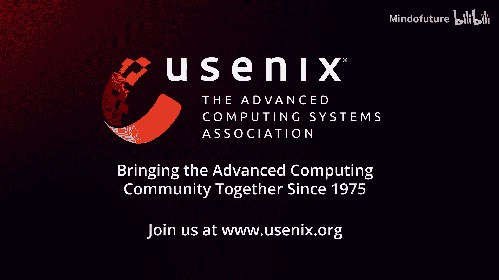

# FAST25存储大会-｜-USENIX-Conference-on-File-and-Storage-Technologies-p38-P38-Honoring-Erik-Riedel--BV1HmVXzME4J_p38-

。

I'm Garth Gibson and I'm here to recognize the loss of an important member of our community。

 Eric Ridell left us this year about seven months ago， and tomorrow。

 those of us that want to spend some time reminiscing。

 sharing stories and spending time with his family， welcome to come to the Ellameda room Six。

 30 PMm tomorrow evening。U。You can either look at this picture for the family from 15 years ago。

 or you can look down there where they are now。It'll be an event for people who have known Eric in his many different environments for those of you who don't know Eric。

 I want to point to his record of service and I encourage you to emulate it in 30 years in the academic community。

 25 years in the industry community， PC co-chair and in many different events but in this event in 2008 and 15 years on the Steing committee and in Ho St in 2009 and 15 years on the Steing committee at SNA。

 the Stage Networking Industry Association on the technicalical council and on various standards committee。

 some of which gotta standard， so a lot of work in all of these things。For me。

 I go back to when he was a graduate student and I did work with him on his PhD。

 Act disks was the title may not mean anything to you today。

 but the big trend is something you will recognize that electronics continues to put more transistors and deliver you more computing performance for less money so you replace hardcore electronics with processors and write programs on him。

 therefore you could do that inside a device。 How should you use it and what can you use it for and 30 years ago。

 he looked at that question， but did it away I really liked。

 he took an important application databases， an important real production open source database Postgres。

 and he found where you could find that enough information to decide what to pull out and offload to the device and characterize what kind of benefits you could get。

Because the cost constraints。 and at the time， the amount of computing。

 you couldn't spend a lot of cycles on it。 You didn't。 couldn't have a large footprint of state。

 and you had to reduce the amount of bandwidth you were going to use after the computational by a lot。

 that's gotten better since So today with a flash， you can put an FPGA on the system you can look at many banks of the flash at the same time and do a lot of reduction。

 And so this idea that characterized with a few people that did it in networking as well。

 and a few people that did at other universities， this set an architectural model that we're still pursuing。

 for example， I'm showing the Samsung device， which is doing that today and the open source interface and VME CSD for computational storage devices or disks or whatever we call the computational storage thing。

Lately， Eric has been looking at carbon footprint。 He was a member of the green storage working group for quite a while。

 I think he helped start it。And I saw， it wasn't in the room。

 but I saw his storage developers conference talk， which is you can find on YouTube。

 You can find on the SNA website。 He talks about the range of things you can do when you focus on trying to improve characteristics。

 the engineering way of thinking， the key one that he was talking about that as I understood it was to lower the carbon footprint effect of I T equipment。

 And if you're doing GPUs these days， you're getting a lot of pressure on this one。

 But the key idea was that the equipment we use。The majority of its carbon footprint is accrued in the construction of the equipment long before you use it。

 And if you're an owner and you want to operate on it。

 you can only do so much improvement by the time you've bought it。

 What are you gonna do about the cost upfront。 And yes， you can help people do better mining。

 and you can help people do better or smelting。 But you could also say this equipment lasts a lot longer than I normally use it。

 Most of the the components in this system， are going to last at least 10 years And many of them are contractually obligated to be able to be replaced for full 10 years。

 So they started looking at scavenging equipment and coupling it with the replacements for whatever you could use in order to offer components。

 complete systems， which they built that could be lower cost because they re useded working equipment。

 and amortize the original construction penalty for construction。 Fabous stuff。

 En you to listen to the video。 Besidess these entertaining to listen to。Alright。

 so when after Eric passed the steering committee for Fast。

 realizing the the loss to the community decided to rename the best paper award。

 the Eric Ridell Best paper Awards that we will just get to now。 And I thought this is really great。

 And I look forward to talking to anyone who wants to come talk to us tomorrow evening to talk about Eric Ridell and thinks he's done。

 Thank you。😊。

