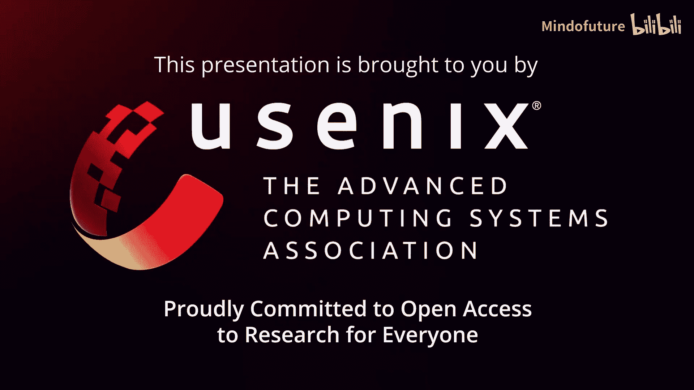
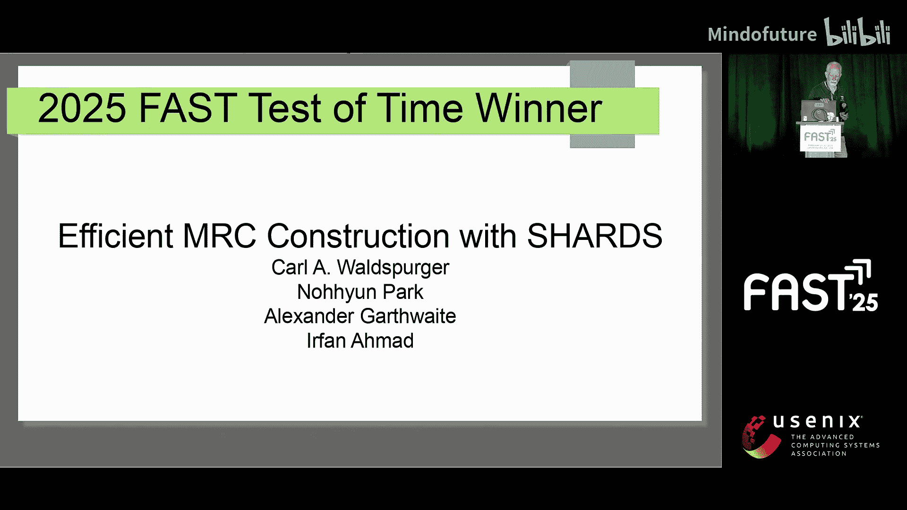
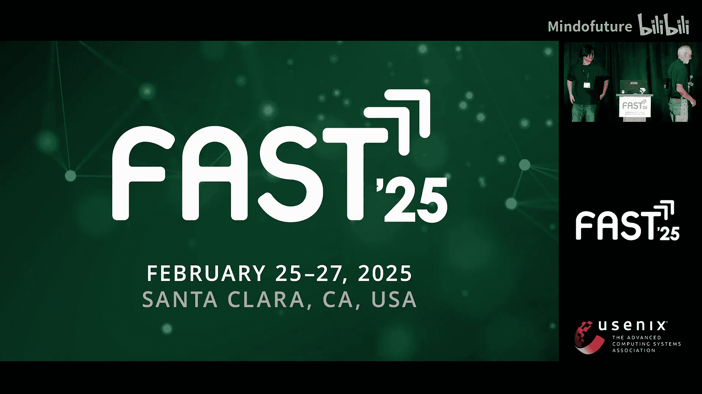
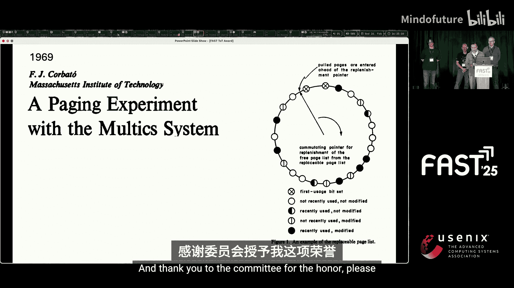
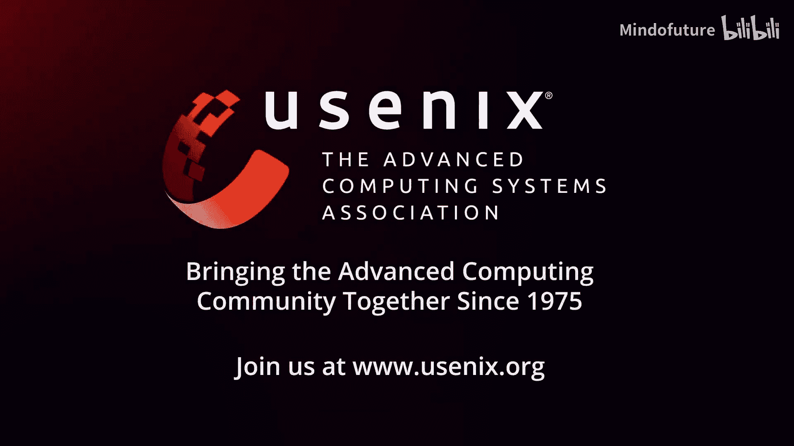
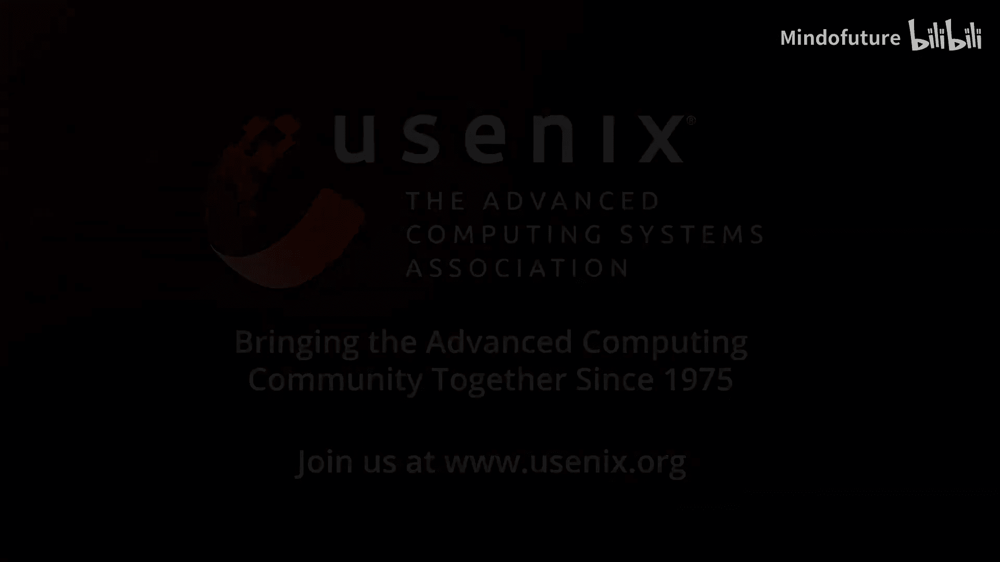

# FAST25存储大会-｜-USENIX-Conference-on-File-and-Storage-Technologies-p39-P39-Test-of-Time-Award-Presentation--BV1HmVXzME4J_p39-

。

嗯。So the test of time Award was established now 13 years ago。

The idea is to recognize papers that have had a significant impact in the storage community。嗯。

The papers have to be at least 10 years old。 The idea is that it's not just something that was cool at the time。

 not just something that earned a best paper award， but something that actually has had influence。

 And so we want to give it time to have that influence。

 The selection is done by the fast steering committee and past program chairs。U。With the。

 the process being managed by Raju and myself。嗯。I'm just going flash up here past awardees。

 I'm not going to go over these just some of you can look back and see things that， oh yeah。

 I remember that paper and that was a really cool paper or you know my advisor made reread all of those papers or something like that。

 in which case you have a good advisor。嗯。So the process this year we had four nominees for the award。

 we had 17 reviewers who submitted a total of 63 reviews。And then Raji and I reviewed the reviews。

And we met in January to make a final selection， and we chose the paper that I think you will agree is a truly outstanding paper。

嗯。The committee had some comments on this paper， one of them， I've seen commercial systems。

 both storage systems and database systems that have taken inspiration from this work to provide customers and field service engineers insight into the expected effect of allocating more or less memory for their caches。

嗯。Another reviewer said this paper has really revolutionized MRRC usage in online settings。

 as far as I know， it has the best performance of known misracial curve algorithms or is certainly hard to beat and is very accurate。

Another said this paper made MRRCs practical and popularized their use， in fact。

 we often use the proposed algorithm or variance in our company and the folks that study cash policies view this paper as a landmark。

Given those comments， some of you may have already guessed what the award winner is。

So it is efficient MRRC construction with shards by Carl Wals Perker， Noham Park。

 Alexander Garthwaite and Irfphonon Aman。And we are lucky because they are all here today to be able to accept the award。

 and so at this point I am going to turn it over to them， so please come on up。

Take a moment。Congratulate all of you。

So thanks Jeff， and thanks to the award committee， we're honored to receive this award。Sure。

And I'd like to just take a moment to reflect on the origin and in context of this work at the time。

 all four of us were working at cloud physics， which is a small startup focused on resource management and virtualized systems。

And this research stemmed from a real customer challenge， a real world problem。

 and that was sizing flash caches， which were becoming increasingly popular alongside traditional storage at the time。

And it's a reminder that despite the relentless pace of a startup。

 good research can still emerge and also that necessity often motivates the best ideas。

We began by collecting IO traces from customer sites and testing cache sizing heuristics。

 but the results weren't as promising as we had hoped。

A more principled approach that we were aware of was to generate misraio curves or MRCs for short。

 and that's a concept dating all the way back to Matson in 1970， however。

 even the best existing methods were too resource intensive， especially for large traces。

And having used sampling approaches and techniques in prior projects。

 we explored whether sampling could make MRC construction more efficient。

But it was challenging because sampling a large sparse address space while also tracking reuse is something that hadn't been done before。

So the key insight was that using deterministic spatial hashing could be used to drive randomized sampling。

 and that formed the basis of the shards algorithm。

Some of our colleagues were initially pretty skeptical， but early experiments exceeded expectations。

And at one point the results seemed almost too good to be true。

 I even worried that perhaps we had a bug that was artificially inflating our accuracy。

But it all worked out， and then we continued to develop a constant space variant of shards that enables accurate MRCs to be built for any trace length in less than one megabyte of memory。

 and that makes it feasible for even the most constrained resource constrained systems。

And between our original submission to Fast and our final camera ready copy。

 we added preliminary results from applying spatial hashing to nonstack replacement algorithms like Arc or Lrs。

 paving the way to our follow on research in miniature simulation。

So it's been really exciting to see people and others build on these ideas over the years。

 and we're deeply grateful for this recognition， thank you。Could we switch to the。Clients， thank you。

So I'm Irfan Ahma， thank you， Carl， our leader and first author for this paper。

 and for much of the follow on work。As Carl said， this was very interesting time where we were looking back at。

The work。In the area of memory resource management， going back to the dawn of computing。

Whereas Carl walked you through what led to this particular research。

 I wanted to start actually pretty far back。 May let's go back to the beginning and share some things that we learned that many of you may know。

 but some may not。 so as we were looking back and trying to again understand。

Memory resource management。And placement algorithms。 and what oftentimes we just call it caches。

 We went back and looked for it， you know， where did it all start。

 So this this picture here is the console for the Atlas system and the paper that describes the virtual memory for this is 1962。

 which means this paper， the work is probably about 1961。

 as far as I can tell because I tried to look around and to figure out like when was this work done。

As far as I can tell， the system was shipping when this paper was published in April 1962。

So actually， it's a remarkably good paper， you know， when I read it。

 it felt like I was reading a paper published two days ago in 201617 when I found this paper。

It's written really， really well and all we have to do is we can kind of replace the word drum with SSD and the word core with DRA。

 and it would make sense actually， it could probably get into fast， you know now today。嗯。

Well don't get any funny ideas about trying that， though。

So this machine had used bits and therefore was trying to manage memory， using that。

 But its the first virtual memory system that I know of。We were talking earlier。

 and none of us could remember anything earlier than that。 But interesting thing。

 why this was relevant was because this machine， as innovative as it was。

 was suffering in the field in production deployments。And with catastrophic thrashing。

 so things would run fine。 and all of a sudden you'd get thrashing and the whole thing would just scratch。

 you could not the console would become unresponsive。 You could not submit a new job。 Okay。

 it was that bad。And not only this， but it was actually kind of pretty common in the '60s for this to be a problem。

 it was such a big problem that IBM didn't want to ship a virtual memory based system。

Until IBM felt that they had solved this problem。 So there's multiple other ones out there already。

 So in the mid 1960s。IBM launches a big effort to study eviction algorithms for their virtual memory system because they were getting demand from programmers in the field who did not want to program anything other than virtual memory。

 because why would you write if you have virtual memory。

 just everything is so much easier because you have zero based and range for your memory allocation。

So reluctantly， or by necessity， they started this project。

 which actually led to a sequence of events that ended up in the work that we did。Let's see。

 1966 as part of this project。Bladi publishes one when trying to study LRU。

 publishes a paper which has extremely high number of citations because pretty much all of us you know。

 at some point in time are dealing with memory management or cash replacement policies。

 and we have to compare against the dreaded min， right。

So this offline optimal algorithm goes back to 1966， and now you can see 62 to 66。

 already we've gone through this cycle of understanding hey。

 you've got to do better memory management， you have to study this fundamentally and formally。😊。

And this semiminnal paper is published。And you know， interesting， know， again。

 this could be from fast this year， you know， one hopes to improve replacement decisions by anticipating future references on the basis of previous references。

 right， So we are definitely building on the shoulders of giants here。😊，Something interesting。

 So the on the left hand side is plot from Belladi's paper， which has cache size on the X axis。

And then frequency of access on the Y axis and。And it's really interesting。 Like。

 similar plots are published in papers today。 And this is the first one that I found that actually plotted a mis curve。

 It may have existed before。 I'm just not aware of it。

 And the way they constructed this was by running multiple experiments and drawing lines between them。

 And this is how you could tell what the shape of the workload was in its cache efficiency。 Okay。

 very， very important thing。😊，And so this is published in 1966， between 1966 and 1970。

 people already got tired of running lots and lots and lots of experiments to try to draw these curves。

So in 1970， Dick Madson at IBM again。Publishes his seminal work。

 which is a onepa algorithm to draw the entire curve for algorithms of a certain specific type。

 which Carl alluded to， which are called stack distance algorithms。

So this is revolutionary because now you can just run one single pass and get the full curve as long as the algorithm is stacked distance。

 which many at the time were only recently have other ones become， more and more fashionable。嗯。

And so now we are at 1971。 This paper was published。

 but adoption is very low in industrial settings because for long traces。

 it's very hard to run because it is an expensive algorithm。 So over the decades。

 improvements are done on the data structures， but not the algorithm the complexity of this algorithm。

And that's where Carl， Alex， Nojiin and I， you know in 2011， 2012。

 I think we are sitting there trying to figure this out， starting from that and realizing that， hey。

 this algorithm is like what you want to do is just too expensive and that leads to the approximation algorithms that Carl referred to earlier。

So。A couple of funny stories so when we were writing this paper。

You know you're supposed to cite sort of the earliest instance of something that you want to refer to。

 so in this case， this was a clock algorithm。So a couple of us were discussing saying， hey。

 what's the last time you read the original flock paper。And I hadn't read it like， I haven't read。

 I like to go find it。 Well， we search on Google and we search on every search engine you could imagine to try to find this PDF of this paper。

 We couldn't find it。And like， how is this possible。

 how is this not on the internet in whatever 2014？Maybe it was 2015。

And so we reached out to some friends to go look on the shelves of the MIT libraries to see if you could find Corby's Fernando Corbado Turing laureate。

And responsible for leading the Malx project， from which comes Uniix。

 from which comes everything that we use every single day， including operating system on this laptop。

So， so Samman， I guess， he went， couldn't find the papers at the MIT libraries and then a panic ensues。

 How is this paper that has been cited thousands upon thousands of times， not on the Internet。

 not at the library。 So what we， what have we been citing。Like， has anybody read this paper？

Where is it So thankfully， Simon at professorfes of MIT was able to get a hold of Corby。

 who at that time already was， I mean， retired for a long time and very old in his 80s。😊。

On vacation and Corby responds while on vacation and says， hey。

 I'm surprised there's no copy of this， I think I have a copy of this in a box in my attic。

And so again， panic continues， we hope he has a copy of this paper because nobody else has a copy of this paper。

So anyway， he comes back from a vacation， finds paper。 We got a P。 And now finally， it is on Malians。

 org。 you can actually just search for it， you'll find it。So just fun stories， you know。

 we all go through interesting you know adventures and fun incidents that happens。

 so we wanted to just share a couple of them。 Thank you for your attention and thank you to the committee for the honor。

 please。😊。

好ello。Yeah， hi， I， I would like to thank the committee and， and， and the co-authors for。You know。

 it was a fun project。 I still remember it was like 10 years ago。

 but I still remember it pretty well。I first thought the。

 I first thought about the idea when I was interviewing with Cloud physics。

 I hadn't actually joined yet。 And in a cab ride， I I wasn't sure I'm not sure if it's cab。

 but in a car ride， K mentioned this idea。And I thought， that's not going to work。

Because I process is unstary。 if you sample， you're not going to get the average behavior。 actually。

 I actually said it。I， and， I had met T for the first time， I think on that day。 And then Carl said。

 oh， yeah， but let me try it anyway。I went back to school。 I think a few weeks later。

 Car sent me this data。 hey， here is like preliminary data。 We did these traces。

And I spend like whole day trying to show why it doesn't work。诶。And I， I think I， I。

 I was fairly skeptical until a few months in。 And then once I was born in， I was。

Confused and also try to figure out why it actually works。 And， and。

 and that was kind of fun journey for me。 So yeah， thank you。😊，Thank you。

 I'd also like to thank everyone。 It was a really wonderful experience。

 I'd like to pick up on one thing that Carl had said。

 which was the amazing accuracy of the algorithm。 And in particular。

 one thing we came up with was this notion of the adjusted charts algorithm。😊。

And the basic observation was that what you want from a sample and a simulation is something that has fidelity to the full blownown you know。

 set of events， as if you hadn't sampled at all。嗯。And the key observation here was that。

How could we take sort of something that's easy to measure about the overall run， for example。

 of a trace。And compare that to how our particular sample had done and then adjust the sample to be even closer to。

 to the original。That the basic observation in the case of MRRCs was that what you're measuring in MRRCs are basically events。

 right， they're aes， and even though we print them as ratios。

 really what you have or counts at each distance， right？And the observation is， is that the counts。

 the further you get to the left， the longer the distance， right， In some sense。

 the fewer of those there can be because they depend because they're at a greater distance。

 they depend on a lot of other events of having happened in between。As an interesting property。

 actually， in the case of sampling， because the the larger the distance。

 the more events had to happen to lead to that distance。

 So the more likely your sampling will have picked up that signal and you'll get something out there。

 The other thing， though， is the less if you over sampleample sort of the things that are。

arOr the things that have the greatest distance。It's hard to do because there aren't that many events of that kind because they depend on so many other things to have occurred in between。

 right So the observation was that if there is an error。

 the error is going to be actually right down in the small distances。

 It's not all going to be at the very smallest distance， but it's mostly going to be there。 right。

 Those are the things where you're either going to under or overcount。 And when you do。

 youll get a rather dramatic impact。So what we did with adjusted chartards was essentially。

Could compute the， the total number of events that occurred for the full run。Right。

 compared that to the number of events we actually got from our sample。And。And。

What you'd expect is that， you know， if the sample size was certain percent of the whole thing。You。

 you should see the， the number of events you measure similarly。Right， related it that way。

 And if it isn't， then that actually is a very good estimate of just how far off you are in terms of your error。

 And so the adjusted charts algorithm basically took that delta and used it to adjust。The， the， the。

 the shortest distance because that it was where most the air was。

 And that that actually had a profound impact in terms of improving the accuracy。 Well。

 what what I like about that story， though， is what it's trying to do is is。

Make a relationship between what the sample shows you versus what you know is true about the overall thing that you can measure easily。

 And then using that。Combined with identifying some bias in how errors are distributed to then make your simulation actually that much better。

 And I honestly think that's a more general technique。

 I've been thinking about how that could be used elsewhere。But anyway。

 just wanted to share that as well， thank you。So I thought I would give everybody a quick update on the research agenda。

 so remember sitting down with my co-authors， we were discussing kind we're really excited about this paper。

 I mean， I just like the excitement was just absolutely immense because you felt like you were really on to something interesting。

And you know we wondered， okay， will other researchers actually follow up in this work as actually kind of an interesting question we had like will other people like try to improve this or apply this in ways we haven't thought about。

 and I think I'm just so happy to constantly like back and forth between us long after the paper was published sending each other papers that develop on top of this work and improve it or fix some specific corner case。

 so that's an interesting thing we've also many of us have published additional works in this area as Carl has mentioned。

😊，We also now have a proof that the algorithm， the sampling algorithm works and itbounds on its accuracy。

 which is really exciting and then there's the intellectual property。

 the ideas and the patternss that were formed as part of this now were spun out into a new company。

 It's called Magnian。 It's in business。 it helps companies that are designing storage devices or cloud block storage or content distribution network to use these techniques to optimize their memory hierarchies basically and I think final thing I'm pretty sure we can speak for everybody。

All of us here that this is not done actually were if you come talk to us we'll tell you about certain other interesting areas that are unexplored。

 so if you're students that are interested in high impact work。

 there's tremendous opportunity in the world of predictive。

Performance modeling of caches and memory hierarchies and actual real world opportunity for impact in reducing the total D burn in the world。

😊，The gigawatts that are wasted in just idle memory and it's just really。

 really high impactful work awaits。Thank you。

