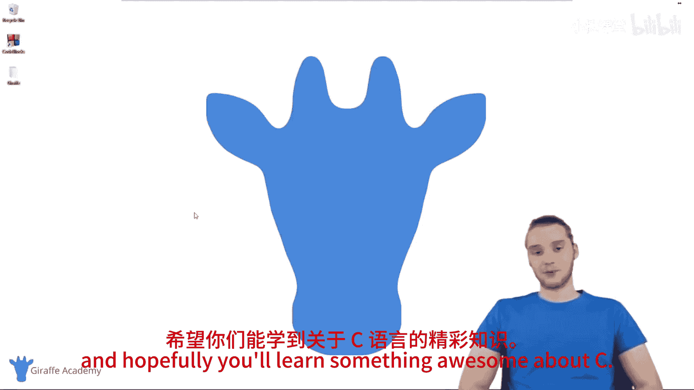
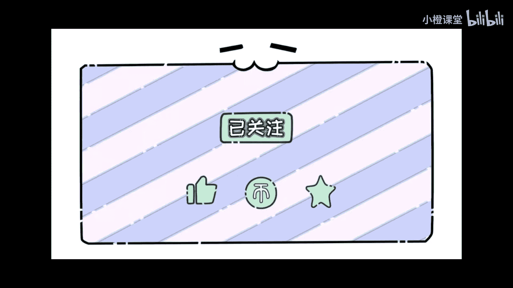

# 【油管千万订阅 freeCodeCamp】面向C语言编程初学者教程 Tutorial for Beginners in C Programmin（中英双语字幕） p01 C编程初学者教程第一节：介绍 -BV1ug4wzBEhT_p1-

Hey， welcome to Draf Academy。 My name is Mike。 In this course。

 I'm gonna be teaching you guys everything you need to know to get started in the C programming language。

 C is an awesome programming language， and it's actually one of the oldest programming languages around。

 In fact， a lot of modern programming languages are based off of C。 So it's a really good idea。

 if you want to get into C， or even if you're trying to get into something like C plus plus to learn the basics。

 And in this course， we're gonna cover everything you need to know。

 I'm going talk to you guys about installing a text editor and using the C compiler and we're gonna write some basic code。

 I'll talk to you guys about what is a program and how do programs work and how does C read the instructions that you give it。

 we're gonna get into some more advanced stuff。 We're gonna look at things like if statements and loops。

 we're going create different variables， we're going talk about the different types of data that you can use in C。

 Then we're gonna get more advanced。 We're going talk about things like structures and functions。

 we're going talk about pointers。 And basically， I'm just gonna give you a full overview of all of the core。

😊，And CSo by the end of this course， you'll have a really good understanding and a really good foundation which you can build on you can kind of go forward and learn some more I'm really excited to be bringing you guys this basic course on C I'm really excited for you guys to dive in and start using these tutorials so feel free to click around through all the videos and hopefully you'll learn something awesome about C。

😊。

。

