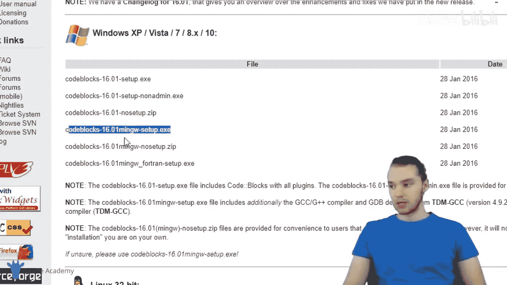
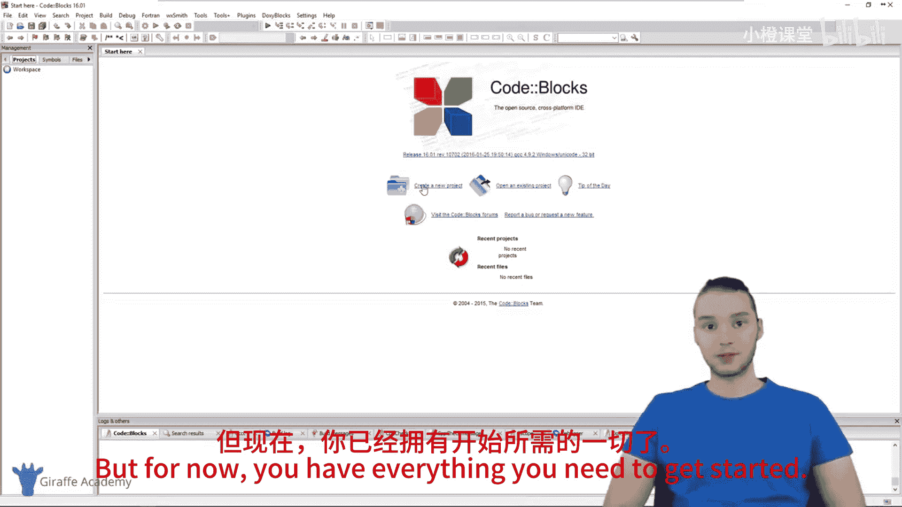

# 【油管千万订阅 freeCodeCamp】面向C语言编程初学者教程 Tutorial for Beginners in C Programmin（中英双语字幕） p02 C编程初学者教程第二节：Windows安装程序 -BV1ug4wzBEhT_p2-

In this tutorial， I'm gonna to talk to you guys about getting everything set up to start programming in C Now。

 in order to program in C， we're actually going to need two things。

 The first thing we're going to need is an environment where we can write our C programs Now there's a bunch of these different environments。

 Essential all you need is just a text editor。 So anything that can allow you to write text and then save that text in a specific file format is going to work。

 although when we're working with C， a lot of times it can be useful to use a special environment called an ID and IDde stands for integrated development environment。

 Basically this is a special text editor which makes it a lot easier for us to write our C programs in So I'm gonna to show you guys how to install an ID called code blockslock the second thing we need to write our C programs is going to be something called a C compiler Now C is a programming language which means we can basically write out instructions that we want to give to the computer。

😊，But eventually for the computer to be able to execute those instructions， they have to be compiled。

 which basically means like translated or transformed into a language that the computer can understand。

 So we're going to basically download and install a special program that will do that for us。

 So let's get started。 I am going to come over to my web browser。😊。

And I'm just going to go up to the Google search bar。

 and I'm going to search for a program called code block。 So just type in。

Codeb C and this link should come up。 It's codeblock org。

 Now this is an integrated development environment。

 It's basically a text editor that will make it really easy for us to write our C programs。

 So I'm gonna to come down here into downloads and there's a bunch of options here。

 one says download the binary release， download the source code we want to click on download the binary release。

 This is gonna be the easiest option。 So if you're on Windows or Linux or Mac。

 you can install it from this page。 So depending on the operating system that you're on。

 you want to click that。 I'm on Windows。 So I'm gonna come down here to the Windows option。

 you'll see there's little options for us to download this stuff。 So there's a bunch of options here。

 what we want to download is going to be this one right here。

 it says code blocks and then the version number and then it says min GW hyphen setup Basically what this is is it's going allow us to install code blocks。

 So we're gonna be able to install that I。EProgram。

 and we're also going to be able to install a C compiler。

 So remember I said we needed those two programs。 We needed those two things。

 and this is actually gonna give us both of them on Windows。

 So I'm going come over here and click on the link to download this from sourcefor net and you can see it's gone ahead and downloaded that。

 So now let's head over to our downloads folder and I'm just gonna double click on this setup program so this should open up a window where we can set up the program。

 and let's just click through this。 So I'm just gonna click nextm going agree to the license and basically just leave all the options as default and you should be good to go。

 Alright， when that's done installing， it's gonna ask us to run code blocks so we can just go ahead and do that and it's giving me this little window here。

 it says compiler auto detection。 So you can just click on the one up here that's highlighted。

 it says Gnu Gcc compiler and I'm just gonna click set as default and click okay。

And there you go， we now have code blocks installed。So in the next few tutorials。

 we're going to be learning about setting up code blocks。

 writing our first C programs and really just getting started with C。

 but for now you have everything you need to get started。

。

