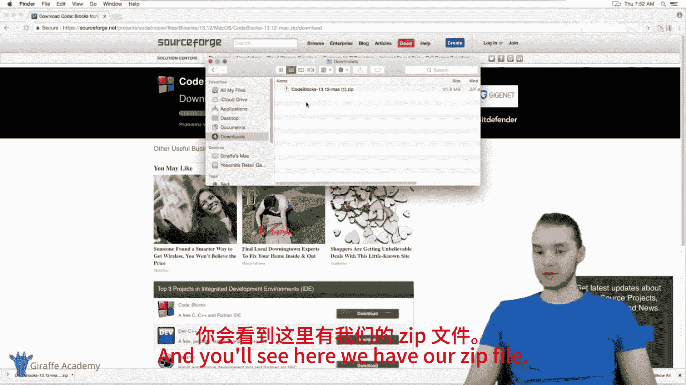
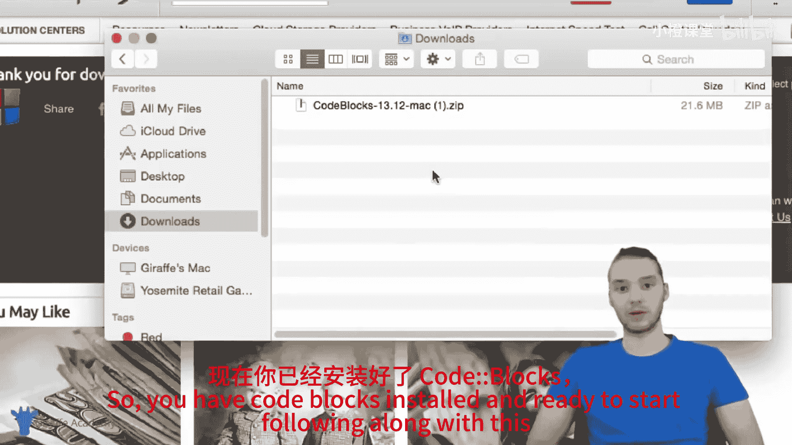

# 【油管千万订阅 freeCodeCamp】面向C语言编程初学者教程 Tutorial for Beginners in C Programmin（中英双语字幕） p03 C编程初学者教程第三节：Mac设置 -BV1ug4wzBEhT_p3-

In this tutorial I'm gonna to talk to you guys about getting everything set up to start programming in C on OSX。

 So if you're using a Mac， then this video will basically show you how to get everything set up in order to start working with C we're actually going need two things The first thing we're going to need is a text editor and basically we're going to use the text editor to write our C programs in and you can use any text editor that you want to write C programs。

 but there's actually a special type of text editor which is called an IDE and it stands for integrated development environment and it's basically a special environment where we can go to write and run and manage our C programs So that's the first thing the second thing we're going to need is what's called a C compiler Now C is a programming language So essentially what we're doing when we're using it is we're writing instructions for the computer。

😊，But in C， we're writing instructions that us humans can understand and work with。

 but in order for the computer to be able to carry them out。

 they have to be compiled or translated or transformed into a language that the computer can understand and that's what the C compiler is going to do。

 It's going to take our C programs and essentially just translate them into a language that the computer can understand。

 So the first thing I'm going to do is show you guys how to install that compiler and then we'll get a text editor So what you want to do on your Mac is go over to the search bar and you're just going to type in terminal。

And click enter and a window that looks like this should pop up。

 Now the terminal is basically a program that allows us to interact with the computer using text commands。

 So we're actually gonna need to use the terminal in order to do what we want to do So first thing we want to do is check to see if you might already have a C compiler installed So in certain circumstances you might already have one So you just want to type in CC hyphen V and clickent and you'll see over here I have a C compiler installed So I'm getting all of this information you can see over here it says like C lay and it's giving me you a bunch of information。

If you have that， then you have your C compiler installed and you're ready to go。

 But if you don't have that I'm going to show you guys how to get it。

 So all you want to do is just type in Xcode， select。

 and then the space hyphen hyphen installed and click enter and you'll see I'm getting an error here because I already have these command line tools installed but if you don't already have them installed and obviously then you wouldn't have that C compiler。

 then this is going to go off and install everything you need to get that C compiler working。

 So once you run that Xcode select command just type in CC hyphen V again and you should be getting this version number。

Alright， so now that we have our C compiler installed， what we want to do is download an IDE。

 so we want to download a special text editor that we can use to write our C programs in。

 So I'm going to go over here to my web browser and I'm up here at a website called Codeblocks。

 org and this is an IDdeE called code blockslock It's one of the most popular free IDs for programming and C So we're just going to come down here to this downloads link。

And there should be a few options here。 Down the binary release。 Down the source code。

 We're going to click download the binary release。And you'll see down here we have a bunch of options for Windows Linux and Mac。

 click the Mac option。 And if we come down here， you'll see that here is what we need to install code blockslock on Mac。

 So if you go over to the right side here， there's a link to sourceforge where we can download it。

 So just click that link and it should start downloading automatically When that finishes downloading。

 let's head over to our downloads folder and you'll see here we have our zip file。

 So I'm just gonna double click on this。

And this should give us code blocks Now all you want to do is just drag and drop code blocks into your applications folder and you're ready to go so you have code blocks installed and ready to start following along with this course and writing some awesome C programs。

Yeah。