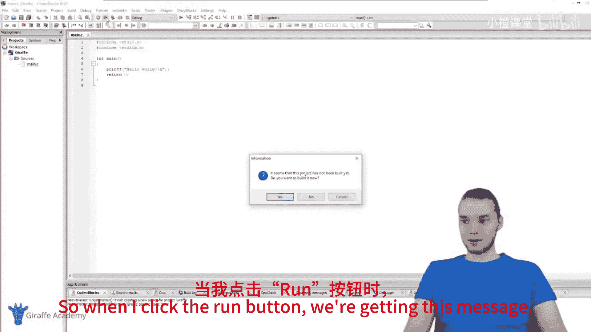
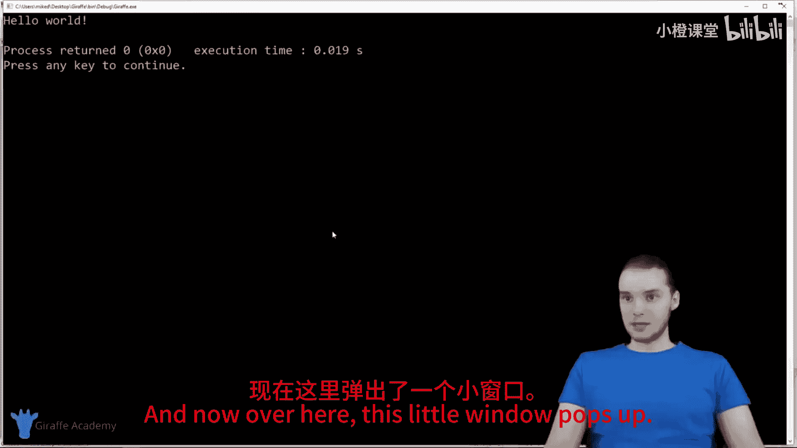
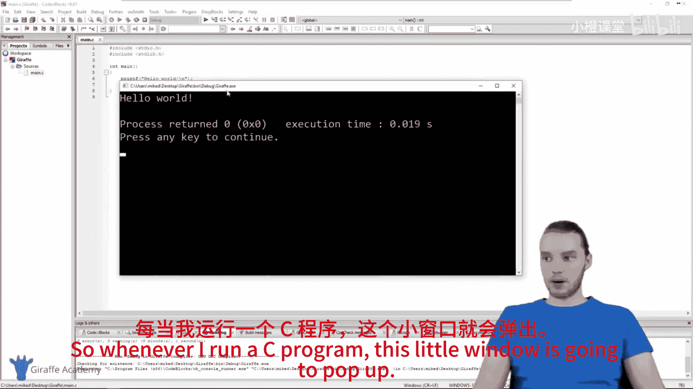
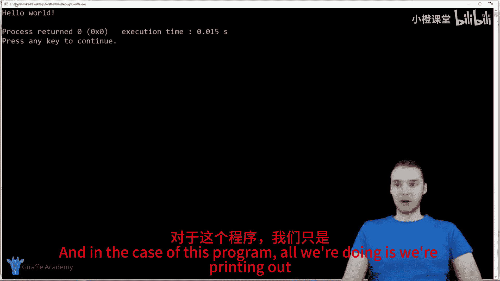
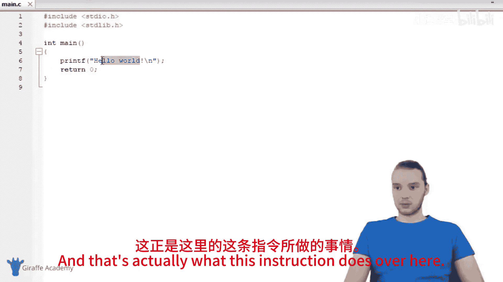
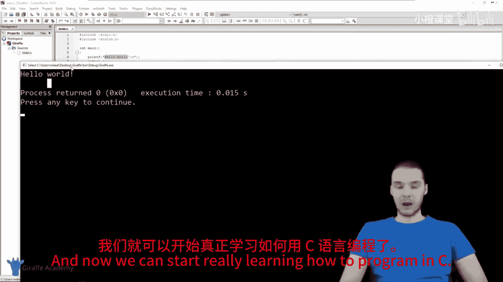
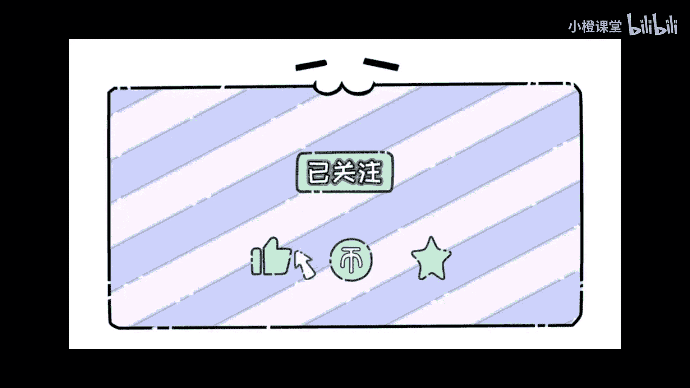

# 【油管千万订阅 freeCodeCamp】面向C语言编程初学者教程 Tutorial for Beginners in C Programmin（中英双语字幕） p04 C编程初学者教程第四节：Hello World -BV1ug4wzBEhT_p4-

In this tutorial， I'm going to talk to you guys about getting our first C file set up。

 so we're gonna to load up a C file and we're gonna be able to get everything working and test out our program。

 So I'm going to open up my code blocks program。 And this is the ID that I'm gonna be using for the rest of this course。

 So I'm just gonna double click on it and it should start opening once we have code blocks open。

 you'll see over here， there's a bunch of different options， like create a new project。

 open an existing project。 So we're actually going want to create a new project。

 whenever we're gonna start writing some C files， we're gonna want to create a new project in code blocks。

 So you can either click this button right here or you can go up to file new and project。

 So either way it's going bring you to this window over here and there's gonna be a bunch of options here basically these are different types of like C projects that we could create what we're gonna be doing is creating a console application。

 This is like just a basic C project that you could run on your computer。

 That's exactly what we need。 So click on。😊，Cons application and then click go and I'm just gonna click through this wizard and you'll see over here it says C plus plus or C。

 Now C and C plus plus are both different programming languages for this course。

 we're going to be working with C so just highlight C and click next and we're going give this a title I'm just gonna call mine draft and we're gonna to have to put this project inside of a folder So I'm going to open this up and I'm just going to put this on my desktop So let's click okay。

And click next and you can leave all of these options as the default and we'll click finish。

 So now what we should have is our first C project in code blocks。

 Now over here inside this little file Explorer you'll notice that draft is right here。

 So that was the name of the project that I just created down here we have this source folder。

 So I'm going click down and you'll see we have this file here called main do C。

 And this is a file that got automatically created for us by code blocks。

 I'm just going right click and open it。 and you'll see over here we have some default code。

 So up here there's these little lines of code that say include down here， this says int main。

 So this is the program that were given by default when we created our C project。

 and this is sort of like the simplest C program that you can write essentially what this program does is it prints out hello world onto the screen So in order to run this program and test it and make sure that everything's working。

 I'm going come up here and you'll see that there's this green play button over here。😊。

Sa run when I hover over it。 When I click this button， this file that we have open right here。

 main dot C is gonna get run。 So we're essentially telling code blocks to run this file and execute the program。

 So when I click the run button， we're getting this message it says the project hasn't been built yet。

 Do you want to build it click yes and now over here， this little window pops up。

 basically this is the command prompt。 So whenever I run a C program。

 this little window is gonna pop up。 So if I was to exit out of this and run this program again。

You'll see this window pops up again and it basically just executes the program and in the case of this program。

 all we're doing is we're printing out Hello world onto the screen。

 And that's actually what this instruction does over here。 when we open up this command prompt。

 it's essentially just executing the program and it's printing out whatever we told it to print out。

 So it's printing out hellello world over here。 and printing something out onto the screen is really easy。

 And that's one instruction that we can give to the computer。 But as we go through this course。

 we're gonna to learn all sorts of instructions that we can use。

 But the purpose of this tutorial was just to get our C project set up and to test our main do C file。

 So as long as everything works here and you're good to go and now we can start really learning how to program in C。

😊。

。