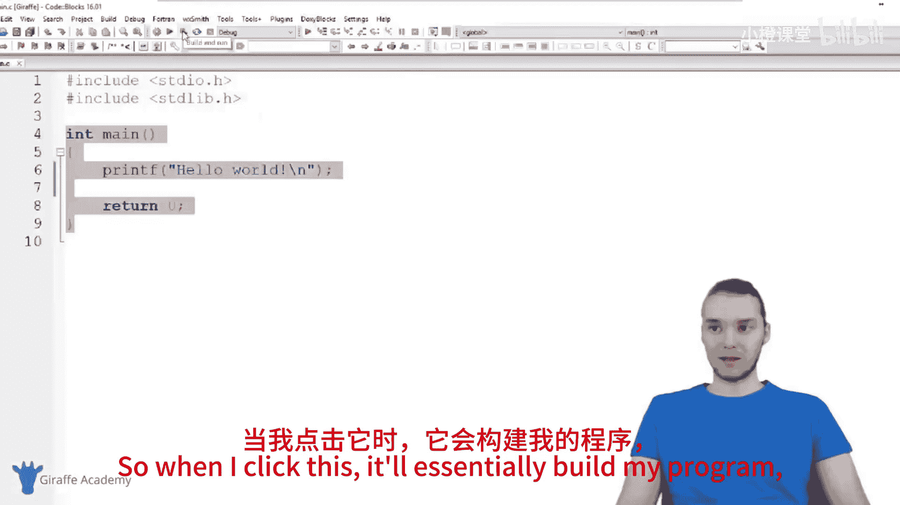
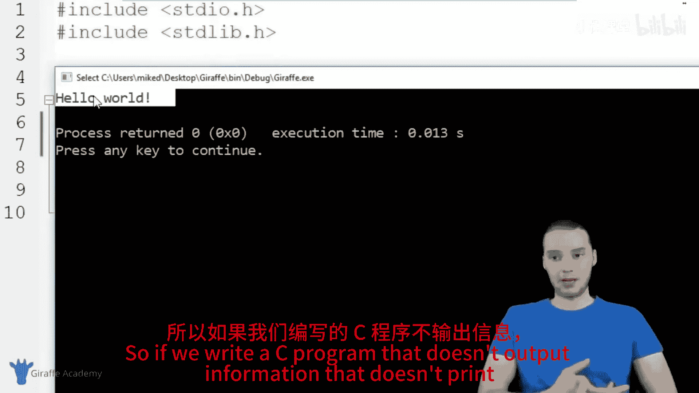
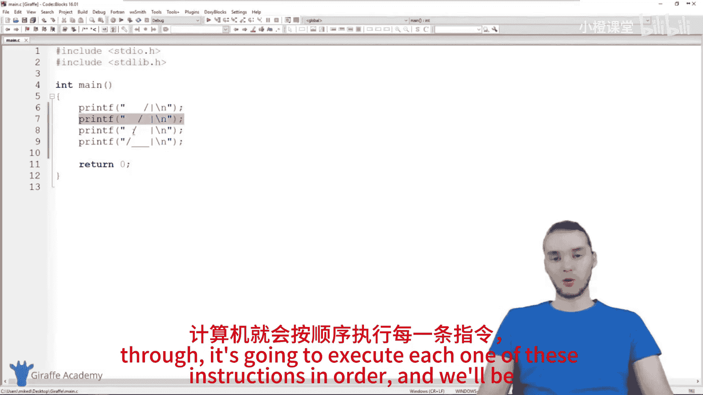
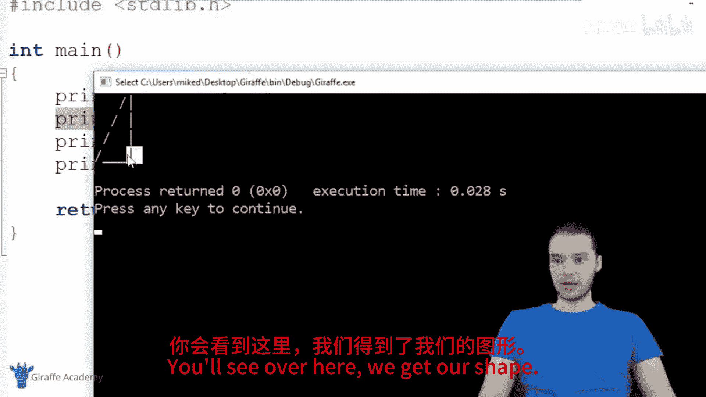
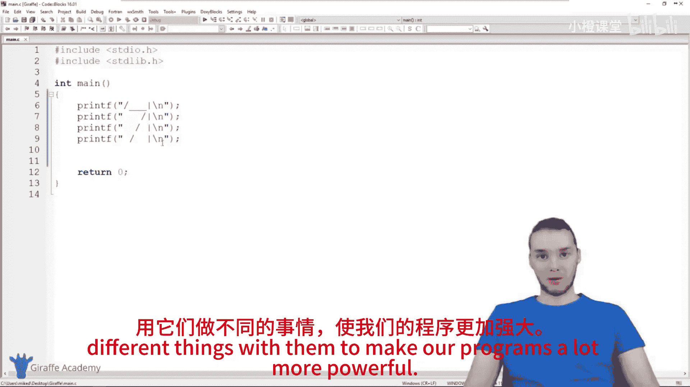

# 【油管千万订阅 freeCodeCamp】面向C语言编程初学者教程 Tutorial for Beginners in C Programmin（中英双语字幕） p05 C编程初学者教程第五节：绘制形状 -BV1ug4wzBEhT_p5-

In this tutorial I'm gonna to talk to you guys about the basics of writing a program in C。

 So if you've been following along with the course up to this point， we've installed a tech editor。

 we've installed a C compiler and we set up our first C program and our first C project inside of code blockslock So now essentially what we have is this file over here。

 This is that main C file I just kind of want to point out a couple things that are in here。

 first up here we have these little instructions which are just called include and I'm not going to get too much into what those do in this tutorial later on in the course we're going to talk about what these are actually doing and the specifics of how they're helping our program but for now just know that in order for us to use our program we're going to need to have these guys up there。

 Next thing we have is this little block of code called main and it just has this name main you can see there's an open andcloed parentheses。

 and this is actually what's called a method and don't worry too much about what methods are。

We're going to again， we're going to talk more about those in future。

 but essentially a method is just like a container where we can put some of our code。

And this method main is very important because this is the method that's going to get executed when we run our program。

 So in C， we can actually write out a bunch of instructions for the computer。

 and then we can run our program。 So we can tell the computer to execute those program。

 And whenever the computer executes our C program， it's going to look inside of this main method。

 In other words， it's going look inside of all the code inside of these open and closed curly brackets。

 and it's going to execute that code。 So I have this instruction here， it's called print F。

 And basically this is just printing out some text onto the screen。 when we run our program。

 it's going to come into this main method， and it's going to execute all the instructions inside of here。

 namely this print F method。 So if I was to run my program， then this is going to work。

 Now let's talk about actually running a program。 whenever we want to run a program that we write in C。

 we actually have to do two things。 The first thing we have to do is what's called building a program or compiling。

😊，basically what that does is it takes all of this C code and it translates it into a language that the computer is gonna be able to understand and execute。

 So it's essentially taking this C program codelating it into computer code and then the computer can execute it and run our program So the first thing you have to do is always build our C file。

 the second thing we have to do is run the file that gets built So once we've built this program。

 we've compiled it down into code， the computer can understand we have to run it basically tell the computer to execute that code。

 and in code blocks， it's actually really easy to do this。

 So we can come over here and this little gear icon will allow us to build our program and then this play button will allow us to run our program But a lot of times when you're programming。

 you're gonna to want to build and run your code at the same time you're just going want to build it and run it just to see what happened see how your program did So we have this option over here called build and run and this will both build your program。

And run it at the same time。 So generally as you're going through this course。

 you're going want to be using this option， this build and run option。 So when I click this。

 it'll essentially build my program run it and then it'll show up here on this little window and this little window is basically a console window you can call it So a lot of people would refer to this as the console。

And it'll just like output any information that we tell it to。

 So if we write a C program that doesn't output information that doesn't print anything to the screen。

 then we wouldn't actually see this。 But since we're using this print F command that window is gonna pop up So let's talk about how these programs actually get executed。

 essentially when we write a program we have a set of instructions So when I'm writing a C program。

 I'm basically writing out a set of instructions Imagine you were writing like a recipe or something a recipe is essentially just a set of instructions that when executed correctly will result in cooking or baking something delicious and that's basically what these C programs are。

 it's a set of instructions that when executed correctly will result in the computer doing something for us And one of the cool things about computers is that we can program them to do anything and C is one of the best languages to do that with So let's look at this instruction over here it's called print F and like I said。

 this prints something out。

Onto the screen but you'll notice over here at the end we have this semicolon and this semicolon is actually really important so whenever we write an instruction in C。

 we always want to end it off with the semicolon that tells C that we're done with that instruction and we want to move on to the next one so I could actually copy this instruction and I could paste it down here。

And now we're basically going be executing this instruction twice。

 So if I was to run and build my program， you'll see that we're not only printing it out once。

 but we're also printing it out twice。 So when we run our program。

 the program comes down into this main method and it looks at all the instructions inside of it。

 So it starts with this first instruction。 It executes it So it prints out hello world onto the screen and then it also prints out a new line。

 So this backlash n is like a new line character and that'll move the text onto a new line。

 when it's done with this instruction， it moves on the next instruction and it'll execute that instruction。

 So as we go forward and we learn how to write and C。

 we're gonna to learn more and more complex instruction。

 and we'll be able to use all those instructions in conjunction with each other to specify some seriously complex programs。

 But for now， this is really the only instruction that we know， which is print F。

 So why don't we use this print F instruction in order to draw out a little shape onto the screen。

 So I'm gonna show you guys how we can。😊，Draw out like a little triangle onto the screen。

I'm going to take this print F， and I'm actually just going to get rid of Hello world。

 and I'm going to copy this a couple times， so I'm just going to copy it and we'll paste it down here maybe four times。

And what I can do is I can specify instructions to the computer that will tell it to draw out a particular shape。

 So down here I can make like a forward slash and over here we'll make another one。

And I'll make another one and I'll make another one。

 And you can see here I've drawn like a little diagonal line with these forward slashes。

 Now I'm going to draw vertical bars going all the way down。 So I'm going to put one here。

I'm going to put one here。I'll put one here and finally。

 why don't we draw some underscores and then we'll put one。

 So I'm basically drawing out a little triangle shape。

 And these backslash ends are just printing out a new line。

 So anytime I print this it's gonna move it onto a new line so it'll print this guy out now on the line down the line below。

 So I was to save my program and execute it。 Now the computer is gonna to go through。

 it's gonna execute each one of these instructions in order and we'll be able to print out the shape onto the screen。

 let's do that。 you'll see over here we get our shape。

 And one thing I really want to stress is that order matters。

 So if I took this instruction and I placed it up here as the first instruction now this is gonna get printed out first So when I run my program。

 you'll see that we're printing out this kind of funky looking shape and that's because we changed up the order of the instruction So the computer changed the order in which it executed those instructions and you'll notice here again。

 we're using this semicollon。

After each line of code so that's kind of the basics of writing a program that's essentially all you need to know when we're writing a program。

 we're specifying a list of instructions that we want the computer to carry out and depending on which instructions we give the computer and which order we give them and how complex the instructions are。

 that'll determine what the program does and as we go through this course。

 we're going to learn more and more complex instructions。

 we're also going to learn how we can take simple instructions like print F and do different things with them to make our programs a lot more。

。