# 【油管千万订阅 freeCodeCamp】面向C语言编程初学者教程 Tutorial for Beginners in C Programmin（中英双语字幕） p06 C编程初学者教程第六节：变量 -BV1ug4wzBEhT_p6-

In this tutorial I want to talk to you guys about variables in C Now when we're using C programming language。

 a lot of times we're gonna to be dealing with data so there's gonna be different data values or different information that we're gonna want to keep track of and use inside of our programs and sometimes it can be difficult to maintain and keep track of all that data and that's where variables come in a variable is essentially a container where we can store different pieces of information so different data values we could sort things like numbers or text or characters and these variables make it a lot easier for us to keep track of and manage all the data in our program So I'm gonna to show you guys basically how variables can be useful and how we can use them in our C programs So down here I have a very basic program I'm basically just printing out a little story It says there once was a man named George He was 70 years old he really liked the name George but did not like。

70。 So this is a simple program we're just printing out a bunch of different lines of text。

 And then when I run this program， you'll see we print out the actual story。 So over here。

 we have our story。 And this is great。 But let's say that I'm reading through my story。

 I'm reading through my program。 and I'm thinking to myself I think I want to change the character's name。

 So instead of calling the character George， why don't we call him like John。

 in order to make that change， I'm gonna have to look through my entire program and find every place where we mention the character's name。

 So right here is one， change it to John， have to keep looking and here's another one so we'll change this to John。

 right So I had to manually go through and change every instance of the character's name to John。

 And let's say that okay， that sounds pretty good。 but maybe I'm thinking I want to make the character a little bit younger。

 So instead of 70， why don't we make him 35。 So now again。

 I'm gonna have to look through my entire program， find every place where we mention the character's age and change it to。

😊。

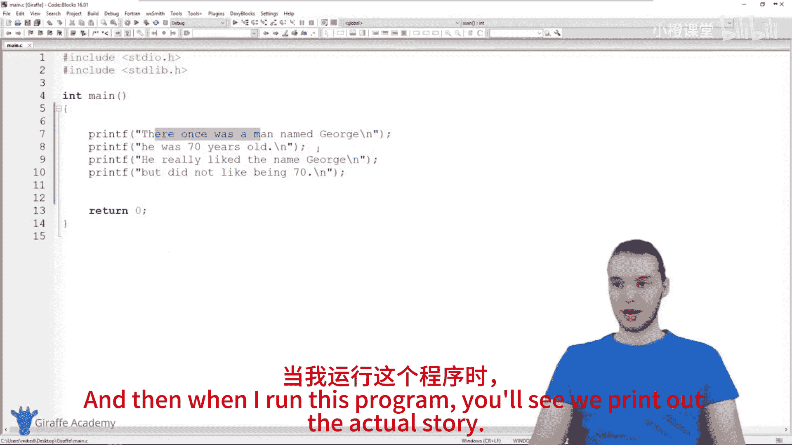

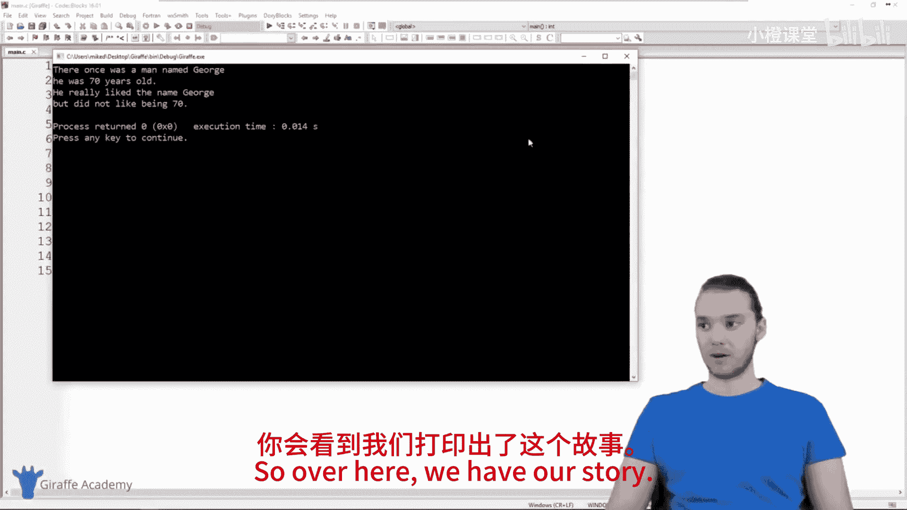

35。So there and there there you go。 I changed the program。 I updated and I modified it。 Now。

 if I was to run this program， then all that information will be updated and we'll have our new story。

 Here's the problem， though， I'm dealing with a very short story。 I mean， this is four lines。

 we only mentioned the character's age and name twice。

 But imagine if I was writing out a huge C program that had hundreds of lines in this story。

 So this story had hundreds of lines。 and maybe we mentioned the character's name hundreds of times。

 we mentioned their age hundreds of times。 Well， if I wanted to change the character's age or name。

 I would have to go through and manually change it in every single location。 that would take forever。

 and it would be a huge drag。 Basically， that's not a good way for us to manage and maintain the data in our programs。

 we basically have two pieces of data that we're working with consistently in this program and the character's age and the character's name。

What I want to show you guys now is how we can use variables to better keep track of and manage these pieces of information。

So remember a variable is basically just a container where we can store some data。

 so I want to create two variables which will store the character's name and the character's age。

 and I'll show you guys how this can make our program a lot easier to manage up here above these print statements。

 I'm just going make a new line and I'm going to come over here and I want to create a variable Now whenever we create a variable in C we have to give C a couple pieces of information So we have to basically tell C a couple different things。

 the first thing we have to tell C is what type of information we want this variable to store Now I'm going to get into the different data types that we can represent and C more in the next tutorial。

 but for now just know that there's a bunch of different types of data that we can store and C we can store things like numbers。

 characters we can store text we can store decimal numbers all sorts of stuff like that In our case。

 I'm going to store the characters's name and the characters's name is basically just a collection of characters。

😊，So in order to create this variable， the first thing I have to do is tell C that I want to create a variable that's going to store characters。

 so to do that I'm just going to type out Charr just like that。And that'll basically tell， see， hey。

 we're going to store characters inside of this variable。 After we type out char。

 I want to type out the name of the variable that I want to create。 Remember。

 a variable is a container， and it's a good idea to give these containers descriptive names。

 And those names will basically let us know what that variable is storing inside of it。

 So I'm going to call this。😊，Character name。 And now what I want to do is I basically want to store multiple characters。

 So over here， I'm telling C that I want to store a character。 but in C。

 we can also store instead of just storing like one single character。

 we can store a bunch of characters。 And that would be kind of like you know， a name。

 So there's like four characters in here。 in order to store a bunch of characters inside of this variable。

 after we type the character the variables name， we're gonna have to make an open andclos square bracket。

 and that's going to tell C that we want to store a bunch of characters inside this variable。

 So I'm going to type char character name， open and closed square brackets。

 I'm going to set this equal to something。 So I'm essentially assigning a value to this variable。

 And I'm just going make an open andclosed quotation marks and inside of here。

 we're gonna type out the value that we want to store。 So in my case。

 I'm just going store the characters's name， which is John。 And then as always in C。

 we're gonna to have to end this off with a semicolon。😊，All right。

 so essentially what I did here was I created a variable and I told C what I wanted to store in the variable。

 I wanted to store a character， I gave this variable a name， it was character name。

And I used these open and closed square brackets to sell C that I wanted to store a bunch of characters。

 not just one。Now what we can do is we can make another variable to store the characters's age。

 So in this case， we're going to want to do something similar。

 but we're going to want to store a number。 There's a bunch of different ways that we can store numbers and C。

 but for our purposes， we're storing a name。 So we're going to use something called an integer and an integer is basically just a whole number。

 So I'm just going to type out INt。 and that basically stands for integer and now we're going to give this a name。

 So I'm going to call this。Character age。 And I'm going to set this equal to a number。

 So in our story， the character is 35。 So I'm just gonna type out 35。

 And now we can again end this off with the semicolon。 So I have two variables here。

 This one storing a collection of characters。 This one storing an integer。 Now， the question becomes。

 how can we use these inside of our program。 Well， basically。

 what we can do is we can print them out alongside of this text。

 and we can actually use this print F instruction in order to do that。

 So I'm going to show you guys how to do this。 And then we're going to talk about it。 So basically。

 I'm going go over here where we have the characters's name。 I'm going to erase this。

 And I'm going to replace it with a percent sign and an S。 And now over here， I'm going make a comma。

😊，And I'm just going to type in the variable name。 So I'm going to type in。Character name。

And basically what's happening is when we use this percent S。

 we're telling C that inside of this string of text here。

 we're going to want to insert another string and a string is basically just a collection of characters so I could call this up here a string variable。

 So when I say percent S， this is basically a placeholder and I'm telling C I'm going to insert a string into here。

And over here， I use this comma and then I type out the string that I want to include。

 So in our case， it's character name。 And so basically over here。

 it's going to say there once was a man named percent S。

 and it's going to replace percent S with whatever we specify over here。

 so it's going to replace percent S with the value that's stored inside that character name variable。

 So I'm going to save this and we'll run our program。

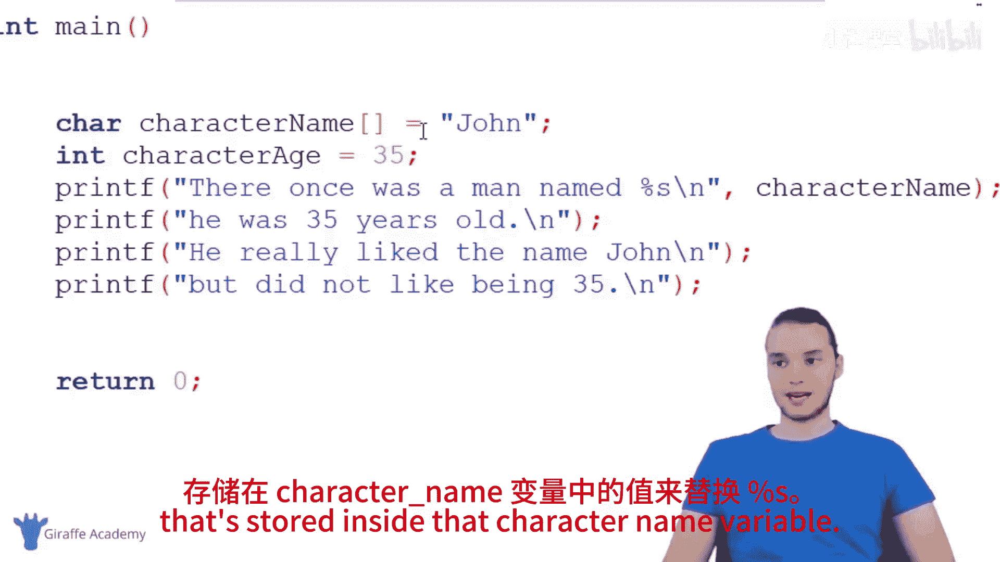

And now you'll see that it's still printing out that there once was a man named John。

 even though we didn't actually type out John over here。

 we just typed percent S in the character name。 So I can do this in this other spot， too。

 So down here， we're also using the character's name。 So I can type percent S。 and over here。

 we can type。

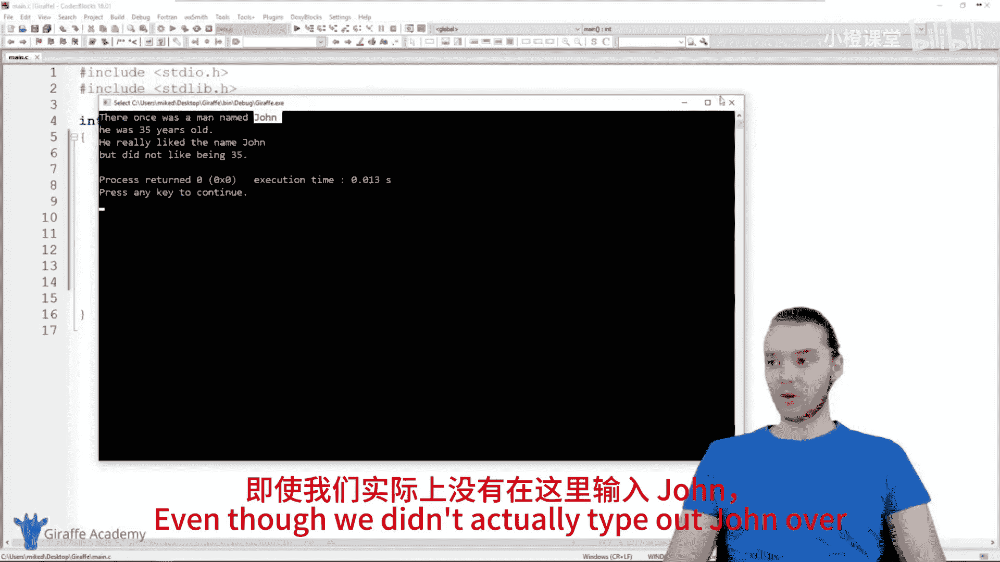

Character name。 And again， this is going to act as a placeholder for this string of characters that we specify over here。

 Let's do the same thing with the age。 So over here we have the age is 35。

 I'm going to do something similar， I'm going say percent。

 but now because I have a number instead of using percent S。

 I'm going to use percent D And that basically means that we're going insert an integer number into here。

 So I'm saying he was percent D years old and over here I'm going to make a comma and I'm just going type out the name of the variable that I want to be placed inside of here。

 So I'm just going to be。😊，Character age。 and we're going to do this one more time down here。

 I'm going to type percent D and。Character age。 So essentially。

 what I'm doing is I'm printing out the value that's inside of character age where I specify this placeholders。

 So let's go ahead and run our program。 And now you'll see it's gonna to look exactly the same as it did before。

 It's the same story， the same name and the same age。

 except I didn't have to actually type out the character's age and the character's name inside the story。

 I just referred to the variable。 And what's cool about variables is is I could come up here。

 And let's say I wanted to modify the character's age。😊。

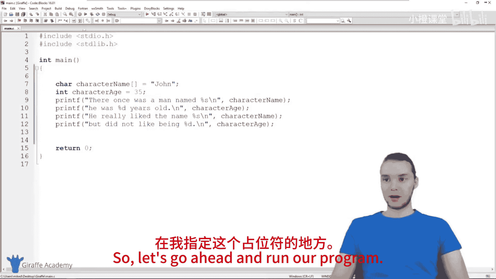

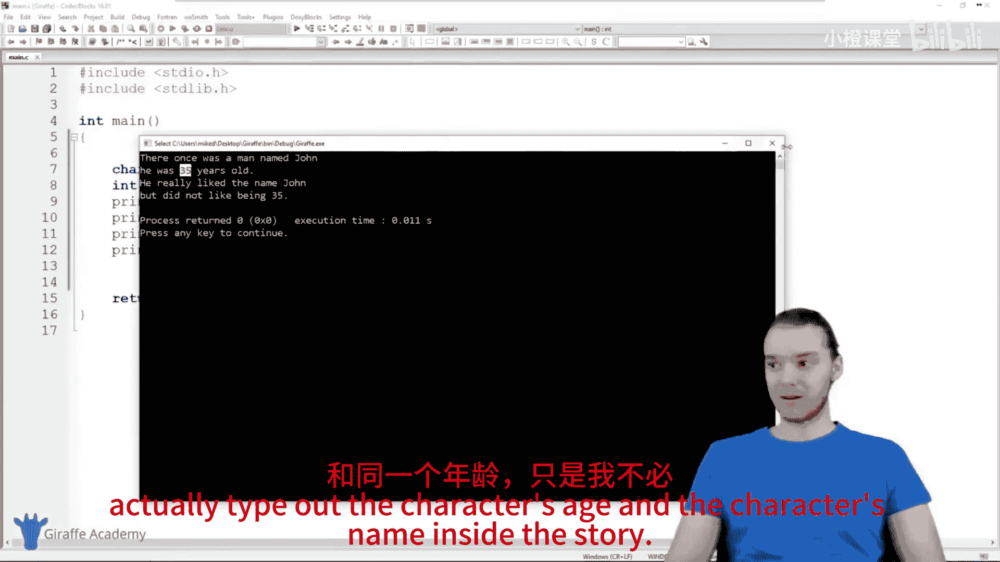

All I would have to do is modify it in this one spot。

 So we could change the characters's8 name to like Tom。

 And we could also change their age to like 67。 And now when I run my program。

 all of that's gonna to get updated in the story。 So now it's using the name Tom and the age of 67。

 In our case， we only mention the character's name in the characters' age a couple times。

 But you can imagine if I was mentioning this variable like 10 or 20 or 30 times。

 having to change it in each one of those individual spots would be extremely difficult。

 So variables are great because we can store the value one time。 And then if we want to modify it。

 we just modify it in one place。 So another cool thing that we can do with these variables is we can actually modify them。

 So let's say that halfway through the story， I wanted to change the characters's age。

 I could actually come down here， I can make a new line。 And right above these print statements。

 I could give this variable a new value。 So I could say。😊。

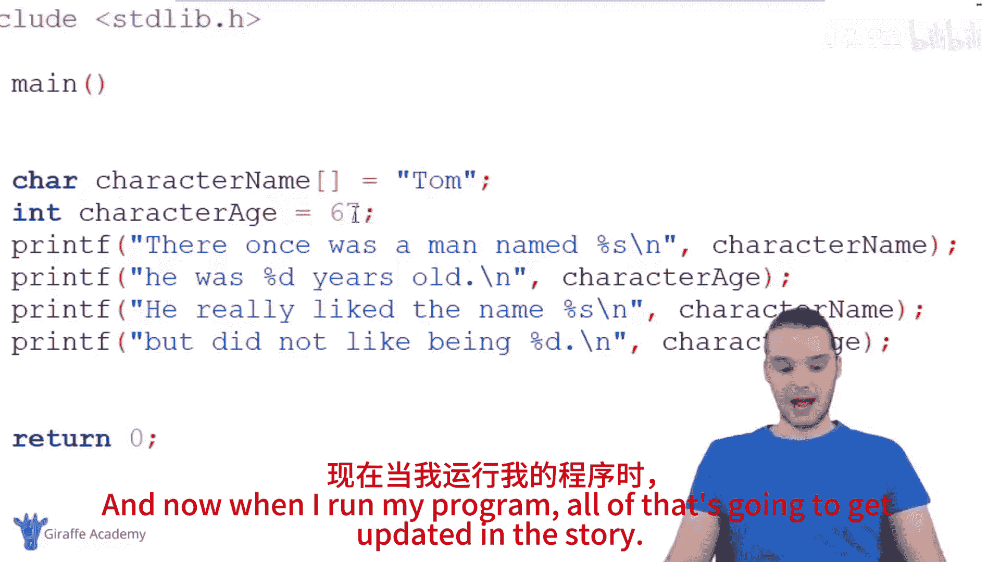

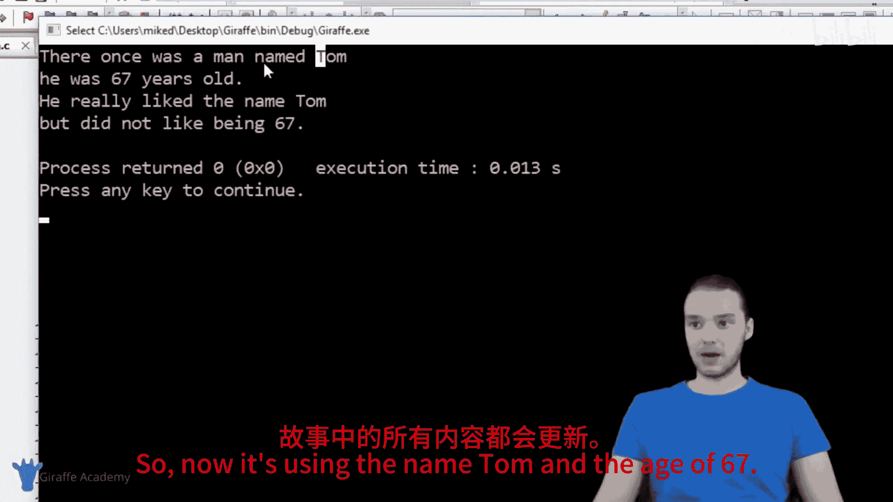

Character age。 and I can just set it equal to something else。 So we can set it equal to like 30。

 And again， we want to include that semicolon。 So now halfway through the story。

 the character's age is actually going change。 So you'll see it says there once there' a man named Tom He was 67。

 And then down here， the age is being 30。 So we actually modify the value that was stored inside of the variable halfway through printing out our story。

 And that's really why variables are useful。 So that's kind of a basic overview and introduction into what variables are why they're useful。

 how we can use them。 And over here again， we're storing a collection of characters。

 which is called a string and we're also storing this integer。

 But there's some other data types that we can also represent。

 So in addition to representing like a string or a number， we can do some other stuff as well。

 And I'm gonna to talk about that in the next video。 But for now。

 this has just been a basic overview and introduction into variables in C。😊。

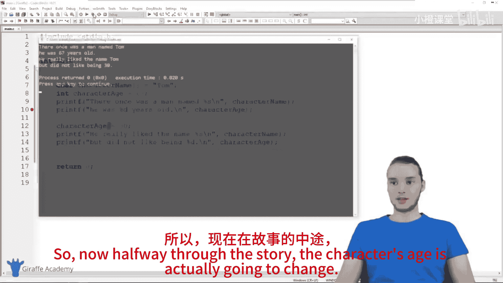

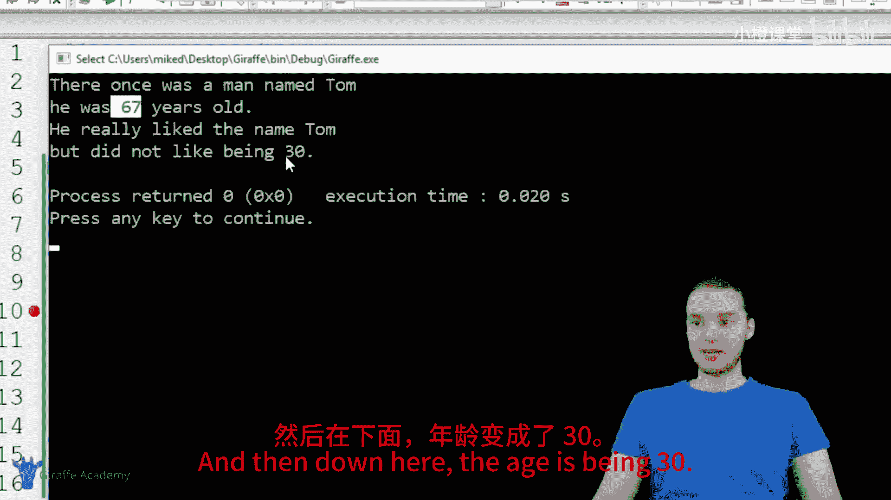

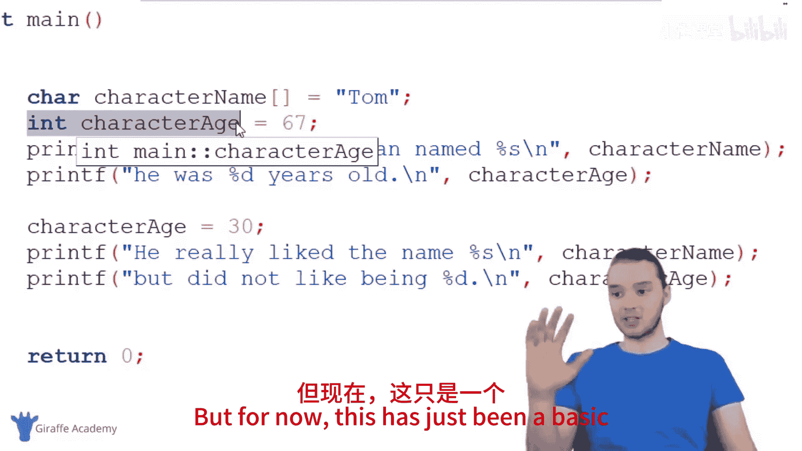

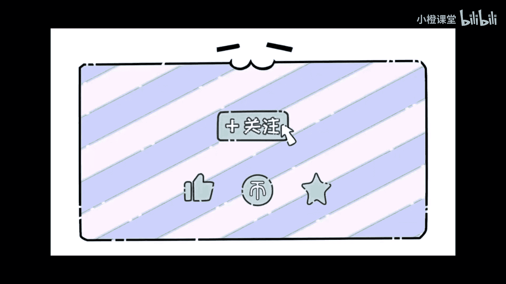

。