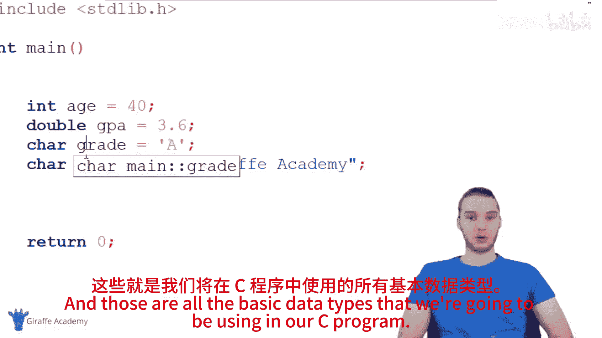
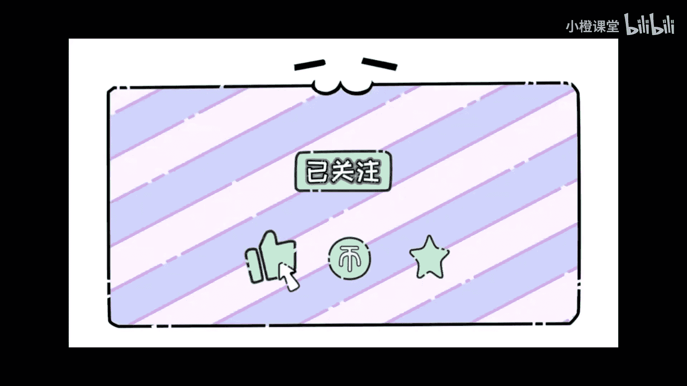

# 【油管千万订阅 freeCodeCamp】面向C语言编程初学者教程 Tutorial for Beginners in C Programmin（中英双语字幕） p07 C编程初学者教程第七节：数据类型 -BV1ug4wzBEhT_p7-

This tutorial I want to talk to you guys about data types in the C Now in the C programming language we're gonna to be dealing with a lot of data so generally when you're writing programs you're going to be dealing with all sorts of information and in this tutorial I just want to talk to you guys about what types of information we can represent and use inside of our C program and these are called data types so what are the different types of data that we can work with in our programs so I'm going show you guys all those different data types right now So a lot of times in C when we're working with data we're going to be storing that data inside of variables so I'm just going show you guys a bunch of different variables that we can create and all the different types of data that we can store inside of those variables。

So remember whenever we create a variable in C， we have to tell C a couple pieces of information and the first piece of information we need to tell C is what type of data that we want to store inside of that container inside of that variable So let's talk about the different types of data one of the most basic types of data and probably one of the types of data you're going to be using the most。

 it's gonna to be numbers and there's actually two very important types of numbers that we can represent in C So the first type is called an integer and an integer is basically a whole numbers so it's a counting number right if I was counting on my fingers 1。

2，3，4，5 I'm just counting out whole numbers and I'm not saying like one1 and a half to 2。

3 like I'm counting in whole numbers and that's what an integer is so to create an integer we could just say int and we'll give this a name so we could say like age and we could set age equal to like 40 or something。

Now whenever we want to use an integer in C， we always just want to type out the number。

 so you'll notice I'm not putting quotation marks or parentheses or anything around this。

 I'm just typing out the number like that and now we actually have our variable age。

Another type of number we can create is a decimal number。

 So this would be a number unlike an integer。 So it would be like 2。5 or 8。67 or 7。

538 it's a number that has a decimal point associated to it。

 So there's actually two types of decimal numbers in C。

 there's something called a double and there's something called a float。

 and I'm not going get too much into the difference between the two of them。

 but as a beginner to see for the most part， you're just going want to use a double。

 So I'm just gonna to type out double and this could be like someone's GP， for example。

 it might be like a 3。7 or whatever。 So you know you can use the double to represent decimal numbers It's also important to note that I could also represent like the number 3 So I could just say like 3。

0 and that's gonna be a decimal or I could say 40。0 So the difference between 40 and 40。0 is that 40。

0 is a double It's a decimal number and 40 without the decimal。Point is an integer。

 So that's something just to keep in mind。 so you can make this like 3。

6 So those are the two basic types of numbers， integers and doubles and those are gonna come in handy all the time。

 Now the next type of data that we're going want to store or is gonna be characters。 So in C。

 we can store single characters inside of a variable。

 So I could just say C AR and that stands for character and we could give this a value So maybe it would be like someone's grade and when we create a character in C we're basically going to specify the character that we want to store inside of single quotation marks。

 So inside of the single quotation marks， I could put a letter， I could put like A or lowercase A。

 we could put H C D basically you can put any character that you want to store。

 So if I put an A here Now this character variable grade is going store the single character A inside of it。

 And it's important to note that you can only store one character So I couldn't put like a whole bunch of characters over here that's actually going to throw。

😊，Arror all we can do is store one single character。 But these three are the basic data types in C。

 So these are the basic types of information that we can deal with in our C programs。

 And just using these three data types。 We can represent all sorts of information。

 I also want to talk to you guys about one sort of extra data type。

 And it's not technically a data type in C。 It's technically like a modification of the character data type。

So you notice when we create a character， we can only store one letter。

 one single character inside of it。 But a lot of times we're gonna to want to represent more than one character。

 So we're going want to represent like a string of characters。 and generally this is called a string。

 So it's a collection of characters that are grouped together。

 And we can use this char data type in order to create a string。 So I can basically say char。

 I can type out the name of the string that I want to create。 So I could say like phrase。

 And then after this， I can make an open andclo square brackets。

 And this is basically going to tell C that we want to string a bunch of characters together。

 And what we're actually doing is creating something called an array And I'm going to get into as later in the course。

 But just for now know that we can create a string of characters by using char specifying the name these open andclo square brackets。

 And then we can create this using two open encloed quotation marks。 So instead of these。😊。

Quotes up here。 we're just gonna use double quotes and I could type in like a phrase so I could type in whatever string of text I want here and this will get stored inside of this variable。

 which like I said， is technically called an array。

 Now it's important to note that doing something like this So creating this like string of characters is a little bit different from these guys up here So like these variables up here we could modify them。

 we could give them new values。 but you can't do stuff like that with this。

 So just know that this is like a special type of data and it's going to act a little bit differently than these ones up here。

 But that's sort of the basics of working with data and those are all the basic data types that we're gonna be using in our C program。

Yeah。