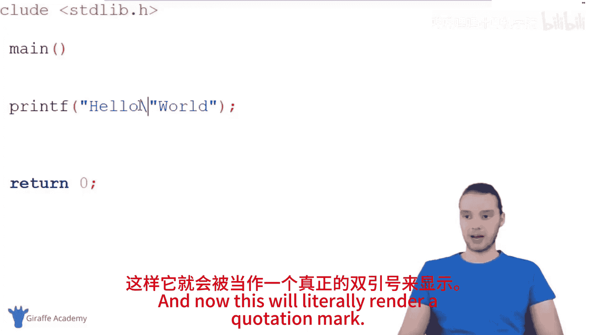
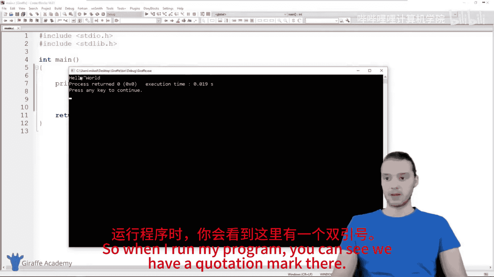
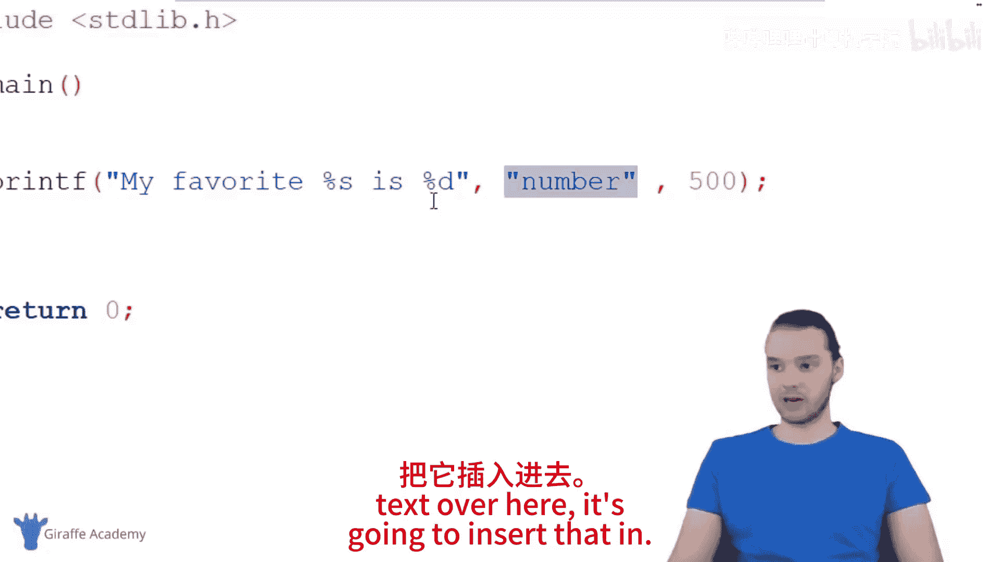
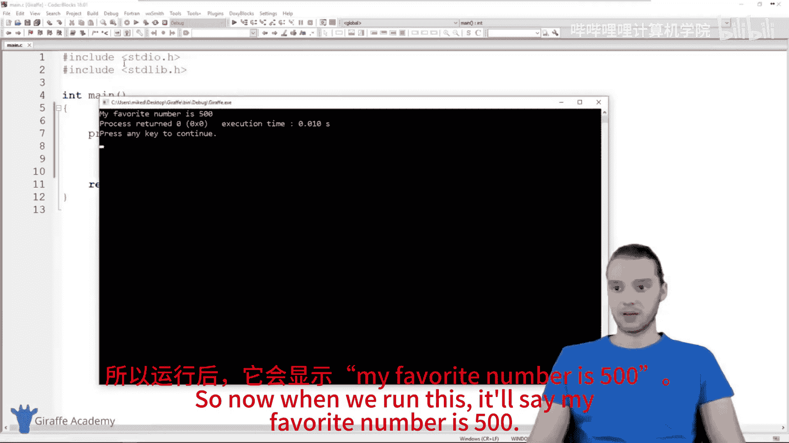
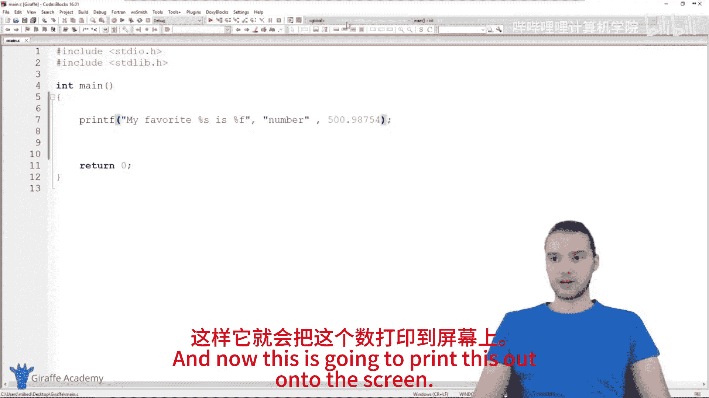
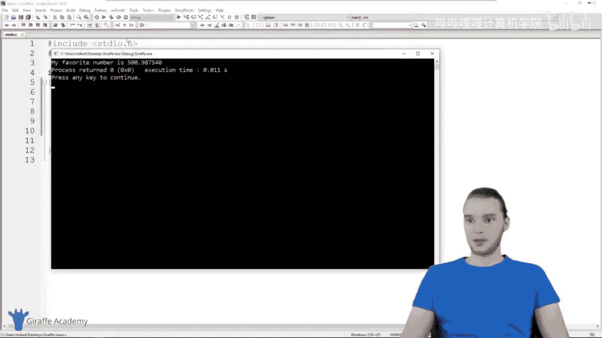
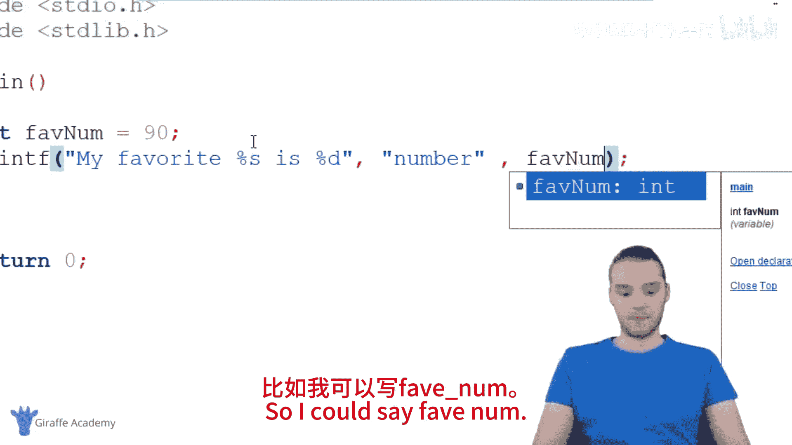
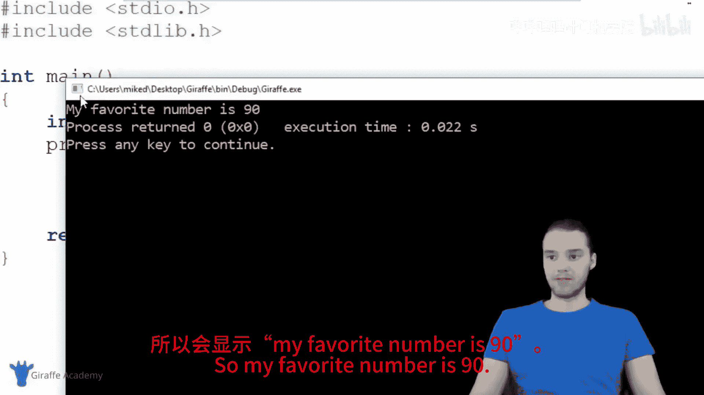
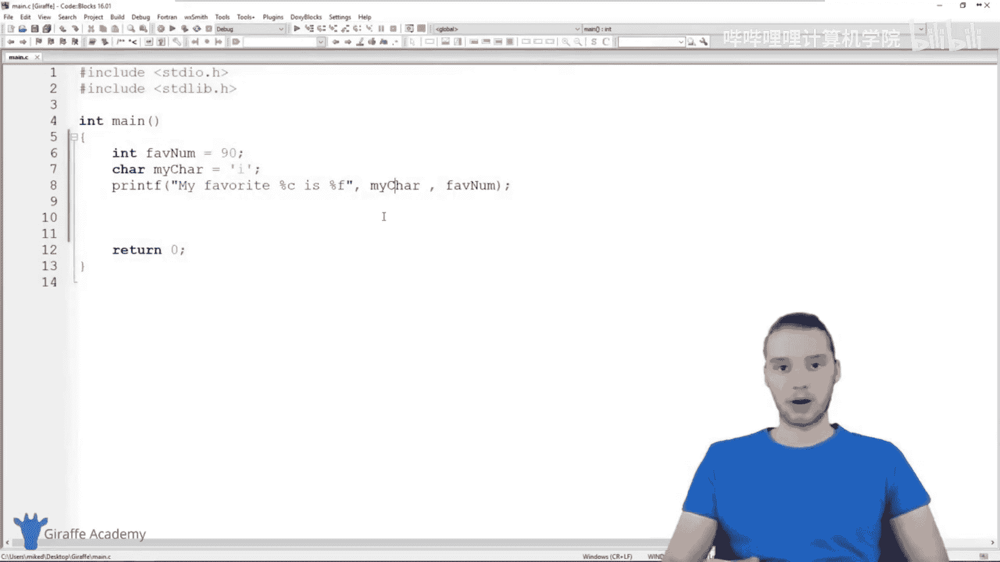

# 【油管千万订阅 freeCodeCamp】面向C语言编程初学者教程 Tutorial for Beginners in C Programmin（中英双语字幕） p08 C编程初学者教程第八节：printf -BV1ug4wzBEhT_p8-

In this tutorial I want to talk to you guys some more about the print F function。

 so if you've been following along with this tutorial。

 we've been using an instruction in our C programs called Pri F and print F basically allows us to print different things out onto the screen in this tutorial we're going to talk more about what print F does and we're going to look at how we can use it to print out things like variables and also things like different data like numbers and strings and all that stuff。

So in order to use print F we just type out PRI and TF。

 and we're going to make an open encloed parentheses and a semicolon。

 Now print F is what's called a function。 and basically what that means is it performs a specific task or a specific function In our case。

 print F just print something out onto the screen the task that it's doing is printing something out and it basically works how you'd expect it to work。

 So if I came in here， I could print out a specific piece of information and generally when we're using print F。

 we're going be printing out text so I can make an open enclosed quotation marks and I could print out like hello world in here and now this will print out onto the screen hello。

And inside of print F， I can use all sorts of special characters。

 so if I wanted to create a new line， for example， I can make a backslash n and down here I could type world and now this will print out a new line。

So you'll see hello world on different lines。We can also use these special characters so for example。

 I could print out like a quotation mark so if I just printed a normal quotation mark right here。

 you'll notice that it's messing this up so it's sort of like counting this as the entire string。

If I wanted to change that I could just put a backslash here and now this will literally render a quotation mark I when to run my program can see we have a quotation mark there and so that's kind of like the basic usage right you can specify some text that you want to print out onto the screen and it'll do it but this print F function is actually extremely powerful and we can use it to print out different pieces of information So in addition to just printing out plain text inside of these quotation marks。

 I could also print out other types of information For example。

 I could print out a number And if I wanted to print out a number。

 I would have to use something called a format specifier a format specifier basically tells this print f function that we want to print out a type of data that's not just plain text like this。

So if I said percent sign and then I said D， this would actually allow me to print out a number。

 So generally when we use these format specifiers， use this percent sign and that tells C that you're going want to print out something special and then after that。

 we would type in a specific letter and that'll tell C what exactly we want to print out。

 So if I said percent D， this means that we want to print out an integer。

 So all I have to do now is I can make a comm And over here。😊。

I can specify the integer that I want to print out。 So I could say like 500。

 And now this is gonna print out 500 to the screens。 you can see over here， we're getting 500。

 And this is cool because we can interweave these different types of data with text。

 So I can say like my。😊，Favorite number is。Percent D and this acts as a placeholder for this number over here。

 So when I run my program now it says my favorite number is 500， and that's really cool。

We can also use multiple format specifiers。 So in addition to just using this percent D。

 I could also specify another one。 So over here， I could say percent S。

 and you'll notice that this is structured similarly to percent D。

 percent S is basically going to allow us to include some text。

 So I could include some more text just like this。 So if I said percent S。

 I can make another comma here。 And I could say。Number。

And now this is going to print out my favorite percent S。

 So it's going to look for this string of text over here。

 It's going insert that in and it's gonna say 500。 So now when we run this it'll say my favorite number is 500 and you'll notice here that I'm using multiple commas So I'm saying like percent S percent D and over here I have a comma and I'm specifying this string that I want to print。

 So the string of characters and then the integer And so basically the order that you put these format specifiers inside of your string of text is the order that you need to include them using these commas。

 So you're gonna to separate each of them using a comma So in addition to percent S and percent D。

 we can also use a bunch of other ones。 and I'm going to talk to you guys about some of the most comm D will print out an integer like 500。

 but if we wanted to print out a decimal number， for example。

 a double we could say percent F and this is gonna to allow us to print out a decimal number So I can say like 500。

9875。

And now this is going to print this out onto the screen and actually， I need to build this。

So my favorite number is 500。987540。 So essentially you can use these print fs and you can use these format specifiers in order to include different data types into your output。

 So like this is just some general text output and we can use these different guys to interweave like numbers or you know other strings and stuff like that。

 And where these really become useful is when we have variable。

 So if I was to create like a number variable up here。

 I could call it like fave nu set it equal to 90。😊。

I can use this variable and print it out inside of this print F。

 So over here we could make this percent D。And instead of printing out this number。

 we can just access that variable。 So I could say fave nu。

 And this will allow me to print out that variable using that print F function。

 So my favorite number is 90。 So that's the basics of using print F。

 This is a very awesome tool that we can use。 And print F is basically just used for us to find out information。

 So when we're running our programs， a lot of times we're gonna want to be able to get some information about what's going on about what they're doing。

 And print F can allow us to do that。 So don't be afraid to use these different access modifiers。

 like I said， percent F percent percent F， those are all sort of the common ones。

 And you can also use percent C。 and this will allow you to print out a single character。

 So I can come over here， create like a character variable。😊。

We'll call it my cha and just set it equal to like lowercase I。

 And I could print this out using percent C。 So now we could say my cha。

 and you'll see that we print out I so。Play around with printnt F。

 it's extremely useful and it's really going to come in handy when we're writing more complex programs。

Oh。

