# 【油管千万订阅 freeCodeCamp】面向C语言编程初学者教程 Tutorial for Beginners in C Programmin（中英双语字幕） p09 C编程初学者教程第九节：使用数字 -BV1ug4wzBEhT_p9-

In this tutorial， I want to talk to you guys about working with numbers in C。

 Now a lot of times when we're writing programs in C。

 we're gonna want to do different things with numbers。

 whether that's just storing numbers and keeping track of them or adding multiplying subtracting。

 doing math with numbers or really just dealing with numbers in general。

 So I'm just gonna give you guys a basic overview of a lot of the stuff we can do with numbers。

 we're also going talk about how different number types interact。

 So how like integers and doubles interact and all that fun stuff。

 So down here I am printing out a numbers。 So you can see I'm using this print f function and inside of these quotation marks。

 I'm basically saying percent F and percent F stands for like a floating point numbers so I can be either a double or float basically a decimal number So when we put percent f in here it's gonna to allow us to print out a decimal number just like this。

 And you can see I can run my program and it'll print out 8。9。

 you'll notice that it's printing out not just 8。9 but it's also printing it out to a very precise decimal point and that's what。

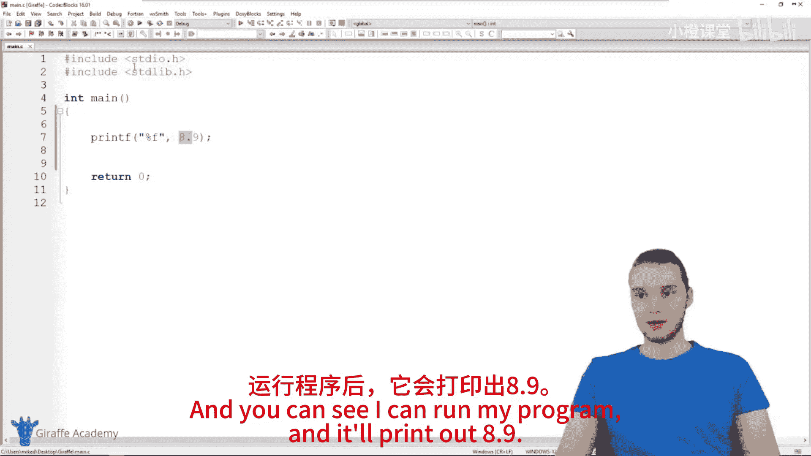

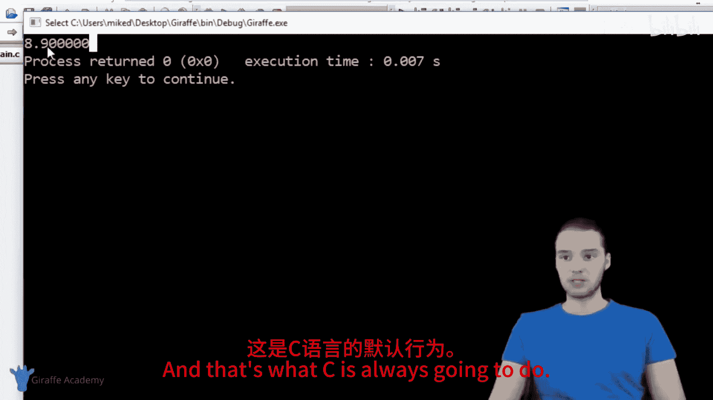

C is always going do。 So it's always gonna print it out to a very precise decimal。

 So using these decimals， I can do all sorts of stuff。 So obviously I can just print out the decimal。

 but I could also do things like math。 So I could say like5。0 plus 4。5。

 And this is gonna go ahead and be able to do that for us。 So when I run my program。

 not only is it gonna like print this out， but it's gonna do the actual math operation。

 you see we get 9。5。 So in addition to addition， we can also use subtraction division。

 which is going be a4lash and multiplication， which is gonna be an asterisk。

 and you can use all these different things to know do the four basic math operations Add subtraction multiplication and division。

 So now I want to talk about how we can use floating point number。 So like doubles and floats。😊。

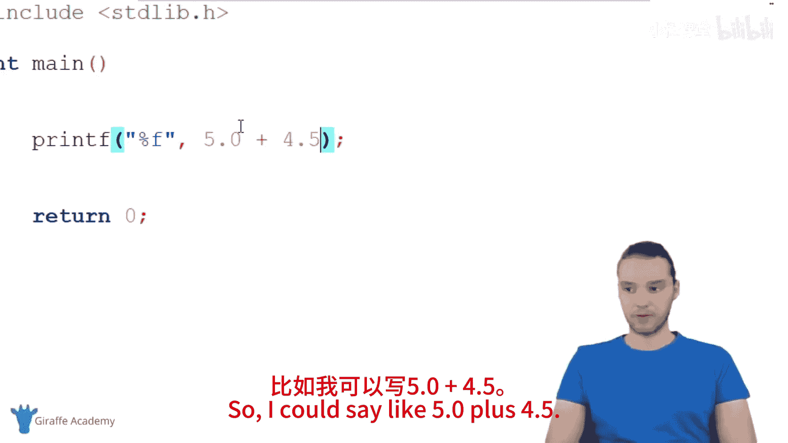

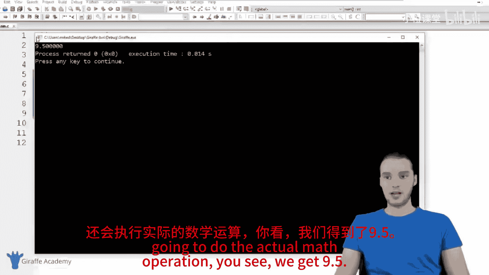

Alongside integer。 So let's say I was going to add an integer with a double。 So if I said 5 plus 4。5。

 well actually when we do this， this entire answer is going to get converted into a decimal number。

 So when I say 5， which is an integer plus 4。5， we're going to get a floating point number back。

 So we're going to get 9。5 and basically any operation that you do between an integer and a floating point number is going to return a floating point number back。

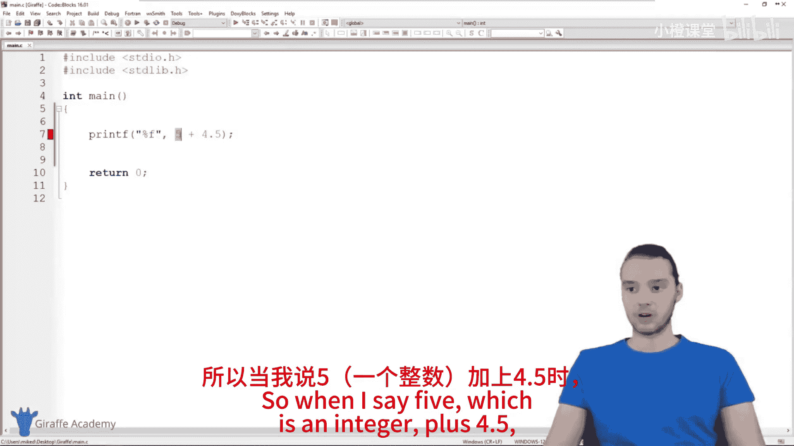

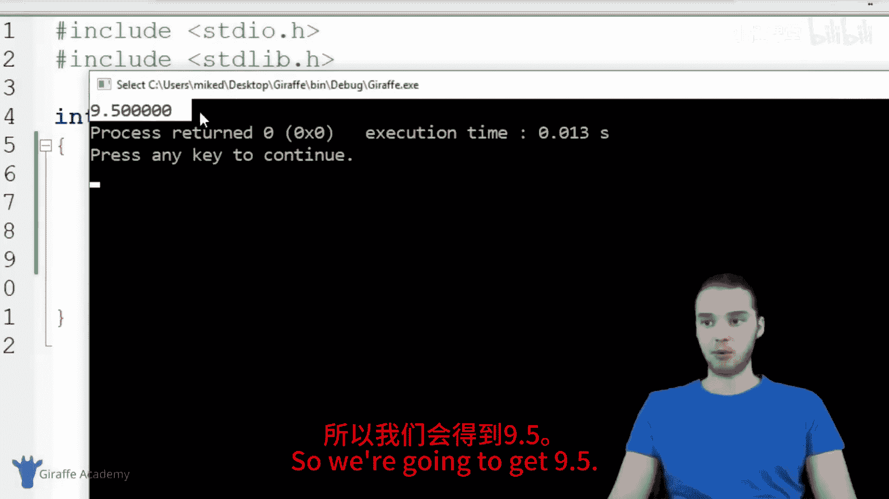

So that's important to realize。 But if I was to change this to four now this isn't gonna work anymore because this is asking for a floating point number and we're giving in an integer。

 So when I do math with two integers， it's gonna give us an integer back and if I do math with a floating point number and integer it'll give us a floating point number back。

 It's also important to realize， for example， if I took5 and divided it by4。

 this should actually be a decimal number right， and you'd expect us to get a decimal back。

 But if I just printed out percent D So if I printed out the result of the integer 5 divided by the integer 4。

 I'm actually going get an integer back。 So when I run the program。

 you'll see we're getting a one here。 but really like the answer is one technically。

 but it's one with a bunch of decimal points after it it's one plus a bunch of other stuff。

 But when we just do math with two integers， we're gonna get an integer back。

 If I was to say5 divided by 4。0 and I printed out a decimal， now we're gonna get the entire。

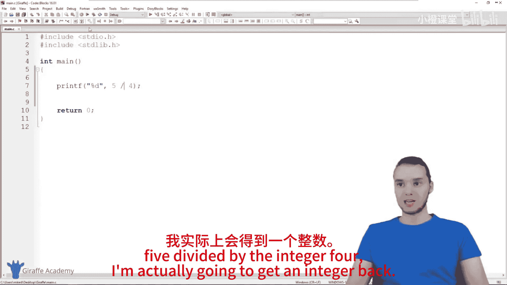

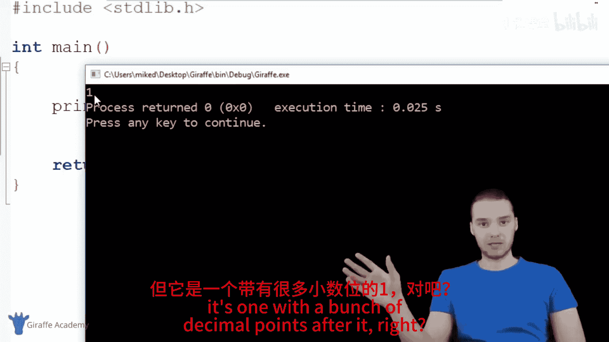

Your answer back So we're going to get 1。25。 So that's just a little bit about dealing with integers and floating point numbers。

 We could also take these and put these into variables。 So， you know。

 in addition to just having numbers down here， I could specify a variable like you know。

 numb set it equal to six and we can go ahead and print numb out down here as well。

 I'm going need to make this in D。

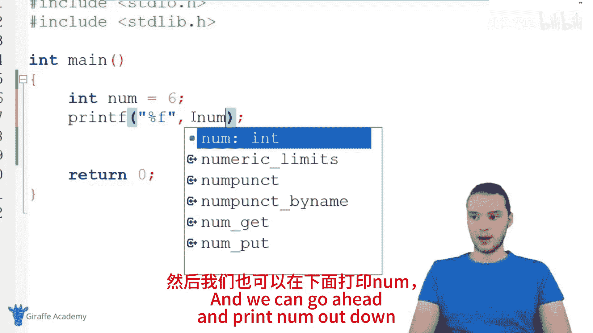

So now we willll be able to print out that variable with no problem so it can be really useful sometimes to store these numbers inside of variables。

 I also want to talk to you guys about using more complex mathematical functions Now and see we have these things called functions which are basically just little blocks of code that we can call and when we call them they're going to go off and do certain things for us so they'll like modify a value or give us information about a value and these functions can be really useful I'm going to show you guys a couple functions that we can use with math。

😊。

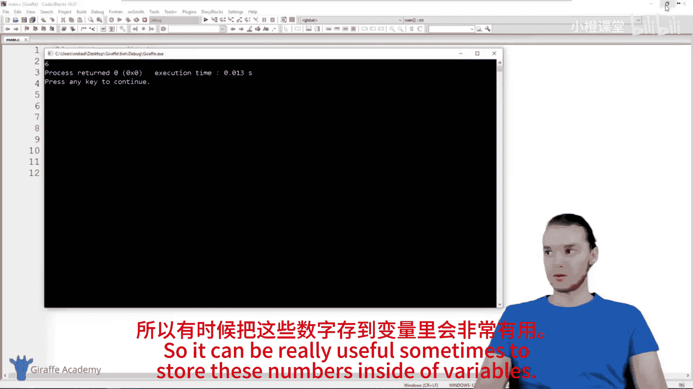

So I'm just gonna come over here and I can actually start using these functions and all you have to do is just type out the name of the function that you want to use。

 So by default， C is going to give us access to a bunch of math functions that we can use So we really don't have to do anything All we have to do is just type in their names and I'm going to show you guys want it's just PW so I'm just typing in PW and I'm going to type an open andclo parentheses and inside of this parentheses I can actually give this two numbers what this is going to do is it's going take the first number that we give it and it's going to take it to the second number So if I said like two and three and you'll notice I'm separating them with a comma this is basically going to give us two ray to the third power So to give us two cube So whenever I're in my program and actually we need to print this out as a decimal number so this is gonna give us a decimal number back So I need to print this out with F。

When I roll my program， we're going to get eight back just like that， so it's basically cuubing two。

 I could say like four race to the third power and now we should get back 64， which we do。

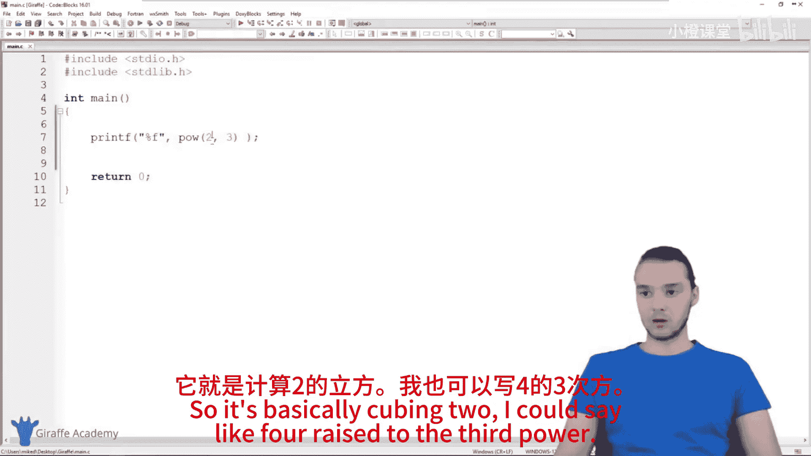

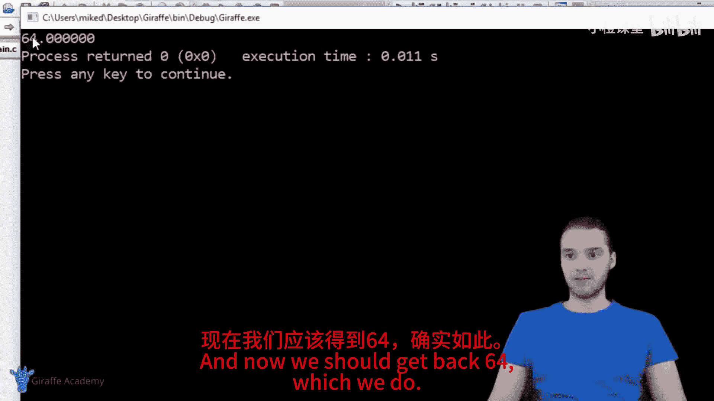

So that can be pretty useful。 There's a couple other ones I'll show you another one is SQRT。

 so this will allow you to take a number square root。

 So if I said like 36 in here now we're going to print out the square root of 36 which is going be6 and there's a couple other ones。

 So let's say that I had a decimal I could say CL which stands for ceiling So if I had like 36。

7 or 36。356 this is going give us the next highest number so it'll basically round this number up。

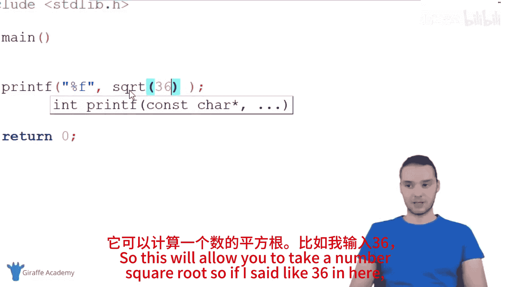

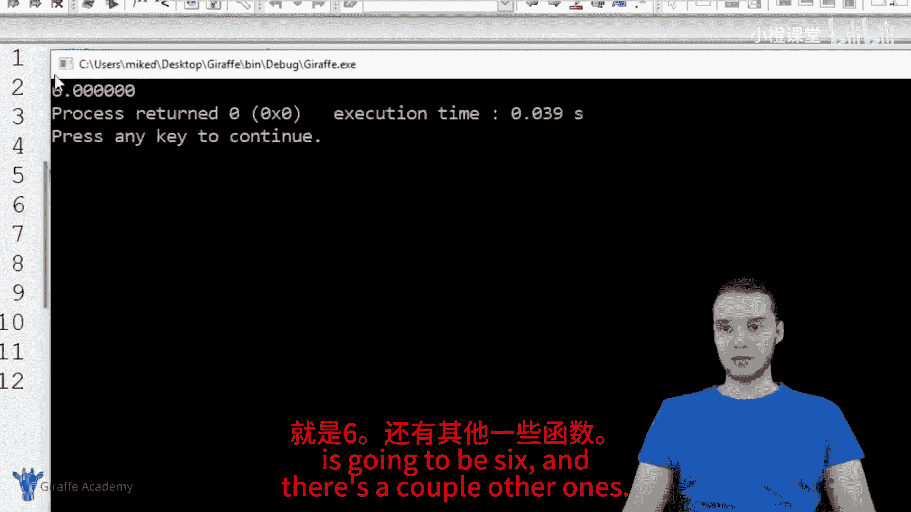

And this is going to give us 37， as you can see， We can do another one。

 which is called floor and floor will do the opposite。

 So Flor will just round the number down no matter what。 So if I had like 36。656。

 this will round it down to 36。So there's all sorts of little things we can do little functions that we can call and get information about numbers。

 and like I said， these functions will either like modify a number so it would like give us the floor or the ceiling or sometimes they'll like give us information about numbers。

 So that's sort of the basics of working with numbers you can do all sorts of math with numbers you can add and subtract。

 multiply and you can even multiply ads subtract integer numbers and floating point numbers So play around with all these different things with numbers And if you want to find some more of these little math functions。

 all you have to do is just go online and Google search for see math functions。

 There's like dozens of these little functions that you can use but I think these are some of the most widely used。

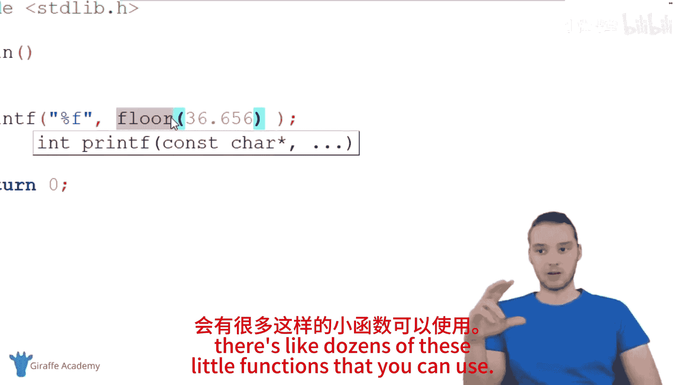

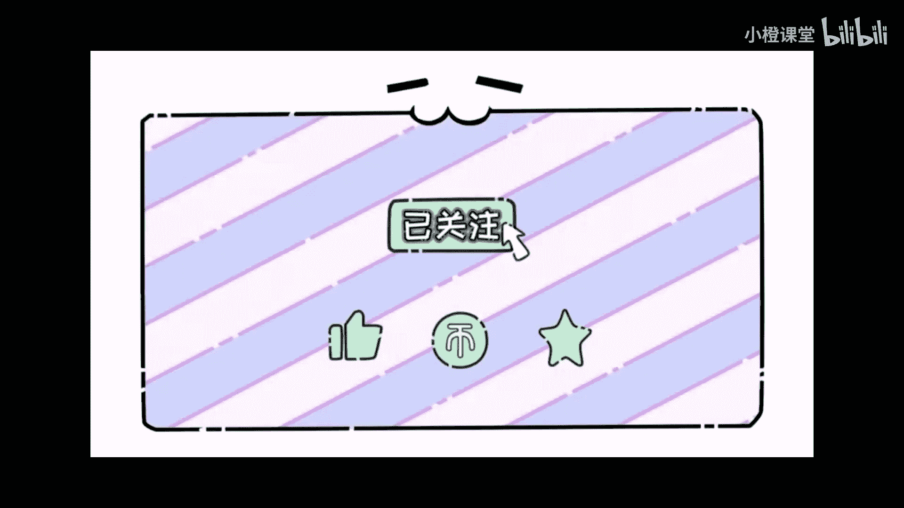

。