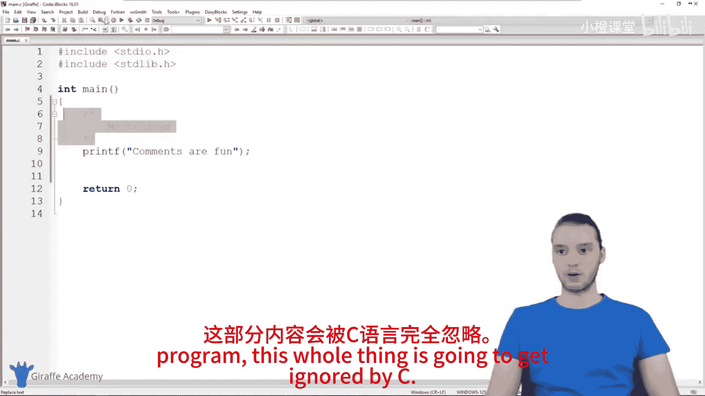
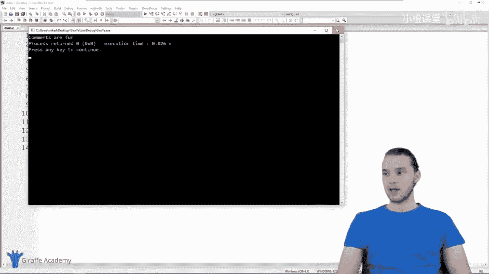
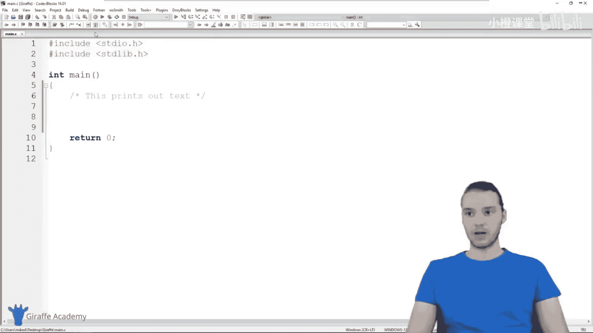
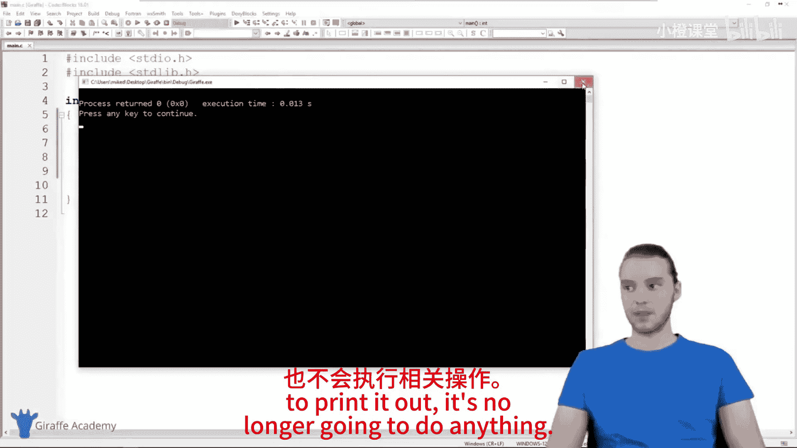
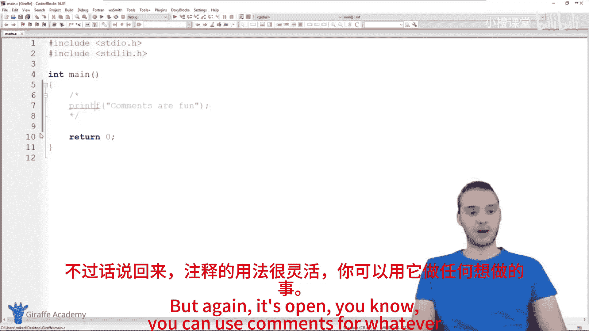

# 【油管千万订阅 freeCodeCamp】面向C语言编程初学者教程 Tutorial for Beginners in C Programmin（中英双语字幕） p10 C编程初学者教程第十节：注释 -BV1ug4wzBEhT_p10-

In this tutorial， I want to talk to you guys about using comments in C a comment is a special block of code in C which actually gets ignored when we run our program So if you want to write a comment you can use a special starting and ending tag and any of the text。

 any of the code， anything that you put inside of that tag isn't going to get executed or really looked at by C so we can use comments to do all sorts of things you can leave little notes or little comments inside of your program you can use comments to temporarily disable certain lines of code they can be really useful so I'm gonna to show you guys the basics down here in my program if I want to create a comment I can start a comment using a forward slash and an asterisk and you'll see when I put this asterisk in all the code in my text editor changed color and basically what this means is anything that comes after this forward slash an asterisk is going to be considered a comment in order to close off the comment I can use another asterisk。

And another forward you'll see the code changed back to normal code inside of these two asterisks。

 I can basically write out anything I want and it's going to get considered as a comment so。

For example， if I wrote out like my program and I ran my program。

 this whole thing is gonna to get ignored by C。 So it's just gonna print out comments or fun。

 It's not gonna to do anything else。 And like I said。

 comments are really useful So I could leave a little note up here。

 I could write something like to do like I have to do something and a lot of times people would use comments to explain certain lines of code。

 So I could put a comment here and I could say like this print out text so maybe this was like a really complex line of code。

 we could use this text in order to explain it。 You can also use comments to do something called commenting out a line of code So for example。

 let's say I wanted to run my program but I didn't want to have this line of code in there。

 one thing I could do would just be to delete the entire line of code so I could delete this code and now I can run my program and it's no longer gonna print it out。

 It's no longer going do anything。 But here's the problem in order to do that。

 I had to actually delete。

Line of code。 So instead of deleting it， I could just bring it back and I could comment it out so I could basically surround it with these comment tags。

And now the computer is just going to ignore it， so it's not going to render it because it's been commented out。

So now when I run my program， it's going to do the same thing， it won't execute that line of code。

But I didn't have to actually delete the line。 I could just comment it out。

 So a lot of times when you're writing programs， you might want to try to run your program without a certain line or a certain series of lines of code and instead of deleting them and then running the program you can just comment them out and C will basically ignore them so that can be really useful So those are the two basic uses for comments and essentially comments are open it's just a way that we can write out information in our files that won't get rendered by C so you can really use comments to do whatever you want Now I will say one best practice with comments is to use them sparingly generally you only want to use a comment when you absolutely have to So we can be really annoying if you open up a C file and there's like comments littered all around and obviously if you want to put a bunch of comments in your code I mean no one' stopping you but as a best practice going forward I think generally only using comments when they're absolutely necessary is kind of like a good practice but again it's open。

You know， you can use comments for whatever。

。