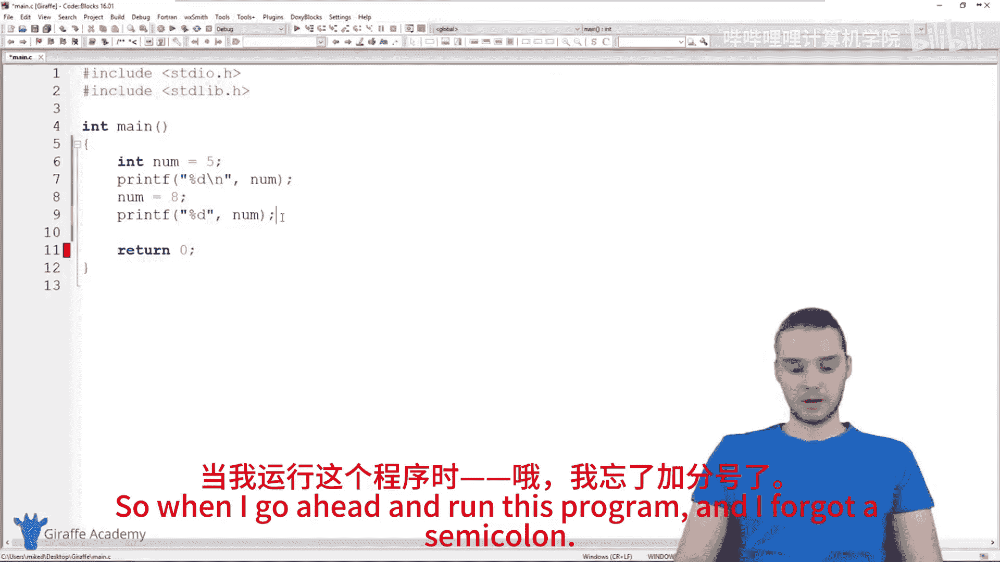
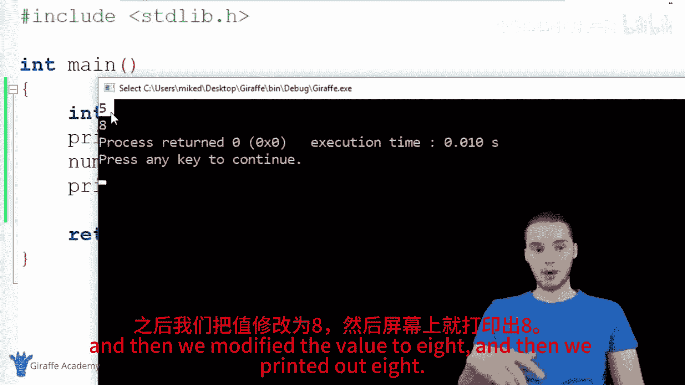
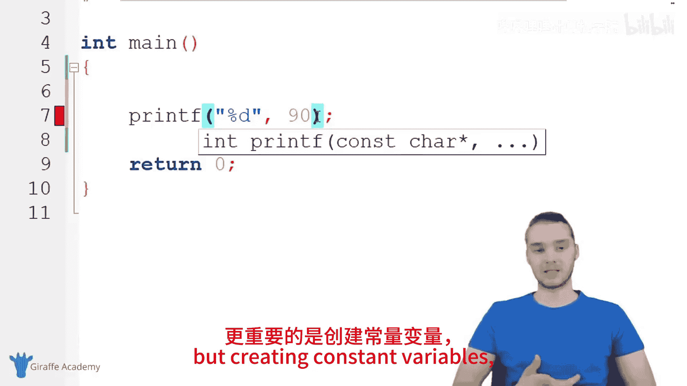

# 【油管千万订阅 freeCodeCamp】面向C语言编程初学者教程 Tutorial for Beginners in C Programmin（中英双语字幕） p11 C编程初学者教程第十一节：常量 -BV1ug4wzBEhT_p11-

In this tutorial I want to talk to you guys about constants in C well constant is a special type of variable in C which can't be modified。

 so when I create a constant in C I'm basically creating a value that is unable to be modified。

So I'm going to show you guys basically how this works let's say I created a variable。

 let's say I created an integer， I just called it numb。

 and I set it equal to five right and then I printed out that integer onto the screen so we can print this out percent D。

And I'm just going print out nu right so I can create this numb variable。

 I can print it out onto the screen。 Let's say that down here I wanted to modify numb。

 so I could basically say numb is equal to 8 so I can modify the value that's stored inside of the numb variable and let's come down here and we'll print this out as well。

 So D。And we'll print out numb again。 And actually， I'm going to print out a new line here。

So when I go ahead and run this program and I forgot a semicolon when I go ahead and run this program you'll see we're printing out five and then we modified the value to 8 and then we printed out 8。

 So I was able to modified this value down here I was able to modify numb。

 but in certain circumstances in C you're going to want to create variables or you're gonna want to create values that can't be modified。

 So these would be values that just like can't change and those are called constants So if I wanted to make numb a constant in other words。

 let's say for some reason I didn't want the numb variable to be able to be modified in my program I could come over here and I could say constant So CONST and I'm going to say that right before I declare the type Now you can also say con right after you declare the type。

 but I've always preferred to just put it before。

So I say constant nu five and now this program is actually going to throw an error so when I try to run this。

You'll see down here。 it's getting highlighted in red。 That's because I can't modify a constant。

 So I'm trying to modify numb down here， but I can't。

 because I gave it this constant keyword because it's now considered a constant。

 So in a lot of cases， you want to have variables that just can't be modified can't be changed。

 And in a situation like that， you want to make them constant。 Also。

 a lot of times when we make constant variables in C will give them all uppercase names。

 And this isn't required。 this is just sort of like what a lot of developers will do。

 So they'll say like instead of N U am like this， they would say like numb。

 or maybe this is like your favorite numbers。 So you could say fave underscore nu。

 So that would be how you could like distinguish two words。

 But generally like constants will be all capital and that's just so it's kind of obvious that they're unchangeable that they're constant。

 But again， you don't have to do that。 but that's kind of like a best practice。

 So this is one way that we can create a constant。 And we basically create a constant variable that can't。

Cha but a constant could also refer to just like any number or any text that we're using in our program。

 So， for example， I'm gonna get rid of this。 if I came down here and I just like printed out some text。

 So let's say I just print out like hello， this is actually also gonna be considered a constant。

 So this is just like a string of characters a string of text。

 that's also considered a constant because it's just like text on the screen we can't change it。

 we can't modify it， it's just kind of there。 So you would also consider this a constant。

 if I was printing out a number to like let's say I came over here and print out 7070 is also considered a constant So it's just considered to be like a piece of information or a piece of data in our program that is sort of unchanging So 70。

 this isn't gonna change。 I mean， unless I physically came in here and changed it。

 this value is always gonna be 90 no matter what I can't modify it unless I like manually come in and modify it。

 So that's also。It it a constant。But I would say like for the most part。

 where this is going to come in handy is obviously doing stuff like this。

 but creating constant variables， variables that can't change。

Yeah。