# 【油管千万订阅 freeCodeCamp】面向C语言编程初学者教程 Tutorial for Beginners in C Programmin（中英双语字幕） p12 C编程初学者教程第十二节：获取用户输入 -BV1ug4wzBEhT_p12-

In this tutorial， I'm gonna show you guys how to get input from a user in C。

 So a lot of times in our C programs， we're going to be working with all different types of information。

 and a lot of times we're gonna to want to get some of that information from the user。

 So I'm gonna show you guys how we can prompt the user to enter in some information。

 we can take that information， store it inside of variables。

 and then we can use it inside of our program。 So this is gonna be pretty cool。 So down here。

 I will basically write out the code for this。 And the first thing we want to do whenever we're getting input from the user is we want to prompt them。

 So I want to prompt the user， know as far as what they should enter in。

 So I'm just gonna say print F。 And over here， I'm just going to print out a prompt。 So why don't we。

😊，Ask the user to enter in their age。 So we'll I'll show you guys how we can get a number from the user。

 So I'm just gonna to say enter your age。And now that we've prompted them to enter their age。

 I need to do two things。 So the first thing I want to do is create a variable where we can store。

The input that the user puts into the program。 So I want to create a variable where we can store the age that the user inputs。

 So I'm gonna to create an in over here。 that's called age。 And I'm not going to give this a value。

 So all I'm going to do up here is just declare the variable。

 I'm just going to tell C that I want to use this variable， but I'm not going to give it a value。

 In other words， I'm going to allow the user who's inputting the age to give this a value。

So down here， I want to be able to get input from the user so I can use another function。

 which is called scan F。And scanf is basically going to allow the user to enter in some information into our program。

And this works similar to print F， it's kind of doing the opposite of print F right printnt F is printing something out onto the screen and scanf is allowing the user to input something into the program。

And we're going to make an open and close quotation marks。 And in here。

 I basically want to tell C what type of information I'm asking the user to enter in。 So in our case。

 we're asking for an integer， right， age is going to be an integer。 It's a whole number。

 So I'm going to accept as an input and integer。And over here we want to tell see where we want to put that integer。

 so I'm basically going to tell see what variable I want to store this in。

 so I'm going to store this inside of my age variable。

And I can essentially just type out the name of the variable here。

 but in order to get input from the user， I'm actually going to have to type an ampersand in front of this。

 So instead of just typing out age， I'm going to have to type ampersandand age。

 And when I say ampersand age， this is what's called a pointer。

 and we're gonna talk about pointers in a later tutorial。

 I'm going cover everything you need to know about pointers。 But for now。

 that's a little bit beyond what we need to learn。 So all you need to know is that when you're using scanf and you want to store information inside of like an integer or a float or like a character。

 you need to use this ampersand over here。So down here now that we've scanned for the user's age I'm just going to go ahead and print it out so we'll just print out like you are and I'll say percent D years old and over here I'm just going to print out that age variable so essentially what I'm doing is I'm prompting the user to enter their age I'm storing whatever age they enter inside of this age variable and then I'm printing it out to them。

So let's go ahead and run this program and we'll see how we did。

 So I'm gonna run the program and it says enter your age。 So let's say someone is 50。

 When I click enter， it's gonna to take that value。 It's gonna to take that integer that we enter 50。

 store it inside of that age variable and print it out。 You'll see over here。

 it says you are 50 years old。 So that's how we can get an integer from the user。

 we can also get like a double from the user。 So for example， I could say enter your GP。

 And so now instead of asking for an integer， we're gonna to be asking for a double so I can come up here and say like double and we can call this GP。

 And now I can do the same thing。 But instead of saying D， I want to say Lf。

 and Lf is basically going to tell this scanf function that we're looking for a double。

 And then obviously， instead of age， we're just gonna put GPA inside of here。

 And so now we can just say like。😊。

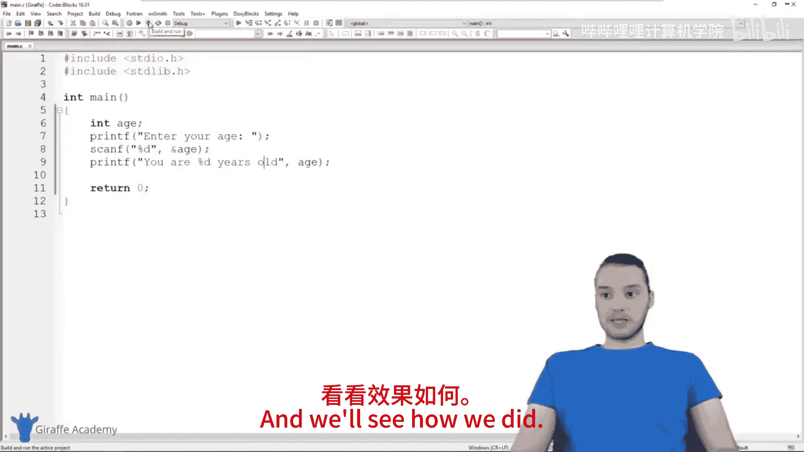

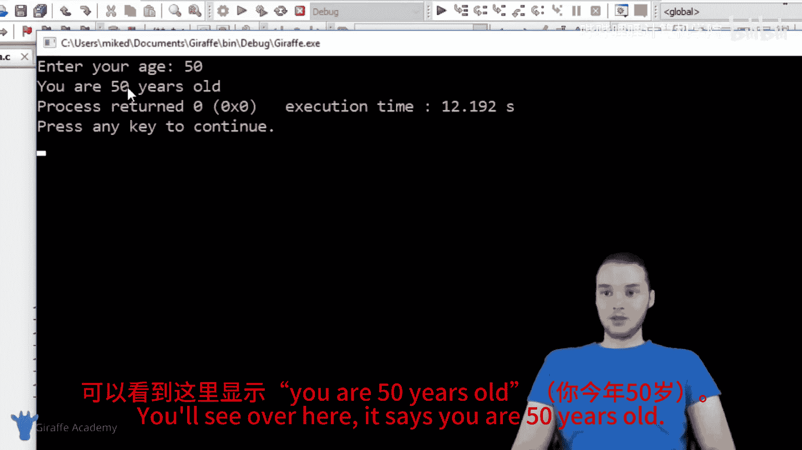

Your GP is， and then we can put percent F because we're gonna be printing out a double and I'll just say GPA。

 So you notice here in print F， when we want to use a double， we're using percent F to print it out。

 But when we're using scan F， we're gonna to use percent LF。 So that's just like a little difference。

 And now let's go ahead and run this program and we should be able to get a GP。

 So let's say someone's GP is like 3。1。 Now it says your GP is 3。1。

 So that's how we can get a double。 I also want to show you guys how we can get a character。

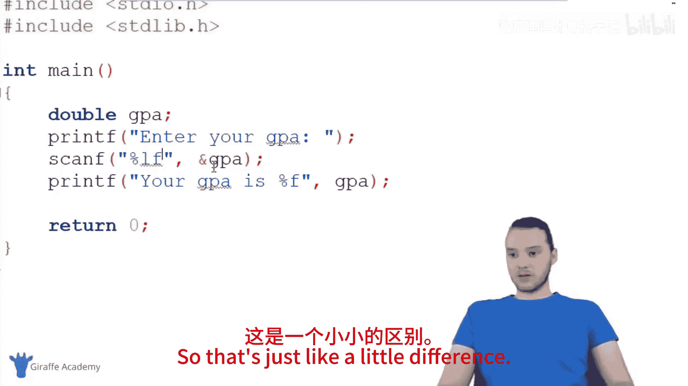

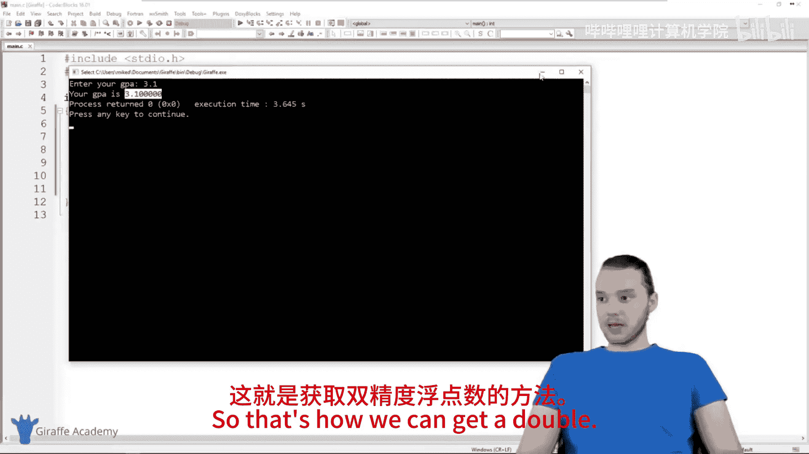

So why don't we create a character up here and we'll just call it grade。And we'll say。

 enter your grade。And now when we want to get a character， we can just say percent C。

 and again I can just come down here and say ampersand grade。And then down here。

 we can just say your grade is percent C and we'll go ahead and print out the grade。

 So now we should be able to get a character from the user。

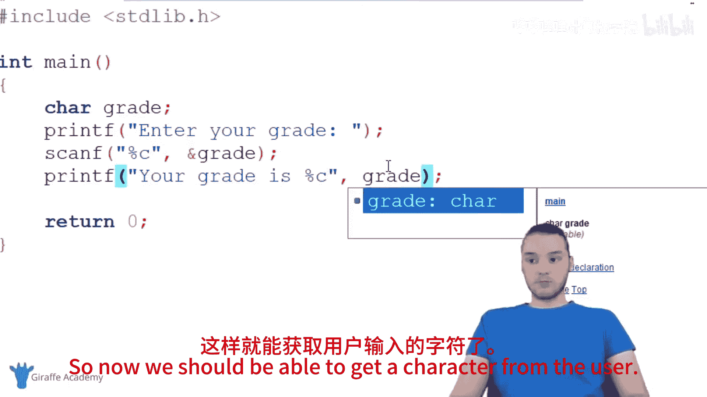

So enter the gray。 let's say I got an A and it says your grade is a。

 so we can use this scan F to get specific types of input from the user and we can store those specific types of input inside of variables。

 Now I also want to show you guys one more thing we can do。

 which is we can actually get a string from the user。

 So in addition to getting numbers and a characters。

 We could also get like a string of characters from the user。

 And this is gonna be a little bit different from doing like numbers and characters。

 So I want to kind of show you guys how we can do this really quick。 So over here。

 let's create a variable。 We'll just call it， let's just call it name。

 So we'll be storing someone's name。😊。

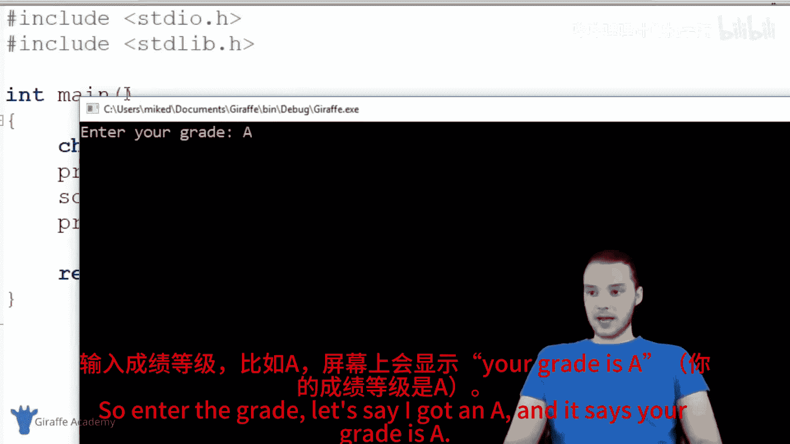

And。Whenever we're creating a string of characters。

 we always need these open and closed square brackets， and inside of here。

 I'm actually going to specify how many characters I want to be able to store inside this string of characters。

 so I'm just going to put 20。And in the past in this course， when we've been creating strings。

 we haven't put a number in there。 we've just kind of said like whatever we've basically just given this a value straight away。

 but in this particular situation， we're not gonna be giving this variable a value right away。

 In other words， I don't know what the user's name is gonna be。

 Like I don't know that right up front they're going to tell us what that is。

 And so if I'm not gonna give this a value right away。

 I do actually need to tell C how big I want this variable to be。 In other words。

 I need to tell C how many characters I want this variable to be able to store。

 And that way C can go ahead and allocate enough memory for this variable。

 So I'm just gonna to put 20 and 20 basically means this will be able to store 20 characters。

 And I think that's enough for a name。 So down here we'll just say enter your name。

And I can use scan F in order to get input in the form of a string， but instead of saying percent C。

 I'm just going to say percent S。 And over here， instead of saying ampersand grade。

 I'm just going to type out the name of the string of characters so I don't actually need this ampersand here。

 I can just specify the name of the string。 So down here it says print F your grade is。And actually。

 let's just say your name is。And we'll just say percent S。

 and then over here we can print out the name。So this should work just like it did in the other cases。

 so let's go ahead and run this and it says enterter your name， so my name is Mike。

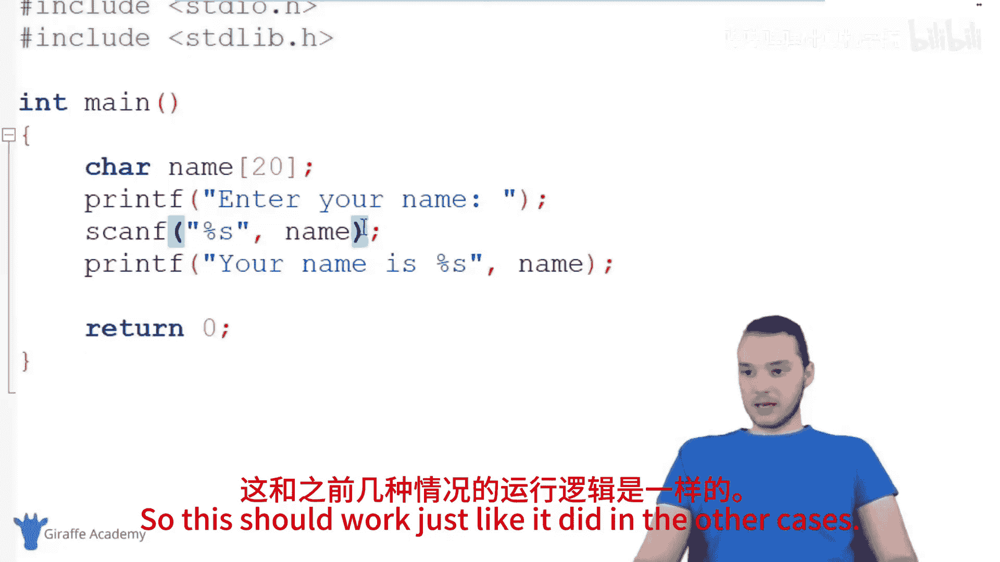

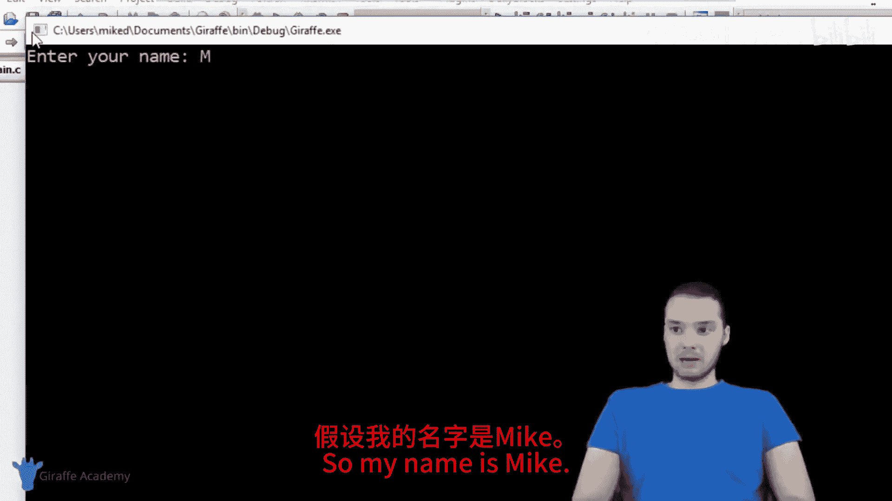

And you'll see it says your name ismic。 So that works out really well。

 but there is one problem when we're using scanF in order to get a string from the user。

 So for example， if I came in here and I said enter your name and I said， my name was John Smith。

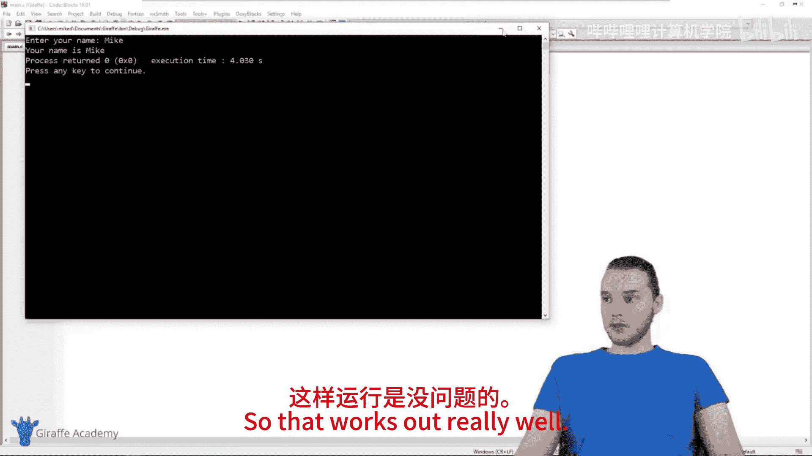

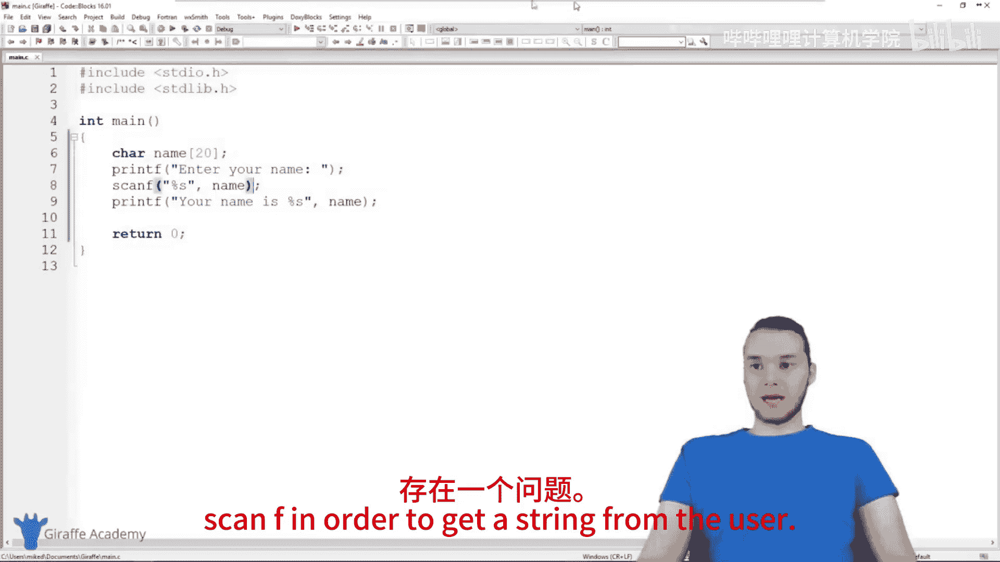

When I click En。You'll notice that it's only saying your name is John。

 it's not including Smith over here。And here's the problem。

 This is because whenever I use this scanf function and I use it with a string。

 it's only going to grab the characters up to the first space。

 So once it sees this space it's going to be like okay。

 we're done getting characters so that's kind of a problem and that's just kind of how scanf works。

 it's not really you know scanf's fault， there is a way that we can modify scanf in order to be able to get input with spaces。

 but there's another function which I want to show you guys which we can use to get a line of text from the user and it's called F gets。

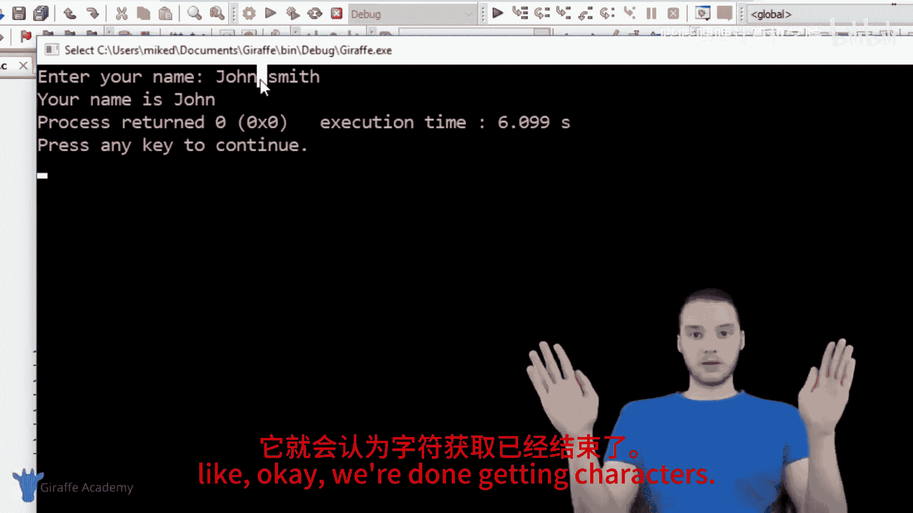

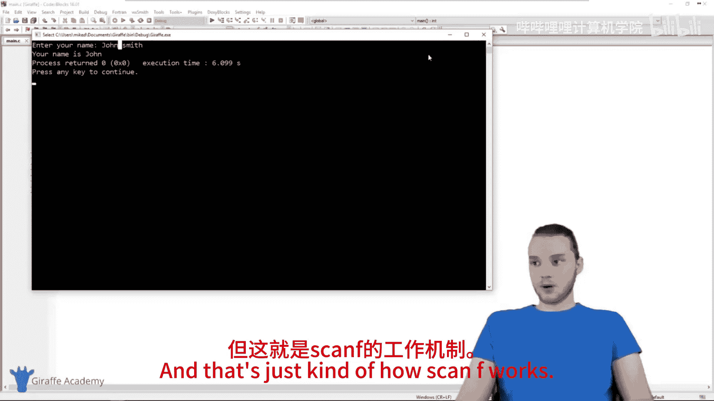

And F Gs is another function it's similar to scan F。But FGts is basically going to be more general。

 so FGts is essentially just going to grab like a whole line of text。

 it's not going to be able to grab it and store it inside of like an integer or a very or a character。

 it's just going to be able to store it inside of like a string of characters。

So when we're using F getss， the first argument we want to give it is the name of the variable where we want to store the line of text。

 so in our case it's just going to be this name variable。

The next thing we want to do is specify how many characters we want to be able to input from the user。

 so this will essentially limit the amount of characters that the user can input。

And this is always a good idea when we're trying to get a string from the user because one common problem is that the user could try to enter in like a million characters and they would overflow the like the buffer。

 In other words， like C wouldn't be able to handle accepting that many characters and the program might break So over here with F getss we can specify how many characters we want to be able to accept so I'm just going say 20 because that's how many characters we can store inside of this variable and over here I'm just gonna to say STDN and this stands for standard input essentially what we're doing over here is we're telling F gets where we want to get the information from and standard input is essentially just like that little console that we've been using。

So now I'm using Fges， and this is going to do exactly what scanF did。

 so we'll be able to store the input inside of this name variable。

 but now we'll be able to store multiple words instead of just one single word。

 So let's run this program and it says enter your name。 So now if we entered in John Smith。

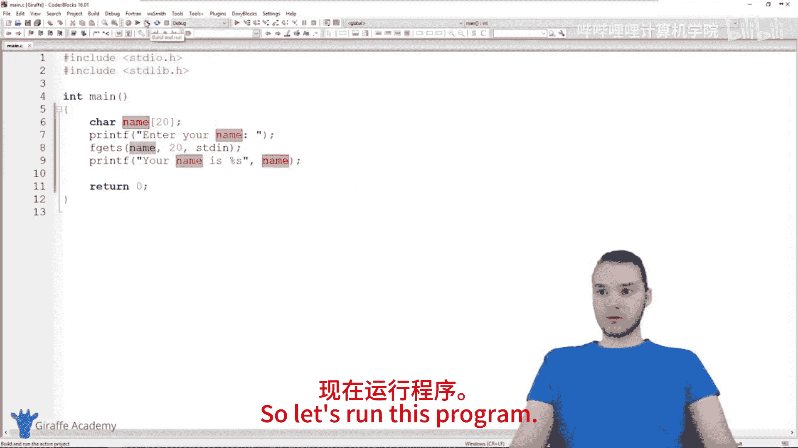

You'll see it's able to enter in John Smith。 Now， the one downside with just using this F gets is you'll notice that it printed out this new line over here。

 So let me actually demonstrate this a little bit。

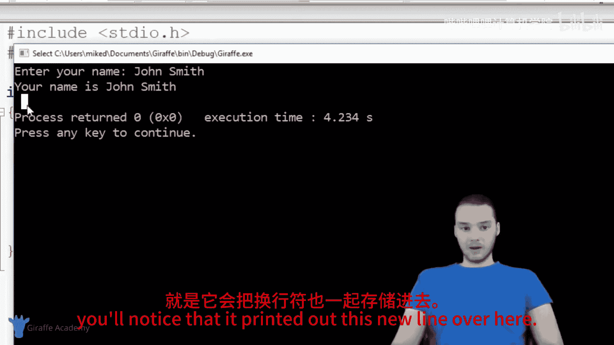

So if I was to print out like， you know， just some random text over here。

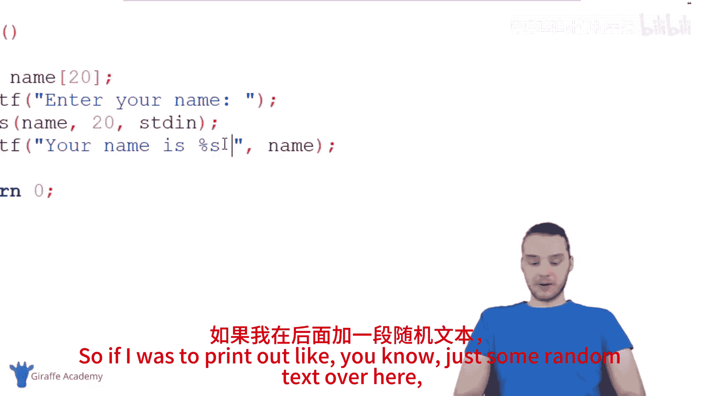

Whenever I get input using scan F， so if I entered in John Smith。When I click the En key。

 so when I'm entering this by clicking the En key， that's actually going to represent a new line character and that's going to get stored。

Inside of the string， so when I click En you'll notice it says your name is John Smith and then it prints out a new line character and it prints out this text and so that's just something that you need to be aware of when you're using this F gets function。

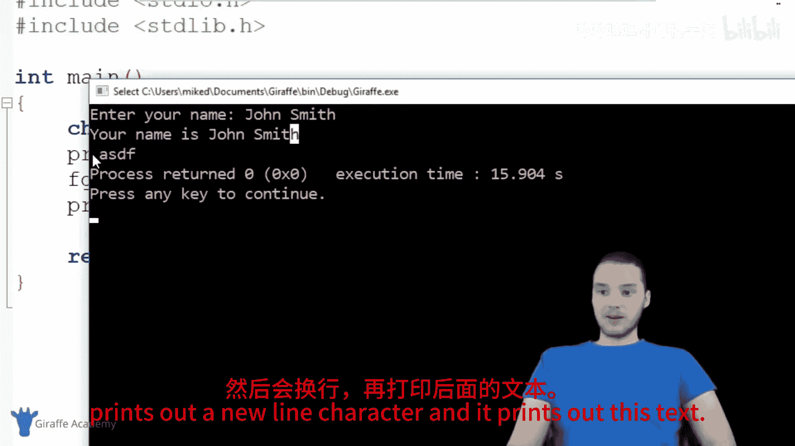

But for the most part， I would say if you're getting input from a user in the form of a string。

 you can use F getss， you could also use scan F and you could use multiple percent essays。

 and I'm actually gonna show you guys how we could do something like that in a future tutorial。

 But for the most part， I would say whenever you're getting a string from the user。

 you just want to use F gets。 So that's the basics of getting input from the user Like I said。

 there's a couple other things that we can do。 and I'm going to talk about at least one other way that we can get strings from the user in a future tutorial。

 but this is kind of the basics and you can kind of play around with doing this stuff in your programs。

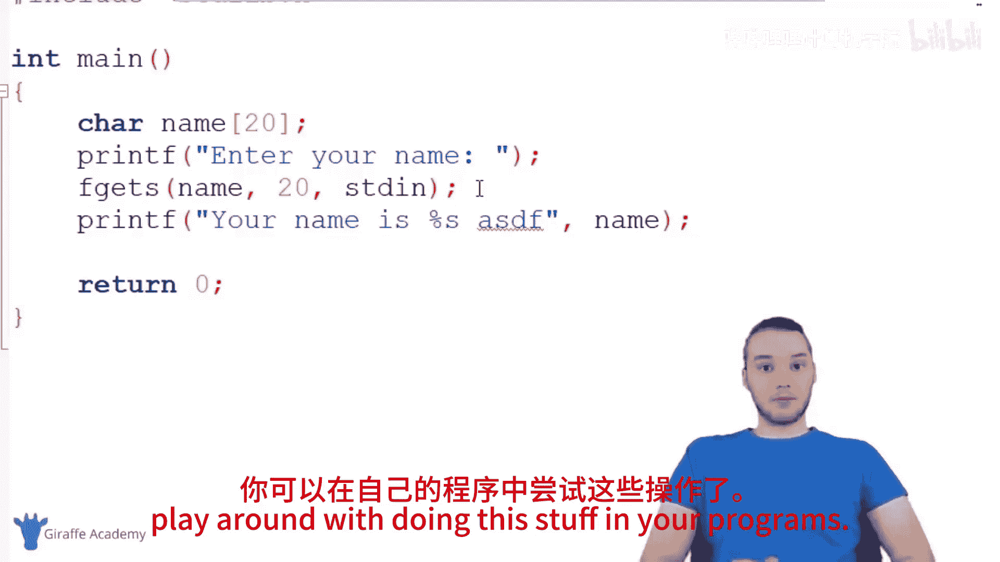

Yeah。

