# 【油管千万订阅 freeCodeCamp】面向C语言编程初学者教程 Tutorial for Beginners in C Programmin（中英双语字幕） p13 C编程初学者教程第十三节：构建基本计算器 -BV1ug4wzBEhT_p13-

In this tutorial， I'm gonna show you guys how to build a basic calculator in C。

 We're basically going to build a little program where the user can enter in two numbers。

 and then our program will take those two numbers， add them together and spit out the answer。

 So this is gonna be kind of cool and we'll also learn about getting numbers as input from a user。

 So over here， I want to show you guys exactly how we can do this。

 The first thing I want to do is print out a prompt。

 So I basically want to prompt the user for some input。 So over here， I can just say print F。😊。

And inside of here， we're just going to give them a little prompt， so I say enter first number。

And essentially， what we're going to have them do is enter in two numbers。

 So I'm actually going to create two variables up here。 So I'll make an int and we'll call it nu1。

And then we'll make another int and we'll call it nu2。

 And I'm not actually going to give these values right up front。

 We're going to end up giving these whatever the user enters in。

 So after the user enters the first number， we need to actually grab that number so I can use another C function called scan F。

And in here， we're basically just going to say percent D because we want to grab an integer。

 And then over here， I'm going to say the name of the variable where I want to store the value that gets entered。

 Now， if you're following along with this course in the last tutorial we're able to get a string of characters as input from the user and basically we just typed in like the name of the variable But when we're getting input that's not a string of characters。

 in other words， when we're getting input that's not percent S。

 So if it's like percent D or percent F or percent C。

 So if it's like a decimal or an integer or a float or a character。

 we actually need to use a special symbol， this ampersand。

 So I'm going to have to say ampersand and then the name of the variable where I want to store this value。

 So I'm just going to say ampersand1 and basically what this means is we're accessing the address of nu1 and we're gonna to talk about a addresses and pointers in a future video。

 but for now just know that you need this ampersand here in order to store。

OrThe value that gets entered inside of this variable。 So once we do that， now we can move on。

 and we're basically just going to do the same exact thing。 but for the second number。

 So I'm going to copy these。And I'll paste this。 And now instead of saying enter first number。

 we'll say enter second number。 And we're just going store this inside of nu2。 Alright。

 so once we're done with this， the last thing we want to do is add them together and print out the answer。

 So I'm just gonna to come down here。 I'm going to say print F。And we'll just say answer。

 and over here we'll print out the answer。 So it's gonna to be an integer。

 and we're basically just going to print out nu1 plus nu2。

 So we're going to print out the value of nu1 plus nu2。 So we have our basic calculator。

 We're getting the first number。 We're getting the second number。

 We're storing them inside of these variables。 We're adding them together and printing them out。

 let's try to run our calculator。 I'm going run my program and you'll see over here it says enter first number。

 So let's go ahead and enter a 6 enter second number we'll enter a8 and now we're gonna get 14。

 So 14 is the correct answer。 So our program works。

 It was able to add the numbers correctly and everything's awesome。😊。

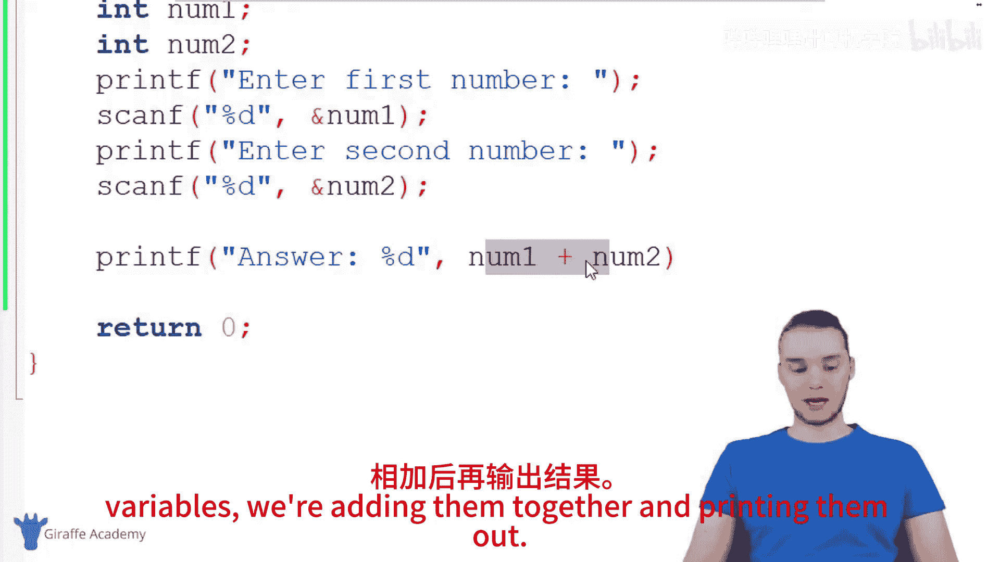

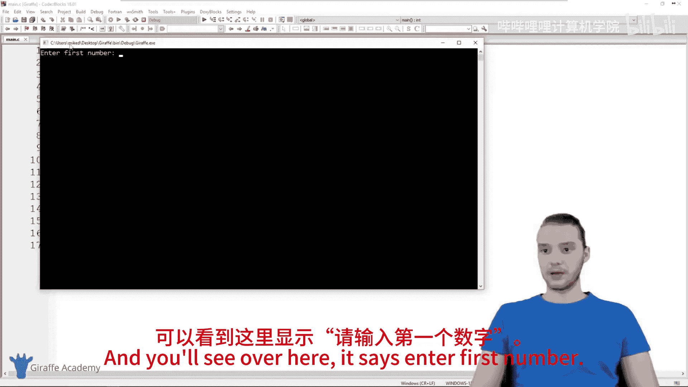

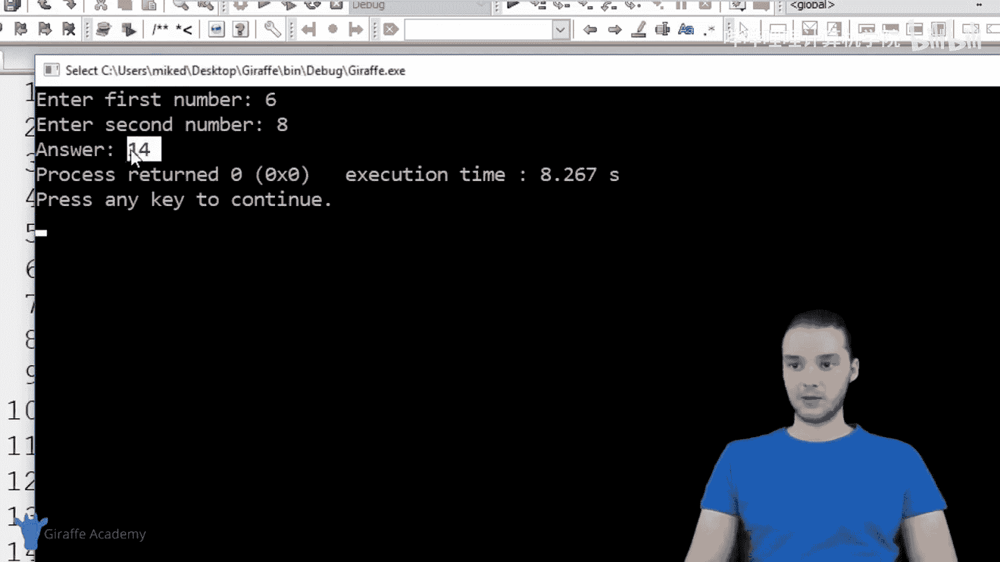

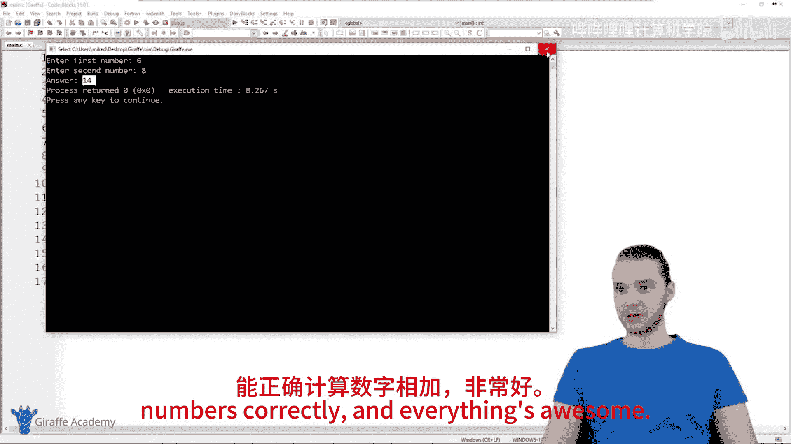

But let me show you guys one problem with this program。

 If I wanted to do math on multiple unde decimal numbers， For example， if I said two。

 and then over here， I said like 6。8， when I add these together。

 we're not gonna to get the correct answer we're gonna get 6 plus2 which is going be an integer 8。

 but we're not going to get 8。8。 So we're not getting the correct value。

 So instead of letting the user enter in only integers。

 why don't we instead let them enter in doubles。 So over here I'm going change these to double So I'm gonna say nu one is going to be a double nu2 is going to be a double And since we're getting doubles as input。

 we're gonna have to come down here and modify these So right now this is accepting an integer So we want to make this except a double。

 So normally if we're using print F and we wanted to print out a double we would say F and that stands for like floating point number But when we're scanning for a number if we want to use a double。

 we have to say LF just like that。 So down here I'm also gonna say LF and we'll change this to。

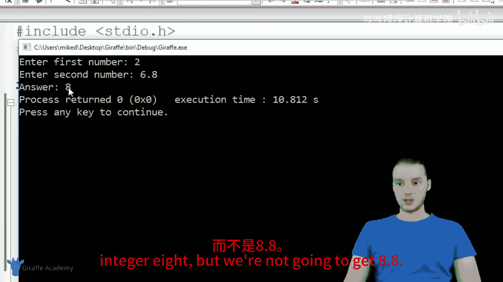

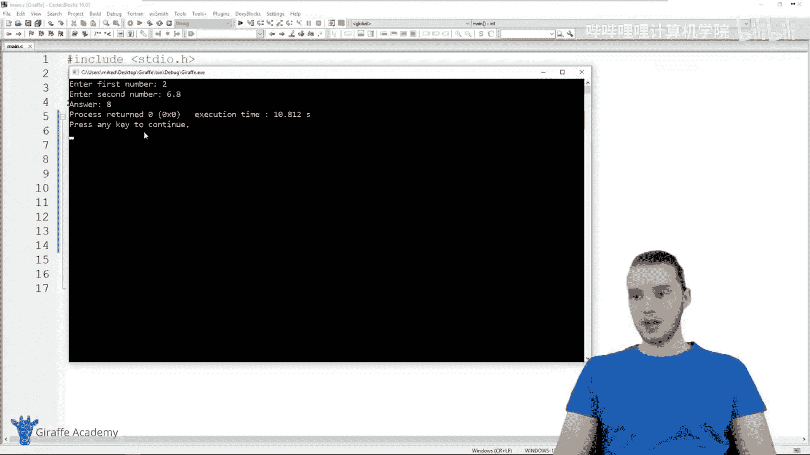

Just F。 So print F is a little bit different than scan F right and scan F。

 if we want to accept a double as input， we need to use LF and print F we just use percent F。

 So let's run our program now and we should be able to add floating point numbers so decimal numbers over here it'll do 4。

5 plus 6。7 and we get 11。2。 So that looks good to me， looks like everything is working properly。

 and now we have a basic calculator so the user can enter in any numbers that they want and the calculator will be able to handle them。

 Now this calculator is not like 100% iron cloud secure for example。

 like if I was to come up here and enter in like a string of characters instead of a number you'll see that it's gonna break the program right so it's just like not doing what we wanted it to do and as we go further in this course we're gonna learn all sorts of ways that we can check to see if certain things are getting entered correctly and we could basically mitigate circumstance。

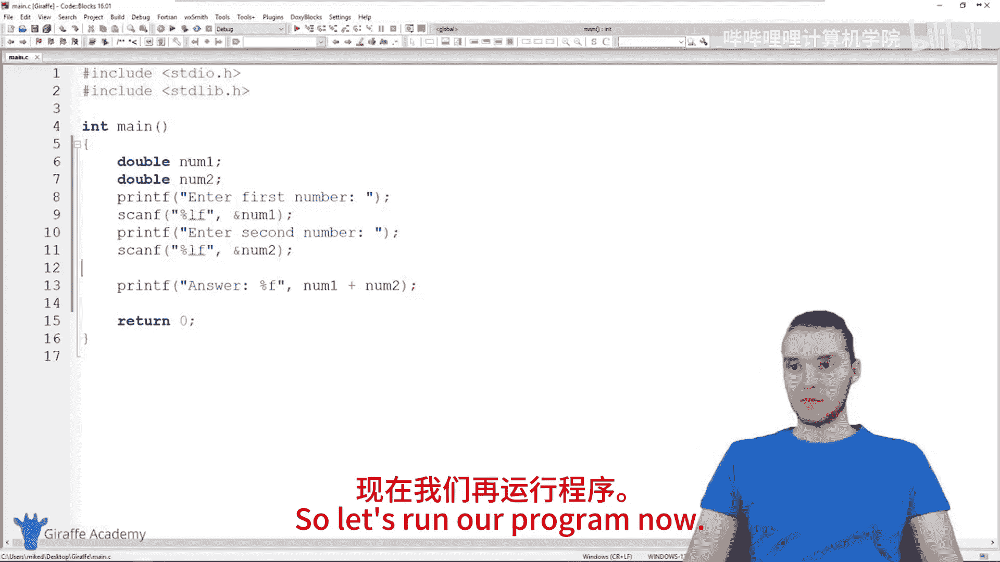

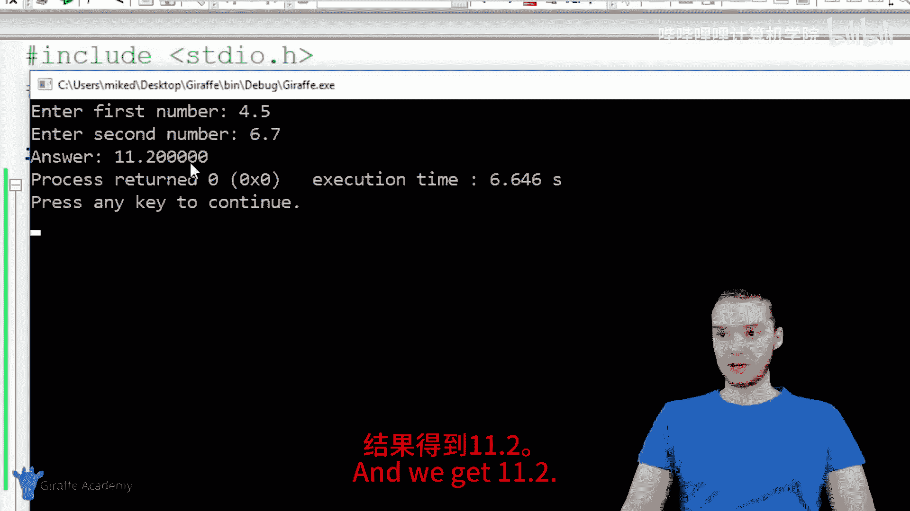

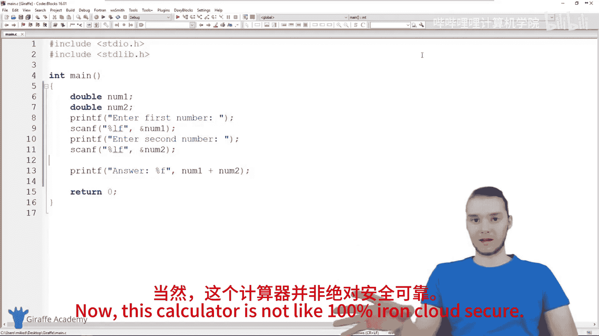

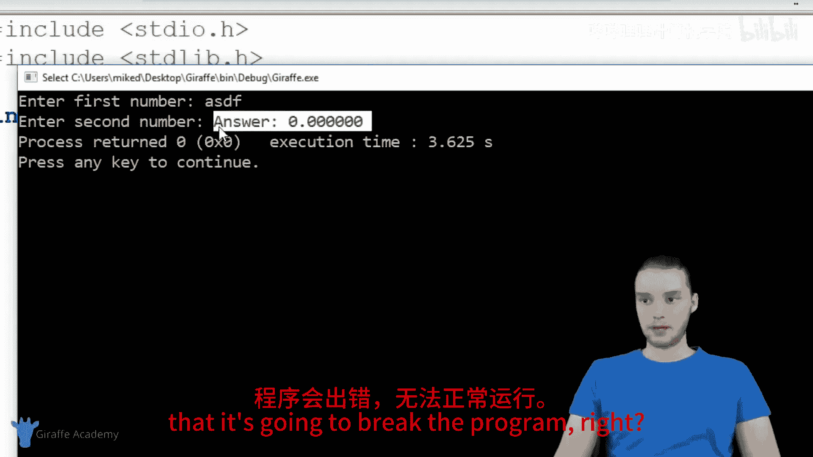

is like that， but for now， this is just kind of an introduction into how we can get numbers as input and do things like addition or multiplication once we have them。

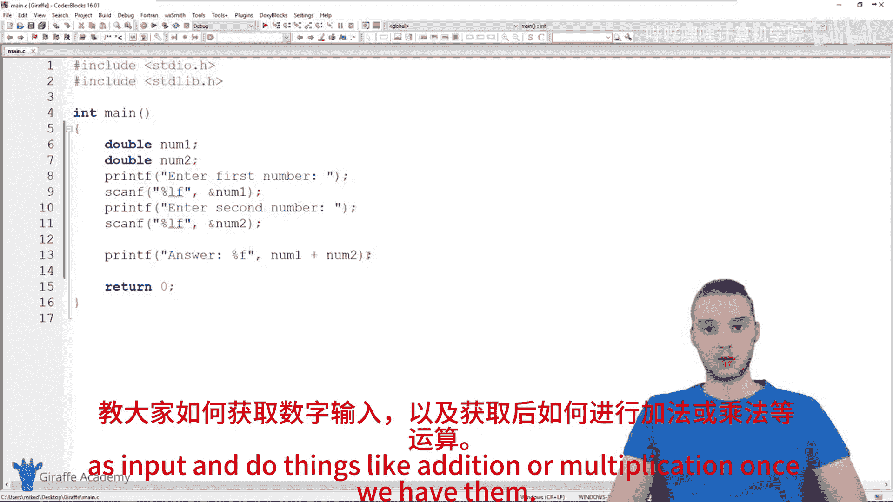

。

