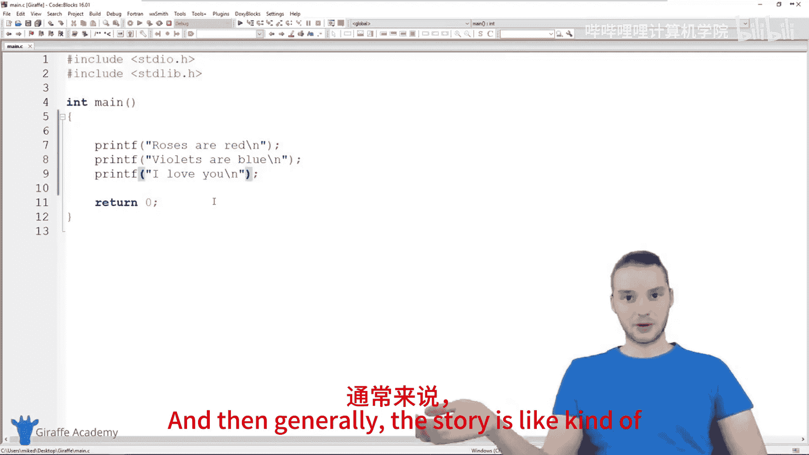
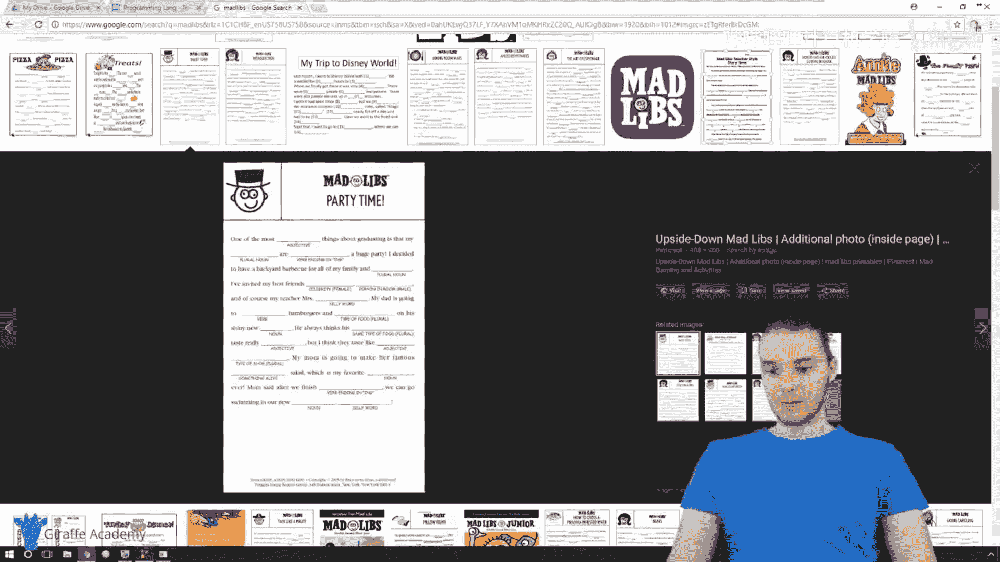
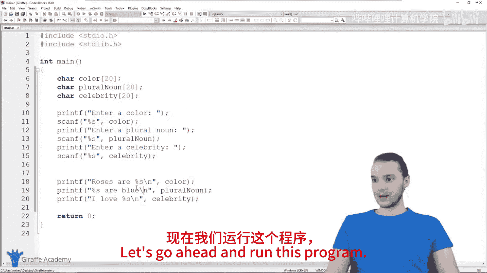
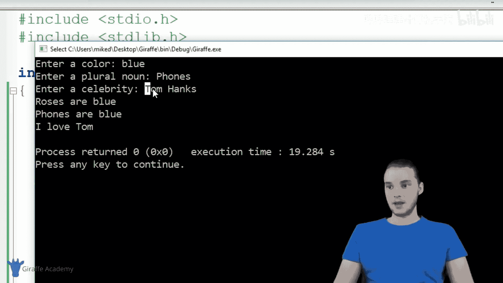
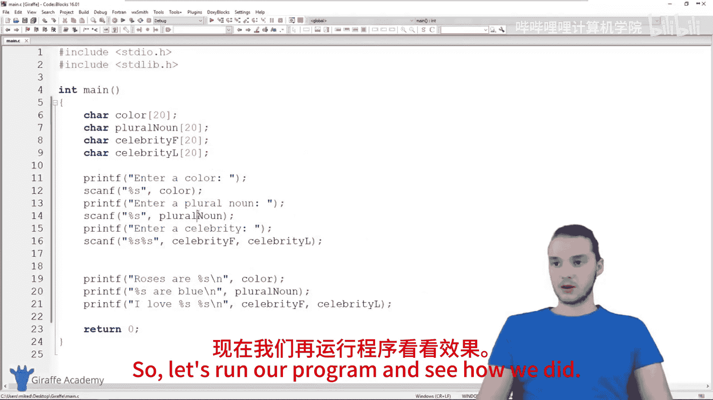
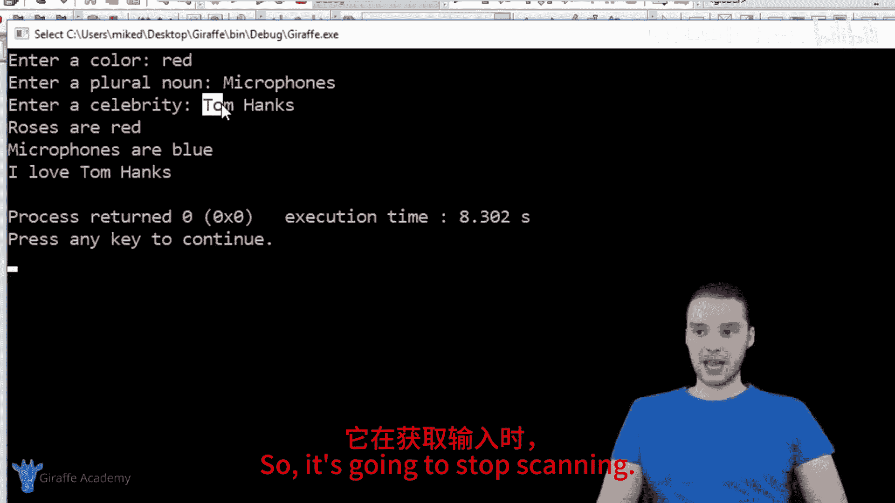
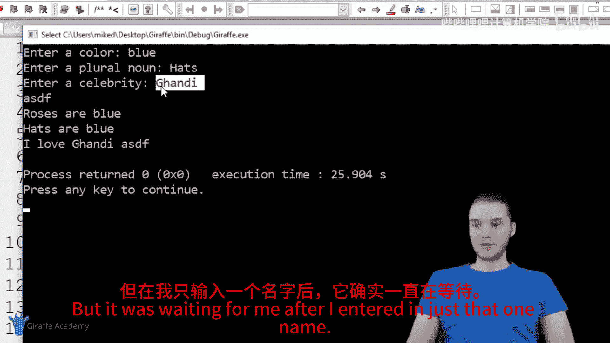
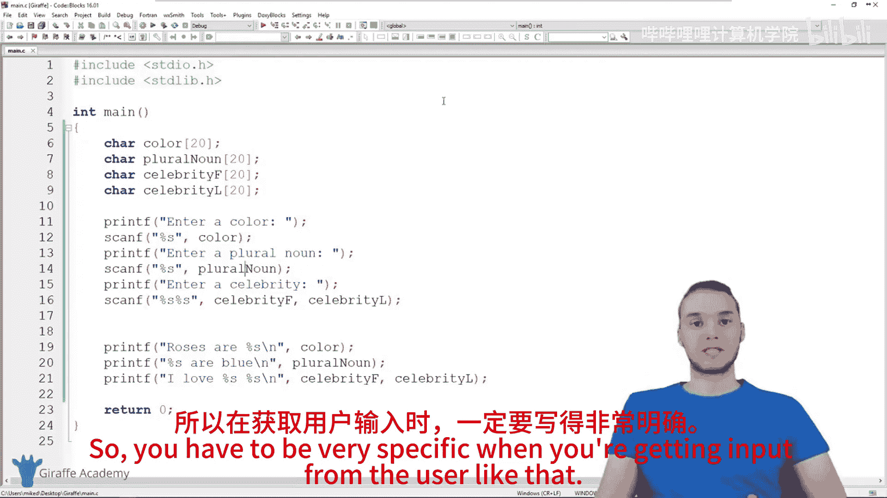

# 【油管千万订阅 freeCodeCamp】面向C语言编程初学者教程 Tutorial for Beginners in C Programmin（中英双语字幕） p14 C编程初学者教程第十四节：构建Mad libs游戏 -BV1ug4wzBEhT_p14-

In this tutorial， I'm gonna to talk to you guys about building a little game in C。 more specifically。

 we're gonna be building a Madlibs game。 Now if you've ever played the game Madlibbs。

 it's basically a game where you write down a bunch of random words。

 So it could be like nouns or verbs or someone's name or verb ending an IG， something like that。

 you take all of those words that you enter in and you kind of sprinkle them in into a story。

 and then generally the story is like kind of funny because it has all these random words in it。

 So actually if we head over to my web browser you see I have a picture of a madlib up here。

 and basically you just add in a bunch of random words into the story。

 and then you'd read the story back and it could be kind of funny。

 So I'm gonna show you guys how we can build something like that in C。

 And we're also going talk about some more ways that we can use that scan f function that I showed you guys in last tutorial。

 So over here， we have a little story that I printed out， it just says roses are red。

 violets or blue， I love you kind of like a classic poem。😊。

But I think this poem would be a lot funnier if we turned it into a madlib。

 So that's exactly what we're gonna do。 I'm going to replace roses or red。

 I'm gonna to replace red with a random color。 So we're just gonna have the user enter in a color。

 I'll replace violets with a plural noun。 So we're gonna have them enter in a plural noun。

 And I'm gonna have instead of saying I love you， we're gonna say I love and then a specific celebrity。

 So I'll just type in celebrity right there。😊，All right。

 so this is basically what we're going to be out， we're going to be printing out， roses are。

 and then whatever color they enter in plural nouns are blue and then I love whatever celebrities。

Let's talk about actually creating this program。 So we're actually going to need to do a couple things。

 And actually， the first thing I want to do is I want to create variables。

 We're going to create variables to store the color that the user inputs。

 the plural noun that the user inputs and the celebrity， the user inputs。

 We're going to create three variables。 And these are basically going to be character strings。

 So they're going to be collections of characters and we can store them in a variable。

 So I'm going to create some of these variables。😊，Why don't we create one for color and remember whenever we create a string or like a collection of characters。

 we need to make these open and closed square brackets。

And what I also want to do because I'm not going to be giving color a value right away。

 In other words， we're letting the user determine the value of color。

 I just need to tell C how many characters we want this string to be able to store that way C knows how much memory it needs to allocate for this variable。

 So I'm just going say 20。 and we'll basically just say they can enter in a color that is up to 20 characters。

 We're going to do the same thing for plural noun。And again。

 we'll let them enter in 20 characters maximum。And finally。

 we're gonna do the same thing for celebrity。 So， again，20 characters sounds good。 Allright。

 now that we have our variables created， I want to actually get information from the user。

 So I want to prompt the user for information。 and I want to take the information that they entered in。

 and I want to store it inside of each one of these variables。

 First order of business is to prompt them for input。 So I can just say print F。 And inside here。

 we'll basically just type in enter a color。😊，Once we've prompted them to enter the color。

 we can actually get whatever color they enter and store it inside of a variable。

 I'm going to use a function called scan F and over here I'm going to accept a string so I'm going to accept a string of characters and we're going to store this inside of our color variable just like that。

And remember， if you watch the last tutorial， we used the Ampersand here when we were getting numbers or also you'd do the same thing if you were getting a single character。

 but when we're getting input for a string of characters。

 we don't need that ampers sand so you can just get rid of that。Let's copy these。

 and I'm going to paste this two more times。 So the second thing we want to get from them is going to be the plural noun。

And I'm going to store this inside of the plural noun variable so you can see now we're getting the plural noun and finally we're going to do the same thing for celebrity and again。

 we're going to get that celebrity。Okay， cool。 So now I'm getting the color。

 I'm getting the plural noun， and I'm getting the celebrity。

 So last thing we have to do is we have to take all of these variables and put them into our story。

 right， So we need to be able to print out the story with all of those variables。

 So I'm going to come down here and I'm just gonna say percent S。 And over here。

 we'll pass in the color。😊，Same thing here。 I'm gonna replace the plural noun here with a。Percent S。

 and will pass in the。Plural noun， and finally， same thing for celebrity down here。All right。

 so everything seems to be wired up and you'll notice that I have new lines here so that this story prints out on new lines。

 let's go ahead and run this program and we'll see how we did。

So over here， it's prompting us for a color。 Why don't we enter in magenta。Ener a plural now。

 Let's do microwaves。And enter a celebrity， why don't we just say。Printnce， so when I click enter。

 it's gonna to say roses are magenta。 Mis are blue。 I love prints。

 So we were able to prompt the user to enter in all of that input。

 We took everything that they input。 We stored it in variables。

 and we printed all those variables out inside of our story， and we have our Madlib。

 The program seems to be working really well。 I do want to show you guys one way that this program could mess up。

 So let's go ahead and run this again。😊，So let's enter in a different color。

 I'm going enter in like blue， En in a plural noun。 So why don't we enter in phones。

And now enter in a celebrity。 So I'm going to show you guys one way that we could actually break this program。

 If I entered in a celebrity with a first and a last name like Tom Hanks， when I click enter now。😊。

You'll notice that instead of saying I love Tom Hanks， it's only saying I love Tom。

 Here's the problem。 When we use that scan f function。

 scan F is only going grab characters up to the first white space。 So essentially。

 when we put this space here， we're telling C that we don't want to grab anymore。 But in reality。

 we want to be able to grab the actor's full name。 We want to be able to grab the celebrity's first and last name if need B。

 So this is a situation in C where we would have to modify our little program。

 So what I could do is instead of just getting one variable like the celebrity。

 I could actually get two。 So I could say over here， like celebrity F。

 and that'll stand for celebrity first name。 And then down here。

 we can make another variable called celebrity L。 that'll stand for last name。 So now， when we scan。

😊。

Instead of just scanning for one string of characters。

 I can scan for two strings of characters and we'll have celebrity F。And then， celebrity L。

And down here， we're going to want to do the same thing so we can just say celebrity F and。

Celebrity L。 And we just need to add another percent here。 So it's gonna say。

 I love celebrities's first name and celebrityties's last name。 So let's run。

 let's run our program and see how we did so I can enter in like red and。😊。

Microphones， and now we can entering Tom Hanks。And we're printing out the actor's first and last name。

 So that's one way that we could remedy this program and make it be able to accept two inputs with a space in the middle。

 And that also just shows you guys a little bit more about how scan F works。

 So it's going to stop scanning， it's going to stop getting the input at that first space。 Now。

 here's the thing about this program。 though， If I wanted to enter in a celebrity。😊。

With who only had one name。 So if I only wanted to enter in one。

 the program actually isn't gonna be able to handle that。 So if I said like hats。 And down here。

 if I said like Gandhi and I click enter， you'll notice that it's still waiting for me to enter in a last name so I can enter in something here。

 and then the program will work but it was waiting for me after I entered in just that one name。

 So that's something that you're gonna have to， you know play around within your programs。

 basically C is gonna to force you to be very specific about what the users entering。

 So if the user needs to enter two things like two words and you need to specify that。

 If the user is only gonna enter in one word， you have to specify that。

 So you have to be very specific when you're getting input from the user like that。

。