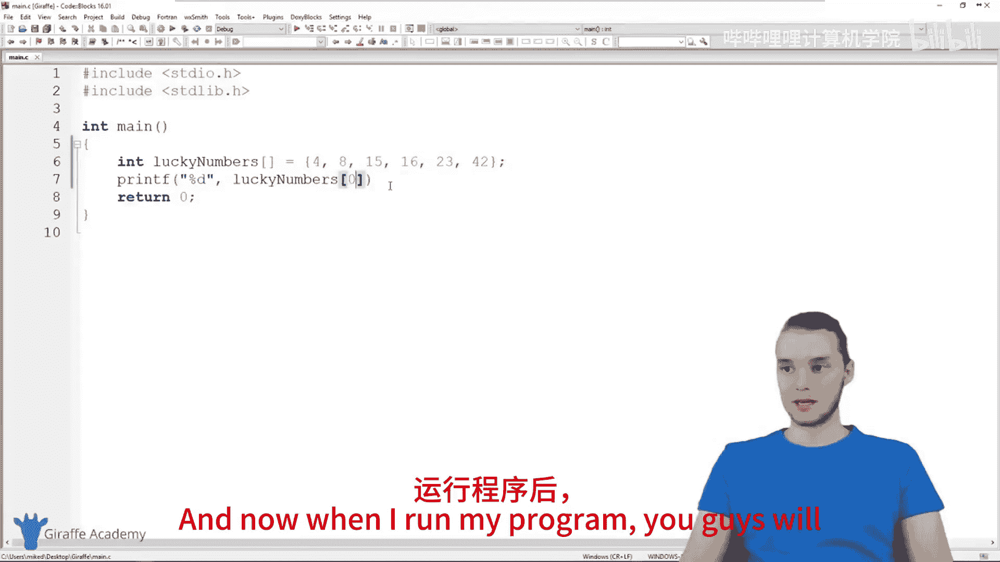
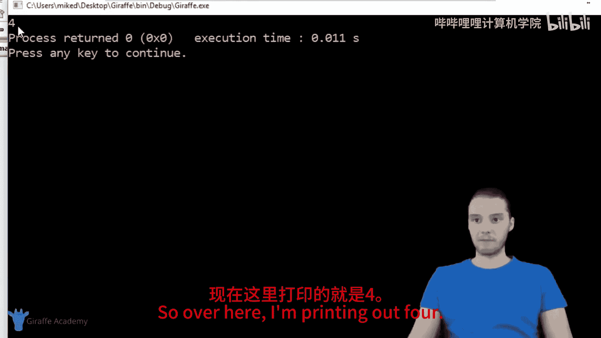
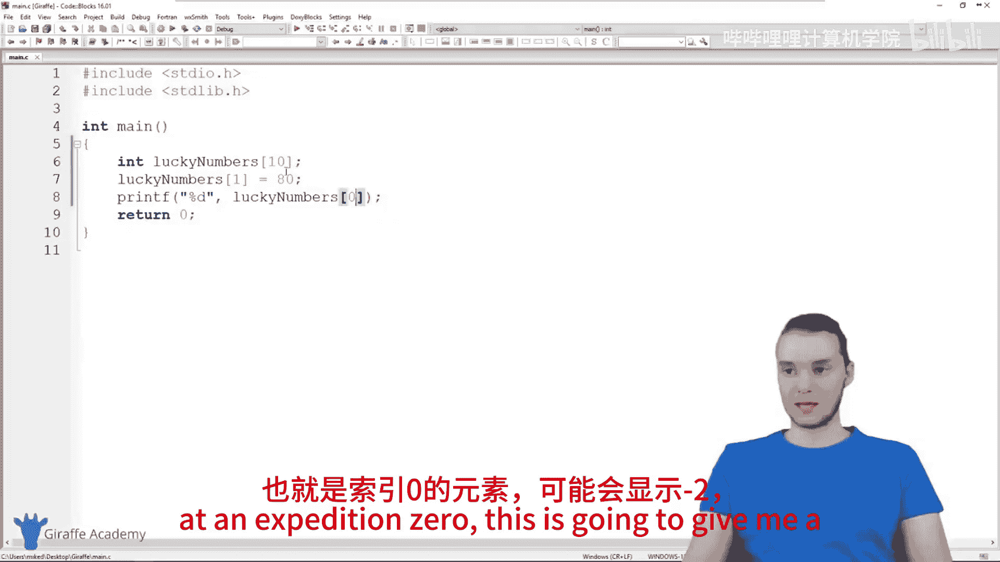
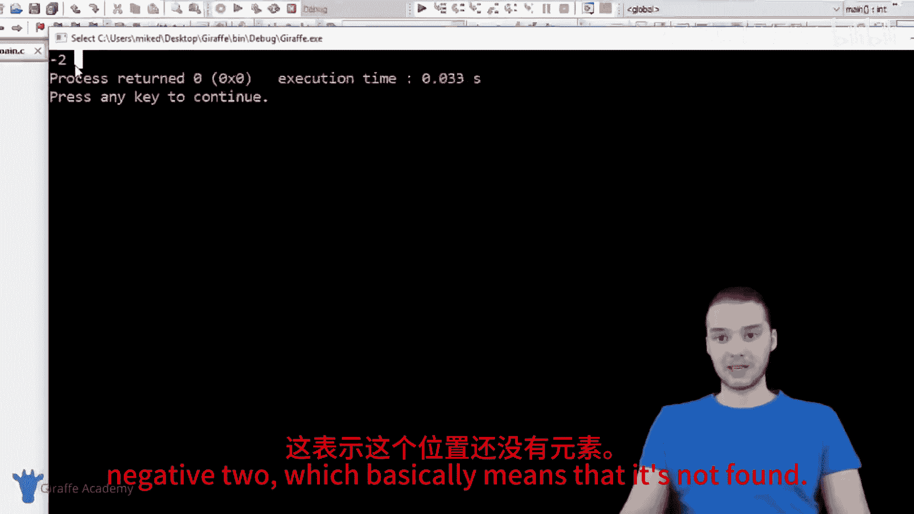
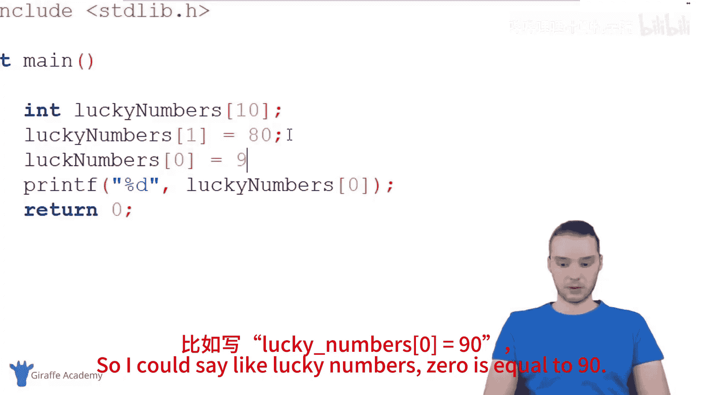
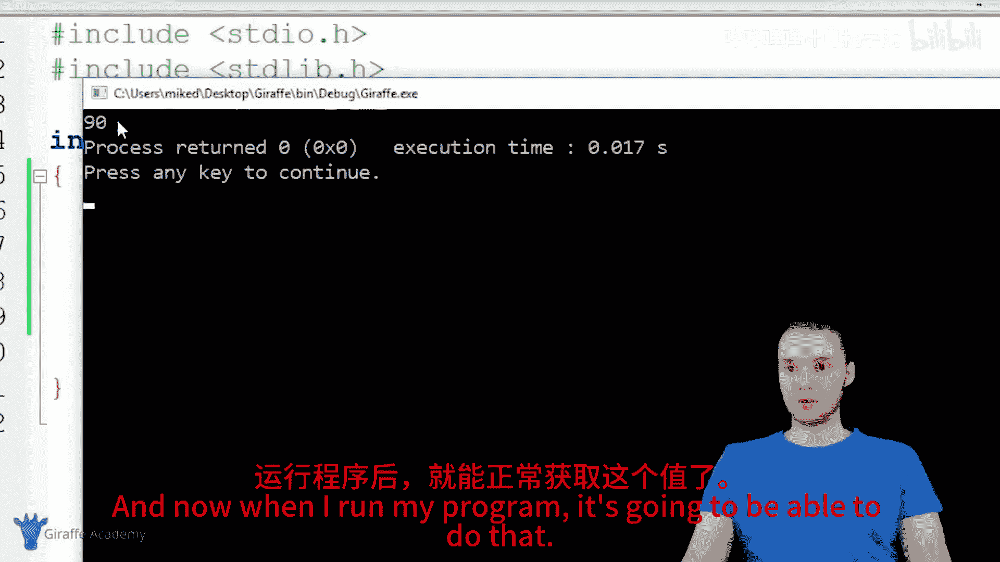
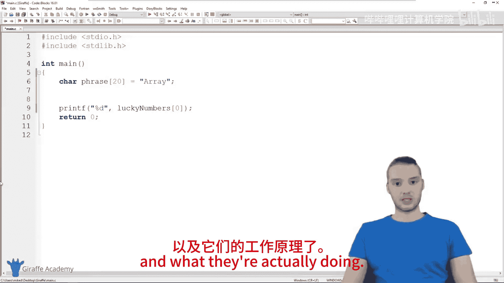

# 【油管千万订阅 freeCodeCamp】面向C语言编程初学者教程 Tutorial for Beginners in C Programmin（中英双语字幕） p15 C编程初学者教程第十五节：数组 -BV1ug4wzBEhT_p15-

In this tutorial I'm going to talk to you guys about using arrays in C a lot of times when we're writing our C programs。

 we're going to be dealing with a bunch of different data and one of the things we can do to control and manage and sort of keep track of and organize that data is put data inside of things called arrays and an array is really useful because it's basically a container where we can store a piece of information。

ButWhat happens in your programs when you're dealing with huge amounts of information。

 specifically huge amounts of information that are related。

 Imagine I had a list of like a bunch of names or a list of a bunch of numbers that I needed to keep track of。

 let's say I had like a list of 100 numbers， I wouldn't want to have to create100 different variable to store all of those different numbers。

 And this is where arrays come in。 an array is essentially a data structure where we can store a bunch of different data values。

 So inside of an array， unlike a variable where I can only store one value。

 I could store hundreds or thousands or even millions of values。 So inside of a single array。

 I could store like5 things or7 things or 10 numbers or 20 characters。

 know I could store a bunch of different pieces of information。

 And then all that information would be nice and neat and organized in my programs。

 I'm gonna show you guys how to create arrays。 We can create an array。

 a lot like we create a normal variable。 and a variable in array or。😊。

Very similar A variable is basically used to define a container that stores a single value and an array is used to define a container that stores any number of values。

 So the first thing we're gonna have to do when we create an arrays。

 give C some information And the first piece of information is what type of data we want to store inside of the array。

 So for example， I could say int， and now I'd be creating an array that would hold integers。

 if I said char， I'd be creating an array that would hold characters or if I said like double same thing but for double numbers。

 So why don't we create an array of integers and I'm just going call this lucky numbers。

 whenever I create an array， I always want to use a special little symbol and this symbol will tell C that instead of just create a normal variable。

 we want to create an array and it's an open andcloed square brackets。

 whenever I use these open encloed square brackets after the name， it's going to tell C like okay。

 we want to store multiple pieces of information。😊，Now。

 there's a bunch of different ways we can create these arrays。 The easiest one， though。

 is to just say equals。 and I can make an open enclosed curly bracket。

 And inside of this open enclosed curly bracket， I can just start typing out some numbers that I want to put in this array。

 So we could type out like 4，8，151623，42 I could basically type out as many numbers as I wanted。

 and I could store them inside of this array。 So over here know I printed out six numbers。

 I could print out 600 if I wanted， the only thing that's limiting me is how many I can actually put in here。

 So you'll notice that I put in the piece of data。 So like 4， for example。

 and then I put a comma and a comma is going separate all the elements in the array。

 So we would say4 is the first element in the array 8 is the second element in the array。

 These are all considered to be elements。😊，Inside of this array。

 And what's cool about this array is it's now storing all of this information。

 So unlike a variable where we can only store one value， now in this array。

 I'm storing six different numbers。 So if I wanted。

 I can print this out and I'm actually going to print this out just to show you guys。 So remember。

 we're going to print out a number。 and I'm going show you guys how we can access specific elements inside of this array。

😊，So all of these numbers are stored in this lucky numbers array， in this array structure。

 But the question becomes， how do we access them， right， How can I gain access to one of these， Well。

 I could say percent D， So I'm going to print this out。 and now I can just say。Lucky numbers。

 So I'm going refer to the name of the array。 And when I want to access a specific element。

 I can make an open and closed square bracket。 And inside of this open and closed square bracket。

 I want to put the index of the element that I want to access。

 So all of these elements in here have a specific index and I can access them by putting the index inside of this square bracket。

 So if I wanted to access this four， for example， I can put a0 inside of here。

 And now when I run my program， you guys will see that we'll be able to print out that4。😊。

So over here， I'm printing out four。

If I wanted to access this 15， I can put a two in here， so now when I run my program。

 I'll be accessing the 15 as you can see。So one thing you might have noticed by now is that we start the indexes in arrays at zero。

 So when I wanted to access this4， instead of putting a one in here。

 I put a0 in here you might think that four would be at index position1 because it's the first element in the array。

 But in C we start array indexes at 0。 So actually the first element。

 this4 is gonna be at index position 0 So if I was going to write out indexes。

 I would say like4 is it index position 0， this8 is an index position1。

 this 15 is it index position 2，16 is index position 3 etc。

 So that's going allow me to access all these elements inside of the array individually So I could print them out just by referring to the index inside of these square brackets。

 Another thing I can do is I can modify some of the elements inside of here。

 So let's say I want to modify lucky numbers index position 1。 So let's say I want to modify this8。

 So I don't like this8 anymore。 So I could basically just assign。

This a different value like I normally would， so I could say lucky numbers。

And I can make an open closed square bracket。 we can say one。

 and I can just set it equal to something else。 So I could set this equal to like 200。

 And now when we print out lucky numbers one， instead of printing out an8 it's going to be printing out a 2 hundreds。

 So let's go ahead and do that and run my program and you'll see we're printing out 20 instead of eight。

 So you can modify any of the individual elements inside the array， just by referring to the index。

 And really when you think about this conceptually。

 an array is basically just holding a bunch of variables。 but those variables don't have names。

 So when I access lucky numbers one， it's the same as me accessing an integer variables。

 it's just that the array is holding potentially hundreds or thousands or millions of these different variables。

 So an array is a very useful structure， especially if you're storing data that is very similar。

 So like I said， I could do this with an I could also do this with a double。

 I could do this with a float， I can do this with whatever I wanted。 But there's gonna be。😊。

Situations where you might not necessarily know all the elements that you want to put inside your array so let's say I'm creating an array and I don't know what numbers I want to put in it yet so maybe I just like want to create it。

 I want to tell C that we need it， but I don't want to necessarily put anything in it right away。

Well up here， we're basically saying lucky numbers， the open and closed square brackets。

 and then we're giving it a bunch of information， but if we don't want to give it all that information instead I can just put a semico in here。

But inside of these square brackets， I need to tell C how many elements that this array can hold。

 so I need to tell C like hey， this array can only hold like 10 elements or this array can hold 20 elements or whatever。

 so let's say we wanted an array that could hold like 10 elements。I can put a 1 right here。

 and now the capacity of this integer array is 10， so it has the potential to hold 10 items。

And what I could do is I could come down here and I could start assigning values to those items so I could say like。

Lucky numbers1 is equal to 80 right， so I'm giving lucky numbers1 a value and now over here I could print that value out onto the screen and you'll see we're printing out of 80。

 but if I tried to print out， for example， lucky numbers0。

 so the lucky numbers at in Exposition  zero。

This is gonna give me a negative 2， which basically means that it's not found， so。

Basically means that there's no element inside of lucky numbers at index position 0。 But if I wanted。

 I could do that。 So I could say like lucky numbers。0 is equal to 90。 And now when I run my program。

 it's going to be able to do that。 So it'll be able to get that value。 So in a lot of situations。

 you're just going to want to give these arrays values up front right off the bat。

 But in a lot of other situations， you're not going to necessarily know what's supposed to go in there。

But in a situation like that， you still have to tell C how many elements the array is going to hold。

 You still have to like rigorously define like， hey， this array can only hold 10 elements。

 And that's just so C is able to allocate enough memory in order to hold all of those elements。

 So that's kind of the basics of working with arrays。 Now。

 I do want to point out one thing that we've been using in this course。Has been a strings。

 So I've been creating character strings。 so I could say like char phrase。

 and I could set this equal to draft Academy or other times in the program。

 we created like when we were making our little game， we created an array。

 And I would just say like 20。 And then I would get input from the user and put that information in here。

 this is basically a string of characters。 So anytime we create a string in C。

 like if I was to create a string over here， I called it like array， whatever， this is an array。😊。

So we've kind of just been taking this for granted。

 like I've kind of just been calling this a string or calling it like a string of characters。

 but it's basically just an array of characters。 The only difference is this is such a common thing to use in our programs that C makes it a little C makes it special and makes it really easy for us to create。

 But just like that array of integers， this is also an array。

 So now you kind of have a better understanding of what strings are and what they're actually doing。

😊。

。