# 【油管千万订阅 freeCodeCamp】面向C语言编程初学者教程 Tutorial for Beginners in C Programmin（中英双语字幕） p16 C编程初学者教程第十六节：函数 -BV1ug4wzBEhT_p16-

I'm to talk to you guys about functions in C Now function is basically just a collection of code that performs a specific task。

 So what you can do is you can take a bunch of code。

 know maybe like five or six or 20 lines of code and put it inside of a function and then when you want to access that code that's inside the function you can call the function and generally when you create a function。

 you'll design the function to perform a specific task。

 So the function will have a specific purpose So I'm gonna to show you guys how to create function how to work with them and we'll just talk about the basics of using functions。

 Like I said， a function is basically just a collection of code that does a specific task。

 So we can actually create a function here in our C program Now you'll notice up here we have this block of code it says int main and there's an open andclo parentheses and an open andclo curly brackets and we've kind of just been using this for the entire course like up to this point in the course we've just been kind of using this main。

A little block of code here， but actually this is a function。

And sometimes you'll hear people call this a method as well。

 So function and method are two words that essentially mean the same thing， but you generally in C。

 we're gonna to refer to these as functions。 but this is called the main function。

 and the main function is basically a function that's going to get executed when we start running our program。

 And so we've already been using a function， this main function。

 but if you want we could actually create other functions in our program So I'm going show you guys how to do that。

 So let's go down and we're gonna go here outside of this function。

 And the way you can tell we're outside the function is we're outside of this ending curly brackets。

 So down here I'm going to create a function。 and when we create a function。

 we actually have to give C a couple pieces of information。

 The first thing we have to tell C is the return type of the function。

 And so actually we're gonna talk more about return type in the next tutorial。 But for now。

 just know that return type is basically the type of data that the function is going to return to the user。

 So sometimes。😊，Your function can actually give information back to whoever calls it。 In our case。

 though， we're just going to say void and void basically means that this function isn't going to return any information。

 That's the first thing that you have to tell C。 The second thing we have to do is give this function a name。

And generally， when we're naming a function， we're going to want to name the function according to what it does。

So in our case， we're going to create a function that says hi to the user。

 so I'm just going to call this function say hi because that's what it's going to do。

 it's going to say hi。Whenever I create a function now， I want to make an open enclosed parentheses。

 and I'm going to make an open enclosed curly bracket。

 So now any code that goes in between these curly brackets is going to be considered code that's inside of this function。

 So let me show you guys。 I'm just gonna make us a very simple function。

 We're going to do one thing inside of here。 We're just going make a print F。

 And we're going print out hello user。 So I've created my function。 It's called say hi。

 and inside of this function， we're just printing out hello user。

 So now let's go ahead and run our program and see what happens。

 So I'm just going to build and run my program。😊。

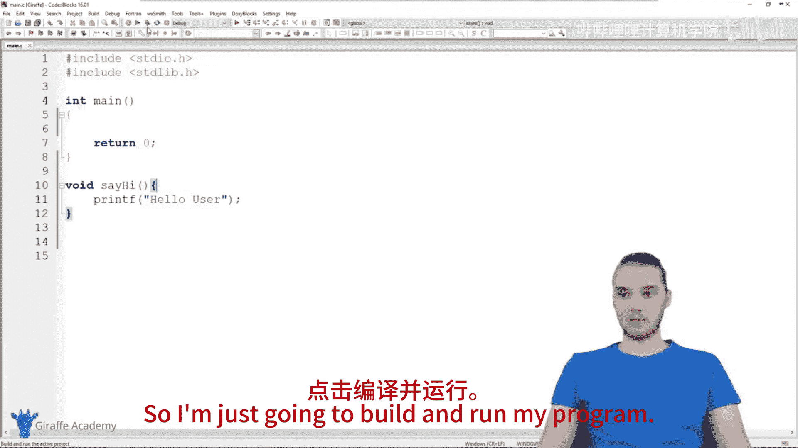

But you'll see up here that hellello user doesn't get printed out right In other words。

 I came down here， I said printf hello user， but this didn't get printed out。

 and this is the first lesson with functions is that in order to use the code inside of the function we have to call it。

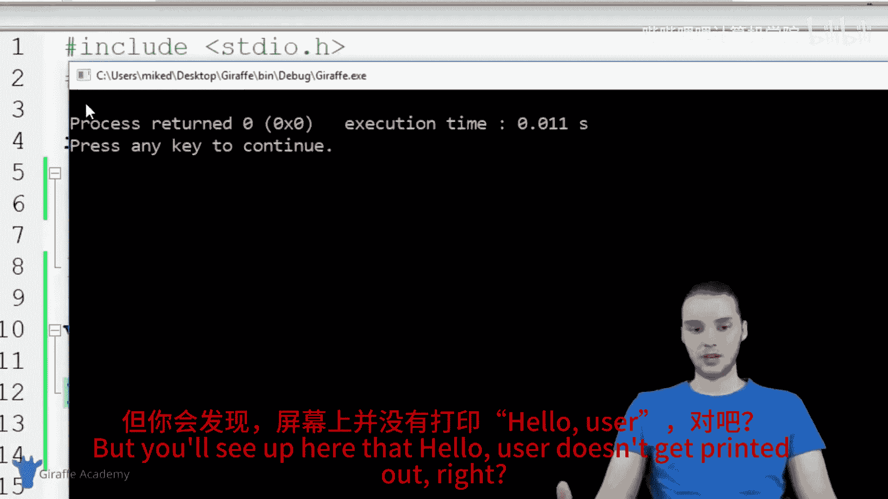

Calling a function basically means we're telling C that we want to execute all the code inside of it。

 So if I want to execute this code， I can call this function。

 And the way that I do that is just by typing out the name of the function and an open and closed parentheses。

 So now instead of just printing out nothing C is actually going to go over here and execute all the code in the say hi function。

 So let's run our code and you'll see now we're printing out hello user。😊。

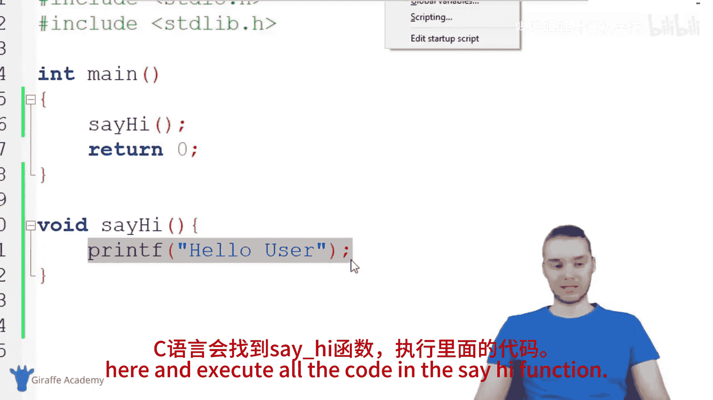

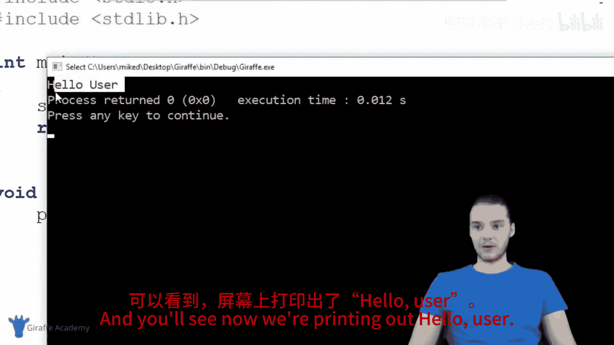

So the difference between this main function up here and this say hi function is this main function is a very special function。

 right when we run our program， this main function basically gets called。

 Then if we want to use other functions， we can call them from inside of this main function。

 And that's sort of how this is going to work。 So also， I want to show you guys one other thing。😊。

I just want to illustrate the flow that these functions take I want to show you guys how these get executed by the program。

 so I'm printing out top and I'm printing out bottom and I'm calling say hi right here。

 so now I'm going to run my program again。

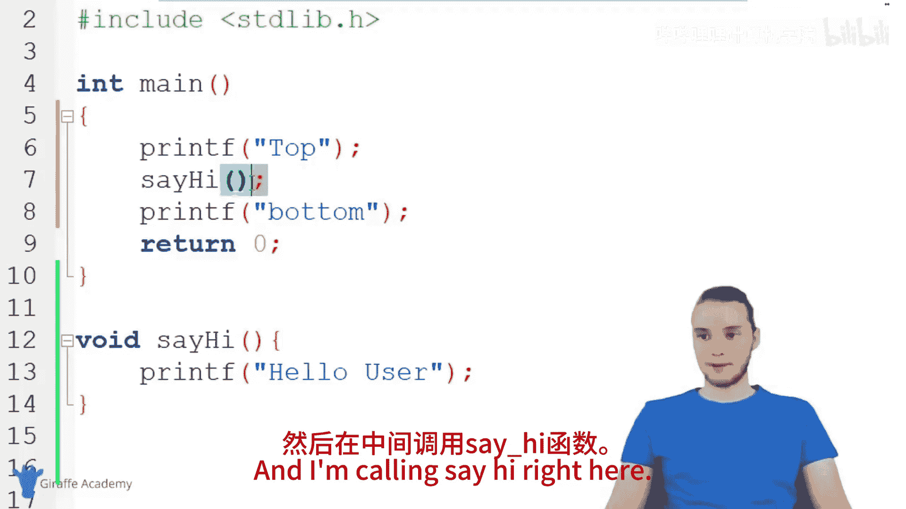

And you'll see we're printing out top， and then we're printing out hello user。

 then we're printing out bottom。 And this might have looked a little bit better if I put new lines。

 but essentially what's happening is when C goes to execute this program。

 it's going execute this first line of code print so it's gonna print out top then we're telling C that we want to call the say hi function。

 C is now going jump over here to the say hi function。

 and it's gonna to execute all of the code inside of here。

 So in this case we just have one line of code， but I could put any number of lines of code inside this function。

 So if I have like five lines of code would execute all five of those lines of code。

 and it's going jump back up here and it's going move on to the next instruction。

 So that's kind of how that works。 And that's sort of the basics of writing functions anytime you have a block of code or a bunch of code that does one thing or that you want to encapsulate into its own little container that you can call you can put it inside of a function。

 And then whenever you。

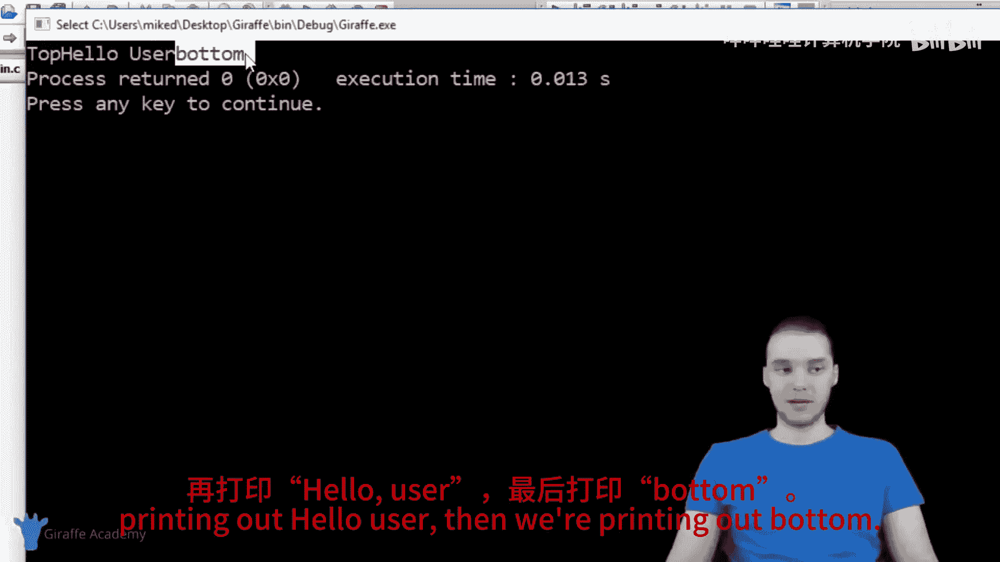

W to access it。 you just call it。 But these functions can actually do a lot more。

 So one thing we can do is we can give these functions some information。

 so I can actually give this function a piece of information and it can use that information to do different things。

 This is what's called a parameter and a parameter is basically just a value that we give to a function。

 So let's say in this say hi function， instead of just saying hi to the user。

 we wanted to say hi to someone specifically。 I can actually come down here in these parentheses and I can specify a function parameter。

 and I can specify a parameter a lot like I would specify a variable。 So I could say， for example。

 char name and an open encloed square brackets。 And I'm basically what I'm saying down here is this say hi function is going to take as a parameter。

 In other words， as an input。😊，A string of characters， called name。

And what I can do is I can come down here and I can actually print that out so I could say percent S and we could print out name。

Now， over here， when I call this say hi function， because I specified that it's gonna take a parameter。

 I have to give it a string。 So I could give this a string like Mike。 like I'll put my name in here。

 When I call this say hi function Now， I'm passing the value Mike into this function。

 So Mike is gonna get stored inside of this name array。

 and we're gonna to be able to print it out down here。 Let's go ahead and run our program。

 and you'll see it says hello， Mike。 So instead of saying hello user now。

 we're able to customize what it says。 The cool thing about this is I could copy this line of code。

 Like I can call this function a bunch of times with different names。 Actually。

 I'm gonna put a new line down here。 So this is more obvious。 I could say hello， Mike， hello， Tom。

 hello。😊。

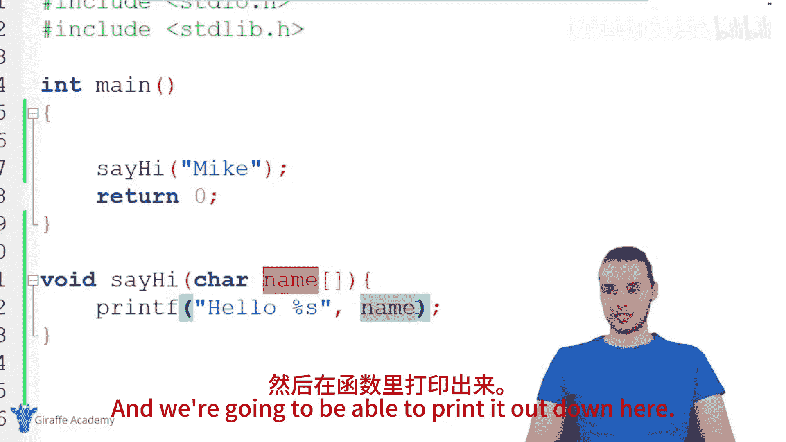

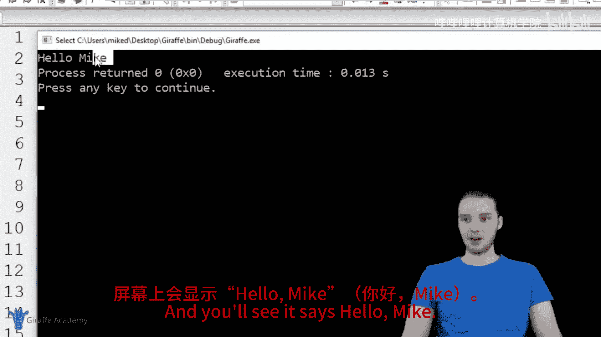

Oscar， now when I run my program。

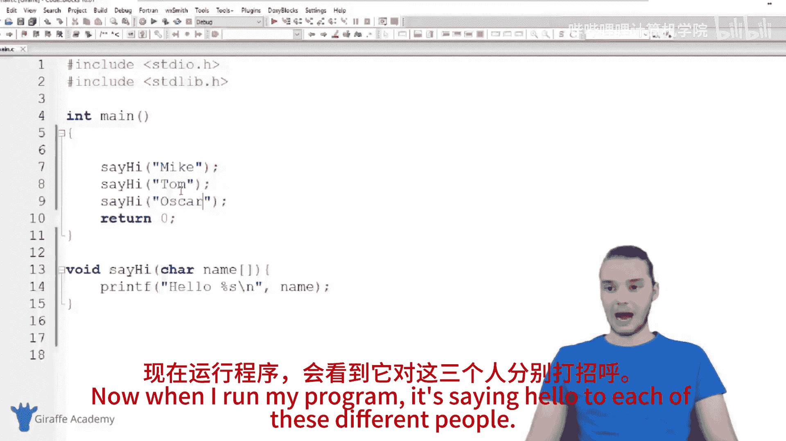

It's saying hello to each of these different people because we define the function and we can pass it different names and depending on what we pass it。

 depending on the parameter that we give it， it'll perform its task a little bit differently。

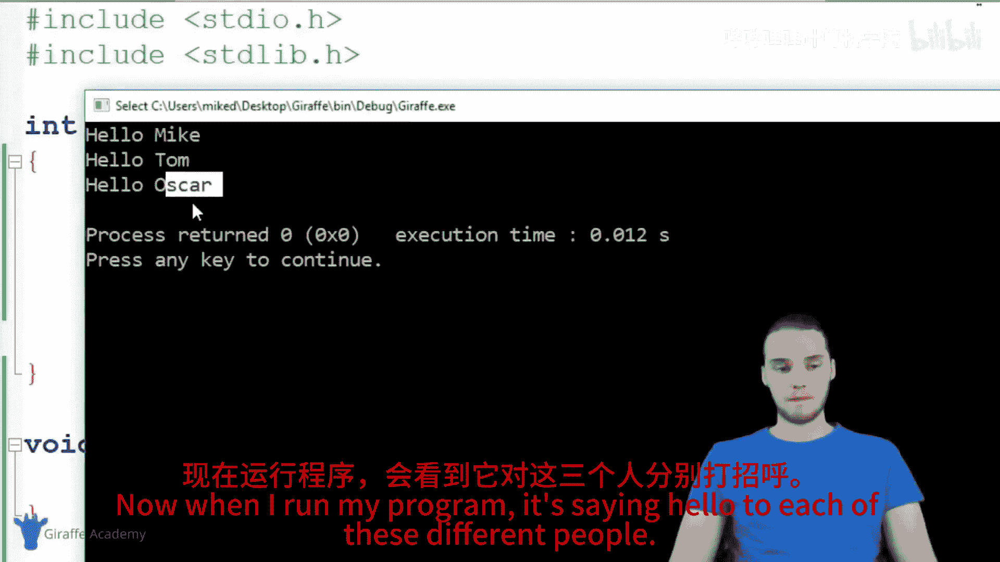

You can also specify multiple parameters。 So let's say in addition to accepting the name as a parameter。

 we also accepted their age。 So I could say cha name。And then down here， I can specify int age。

 And now we're basically saying that this is going to take an age as well。 so I could say hello。

And then I could say you are。 and will say the age。 So now， over here。

 instead of in addition to just saying name， we can also say age。

 So now when I run this function and when I call it， I have to also give this an age。

 So we could say like 40。23。And70。AndNow this is gonna print out all that information for us。

 So hello， Mike， you are 40， hellello， Tom， you're 23 hellello Oscar you're 70 and you can pass as many parameters as you want into one of these functions。

 You always just have to make sure though that you're passing a parameter when you're calling the function just like that。

 So that's the basics of using functions and in the next tutorial we're going to talk about this guy over here。

 which is the return type and we're going to look at how we can get information back from a function。

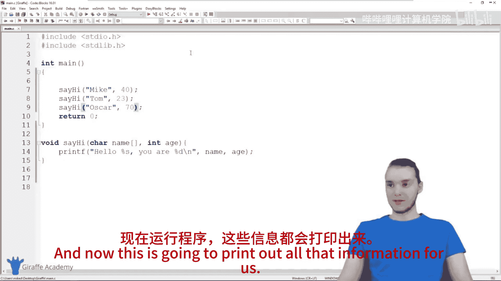

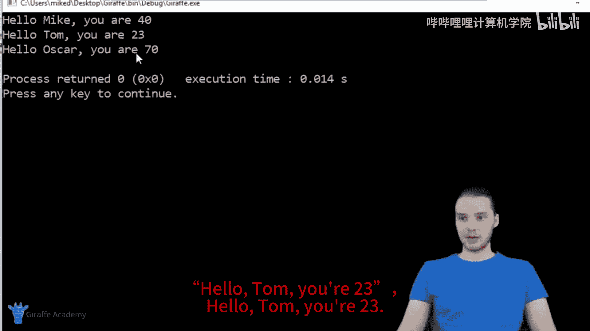

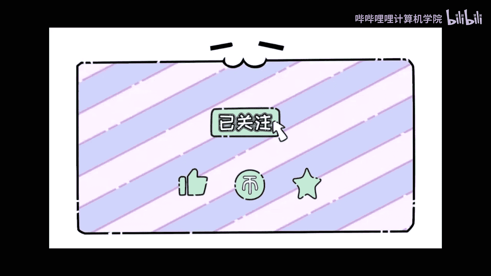

。