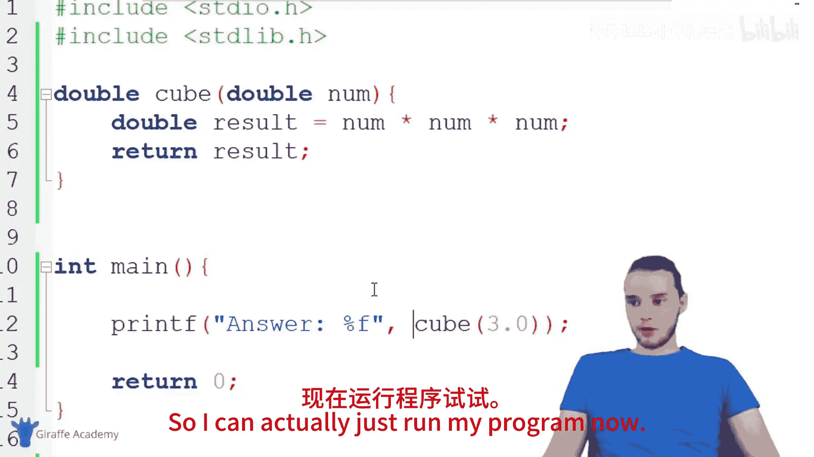
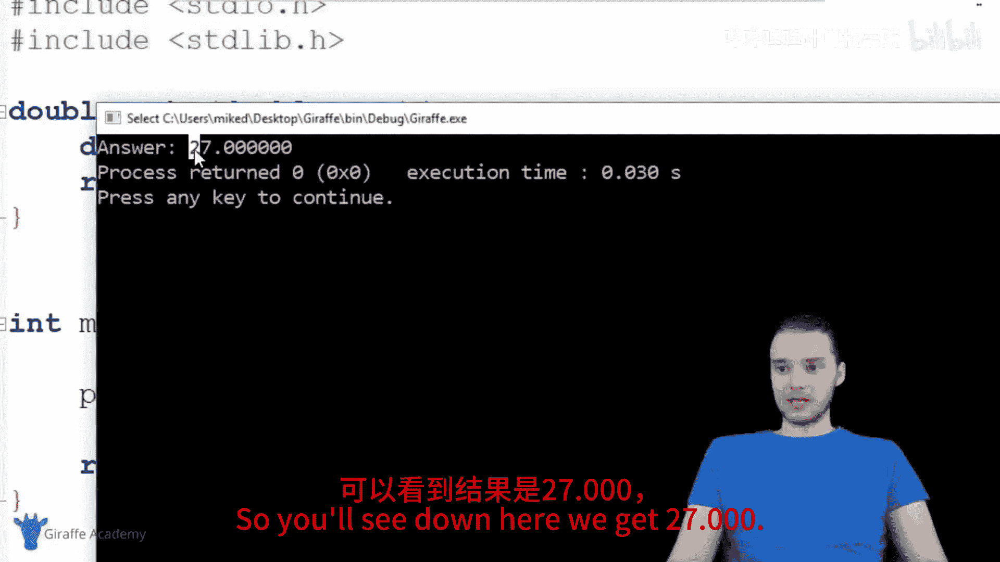
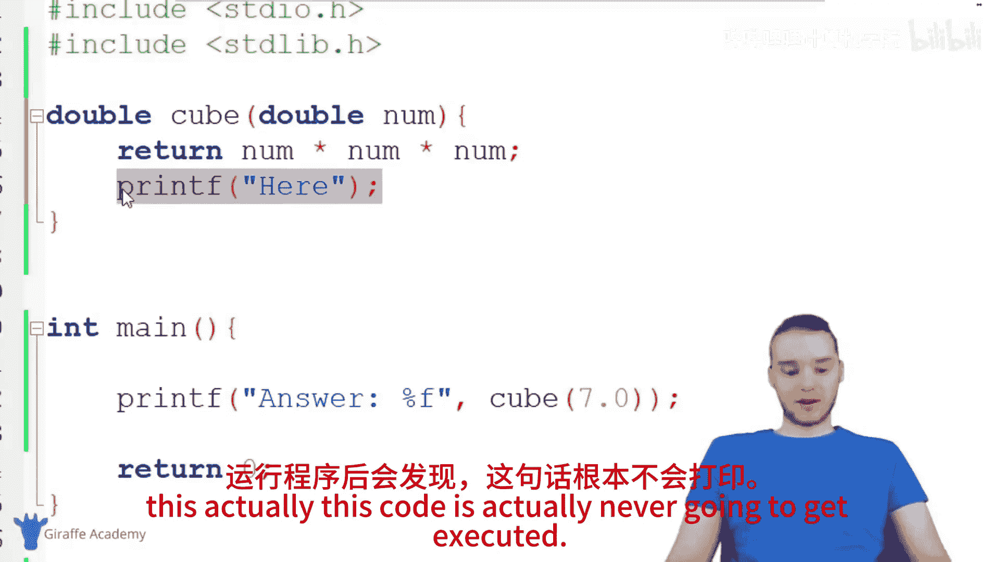
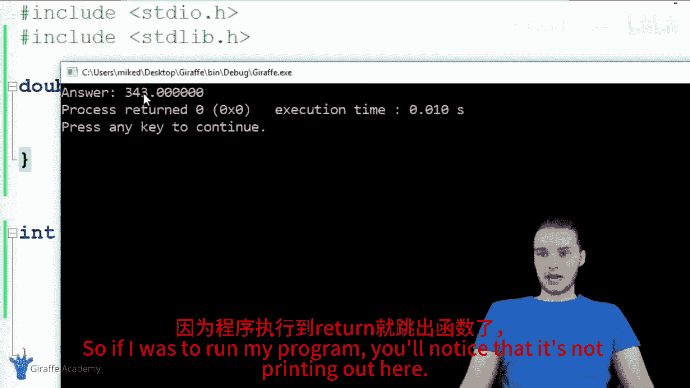
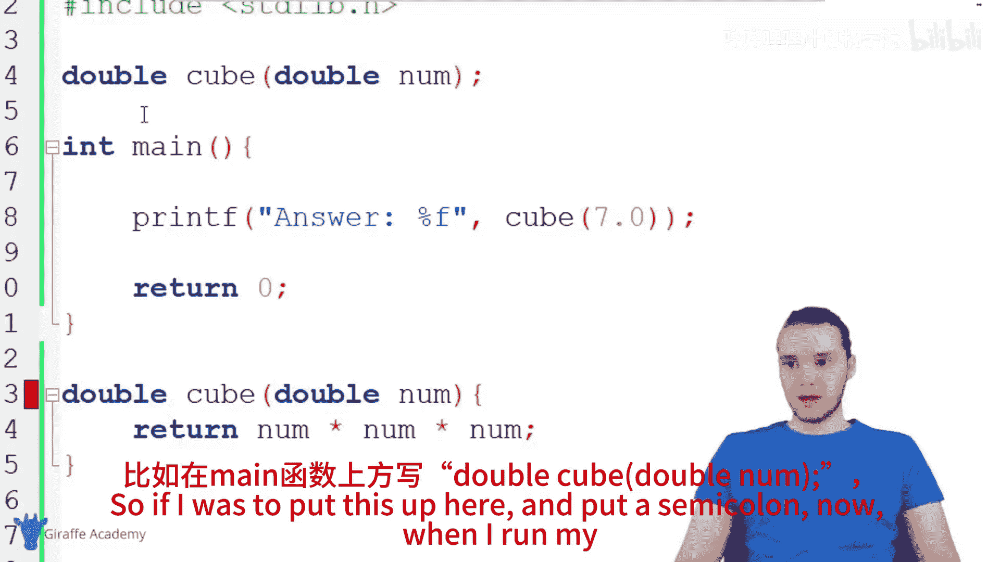
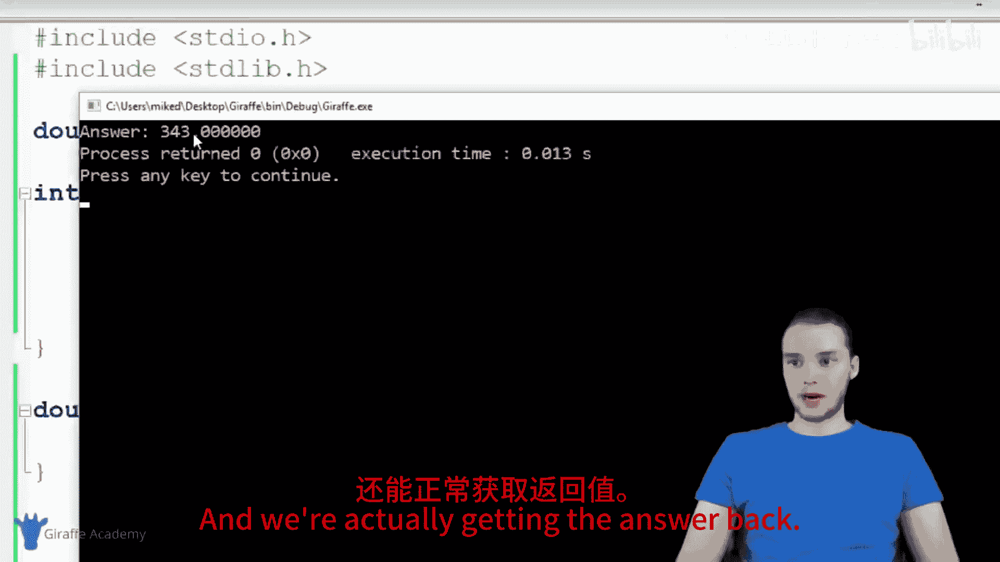
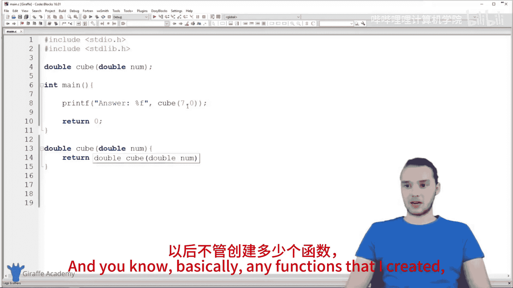
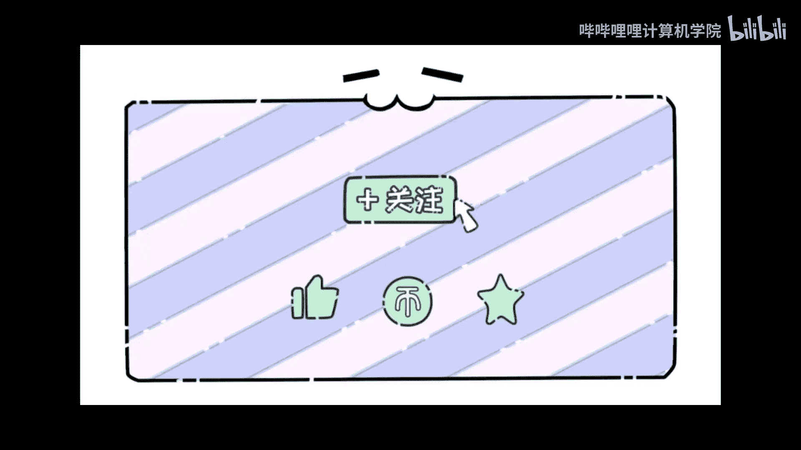

# 【油管千万订阅 freeCodeCamp】面向C语言编程初学者教程 Tutorial for Beginners in C Programmin（中英双语字幕） p17 C编程初学者教程第十七节：return语句 -BV1ug4wzBEhT_p17-

In this tutorial I want to talk to you guys about return statements in C to return statement is a special line of code that we can include in our functions。

 which will allow them to return information back to whoever called them so I can write a function and I can have that function give information back to whoever called it that could be information like the result of some operation or it could be a message telling whoever called it how the function went。

 it could be anything like that So I'm gonna to show you guys basically how we can do that and I'll just give you an overview of like return types and all that stuff so down here I'm actually going to create a function and we're going create a function that cubes a number so when you cube a number generally you take it to the third power so I could say like two raised to the third power which is the same as just saying two times two times two this would be cubing a number you've taken it to the third power So I'm gonna make a function that's going do that Basically this function will accept one parameter which is gonna be a number。

And it'll cubebe that number。 and then once it's done cubing the number。

 it'll give that value back to the call。 and you guys will see how that'll work。

 So I do want to point out one thing。 whenever we are returning values in our function。

 So if you're going to write a function that's going to return a value。

 you always want to put it above the function that's going to be calling it。 So for example。

 like this main function down here， this is the first function that executes。

 so any code we put in here is going to get executed first。

 if I want to return a value with my function， I'm going to define the function here above the main method。

 and there's a couple reasons why we want to do that。

 essentially it'll just make sure that everything works correctly。

 So we want to make sure that we define this function before we actually call it down here and get a value back。

 So the first thing that I need to tell C when I want to create a function is what type of data I want to return。

 if you've been following along with this course， you'll know in the last tutorial。

The void return type， which basically means we weren't going to return any information but now we want to actually return information right so we want to cube a number so why don't we return a double and you can put any data type here you want you could also put like int or character or a character array but let's just do double and we're gonna give this a name So I'm gonna call this cube and I'm gonna make an open andcloed parentheses and inside of this parentheses。

 We're going to allow this method or we're gonna allow this function to accept one parameter as input So it's just going to be another double and we'll call it nu。

 So basically what we want to do is we want to cube nu and we want to give that value back to the user So over here I'm just gonna create a variable it's just going be another double called result。

 and I'm going to set it equal to nu。Times numb。 Time numb。So basically。

 this variable result now represents or now stores the cubed value of none。

All we need to do to return this value now is just say return result。

And this return keyword is basically going to do a couple things。

 The first thing it does is it breaks us out of the function。 So wherever we put that return keyword。

 it's going break us out of the function， and it's going to return this value back to the call。

 So down here， we can actually call this function。 So actually。

 what I want to do is I want to print out the answer that we get back。 So I can do print F。😊。

And in here， I'm just going to say answer and we'll print out the answer。 so percent F。

 so I'm using percent F because we're expecting to get a double back from here。 remember。

 double is a return type。And over here， I can just say cube。And we'll pass in a number。

 let's pass in 3。0。Essentially， what's going to happen now is we're going to call this function。

 all this codes going to execute and this function is going to get a value back。

 basically the value of cubing 3。0。 So normally like in the past in this course when we' wanted to print out a number we'd have to put like4 or 76 or you know whatever we'd have to put a number right there。

 but we can just call this function because eventually this is going to get a number back anyway。

 so this will contain a number after the function is done being called。

SoI can actually just run my program now and this is going to print out the result of cubing 3。

0 so you'll see down here we get 27。0000。

3 cubed is 27，3 times 3 is 9，9 times 3，27， so looks like our cube function works。

 let's try it with another number， why don't we do seven。So let's run this again and we get 343。

 I'm guessing that's right。So basically what we did is we created this function and we used this return keyword and we returned back to the color the value of cubing the number and that's really cool and actually so we can make this a lot simpler so I could actually just get rid of this result variable and I could just straight up return nu cubed and this is going to do the same exact thing so we should get the same answer yeah。

😊，So this can be really awesome。 And one thing I want to point out is this return keyword will actually break us out of the function。

 So if I came down here and I said like print F and I printed out like here。😊，This actually。

 this code is actually never going to get executed so if I was to run my program。

You'll notice that it's not printing out here。 So that never gets printed out。 In other words。

 this line of code down here， print F here， this never gets touched because when we use this return keyword。

 this breaks us out of the function。 So whenever C sees this return keyword。

 it just exits the function and goes back down here to the normal program。

 So just keep in mind that you can't really put any code after you use this return keyword because it will break you out of the function。

 And actually want to talk to you guys about one more thing really quick， you'll notice up here。

 I'm creating my cube function above the main function。 So I actually created this above here。

 And the reason that I did that was because if I was to move this down here below the main function。

And I try to run my program， you'll notice that we're getting an error over here and actually if we look at the error down here in the output。

 it says error conflicting types for cube Now essentially what's happening is when I create this function down here below this main method when the main method over here tries to call it it actually doesn't know about this function yet like it doesn't necessarily know like what this function is what it's going to return and what parameters it's going to take because we created it after we created this main method so what I can do is actually something called prototypetotyping and when I prototype it'll allow me to create this function below this main function without getting this error and basically when you prototype I'm basically just going to write out the function signature so we would call this like the signature basically the return type and the parameters and the name so if I was to put this up here and put a semicol。

And now when I run my program。

You'll see that we're not getting this error anymore and we're actually getting the answer back so this is a way that you can create functions below that main function without having any problems and you know basically any functions that I created I could put another prototype up there at the top and it's gonna be。

。