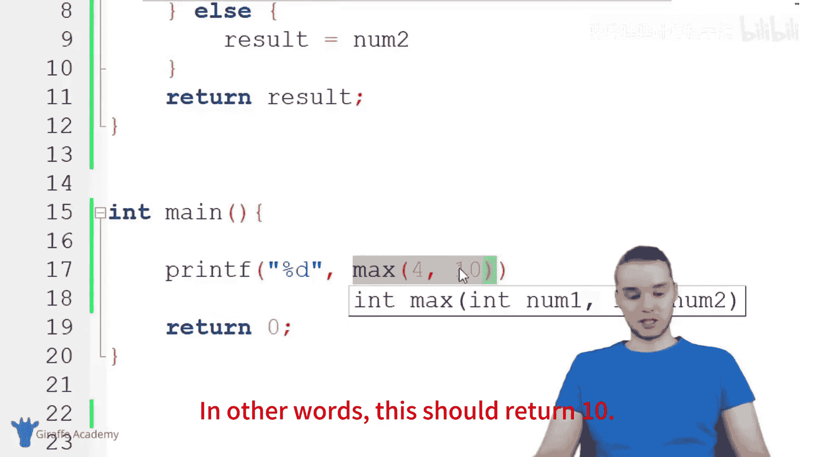
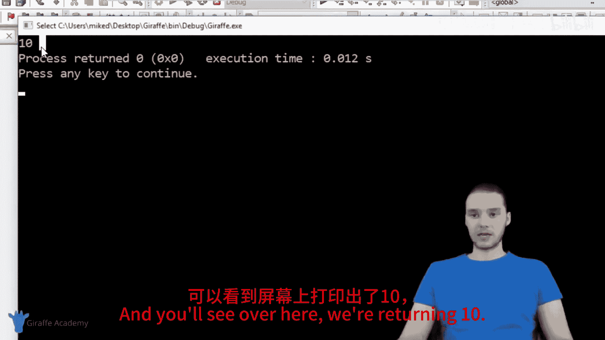
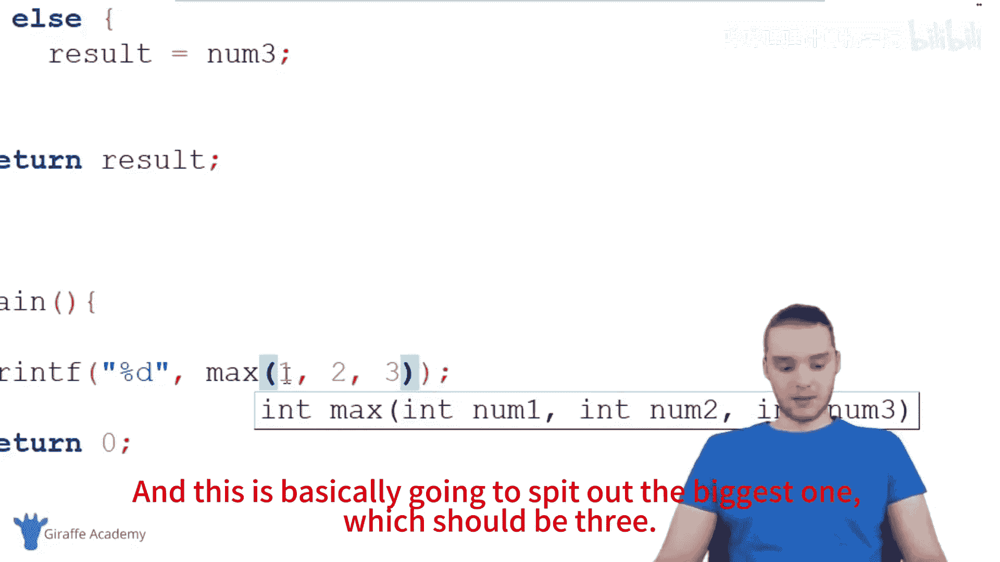
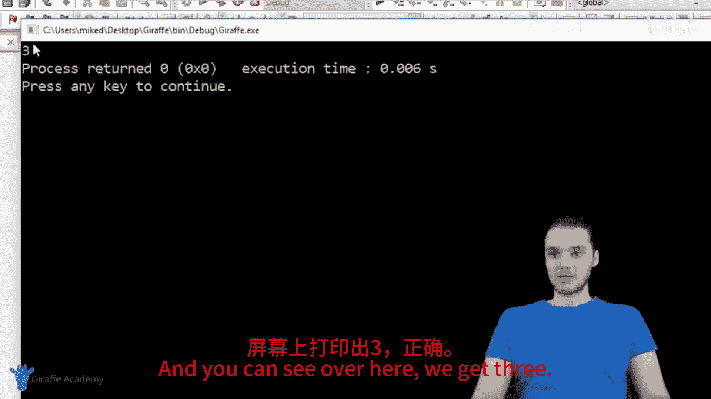
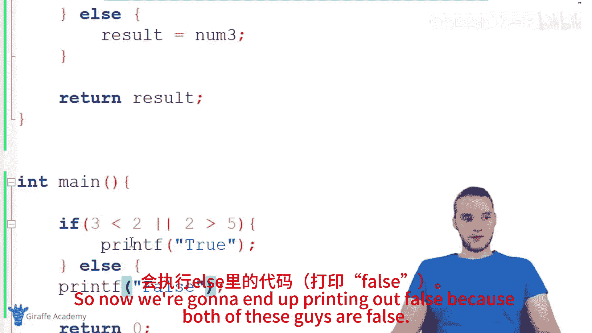
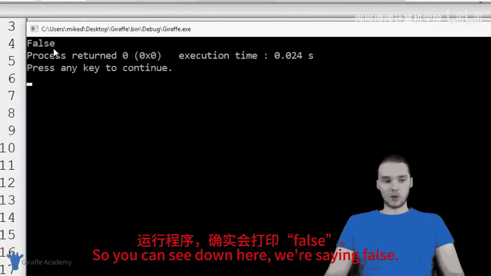
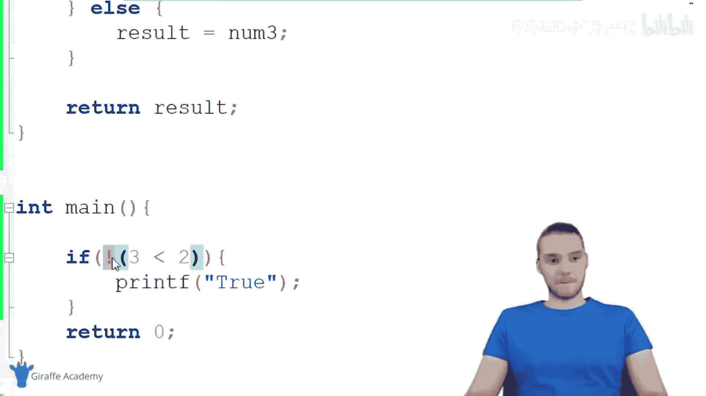

# 【油管千万订阅 freeCodeCamp】面向C语言编程初学者教程 Tutorial for Beginners in C Programmin（中英双语字幕） p18 C编程初学者教程第十八节：if语句 -BV1ug4wzBEhT_p18-

In this tutorial I'm going to talk to you guys about if statements in C and when if statement is a programming structure which we can use to help our programs to make decisions So by using an if statement our programs can actually respond so in certain circumstances they can do certain things and in other circumstances they can do other things and if statements are extremely powerful and they're a great way to add some intelligence to our programs for the purposes of this tutorial。

 we're going to be building a function so we're going to build a function and it's going be called the max function and basically what this function is going to do is it's going to take two parameters two numbers and it's going to tell us which number is the biggest so I could give it like four and I can give it a 10 and it'll tell us which number is bigger let's go ahead and do that I'm going make this function up here。

😊，And it's going to return an integer， and I'm just going to call it max。

 and it's going to take as parameters to integer， so it's going to take an integer nu1。

 and it's going to take another integer nu2。And now we'll just make the actual function body。

 So inside this function， our job is to figure out whether nu1 is the biggest or nu 2 is the biggest。

 And we're going to return the biggest to the color。

 So the first thing I'm going to do is create a variable， and it's going to be an integer。

 And I'm just going to call it result。And I'm not going to give it a value right away。

 what we need to do in this function is we need to figure out which one's bigger。

 We need to figure out if nu1 is the biggest or we need to figure out if nu2 is the biggest。

 and this is a perfect situation to use an if statement。

 and if statement allows us to check a certain condition。 And if that conditions true。

 we can do one thing。 and if the conditions false， we can do another thing。 So down here。

 I'm going to use an if statement。 I'm basically just going say if and then we're going to make an open enclo parentheses。

 and I'm going to make an open andclo curly bracket。 Now， inside of here inside of these parentheses。

 we need to specify a condition。 this is something that's either going to be true or false。

 If the condition inside of these parentheses is true。

 We're going execute the code inside of these curly brackets。 If it's false。

 then we're just going move on So in order to tell whether or not nu1 is bigger than nu2 or numb2 is bigger than nu1。

 we can actually compare them。 So down here。I could say if nu1。

 and I can use this greater than sign nu2， I'm basically saying if nu1 is greater than nu2。

 then I want to do something。 So down here we can set result equal to nu1。If this condition is true。

 then we're going do this。 So only when nu1 is greater than nu2 are we going to set result equal to nu 1。

 So basically by using this if statement， we're able to tell which one is bigger。

 But here's the thing。 What if nu 1 isn't greater than nu2。 What if nu 2 is greater than nu1。 Well。

 I can use something called an else statement。 So I can come down here and I could say else。

 and I don't actually need to use an open and closed parentheses。

 I can just make an open and closed curly bracket， and the code inside of this else block is going to execute if the condition up here is false。

 So if this condition is false if nu 1 is not greater than nu2。

 then we can just set result equal to nu 2。 and then down here， finally。

 we're going to return result。 So depending on whether or not this is true。

 result is either going to set equal to nu1 or it's going to be set equal to nu 2。

 So let's go down here into our main method。Why don't we call this So I'm actually going to print out the results。

 so I'm just going to say。Print F， and we're going to be printing out an integer。And over here。

 I'm going to call this function， so I'm just going to say max。And I'm going to pass in two numbers。

 so we'll pass in a four and we'll pass in a 10， so I'm passing in a4 and I'm passing in a 10 and this is going to return to us whichever one is bigger。

In other words， this should return 10， so let's go ahead and run our program。

And you'll see over here， we're returning 10。 So we got the value of 10 back from this function。

 So Let's try it with the other number。 So let's make the first number bigger。

 So now we have 40 and 10。 So this should give us 40 back A。 So over here。

 we have an awesome function， right， we're basically checking to see if nu1 is greater than nu2。

 if it is， then we're going return nu 1。 Otherwise， we're going return nu2。

 And it's important to note that even if I made these equal。 So if I made it 40 and 40。

 we're still going to get back the correct answer。 So it's still going give us 40 back。

 So this is the basics of using if statements right， we say if we specify a condition。

 if that conditions true， we're gonna execute this code。 if that conditions false。

 we're gonna to execute this code down here。 and that is an extremely powerful structure in our programs。

 And we can really use this to respond to different input right。

 So depending on what the user puts in nu1 and nu2， we can do different。😊。

But this is just sort of the beginning。 So why don't we try to make this function a little bit more complex。

 So down here， we're allowing the user to input two parameters。

 So we're accepting two parameters into this max function nu1 and nu2 and we're able to spit out which one is bigger but let's up the antste a little bit what if we wanted to accept three parameters。

 So instead of just passing in two numbers we wanted to be able to pass in three numbers and have the max function spit out the biggest。

 So over here we can modify this max function。 So I'm just gonna make another parameters。

 So I'm gonna say int and we'll call this one nu 3 So now this function is accepting three parameters nu1 nu2 and nu 3 But in order to figure out which one of these is the biggest we're actually going need a more complex if statement。

 So I'm gonna get rid of this and let's just start from scratch。

 So let's think about this how can we figure out which one of these is the biggest what I would recommend is we could say if nu1。

Is greater than nu2 and nu1 is greater than nu 3。 Then we know nu1 is the biggest， right。

 So if nu1 is bigger than nu2 and it's bigger than nu3， we know it's the biggest。

 If nu2 is greater than nu1 and nu2 is greater than nu 3， then we know nu 2 is the biggest。

 And otherwise， we can just say that nu 3 is the biggest。 So I'm going show you guys how to do this。

 And we're actually going be introducing a couple more concepts for if statements。

 So I'm just gonna say if。😊，And I want to check a condition。

 So I basically want to see if nu1 is greater than or equal to nu2 and nu3。

 So down here I can say nu1 is greater than or equal to nu2。

 and now I also want to check to see if nu1 is greater than or equal to nu 3 because if nu1 is greater than or equal to nu2 and it's greater than or equal to nu 3。

 we know nu1 is the biggest。 so I can use this special signal here。

 This is called a logical operator and and basically this is going to allow us to put another condition in here。

 so I could say nu 1 is greater than or equal to nu3。😊，Basically。

 what this and does is it allows us to put two conditions so we can check two things。

 and this whole thing is only going be true if this conditions true and this conditions true。

 So if one of these guys is false， then this if statement isn't going to get executed。 So down here。

 I'm just going to open this up。 And if this is the case， then we want to set result equal to nu1。

 because if nu ones greater than or equal to nu2 and nu1 is also greater than or equal to nu 3。

 then we know nu1 is the biggest。 here's the thing we also want to check to see if nu2 is the biggest。

 So if this is false， we also want to check to see if nu2 is the biggest now。

 and we can use something called else if So down here， I could type out else if。

And I can make another open and closed parentheses And inside of these parentheses。

 we can actually check another condition。 So if this stuff up here， if this condition is false。

 then else if is saying， let's come down here。 Let's check another condition。

 So here I want to do basically the same thing。 I'm going to check to see if nu 2 is greater than or equal to nu 1。

 and。😊，Noumb 2 is greater than or equal to nu 3。So if this condition is true。

 if nu2 is greater than or equal to nu1 and it's greater than equal to nu 3。

 then we know for a fact that result is going to be nu2 because that's the biggest。 Now， finally。

 down here， we can just say else， and we can make another open and closed curly bracket。

 And remember， this code is going to get executed when neither of these conditions is true。

 So here we can just set result equal to nu 3。😊，So let me walk you guys through this one more time up here。

 we have this if statement and in addition to checking to see if nu1 is greater than or equal to nu 2。

 we're also using this special operator called and and we're checking to see if nu1 is greater than or equal to nu 3。

 if that's the case， then result is going to be equal to nu1 Otherwise if this condition is false。

 then we're going to come down here we're going check this other condition。

 So we're going to check to see if nu2 is bigger than nu1 and if it's bigger than nu3。

 If that's true， then we're going to do this。 Finally。

 if neither of these conditions up here is true， we're just going to go ahead and set result equal to nu3。

And then we're going to return results。 So this looks good to me。

 Let's test this out and we're going to see if it works。 So now when we call max。

 we need to include three numbers。 So why don't we just do  one，2 and 3。😊。

And this is basically going to spit out the biggest one， which should be three。

 So let's run our program。 and you can see over here we get three。

 So let's try to make one of the other ones the biggest。

 So we'll make the one in the first slot the biggest。

 and let's run this again and you can see that it returns 10 So this function is working。

 So that's how we can use these ands and we can also use else if in order to check additional condition。

 So the and is used to check more than one condition inside of the if parentheses and the else if is used to check another condition when this condition false And so that is actually going to work out pretty well。

 Now I want to show you guys a couple other things。

 There's a couple other things that we can do with these if statements。 So for example。

 I'm going come down here and just show you guys some of these in addition to using that and we can also use something called or So I'm just going type out a simple if statement I could say if3 is greater than two and instead of using and like this I can use or and or is。

going to allow us to check two conditions。 And the whole thing is gonna be true if only one of those conditions true。

 So I could say if three is greater than two or two is greater than 5。 So only one of these is true。

 right，3 is greater than2。 That's true， but two is not greater than5。 So this guy's false。

 But when we use or， only one of these two conditions has to be true for the whole thing to be true。

 So if I like printed something out here， like。Thu。Now when I run my program。

 we should print true because we're using that or and you see that we do。

But if I was to make this guy false， so if I made this three less than two。

 now it's not going to print out true。And we can just print out false， so。

Now we're going to end up printing out false because both of these guys are false。

So you can see down here we're saying false， so the difference between and and or when we have and like this。

Both of these conditions have to be true in order for the whole thing to be true and for us to execute this code。

 when we have or only one of these guys has to be true。 So that's kind of the difference there。

 And I want to show you guys a couple other things that we can use。 So over here。

 we're using like a less than sign。 So， for example， if3 is less than2。

 I could also use a greater than sign。 I could use the less than or equal to s。

I could use also a greater than or equal to s。 And if I wanted to check for equality。

 I could use a double， I could use a double equals。

 So the double equals will check to see if3 is equal to2。 We can also use one more。

 which is this exclamation point。 an exclamation point basically means not equal。

 So I could say if3 is not equal to2， then we'll print out true。 So down here。

 let's run this and you'll see that we get true。😊，So yeah， there you go。

 One more thing I want to show you is how we can negate an entire operation。 So for example。

 if I said three is greater than two， this is going be true right。

 so we'd end up printing out true down here because three is greater than two。😊。

But I could surround this whole thing with parentheses。

 and I could put an exclamation point right before this。 and this is called the negation operator。

 and it's basically going to negate whatever this ends up being。

 So if this is true and we put this negation operator here， this whole thing is going to be false。

 And so now you'll see because this is true and we're using the negation operator。

 we're not going to end up printing out true。And you can see we just don't print anything。

 But if I put a false condition in here， like if I said three is less than two。

 this is false but because we're negating it， now it's going to end up being true。

 So when I run my program， you can see that we get true。

 So that's sort of the basics of using if statements and I cover just about everything that you can do。

 we can use ans， we can use all these different comparison operators。

 we can use or's and we can use this exclamation point to negate something。

。

