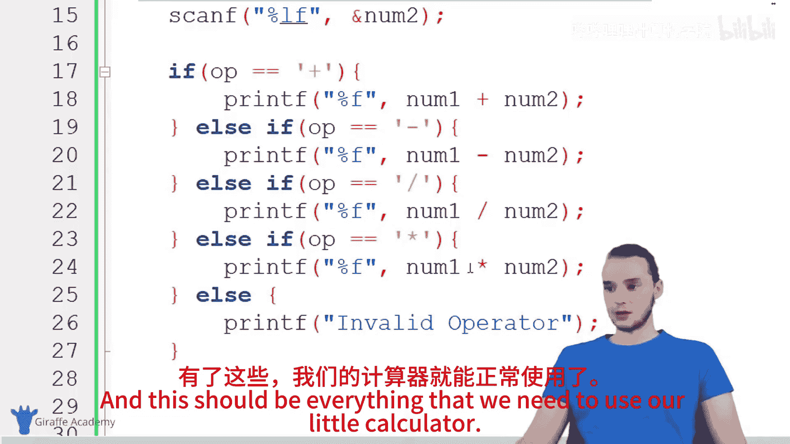
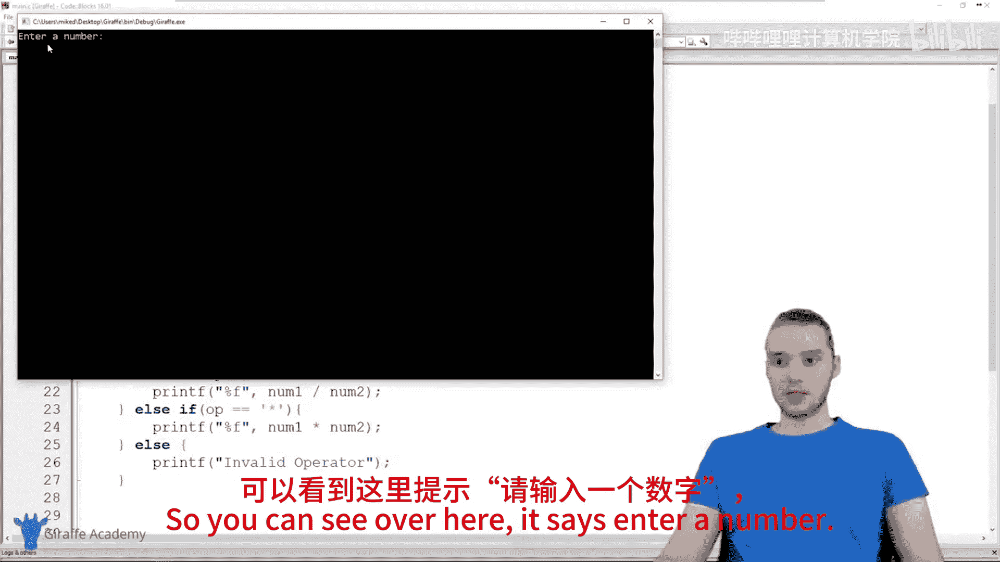
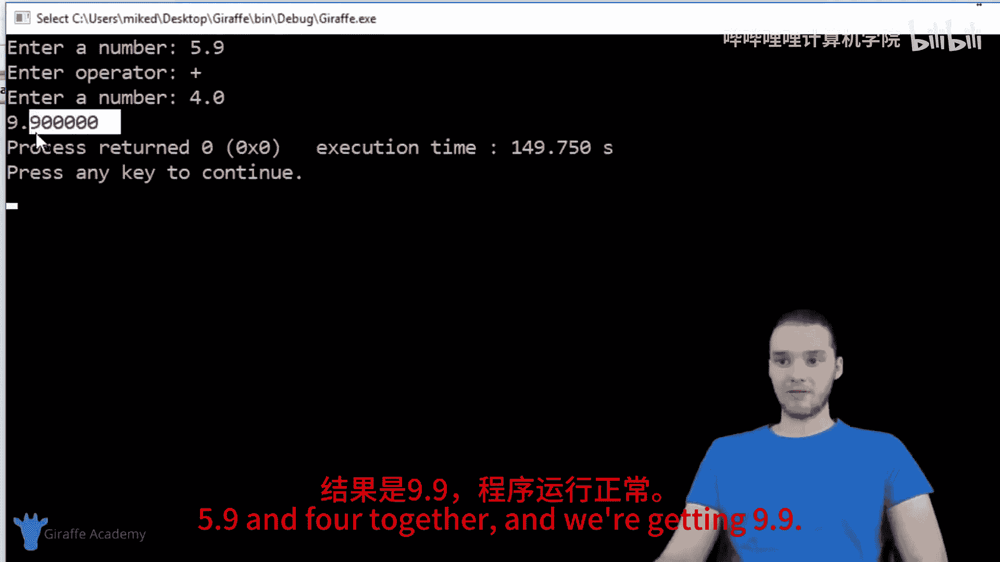
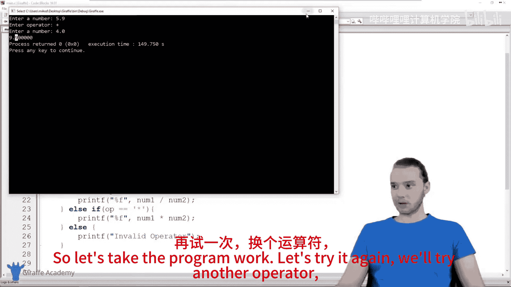
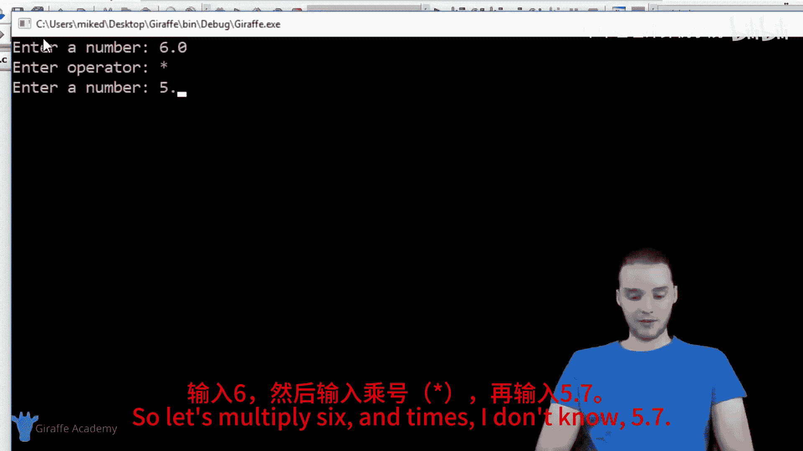
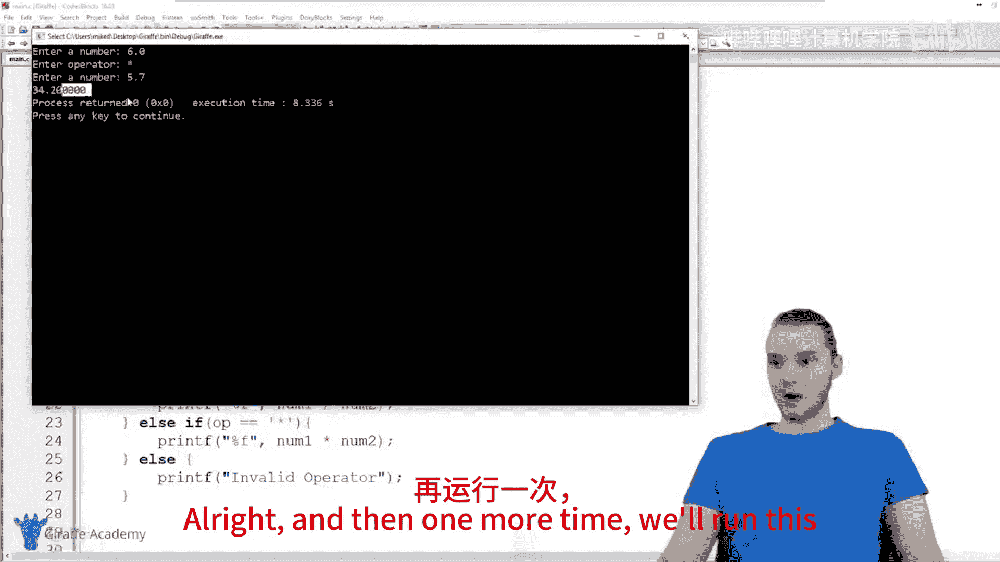
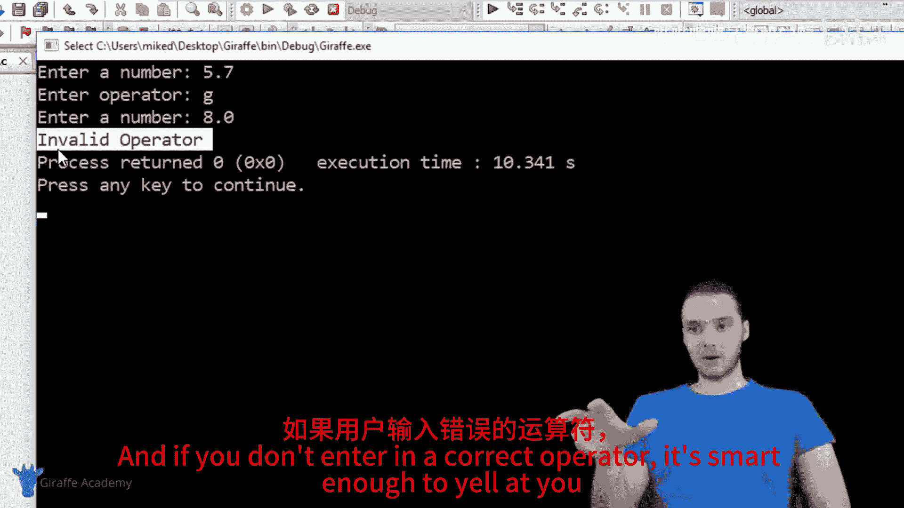
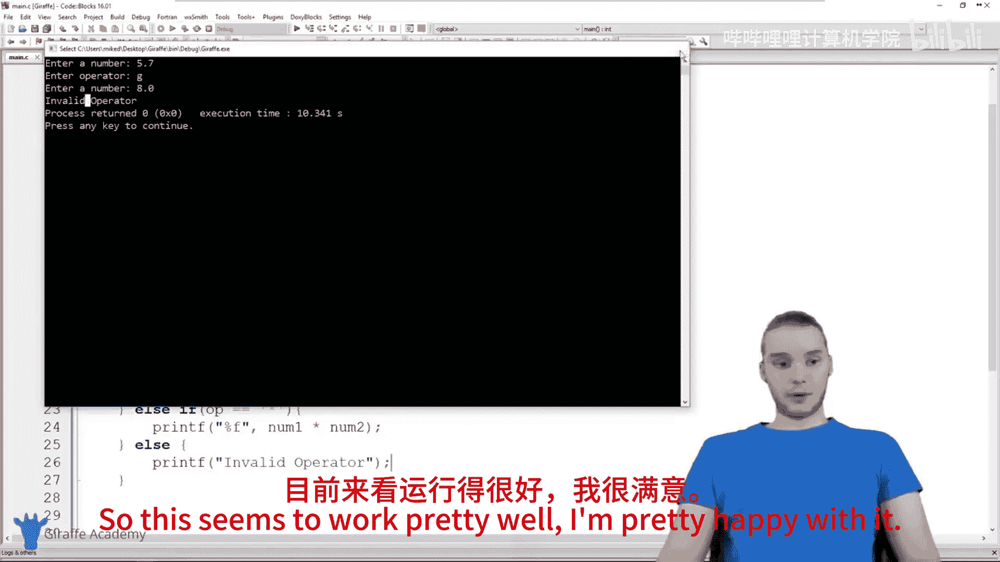
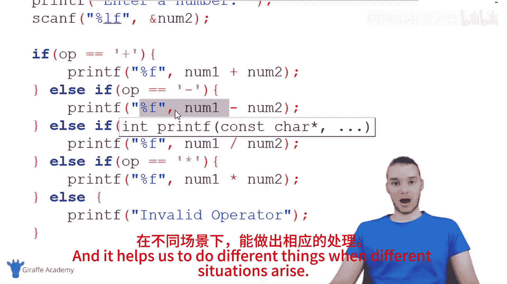

# 【油管千万订阅 freeCodeCamp】面向C语言编程初学者教程 Tutorial for Beginners in C Programmin（中英双语字幕） p19 C编程初学者教程第十九节：构建更好的计算器 -BV1ug4wzBEhT_p19-

In this tutorial， I'm gonna to teach you guys how to build a calculator in C。

 If you've been following along with this course， you'll note that in the beginning of the course。

 we actually created a calculator and it was very basic calculator。 Basically。

 we let the user input to numbers and we took those numbers。

 we added them together and we printed the answer out onto the screen In this tutorial I'm going take some of the stuff that we've learned since then and show you guys how we can build a fully functional four function calculator。

 So this calculator will be able to add subtract multiply and divide and we're going to let the user decide which one they want to do。

 So we'll let them decide if they want to add or subtract or whatever it's gonna be pretty cool and we're going to end up using some of the stuff that we've learned recently in the course like if statements。

 we're also going use like getting input from users and I'm going to show you guys how you can get characters as input from a user as well。

😊，So down here， we want to start making our calculator。 Basically。

 what I'm going to do is I'm going ask the user to enter a number。

 Then I'm going to ask them to enter an operator like plus minus division or subtraction。 Finally。

 we're going to ask them to enter in a third number and then we'll depending on what operator they specify So addition subtraction。

 whatever。 we will perform the correct operation and we'll print out the number。

 So first thing I want to do is create variables where we can store the numbers and the operator。

 So I'm going make some double variables and I'm just going call this one nu1 and then we'll make another double we'll call it nu2。

Finally， we'll make a variable that will store the operator that they enter。

 So this is just going to be a char and I'm just going to call it O for operator。All right。

 so now we want to actually get input from the user I want to figure out what numbers they want to use and then what operator they want to use as well so down here。

 why don't we get some input， the first thing I'm going to do is I'm just going to print out a prompt so I'm just going to say enter a number。

And now what we want to do is we want to be able to take the number they give us and store it inside of one of those doubles that we created。

 So I'm just going use this scan F function scan F。

 and in here I'm going to specify that we want to get a double。

 So remember when we're using scan F if we want to scan for a double， we use LF。

 and LF is going to scan for a double。 And now I'm going to use a comma and we'll put the variable that we want to store in here。

 So I'm going to use this ampersand and I'm just going say nu1。

 So this is exactly what we need to do to be able to get the user's input and store it into nu1。

The next thing we want to do is get the operator。 So I'm gonna type out another prompt。

 and I'm just gonna say， enter。Operator， basically， they'll be entering in plus sign， minus sign。

 asterisk or forward slash depending on what they want to do。And again。

 now we're going to scan for a character。 Now， when we're scanning for a character in scan F。

 and I actually don't think I've talked about this yet in this course。

 we want to do something special。 So I want to put a percent sign in a C。 but before I put percent C。

 I want to put a space。 So whenever we're getting a character from the user using scan F。

 we always want to put a space right here before percent C。 Otherwise it's not going work。 And again。

 we want to store this in that O variable。 So I'm just going to say O。

And one more time we're going to get another number， so I'm just going to copy this。

 paste this down here。And we're going to get this one for nu2。

So now we should have all of the input for our program。 So I'm getting the first number。

 I'm getting the operator and I'm getting the second number。

 The last thing we have to do now is actually do the math。

 So we're gonna have to figure out which operator they wanted to use so we have this O variable and this is storing like a plus sign a minus sign a asterisk or a forward slash So depending on what that storing。

 we want to print something different out。 So we can actually use an if statement to do this。

 so I can use an if statement to check and see what operator is inside of our operator variable and depending on which one it is。

 we can do a different operation So I can say if and the first thing I'm going do is just check to see if the operator is equal to a plus sign So if the operator that the user entered is equal to a plus sign。

 then we're gonna want to add the two numbers together So I'm just gonna print out these two numbers and I'll just say nu1 plus nu to because we're going add both of them together can。

😊，I using an La， so I'm going to want to check a few other conditions I'm going to check to see if the operator is equal to。

A minus sign。 And if the operator is equal to a minus sign， then instead of adding the numbers。

 we're going to subtract them。 So over here， I'll just copy this and we'll paste this guy down here。

 so it's going to be nu1 minus nu 2。And I can actually just copy this whole thing and we'll paste it down here。

 So let me make some more room down here。 we'll paste this other Elsif。

And here we're going to check to see if it's division， so we'll check for a forward slash and again。

 we're just going to want to print out a decimal number so it's going to be number one divided by nu two。

Finally， we're going check for multiplication。 So if it's multiplication。

 then we're gonna multiply them together。 So now we're checking for each of the operators。

 We're checking for additions， subtract multiplication and division。 But here's the thing。

 what happens if the user enters in an operator that we didn't want。 So， for example。

 if they don't enter in any of these operators， we're gonna want to tell them。

 So I'm going have this like print out a little error message we're going to say else。

 And basically the code inside this else block will get executed if none of these conditions up here are true。

 And down here， we can just make a print F。 and I'm just gonna to print out invalid。Operator。

So now we have our if statement， our if block set， and this should be everything that we need to use our little calculator。

Al right， so let's go ahead and run this program， so you can see over here it says enter a number so we can enter a number。

 let's enter in 5。9。

And enter an operator will add numbers。 And now let's enter in 4。0。 So we're gonna add 5。9 and 4。

 So when I click enter， we should go through all of those if statements and figure out what we need to do。

 And you'll see over here that we're adding 5。9 and 4 together and we're getting 9。9。

 So let's take the program work。 Let's try again， We'll try another operator。

 Why don't we try to multiply some numbers。 So let's multiply 6。 And。

Times， I don't know，5。7。 So we get 34。2。 That seems about right。 Allright， And then one more time。

 we'll run this。 and I want to try to enter in an invalid operator。 So we'll say like 5。7。

 And I'm just gonna enter in a G。 So that's an invalid operator。 That's not going to work。

 And I'll enter my number。 Let's do 8。 and you can see it tells us invalid operator。

 So basically we have a four function calculator。 This calculator can multiply divide subtract and add。

 And if you don't enter in a correct operator， it's smart enough to yell at you and tell you that you have an invalid operator。

 so。

This seems to work pretty well。 I'm pretty happy with it。

 And you can see down here like this is a perfect situation for using something like an if statement。

 right， we have this variable OP right it's storing some sort of operator。

 We don't necessarily know what's inside of there， but I can use if statements and I can respond to the different scenarios。

 So in the situation where it's a plus sign I can respond in the situation where it's a minus sign。

 I can respond， etcter。 And this just makes our programs a lot smarter and it helps us to do different things when different situations arise。

😊。

