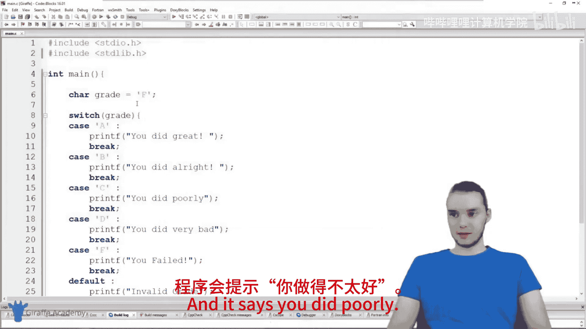
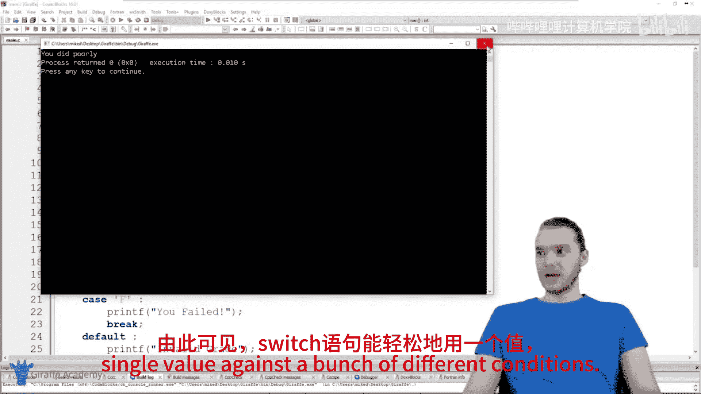
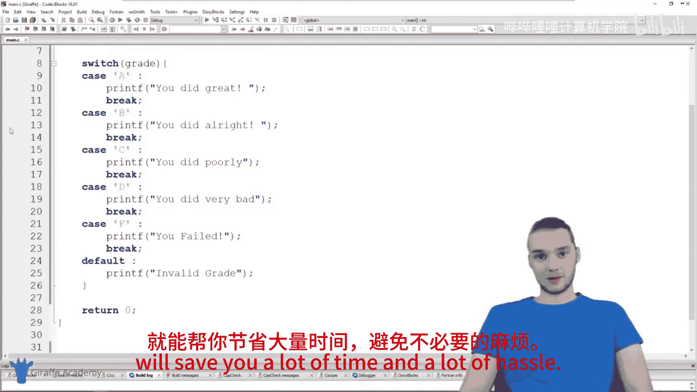

# 【油管千万订阅 freeCodeCamp】面向C语言编程初学者教程 Tutorial for Beginners in C Programmin（中英双语字幕） p20 C编程初学者教程第二十节：switch语句 -BV1ug4wzBEhT_p20-

In this tutorial， I want to talk to you guys about using switch statements in C。

 a switch statement is basically a special type of if statement which will allow us to compare one value to a bunch of different values。

 And it's essentially doing the same thing as an if statement。

 It's allowing us to check different conditions and if different conditions are true。

 then we can do certain things。 So a switch statement makes it really。

 really easy for us to compare one specific value to a bunch of other values。

 And I'm gonna show you guys how we can use that in this tutorial to make a little test app。

 So I'm going build a little program that will take a letter grade and depending on the letter grade。

 it will tell you whether or not you did good or bad on a test。 So if you got an a on the test。

 it would say hey， you did a good job。 if you got a B on a test it'd be like hey， you did al right。

 if you got an F on a test to tell you that you failed to test。

 So we're basically going have a variable where we'll store a grade that you would have gotten on a test and will be able to respond to that。

😊，Graade using a switch statement。 So it's gonna be pretty cool。 So down here。

 the first thing I'm going do is create a variable。 and it's just going to be a character。

 and I'm just going call it grade。 and I'm going set it equal to a。

 So we're going to say that whoever took this test got a on the test and they did really well Now what I want to do is I want to create a switch statement。

 So I'm just going to say。😊，Switch， and I'm going to make an open and close parentheses。

 And inside of this parentheses， I'm going to put grade。 So I'm just going to put grade。

And I'm going to make an open and closed curly bracket。

 So this is sort of like the basic structure for our switch statement。 Now。

 here's what I'm basically going to do。 I'm going to take this variable here that I pass into the parentheses grade。

 and I'm going to compare it to a bunch of different values。

 So I'm going to take this and I'm going to see if it's equal to one value。

 then I'm going to see if it's equal to a different value or a different value or a different value And depending on the value that it ends up being equal to。

 we're going to do something different。 And these are what are called cases。

 So down here I can say case and I just want to type out a character。 So for example。

 I could put a right here。 and then I'm going to put a colon。😊，And when I put a right here。

 basically what this is saying is in the case that grade is equal to a。

 then I'm going to put some code down here that I want to execute so I could just put like a print statement。

And I could say like you did great。Because they did great on the test and basically what this is saying is in the case that the grade is equal to a。

 we're going to print this out and then I want to put one more thing down here。

 which is called break and I'm going to explain what break does in a second。

So I could make one of these little case statements for every possibility。

 so for every possible grade that we could get， so I'm actually just going to copy this whole thing。

And I'm going to paste it down here。So now I can put a B in here。

 so we're saying in the case that the grade is equal to B， I'm going to say you did all right。

And then we're also going to break and down here I'm going to make another one。

 so I'll say case and this time will'll make it C in the case that they get a C。

 I'm going to print out。Poorly。And there's a couple more that we can check so we can check if they got a D or an F。

 so in the case。They got a D。And I forgot to put a brake statement here and I'm going to put one down here too。

 and finally we're just going to do one more for if they failed the test。

 so I'm just going to say in the case that they got an F。We will print out。You failed。

So essentially what I'm doing here is I'm writing out all of these different cases。

 So I'm saying in the case that you got an F。 I'm going to print out you failed in the case they got a D。

 I'm gonna to print out you did very bad。 And then we also have this break statement here。

 and this break statement basically tells our switch statement that we want to leave So whenever we're executing this switch statement whenever C' is executing the switch statement。

 it's checking to see if grade is equal to each one of these cases。 So for example。

 let's say the grade is equal to a， it's gonna to execute this print F。

 but if I don't put this break statement in here， then it's just gonna to keep going and keep checking these different cases。

 So it's always important to put a break statement in there because I basically just want to break out of this switch statement I don't want to be in here anymore。

 So finally we can check one more thing in the case that the user or that we get an invalid grade So for example。

 someone entered in like a T or a G or something that's not a valid grade。

 So I can use something called default in default。It's basically like an else so default is going to execute whenever none of these conditions up here are met。

 so then I can just put something like。Invalid grade or something。And this will basically be like。

 hey， you got an invalid grade。 So let's take a look at this switch statement and we'll just kind of talk a little bit more about what it's doing。

 Basically， I'm passing this in a variable or a value or something。

 And I'm going to check this value against all of these different conditions。 So in the case。

 the grade is equal to a we're gonna print you did great in the case that B is equal to grade。

 we'll print， you did all right， etc cetera。 And this is basically doing what an if statement is doing。

 So I could replicate this entire statement， this entire switch statement as an if statement。

 I can write out if， etc cetera， El， El， El， but this just makes it a lot easier。

 So I don't have to constantly write out all of that if statement stuff。

 So hopefully we did everything right and let's actually check and see how our program does。😊。

So grade is equal to a。 Let's run our program and see what our message is。 It says， hey。

 you did great because we got an A。 If I made this in F instead of an A。

Now it should tell us that we failed。So it says you failed if I made this a C。

It'll tell us that we did poorly and it as you did poorly so this is a super easy way for us to check one single value against a bunch of different conditions and that's really the point of a switch statement is you're checking one single value like grade against a bunch of other values and that's where it can be extremely useful So consider using the switch statements they're not appropriate in every situation and there's I'd say like very select few situations where switch statements will come in handy。

 but when they are appropriate switch statements will save you a lot of time in a lot of hassle。

。

