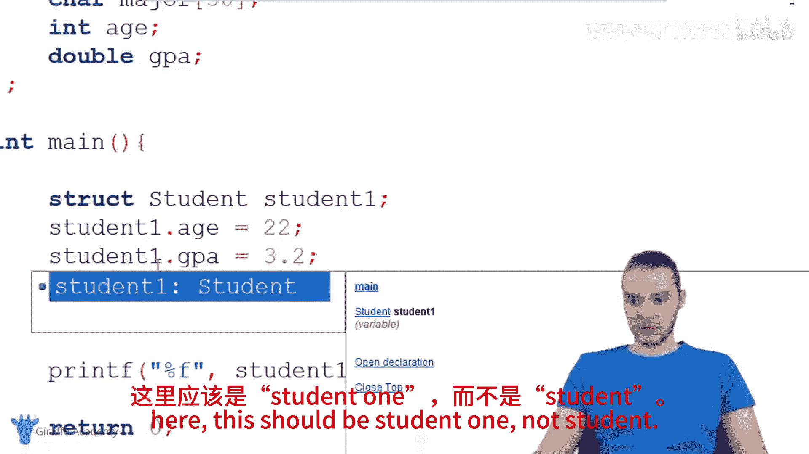
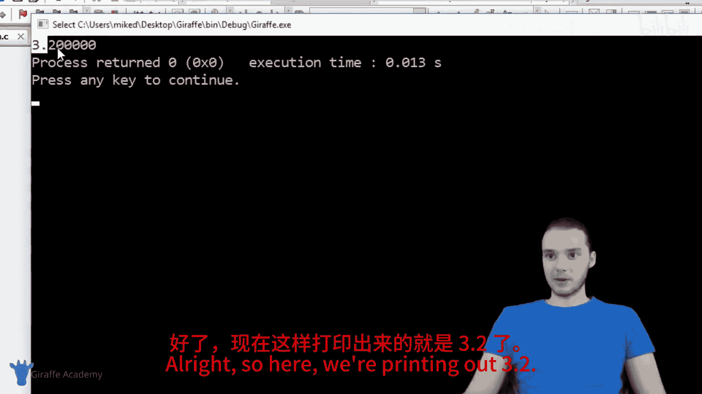
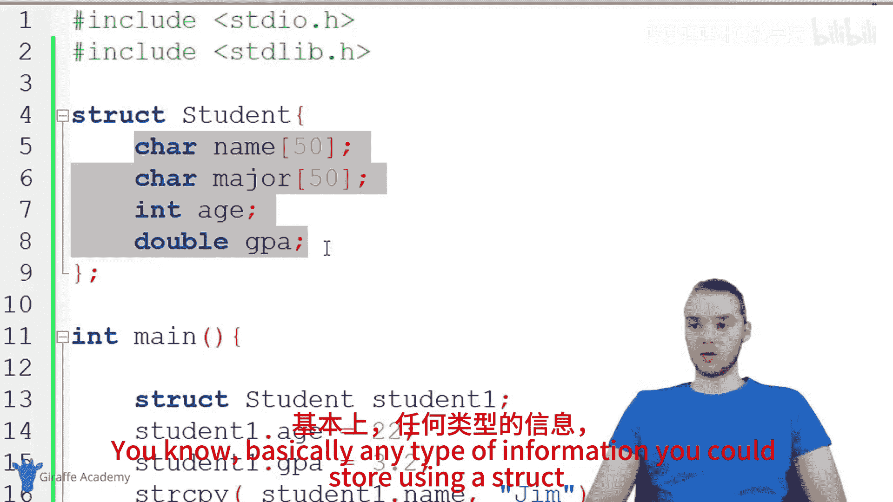

# 【油管千万订阅 freeCodeCamp】面向C语言编程初学者教程 Tutorial for Beginners in C Programmin（中英双语字幕） p21 C编程初学者教程第二十一节：结构体 -BV1ug4wzBEhT_p21-

In this tutorial I want to talk to you guys aboutstructs in C。 Now。

 astruct is a data structure where we can store groups of data types。 So inside of a struck。

 I could store like an integer alongside of a string alongside a character alongside a double。

 I could store all these different data types in one single data structure。

 And there's tons of uses for astructs。 and one of the things we can do with them is model real worldorld entities。

 So I could basically like model something in the real world inside of my program。

 And I'm gonna to show you guys how to do that in this tutorial。

 we're gonna be looking at how we can use astruct to represent a student inside of our program So imagine we were writing a piece of software that was using like students。

 So it was like storing records of students or something。

 I could use astruct to represent a student in my program。 So over here。😊，my program。

 I'm just going to come up here above the main method。 And I'm actually going to create a struct。

 You guys will see like how these work and and how we can use them。 So I'm just gonna to say。Strt。

And over here， I'm going to give this a name， so I'm going to call this student and a lot of times in C when we're makingstructs。

 you're going to give them a capital letter just like that。

And I'm going to make an open and closeded curly bracket now inside of this struct。

 I can start specifying what types of data are going to make up a student in my program so basically I can define like different attributes of a student and place them in here and this will kind of act as a template and you'll see how we can use this later。

So let's think about different attributes of a student Well one thing would be like the student's name so I could say char name and I'm going to make this a array of characters so this is going to represent the name and actually why don't we give this a number so I'm going to say 50 so this string can hold 50 characters maximum。

AndNow we're going to make another one for major， so we're going to want to store the students major and again we'll make this 50。

I also want to make an integer for the student's age。And a double for the student's GPA。

So I have thisstruct student and in here I have a bunch of attributes of a student right I have like the student's name。

 their major， an integer that stores their age and a double for their GPA essentially what I did was I created like a type of student data type So I basically am allowing myself now to represent a student inside of my program。

 So let's come down here to this main method and I'll show you guys how we can use this。

 So I can basically create an instance of this student structure。

 So I can create like an actual student inside of my program。

 And the way that I do that is just by sayingstruct and I want to type out the name of the struct that I want to make。

😊，In our case， it's going to be a student， and I want to give this a name。

 so I'm just going to call it student one。And I can just use a semicolon here。

 basically what I did now was I created a container called Student One that's going to be able to store。

A name， a major an age and a GP。 So if you're familiar with arrays in C。

 you'll know an array is a special structure that can hold multiple pieces of information。

 but all of the pieces of information inside of an array need to be of the same data type And also they don't have names with a struct。

 I can have a bunch of different data types like this。 And I can also give them names like name。

 major age and GP。 So now let me show you guys how we can assign some values to these。

 So for this particular student student one。 I can give them a name。

 I can give them a major a GP and an age。 So I could say。😊。

Student1 do age and I can set this equal to something。

 so I could say let's say student one's age is 22。 So basically inside of this student1 container。

 I'm saying the age of this particular student is gonna be 22。

 I can do the same for the GP so I can say student GP is equal to maybe they have a 3。

2 So I'm saying this particular student's GP is a 3。2。I can also do the same thing for those strings。

 So for the name in the major Now here's the thing about working with strings。 remember in C。

 a string is actually just an array of characters and when we have an array。

 we can't like give it a particular value。 So for example。

 if I wanted to give this student name of value。 this is just an array of characters。

 So I can't just come down here and say student dot name is equal to something。

 that's not going to work because you can't do that within array。

 I can use something called the string copy function and this is a function that will take a string and it'll give it a value that we specify。

 So it'll basically do what we want to do like what we did over here with the age and the GP but with the name So I could say like SR CPY and inside of here。

 I need to pass this two parameters。 The first thing I want to pass is the destination for the string。

 So we're gonna to pass in student1 name。😊，The second thing I want to pass in is the string that I want to store inside of student1。

 name， so in our case let's just name it him Jim。So now we have the student1 do names values equal to gym。

 and I can do the same thing for major， so I'm just going to copy this and we'll come down here。

And I could say student one dot major， and we're going to set this equal to business。

 So let's say Jim is a business major。Essentially what I've done here is I've created a student and that student had all the attributes that we defined up here。

 so this particular student had to name a major in age and a GPA。And I gave all of those values。

 So I signed this student 1， an age of 22， A GP of 3。2， et cetera。

 So now what I can actually do is I could print out all these different values that are stored inside of this structure。

 So if I wanted， for example， I could like。Print out the GP so I could print out。Student1 do GP。

 And now we're going to be printing out 3。2。 and actually looks like I have a typo here。

 This should be student one not student。

Al right， so here we're printing out 3。2 so we're printing out the value of the student's GPA。

 I could also print out like their name， so why don't we do that student one name and now this is going to print out gym。

So you see we print out over there So astruct is a really useful structure and another cool thing we can do with strs is we could actually create another student so I could create like another instance of that student structure So I'm actually just gonna copy all this stuff I'll show you how we can do this I'll just come down here and paste it and instead of student one。

 why don't we call this one student 2 and we can set this student's age to be like maybe 20 maybe their GPA is a 2。

5。 let's say their name is Pam and they're studying art。😊。

So now I have a completely different student and if I wanted。

 I could print out this student's attribute so I could print out like student2 do name and now we're gonna get Pam instead of gym so you can see how that works right there。

 So I could create as many of these students as I want。

 And this is what's cool aboutstructs is I can just define the basic template for a student in my program。

 and then I can create individual students down here that I can work with。

 So now I have this like student variable here。 I could do whatever I want with it。

 I could pass it into a function。 I could print it out onto the screen。

 I could use it in something like an if statement。 I could do basically anything I want with it。

 it acts a lot like a variable or an array。 So remember variables and arrays or just containers we can do just about anything we want with them。

 and that's the same with astructs。 So this has just been kind of an introduction and what you could do as an exercises think of other things you might want to model in your program So maybe something like a book or something like a phone。

 you could model a phone using。Baically any type of information you could store using astruct just like this。

。