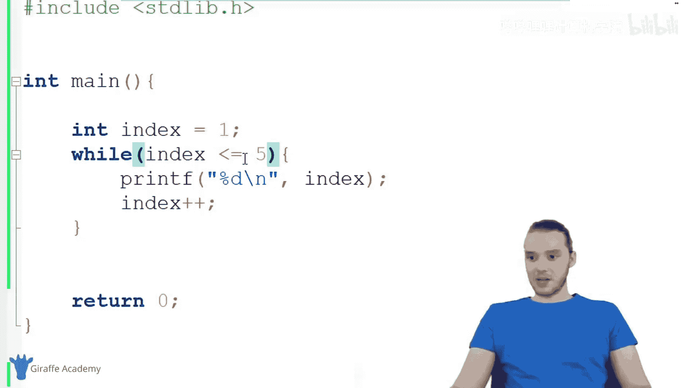
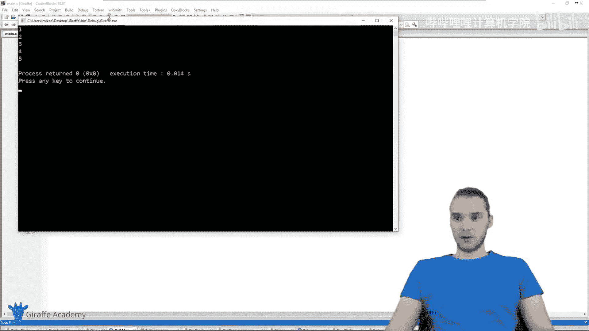
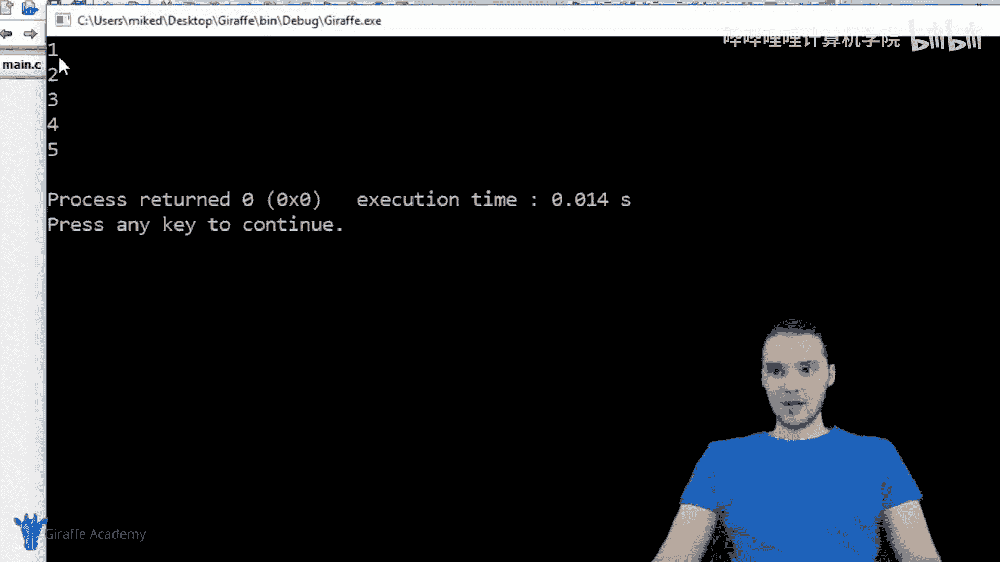
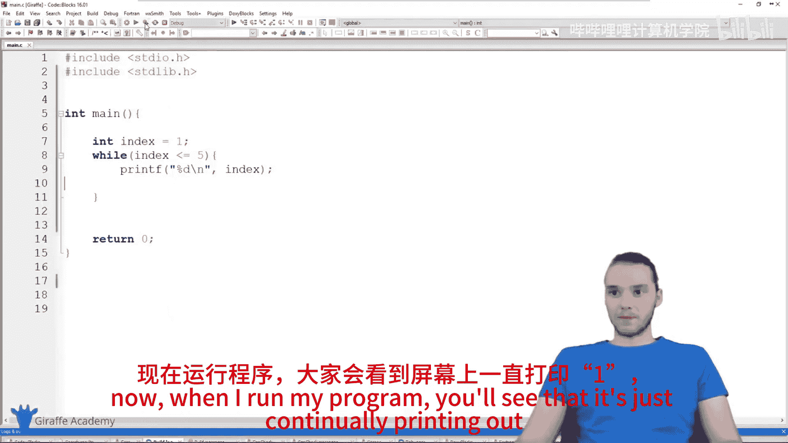
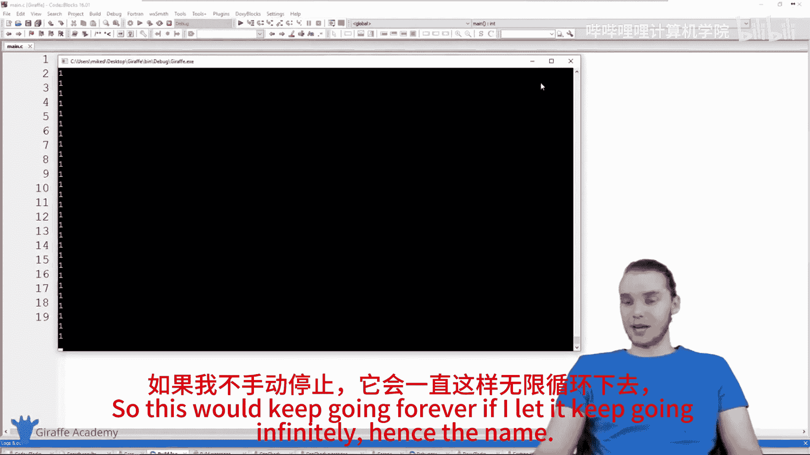
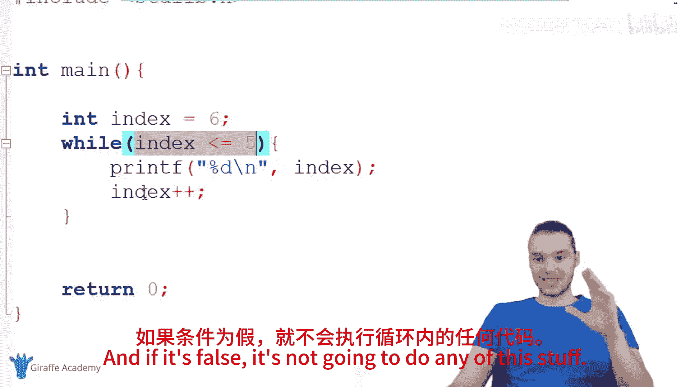
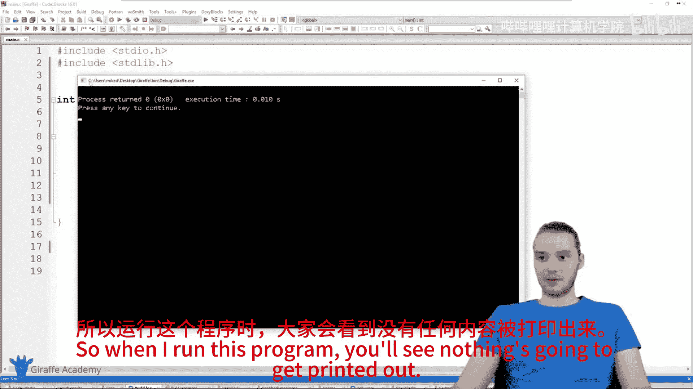
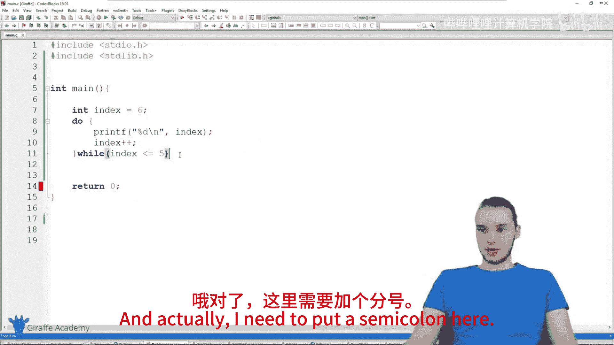
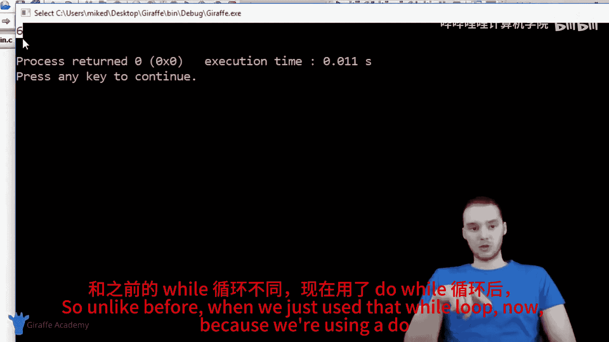
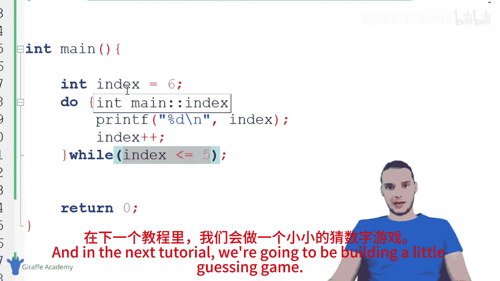

# 【油管千万订阅 freeCodeCamp】面向C语言编程初学者教程 Tutorial for Beginners in C Programmin（中英双语字幕） p22 C编程初学者教程第二十二节：while循环 -BV1ug4wzBEhT_p22-

In this tutorial I want to talk to you guys about while loops in C Now a while loop is basically a structure in the C programming language that we can use to loop over and continually execute a specific block of code until a certain condition is false so I can specify a condition and then I can basically just loop over a bunch of code until that condition is no longer true。

And loops can be really useful there's a lot of times in our programs where we're gonna want to like continually do something while something else is true or while a certain condition is met and I'm gonna to show you guys a really basic while loop in this tutorial and then in the next tutorial we're actually going build a really cool guessing game using W loops so it should be pretty fun and you should get a pretty good idea of like how these things work。

The first thing I want to do and this isn't directly related to creating while loop， though。

 is I want to create an integer， so I'm just going to create an integer called indexex。

 and I'm going to set it equal to one。Now what I want to do is I want to actually create a while loop and you guys will see where this index comes into play。

 So in order to create a while loop， I can just type out while and open andclo parentheses and then an open andcloed curly bracket。

 And this is basically like the outline sort of like the template for our while loop Basically how this is going to work is up here in these parentheses。

 I'm going to specify a condition。And as long as that condition is true。

 I'm going to loop through all of the code inside of these curly brackets。

 so inside of these curly brackets， I'm going to put a bunch of code and as long as the condition in these parentheses is true。

 I'm going to execute all that code。So up here， we're going to specify a condition。

 I'm going to specify a condition that index is less than or equal to。5。

 so while index is less than or equal to 5， I want to execute all the code inside of here。

 So I'm going to put some code in here。 The first thing I'm going to do is I'm just going to print out the value of。

Index， so over here， I'm just going to say we want to print out an integer and I'm just going to print out index。

 So we'll be printing out index and actually， why don't we print out a new line every time too。

There we go。And finally， after this， I want to increment the index variable。

 So I can just say index is equal to index plus one。 Basically。

 I'm adding one onto the index every time。 And actually。

 I want to show you guys something and see there's gonna be a lot of situations where you're gonna want to do something like this。

 Basically add one to an existing variable。 And in C， there's actually a shortcut we can use。

 So I can come over here and I can just say index plus plus and this is gonna to do the same thing。

 So this is just going add one to the index。Essential。

 what I'm doing is I'm saying I want to print out index。 And then I want to increment index。

 And I'm going to keep looping through this code while index is less than or equal to5。

 So let's go ahead and run this program。 and maybe you can predict what's gonna happen。😊。

You'll see over here， I'm printing out the numbers1 through5。 So I'm printing out 1，2，3，4， and5。

 And let me walk you guys through exactly what's happening in this loop over here。

 we create this index variable and we set it equal to1 and basically when C goes to execute this program。

 the first thing it's going to do before it does anything else is it's going to look at this condition and it's going to check the condition and it's going to say okay is index less than or equal to 5 Well。

 the first time through index is equal to1。 So it's definitely less than5 C is going to go through。

 it's going execute this line of code printing out one then it's going execute this line of code incrementing index。

 Then what C is going to do is it's going to come all the way back up here and it's going to check this condition again。

 So it's going say okay is index less than or equal to 5 and index at this point is equal to2 so it's less than5 So it's going go through execute this line of code。

 execute this line of code now index is equal to3 and C is going to go all the way back。

Up to the top， it's going to check this condition again。

 So before C goes through this loop it's always it's always going to check the condition first。

 So before it's allowed to go and execute that code again。

 it has to check the condition to make sure that it's true。Eventually。

 we're going to get to a situation where index gets incremented and it gets incremented up to6。

 Then C is going to come back up here， and it's going to check to C of 6 is less than or equal to5。

 It's going be false， and we're gonna move on with our lives in the program。

 And that's the basics of wild loops。 So this seems very simple。 and that's because it is。

 All we do is specify a condition as long as that conditions true。

 We keep doing all the stuff in here。 And there's tons of situations where while loops are going to come in handy。

 This is just one of them where we can print out like numbers between one and5。

 I also do want to point out one thing that you might want to watch out for。

 which is called an infinite loop。 and an infinite loop is a situation where this condition up here never becomes false。

So this condition will just always stay true。 And there's certain circumstances where you're gonna want to use something like an infinite loop。

 but in a lot of circumstances， you're not gonna want to go anywhere near something like that。

 So let me just demonstrate so you guys can see So if I stopped incrementing this if I just got rid of index plus plus Now when I run my program you'll see that it's just continually printing out ones。

 I mean， look at all these ones that are getting printed out。

 and you can see like the text editor is kind of going crazy。

 This program is it keeps executing through that loop and it's still going right now。

 So this would keep going forever if I let it keep going infinitely hence the name。

 So I'm just going to terminate this。 but that'll kind of show you like how an infinite loop works and you definitely want to watch out for that because you'll get into situations as you work with wild loops where they'll just become infinite and you need to watch out for that especially if you're doing something a little bit more advanced where you're like siphoning off memory or you're creating processes or something it can slow your computer down quite a bit So this is a while loop and is。

Really great loop。 There's also one other type of loop that's similar to a while loop that I want to talk to you guys about。

 And before I do that， I just want to do something really quick。

 So I'm gonna to set this index equal to6 I'm gonna to set this equal to6。

 and I'm gonna run my program。 And what you're gonna notice is nothing's gonna get printed out。

 So the code inside of this while loop isn't going print out because the first thing we always do when we run this while loop is we check this condition。

 So the first thing Cs gonna do before it prints anything before it increments anything it's gonna check this condition。

 And if it's false， it's not gonna do any of this stuff。 So when I run this program。

 you'll see nothing's gonna get printed out and that's exactly what happens。

 There's another type of loop that's similar to a while loop， which is called a do while loop。

 and I'm gonna show you how to make one all you have to do is take this while thing up here and paste it down here below。

😊。

And then up here， I'm just going to say do。And a do while loop is similar to a while loop。

 but the first thing a do while loop does instead of checking this condition down here is it executes all of this code。

 So even though index is equal to 6， we're still going to print out6 and we're still going increment it and then we're gonna check the condition to see if we can keep looping so let me show you guys this and it should illustrate what this is doing and actually I need to put a semicolon here。

So you can see over here we're printing out six So unlike before when we just use that while loop now because we're using a do while loop。

 we're doing whatever was inside of that loop before we're checking the condition and there's gonna to be certain circumstances where a do while loop will come in handy I would say by far while loops are way more common but just you know it's good to know about do while loops because there are certain circumstances where they're come in handy basically anytime you don't want to be checking the condition first。

 you can use a do while loop but those are the two basic types and there's actually another type of loop that we'll talk about later in the course which is called a for loop but for now we're gonna have some fun with while loops and then the next tutorial we're gonna be building a little guessing game。

嗯。

