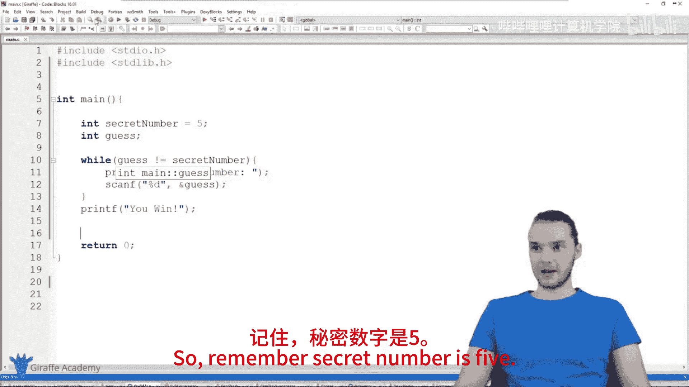
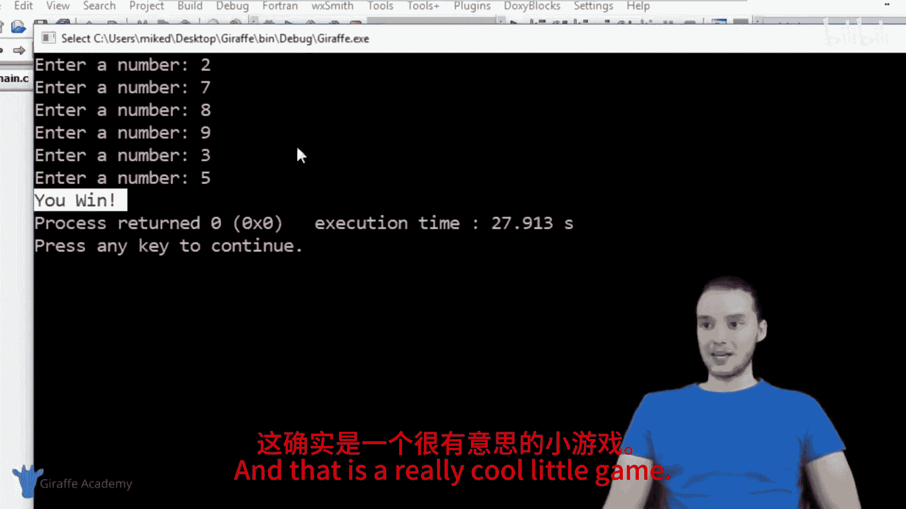
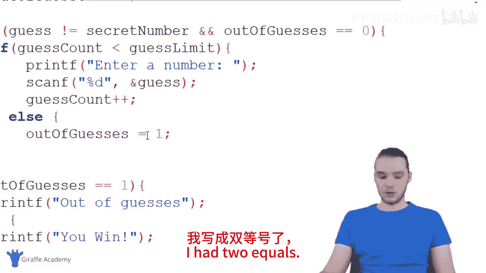
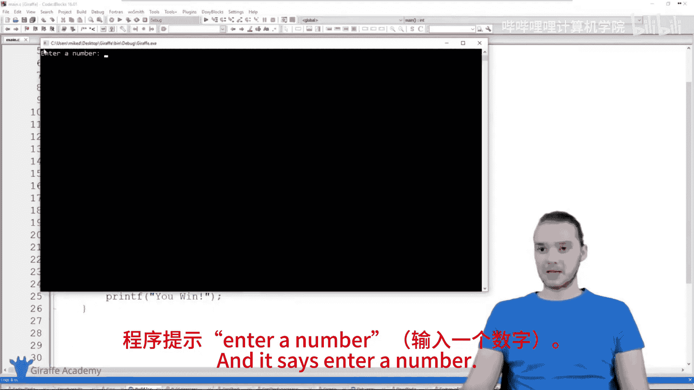
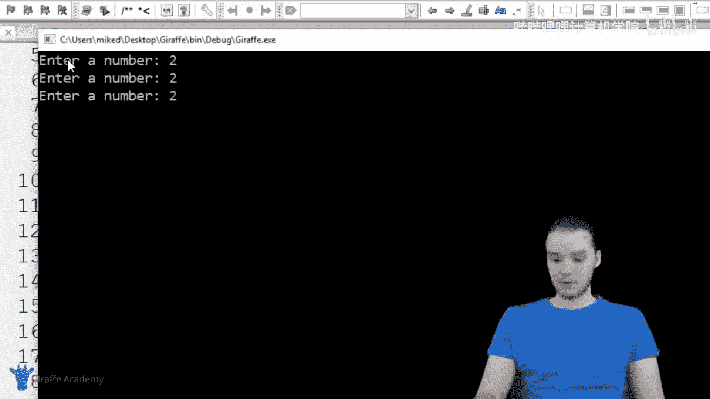
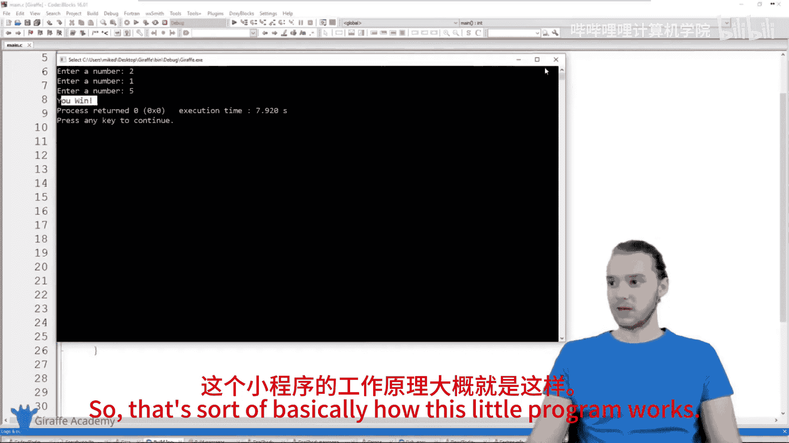
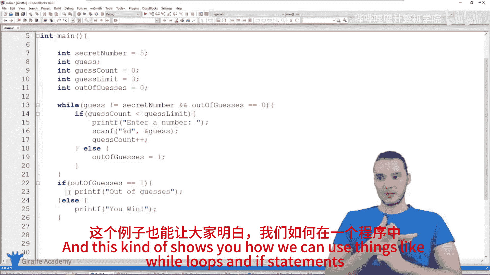

# 【油管千万订阅 freeCodeCamp】面向C语言编程初学者教程 Tutorial for Beginners in C Programmin（中英双语字幕） p23 C编程初学者教程第二十三节：构建猜谜游戏 -BV1ug4wzBEhT_p23-

In this tutorial I'm gonna to teach you guys how to build a little guessing game in C This is gonna be pretty cool because we're going to use a lot of the stuff that we've learned up to this point in the course in order to build it so let's get started basically this guessing game is going to allow the user to guess a secret number so we're gonna define a secret number and we're gonna give the user the opportunity to try and guess it so if they'll try to guess it if they get it right then they'll win the game and if they don't get it right then we'll let them guess again so we'll basically let them keep guessing what the secret number is until they get it。

So down here we want to create a couple variables。 The first variable I want to create is going to be an integer and it's going to be the secret number。

 so I'm just going to call it secret number and why don't we just set it equal to5 The next variable we want to create is going to store the user's guess so this is also going to be an integer and I'm just going to call it guess and I'm not going to give it a value yet because right off the bat the user wouldn't have guess a number。

So what we want to do is we want to be able to prompt the user to enter in the number until they get it right。

 So as long as the user hasn't entered in the correct number。

 we want to keep asking them to enter it in in order to do that in order to like keep asking them to enter it until they've guessed it。

 we can use something called a while loop。 So I'm just going to type you while。

And when making open and closed parentheses and an open and closed curly brackets。

 Let's think about a good condition for our game。 Basically。

 we want to keep asking the user to enter an input as long as they haven't guessed the secret number。

 So it's right there。 We could keep looping as long as the guess is not equal to。The secret number。

 right， And basically， this is always going to be true until they guess the correct number。 Now。

 inside of here， we want to prompt them to enter their guess。

 and then we want to take whatever they enter and store it inside of our guest variable。

 So let's do this first。 We'll say print F。 And I'm just going to say。Enter a number。

And then down here， I'm going to use scan F in order to get whatever number they enter。

 And I'm going to store it inside of that guess variable。 So I'm just gonna say at guess。

 and this is gonna take whatever number， whatever integer they enter and it's gonna store it inside of our guess variable。

 So basically what's happening in this loop is every time through the loop where're getting a different number。

 and then we're going to come up here and we're going to check to see if it's equal to the secret number。

 If it's not， then we're going to go through again and we're gonna keep doing this。

 But if the guess is equal to the secret number， then we'll break out of the loop。

 And that means we'll be down here。 So I'm just going to print out a success message and I'll basically just say like。

 hey， you win。All right， awesome， So you can see this isn't actually that many lines of code， I mean。

 it's probably like 10 lines of code to write out this whole thing and it looks like everythings set up so this should actually work properly。

 so let's try to run this and we'll see if we can guess the secret number。

 So remember secret number is five。

So I'm going to run the program， it says enter a number， so let's just kind of botch the guesses 2，7。

8，9。Three， so you'll notice I can keep entering in numbers。

And it'll keep prompting me to enter a number as long as I haven't guessed correctly。

 So now let's type in5 and remember 5 is the secret number。

 when I click enter now that loop condition is going to end up being false because the guess is going to be equal to the secret number and it's going execute and it's going say。

 hey you win right So we broke out of that loop， we executed the print statement that said you win and the program terminated and that is a really cool little game。

 So one of the cool things about this game and it's different from programs that we've written in this course in the past is it'll keep running essentially infinitely until we enter in that correct guess So it's going to keep going and keep going and keep asking us to do something and to enter in a value until we entered correctly。

 So this is pretty cool。😊。

Now， this is a pretty nice game， and' it's pretty simple。

 but I want to maybe make it a little more complex。

 One of the things that sucks about our game right now is that the user gets unlimited guesses right So basically like they can just guess every single number and eventually they're gonna get it right So why don't we do this。

 We should impose a guess limit。 So why don't we say like the user can only guess three times。

 And if they can't get the secret number in three tries， then they'll lose the game。

 So let's think about how we can go ahead and add that functionality into this little app。

 I'm gonna walk you guys through how we can do that。

 The first thing we're gonna need to do is we're gonna need to create some variables。

I'm going to create another variable up here and I'm just going to call it guess count。

And guest count is basically going to tell us how many times the user has tried to guess the secret number。

 And I'm just going to set this equal to0 because initially the user will have guessed zero times。

 So remember， this guest count variable is basically going to get incremented every time the guess So I'm going to come down here。

 every time we go through this loop， the user is guessing So every time we go through this loop。

 I'm going to increment the guess count。 So I'm just going to say。Gueest count plus plus。

 and that means every time the user guesses， the guest count will get incremented and will have a accurate count of how many times the user has guess。

AlrightThe second variable that I want to make is going to be another integer。

 and I'm just going to call it guess limit。 And this is going to tell us how many times the user can guess。

 So this will basically determine like how many guesses the user gets。

 So why don't we set this equal to3。 I think three guesses is pretty good limit。 And finally。

 we want to create one more variable。 And this is also going to be an integer。

 And I'm just going to call this out of guesses。 And I'm going to set out of guesses equal to0。

 And out of guesses will basically tell us whether or not the user has any more guesses。

 And this might not be super clear what this is doing right now。😊。

But keep following the video and you'll see how this comes into play。

 This is actually gonna be really important。 So we're actually gonna have to modify our code a little bit。

 So down here， we have this setup up so the user can keep guessing as long as the guess isn't equal to the secret number。

 But we want to be able to limit the amount of times that the user can guess。 And actually down here。

 I'm gonna to create an if statement。 And every time we go through this loop。

 I want to check and see if the user has any more guesses left。 I want In other words。

 I want to see if they've reached their guest limit or not。 So I'm gonna to make an if statement。

 and I'm gonna check to see if the guest count。😊，Is less than。The gas limit。

As long as the guest count is less than the guest limit。

 that means they haven't guessed as many times as the limit specifies Basically。

 they can guess again right， so down here inside of this if statement。

 I'm going to put all of this code and I'm just going to surround this with curly brackets。

So basically， the user can only guess the number， this code will only get executed when the guest count is less than the guest limit when the user has additional guesses right when they haven't guessed as many times as the limit specifies。

Otherwise， though， so if they have guessed too many times if the guess count is either equal to or greater than the guess limit。

 I'm actually going set this out of guesses variable equal to1。

 so I'm going to say out of guesses is equal to one and basically what this is going to tell us is if out of guesses is greater than zero。

 then that'll tell us that the user is out of guesses。

 so essentially if out of guesses has a value that's more than zero will know that they've run out of guesses。

And if you ever used any other programming languages before。

 this is what we refer to as like a Boolean variable。

 it's basically storing like a true or a false value， which we're representing was zero or1。

So if the guess counts less than the guest limit， they can guess again otherwise we're going to say out of guesses is equal to one in other words we're going to say that they're out of guesses there' one more thing we have to do though is we have to come up here and we have to change this condition because right now we're going to keep looping through this code as long as the guess is not equal to the secret number。

But there's actually two situations where we want to break out of the loop。

 The first is when they've guessed the number correctly， right。

 then we want to come down here and print out you win。

 but we also want to break out of the loop when they've run out of guesses。

 So I want to check to see whether or not they're out of guesses。

 So I'm going to say guesses not equal the secret number。And out of。Guessses。Is equal to0。

 So as long as out of guesses is equal to0， that means that they're not out of guesses and they still have some guesses left。

 But if the guess counts less than the guess limit and out of guesses gets set equal to one。

 then out of guesses isn't going be equal to0 anymore。 So we're gonna break out of the loop。

 So basically， there's two scenarios now that will break us out of the loop。

 either they get the word right or they run out of guesses。

 So one more thing we have to do in this program is come down here and you'll see down here。

 we're always printing out， you win。 So no matter what， like no matter what happens。

We're printing out U win。 And that's because before if they made it down here。

 if they made it out of that loop， that means that they guessed the secret number correctly。

 But there's actually two scenarios down here where they would have broken out of the loop where they're either out of guesses or they guess the secret word。

 So I want to actually check to see which one we're dealing with。

 So I'm going to check to see if out of guesses。 And I'm going to check to see if it's equal to one。

 And if it's equal to one。That means that they lost and they ran out of guesses。

 So I'm just going to say。Out of guesses， otherwise， though， it means that they won。

 so I'm going to say you win and this will basically be like， hey， you won the game。Awesome。😊。

So this is a lot of code。 I know that and let's just run this， see how we did。

 and we'll see if our games working properly。 and then I'll kind of explain all the code to you guys。

 And actually， you know what， I just notice the typo down here， I said out of guesses double equals1。

 this is just have to be a single equals。 So we're assigning this a value。

 So yeah that was a little typo I had two equals。 that needs to be one。 So let's go over here。

 we'll run our program and it says enter a number So why don't we try to lose the game。

 I'm just gonna say two to And now we're on our third and final guess。

 if I don't get it this time that means we're gonna lose the game。

 So I'm gonna enter and you'll see it says out of guesses。

 So we weren't able to guess it within our three tries and the game told us that we lost。

 Let's run one more time， we'll try to win。 So I'll say like two1 now we're on our third and final guess。

 So if I don't get it this time we're gonna lose。 I'm gonna guess a five and we guessed right。

 So it's gonna tell us that we won So that's sort of basically how this little program works。

 And I'm gonna walk you guys through。😊。

More time so we have all these variables up here secret number is just storing the number they need to guess the guest keeps track of what they're guessing each time the guest count is going tell us how many times they've guessed the number guess limit is going to tell us how many times they can guess and out of guesses is going to tell us whether or not the user is out of guesses so down here we're checking two conditions for this while loop we're checking to see if the guess is not equal to the secret number。

And we're going to keep looping as long as out of guesses is equal to zero。

 Every time we go through this loop， we check to see if the guest count is less than the guest limit if it is。

 then we ask them to guess we increment the guest count。

 Otherwise we say out of guesses is equal to one and that's going break us out of the loop down here there's two situations。

 the first situation is that they ran out of guesses。

 The second situation is that they won the game and we're using this if statement to check both of those so。

That's basically how this works and this kind of shows you how we can use things like wow loops and if statements and also variables together in like one single program。

Yeah。