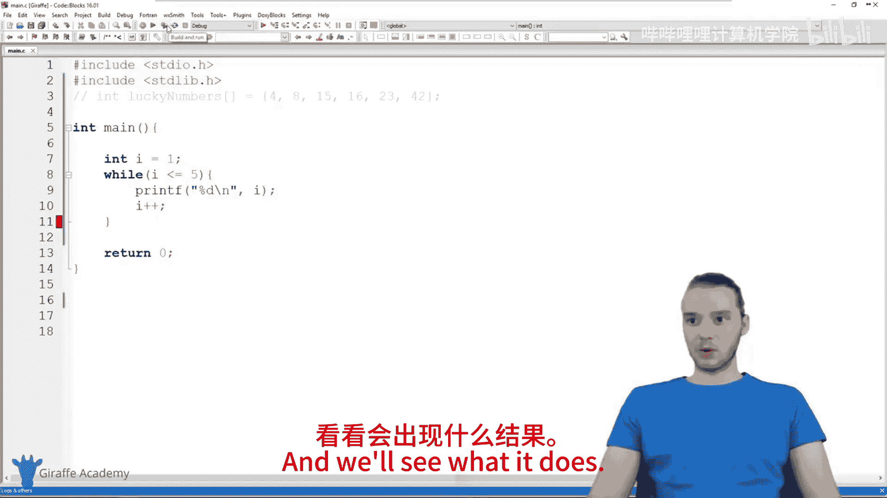
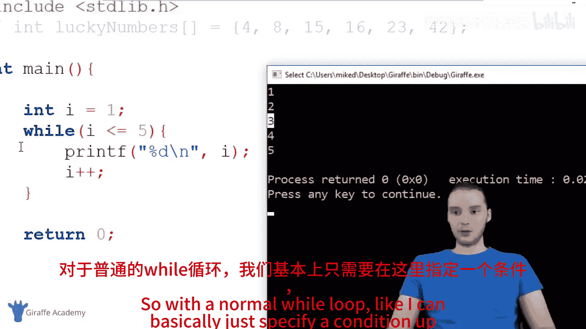
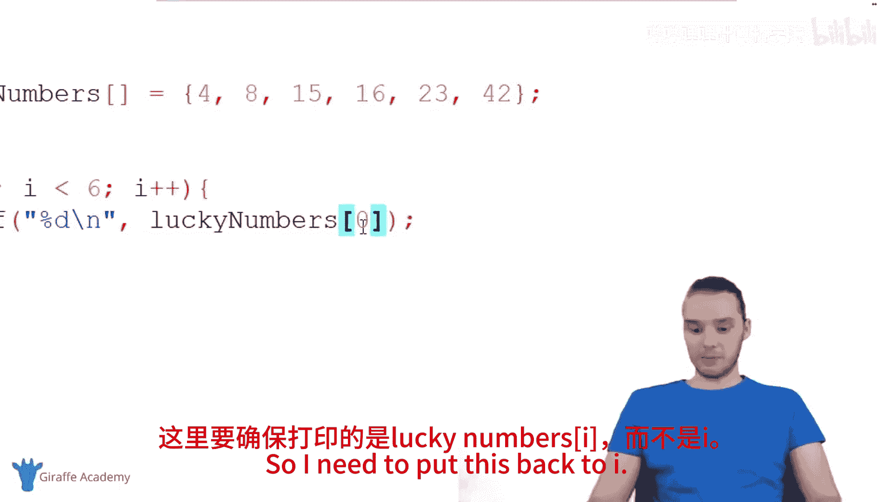
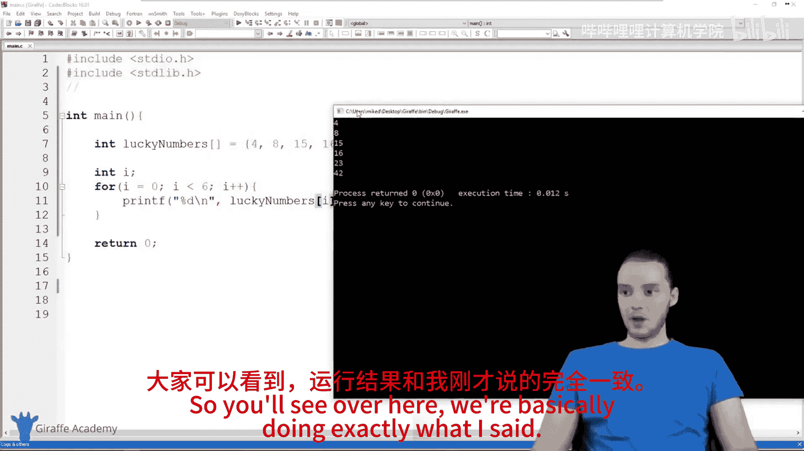
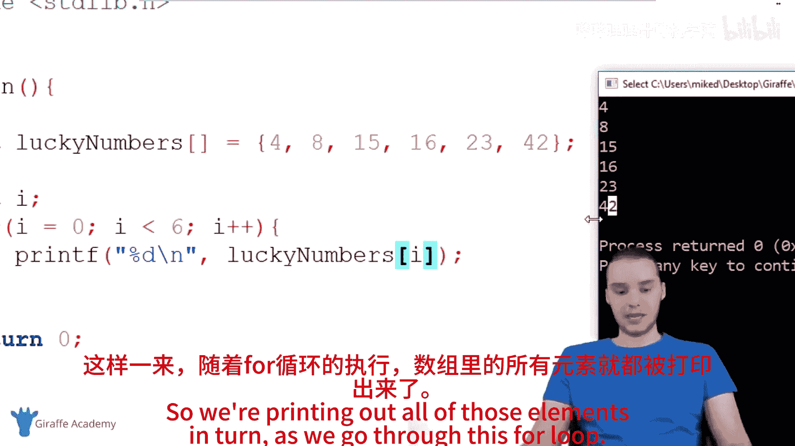
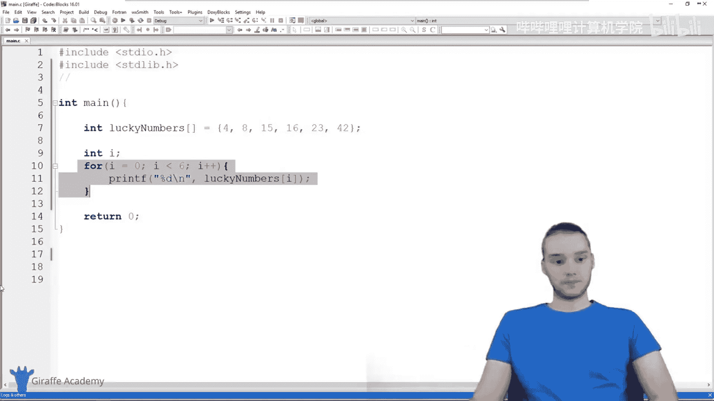

# 【油管千万订阅 freeCodeCamp】面向C语言编程初学者教程 Tutorial for Beginners in C Programmin（中英双语字幕） p24 C编程初学者教程第二十四节：For循环 -BV1ug4wzBEhT_p24-

In this tutorial， I'm going to teach you guys how to use four loops in C。

 Now a four loop is a special type of loop that we can use in C。

 which allows us to use something called an indexing variable and this indexing variable will basically tell us what iteration of the loop we're currently on and we can use that indexing variable to do a bunch of stuff like we could loop through an array of items。

 we could do all sorts of stuff inside of a loop。 So down here in my program you'll see that I have a while loop setup up and I have just sort of a basic while loop and I want to show you guys what it's doing。

 So essentially up here I'm saying int I is equal to1。

 So I'm giving this integer I the value of one and I'm saying while I is less than or equal to5。😊。

I'm going to print out the value of I and then I'm going to increment I so this is a very simple while loop basically we have this variable I and every time we go through the loop we're printing it out until it's greater than five so let's run this program and we'll see what it does。

😊。

So you'll see over here we're basically printing out values between one and5。

 And I want to point out what's actually happening。

 So the first time that we go through this while loop， we're printing out one。

 the second time we're printing out two。 the third time we're printing out three In other words。

 this variable I is basically telling us what iteration of the loop we're currently on So on the first iteration of the loop。

 I is telling us that we're on the first iteration of the loop right the first time we go through the loop。

 I is equal to1 second time we go through the loop， I is equal to2 third time I is equal to three。

 So this variable I over here is basically telling us how many times we've gone through the loop。

 So on the third time it's telling us three， fourth time for etc。

 and believe it or not this is actually a very useful thing for us to have when we're looping。

 And so there's a lot of situations where you're going to want to know what iteration of the loop you're currently on when you're looping。

 So with a normal while loop like I can basically。😊。

Just specify a condition up here and I can do whatever I want it's very open you can kind of just do whatever you want with it。

 but in a lot of situations and there's tons of these situations we're gonna want to have a variable just like I that will tell us what iteration of the loop that we're currently on or basically just a variable that's gonna keep changing every time we go through the loop and this is such a common situation in C that there's actually something called a for loop and a for loop allows us to take all of this code and condense it into its own single loop So it's taking this situation where we want to have a variable like I and it's basically allowing us to do it a lot easier and a lot cleaner。

 So I'm gonna show you guys how we can create a for loop。

I'm gonna come down here below this while loop and I'm gonna create a basic for loop structure。

 So I'm just gonna say four， I'm gonna make an open enclosed parentheses and an open enclosed curly bracket。

 Now the difference between a for loop and a while loop is basically going to happen inside of these parentheses。

 So in the parentheses of a while loop， we have our loop condition or our loop guard this is specifying whether or not we can keep looping through inside this for loop。

 we're gonna to have three different things。 So instead of just one loop guard we're actually going have three different things that we want to put inside of here。

 So with a for loop， the first thing I'm going to put in here is this variable eye。

 So you'll notice in the while loop， we have our variable I up here and this is basically allowing us to loop through and keep track of how many times we've gone through the loop。

 So what I can do down here is I can do something similar。

 I can say liket I and I'm not going give this a value inside of here。

 I'm going say I is equal to one。 So basically I'm going to take my variable I and。

And to give it an initial value of one and now I have my I variable。

 I have my variable that's going to change every time we go through the loop。

The next thing I want to do is include my looping condition。

 So up here we have I is less than or equal to5。 That's our condition。

 I can put the same thing down here， so I'm going to say I is less than or equal to5。

The third thing I want to do is increment I， so you'll notice down here every time we go through this loop。

 we're incrementing that variable I。 I'm going to do the same thing over here in this little third quadrant。

So you'll notice I have these little like sections。

 Here's the first section where're initializing the variable I we're saying I is equal to1 here we're specifying our looping conditions。

 So I'm saying we're gonna keep looping while I is less than or equal to5 And over here is a little line of code that's gonna get executed every time we go through the loop。

 So here I'm saying I plus plus I could also say like I minus minus and that would decrement I I could say like I is equal to I plus2。

 etc ceter。 like I could do basically anything I wanted over here。

 let's just keep it at I plus plus for now。 So you'll see I was basically able to take all of this code and condense it into its own little type of loop。

 And now instead of having to like print this out and create this variable up here。

 I can do all of that inside of this four loop I can basically take this line of code I could paste it down into here。

 and we essentially have the same thing。 So right now this。😊。

Of code and this block of code are 100% equivalent。 They're doing exactly the same thing。

 So let's go ahead and get rid of all this code。 And let's test out our shiny new for loop。

 So I'm just going run my program。 And you'll see over here。

 we're getting exactly the same thing that we got before。 We're printing out 1，2，3，4，5。

 So it's the same exact program doing the same exact thing。

 And that's why four loops are great because we can take that little structure like where we have an indexing variable and we can use it with something like this。

 So I want to show you another situation where these for loops can come in handy。

 and we can use them to loop through all the elements inside of an array。 So actually up here。

 I have this array that I created。 It's called lucky numbers。

 And I'm just gonna grab this and bring it down here。😊，So we have this lucky numbers array。

 it has 48， 15， 16， 2342。And what I could actually do is I could loop through all of the elements inside of this array from this for loop。

 So I'm gonna to show you guys how we can do that。 Now， let's first off。

 see how many elements we have。 We have 1，2，3，4，5，6。 we have six elements in this in array。

 So what I'm going do is I'm actually going say I is equal to0。

 and you'll see why we need to do this in a second。 But basically array indexes start at 0。

 So this first element in the array is at index position 0。 And just for a little refresher。

 If I wanted to access one of these elements from inside the array， I could say like lucky numbers。😊。

Was0。 and this is going to give me access to this element。 If I said lucky numbers 2。

 then I'll get access to this element， this 15。 So this is basically how we can access an element inside the array。

 So I'm going to set I equal to 0。 and I'm going to say I want to loop while I is less than 6。

And six was how many elements we had in the array， so I want to keep looping as long as we're less than 6。

 and I'm going to say I plus plus Now down here， I'm going to do this same exact thing。

 but instead of printing out I， I'm going to print out lucky numbers。I。

 so I'm gonna print out the array element at index position I in lucky numbers。

 Basically the first time we go through this loop， we're gonna to be printing out lucky numbers0 because I is going be equal to0 the second time we go through the loop。

 we're gonna be printing out lucky numbers one because I is going to be equal to1 etc。

 and we're going to keep doing that until we get all the way up to5。

 which is gonna be the last element， which is this 42 So let's go ahead and do that。

 So I need to put this back to I and let's run this program。 So you'll see over here。

 we're basically doing exactly what I said。 So the first time through the loop， we're printing out4。

 we're printing out that first element。 the second time through the loop， we're printing out8。

 which is the second element151623 and 42。 So we're printing out all of those elements in turn as we go through this four loop。

 And there's a lot of situations where four loops are gonna come in handy， but this is a very very。

 very， very common situation where we want to。😊。

Loop through all the elements in an array and either print them out or you know do something to them whatever so that's the basics of working with for loops and I do just want to say like anything that you do with a for loop you could do with a while loop you know I basically showed you guys how we transformed that while loop into a for loop the thing with for loops though is that they're very convenient so it makes it really easy to do something like this without having to go through all the trouble of creating a while loop。

Okay。