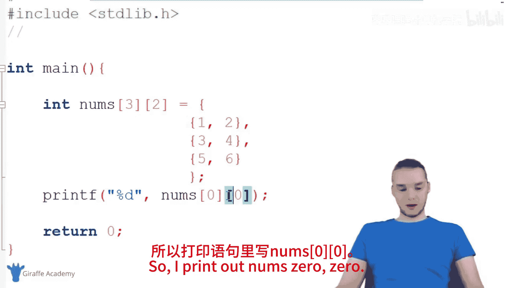
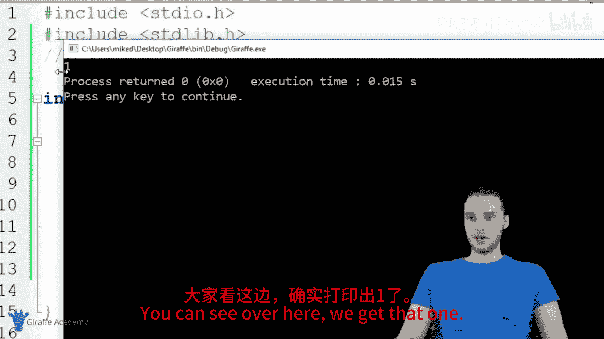
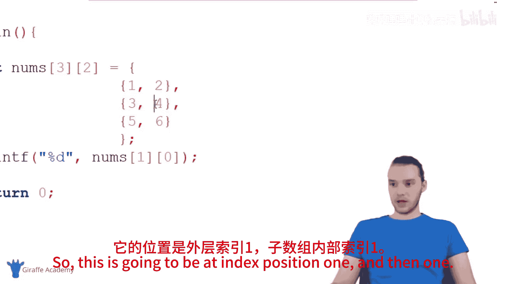
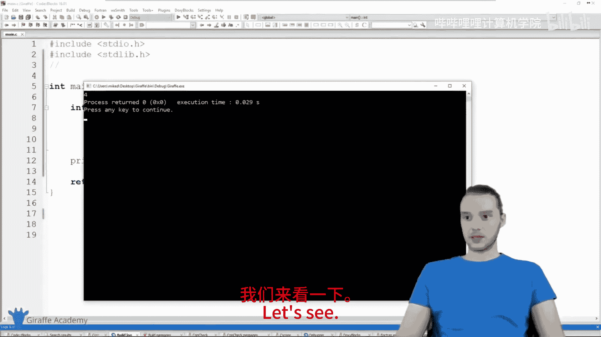
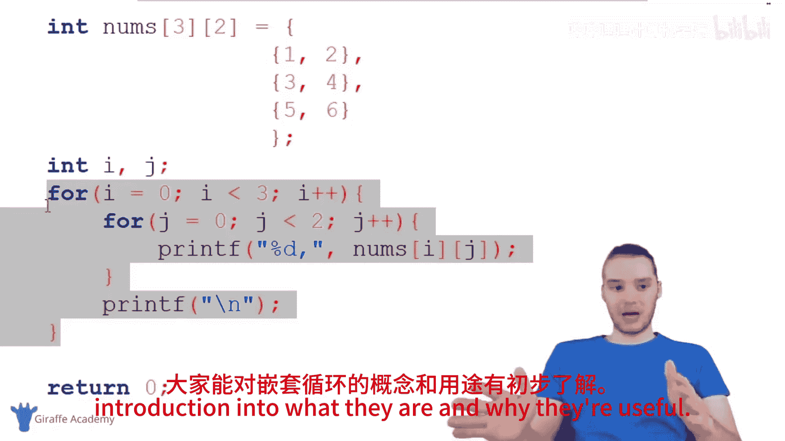

# 【油管千万订阅 freeCodeCamp】面向C语言编程初学者教程 Tutorial for Beginners in C Programmin（中英双语字幕） p25 C编程初学者教程第二十五节：二维数组和嵌套循环 -BV1ug4wzBEhT_p25-

I'm gonna to talk to you guys about two topics and see the first topic we're going to talk about are two dimensionsal arrays。

 A two dimensionional array is basically a situation where we have an array where all of the elements in the array are actually arrays themselves。

 The second thing I want to talk to you guys about is nested loops。

 So we're gonna look at how we can use a looping structure where we have a loop inside of a loops。

 It's gonna to be pretty cool。 And actually these two topics can go together really well。

 And I'm going to show you guys how we can use nested loops and two dimensional arrays in order to make an awesome program。

 So let's get started。 the first thing I want to show you guys is two dimensional arrays So down here we can create a 2 d array And actually the concepts that I'm showing you in this video can apply to multidimensional arrays。

 So not only two dimensions， but 3，4 or5 really as many dimensions as your heart desires。

 So in order to create a twodimensional array。 I'm just gonna make an array of numbers。

 So I'm just gonna say int and we'll give this。😊，Names， so why don't we just say numbs？

And normally when we create an array， after we'd say the name of the array。

 we'd make an open enclosed square bracket。 but when we create a twodial array。

 we're gonna make two open encloed square brackets just like that。

 these two open enclosed square brackets will basically represent like the width and the height of our array。

 So you guys will see what I mean in a second。 but basically we're gonna have like elements in the array。

 And then each of those elements is going be an array and we'll have elements inside of it。

 So these two squares will allow us to like manipulate all that stuff。

 So what I'm going do is I'm gonna set this equal to an open enclosed curly bracket。

 Now this is normally how we would create an array。 So normally I would just say like 1，2，3，4。

 whatever I could put all my numbers in here。 but with a twodial array。

 all of the elements are gonna to be arrays。 So instead of just saying like 1，2，3。

We're actually going to create arrays inside of here。 So， for example， I'll put an array right here。

 and this text editor is so annoying with making these。So， for example。

 the first element in this array I could just make an array， so I'm going to say this is like one，2。

 So you can see here I have two elements inside of this array。

 which is itself the first element of the nus array。 So let's make another one。

 I'm going to come down here and we'll make another one and this keeps trying to format differently。

So now we're going to say3，4。 So this thing right here， this whole array。

 that's the first element in the nus array right， and that array has two elements inside of it。

 same thing with this one。 This is the second element in the nus array。

 and it has two elements inside of it。 So it's basically an array within an array。

Let's make one more and so this is going to be five， six。

So now we have three array elements right one2， three。

 and each of them has two elements inside of them so whenever we create a two dimensionsional array like this。

 we always have to specify the number of elements and then the number of elements inside each array so in our case we're going to have one to three elements in the array。

And each array has two elements inside of it。 So it's going to look like that。

 So we would say three and then two。 And that's basically how we create it。

 So now let's talk about accessing these elements。 So I'm going to create a little print statement here。

And we're going to print out some of this stuff。 So I'm going to。

Say percent D and I'm going show you guys how we can access individual elements。

 So basically I'm going to say nus and let's say that I wanted to access this top left element。

 this one， the first thing I want to do is specify the index where the value that I want to access is stored so like this would be index position zero this would be index position one。

 this would be index position 2 So we're gonna say zero。

And then I want to specify the index position of the individual element inside of zero so I could say like this is element0。

 this is element1， so why don't we access element 0 so I print out nus 00 and this is going to print out that numbers it's going to print out that one for us you can see over here we get that one。

So let's try a different one， let's try to grab this four right here。

 so this is going to be an index position one and then one。

 so this would be at  one1 and now we should get that four let's see Yeah， cool so we get the four。

All right， so that's basically how we can access elements inside of these arrays and also just want to point out that if I didn't want to give this an initial value。

 I could just like put a semicolon here and I could just like manually define each index location so I could say like00 is equal to seven or something like I don't have to give it a a value like right up front。

 although in our case let's just do that because it's a lot easier。All right。

 so we have our numberss array and we figured out how we can print out the elements。

So now I want to talk to you guys about another concept which is called a nested for loop。

 and you guys will see in a second why I'm teaching this alongside 2D arrays。

But a nested for loop is a situation where we have a for loop and inside of that for loop。

 we have another loop。 So I'm gonna to show you guys this really quick。

 let's say we create a for loop。 I'm gonna to create two variables over here in I and in J。

 And I don't know if I've showed you guys this in the course yet。

 but if I want to just like declare two variables， I can just say I comma J。

 and that'll declare both variables。 I'm not giving them actual values yet。

 we're gonna to do that inside these for loops。 So I want to show you guys how we can use a nested for loop in order to print out all of the elements inside of this two dimensional array。

 So I'm going say4。😊，I is equal to0。And we're going to keep looping as long as I is less than three and the reason I'm saying three here is because that's how many elements are inside of this nus array。

So I'm going to keep looming as long as I is less than three， and then I'm going to say I plus plus。

Now inside of these curly brackets I want to create another loop so every time we go through this one iteration of this top loop。

 we're going to fully execute through another loop so I'm going to say。4。J is equal to0。

 J is less than2。 and the reason I'm saying two here is because that's how many elements are inside each array inside of the nus array。

 and you guys will see in a second why this is gonna to work。

 and then I'm going to say J plus plus So now I'm going to make some more open and closed curly brackets。

 and down here I'm going to actually be able to print out all of the elements inside of this array。

 So I'm going to go ahead and do that。I'm just going to say print F。

And we're going to be printing out an integer because these are all integers and we're going to be printing out nus。

And I'm going to print out nus， I and J。So whatever the value of I is and whatever the value of J is。

 that's the index position inside of nus that we're going to print out。

 And now just so this is formatted a little bit better， why don't we put a comma。Right there。

 and then I'm also going to put another print F over here that's just going to print out a new line。

And you'll notice that this print f is outside of this inner for loop so I'm going to run this program we're going to see what it does。

 you guys will see exactly what's happening and then I'll sort of walk you through a little bit more what is going on so。

Let's run this program。And you'll see over here when we ran the program。

 we're basically getting this entire 2D array printed out， so I'm printed out one， two， three， four。

 five， six， so let's talk about why that happens。Over here I'm saying four I is equal to 0。

 I is less than 3 i plus plus， so I'm going through this particular for loop three times I'm going to execute all the code inside of this for loop right here three times that's as many times as there are elements inside of our 2D array。

😡，Now， every single time I go through this top loop， every single time I go through it。

I'm going to execute this loop in its entirety so I will loop through this loop all the way through。

 I'll go through all of its iterations and this loop says j is equal to0。

 J is less than2 and two over here is how many elements are inside of each one of these arrays。

 So this element in the nus array has one， two elements inside of it。

 This element in the nus array has one， two elements inside of it right That's where this two is coming from。

 Then I'm incrementing J。😊，And I'm going to print out so I'm saying print F and I'm printing out nus at index position I and index position J。

 So the first time we go through this four loop， I is going to be equal to0 and remember that first time we're actually going to be going through this loop two times so we're going to be printing out nus0。

0 and nus 01。And then we're coming down here and printing a new line。

The next time we go through this eye loop， we're going to come down here and print nus 10 and nus 11。

 Finally， the third and final time we're going to print out nus 20 and nus 21。

 that's basically how this is working。 So twodial arrays and nested for loops are a match made in heaven and there's a lot of situations where you know besides just looping through 2D arrays that we're going to use nested loops。

 but hopefully this gives you a little bit of a introduction into what they are and why they're useful。

。

