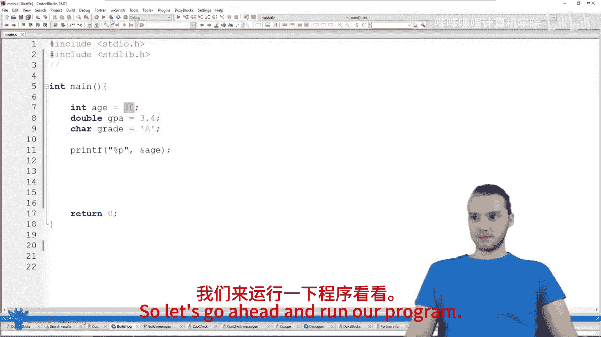
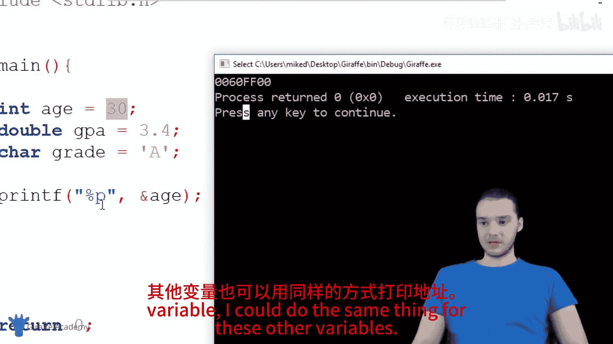
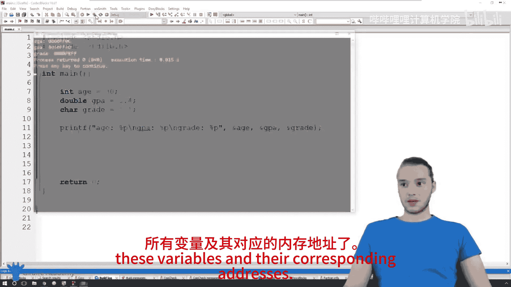
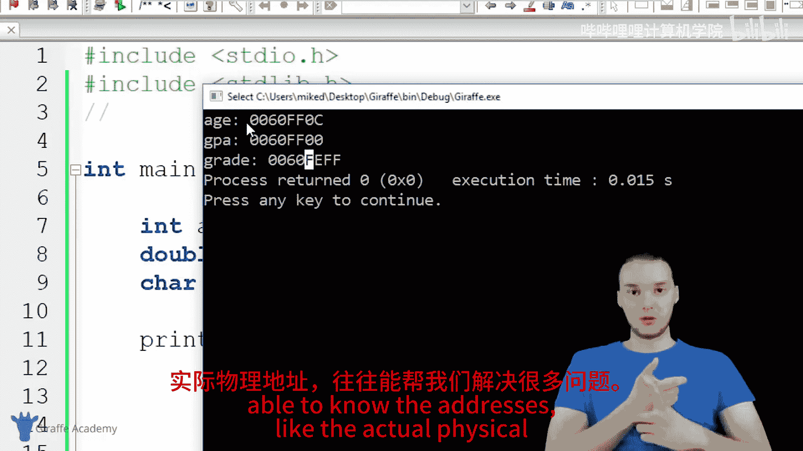
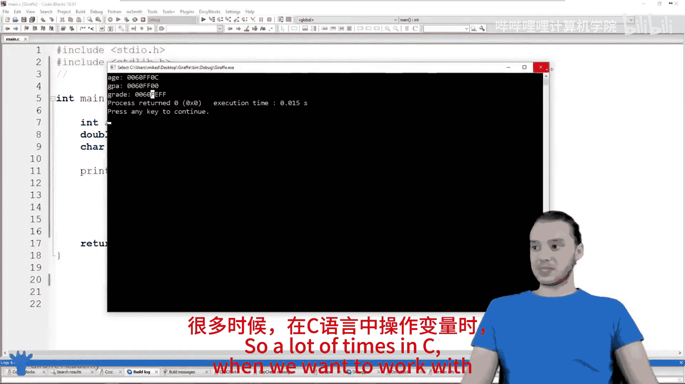
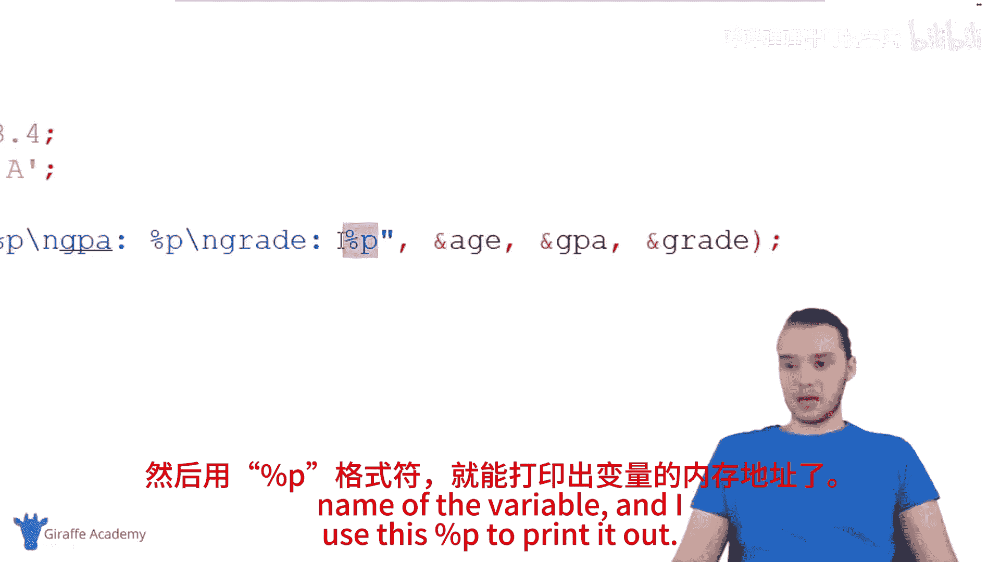

# 【油管千万订阅 freeCodeCamp】面向C语言编程初学者教程 Tutorial for Beginners in C Programmin（中英双语字幕） p26 C编程初学者教程第二十六节：内存地址 -BV1ug4wzBEhT_p26-

In this tutorial， I'm going to talk to you guys about accessing memory addresses in C。

Now in the C programming language a lot of times we're going want to store different information and there's a bunch of different ways that we can store information。

 we can use things like variables。 we could use arrays。

 we could usestructs but the basic point is that whenever we're using C we're gonna want to keep track of and maintain a bunch of different pieces of information and one of the easiest ways to do that is by creating variables So down here you'll notice that I have a bunch of variables I have this integer called age and it just has the value of 30。

 we have this double GP 3。4 and we have this character grade and it has the value of the a character I have a bunch of different variables in my program and it allows me to keep track of data really easily and I can use these to maintain and I can even modify these different information variables are great but I want to talk to you guys a little bit about how these work in the actual physical memory of our computer So whenever I create a variable for example。

 when I create a。😊，ablecalll age。 and I give it a value of 30。

 This value 30 actually gets stored on our computer。 So all computers have memory。

 So a lot of times you'll hear people refer to this as Ram。

 it's called random access memory and basically Ram is the memory that your computer is going to use when it's running programs。

 So for example， if I was to run this C program， my computer would use Ram。

 it would use that memory in order to store and keep track of all this different information So when I create a variable like int age。

 C is actually going to store this value 30， at a specific memory location。

 So it's going to take that value 30， and it's going to store it somewhere in Ram when I create this double called GP C is going to take this value 3。

4 and it's going to store it inside of the physical memory on our computer when I create this grade。

 C is going to store this character and the physical memory。😊。

computer now here's the thing when I create these variables。

 I give them descriptive names so I gave this a descriptive name age so I know what's stored inside of it and when I want to access this value。

 I can just refer to the name I can just refer to age， I can modify it I could print it out。

 I could do something else to it I can do whatever I want with it and the way that I can access this variable in other words the way that I can access the value 30 is just by referring to the name of the variable same goes down here if I wanted to access the grade if I wanted to access this capital a。

 I can just refer to the name of the variable but again。

 here's the thing all of this information is stored in our physical memory somewhere And so whenever C needs to access that information whenever our computer needs to access this value 30 or this value 3。

4 it's actually going to refer to a specific memory address so when I want to access this variable。

Age， I can just type out age， and then I can use this variable。

 But when C wants to refer to this value， it's not actually using age。

 It's going to use the memory address where this value is stored inside of our physical memory。

 So all of these values are stored inside of a physical address in our memory。

 So all of these values have an address where they're stored in memory。

 And when C needs to access them， it can use that address。

 So I'm gonna show you guys how we can access that address。

 how we can print out the address onto the screen and basically just wanted to give you guys an introduction into what memory addresses were so。

😊，Down here， I'm going to say print F。And I'm going to show you guys how I can actually print out the physical memory address where each one of these values is stored on our computer。

So down here， if I want to print out a memory address。

 I need to use a percent sign and a P so normally if I was just going to print out like a number。

 I could say like percent D or I could say percent C for a character。

When we want to print out a physical memory address。

 we're going to say percent P and this actually stands for pointer and we're not going to talk about pointers in this tutorial。

 we're just going to talk about memory addresses， but just know that you need to say percent P。

And now I'm going to type out the name of the variable whose memory I want to access。

 so I'm going to access the memory address of age and before the variable。

 I'm just going to say ampers sand。So I'm going to make an ampersand age。

 and I'm going to say percent P。And now we should be able to print out the memory address where the variable age is stored。

 in other words， we can print out the memory address where this value 30 is stored。

 so let's go ahead and run our program。

And you'll see over here， we're getting this number。 So I'm getting this number 0，0，6，0， FF 0，0。

 So this would be like a hexadecimal number。 I guess it's not technically a number。 It's like。

 I think it's hexadecials。 but basically， this is the physical memory address where the value of 30 is stored。

 In other words， it's the place where C stored the value inside of this age variable。

 I could do the same thing for these other variables。 So actually。

 why don't I format this a little bit。 I'm gonna say here， age。

And then I'm going to make a new line。And we're just going to say GPA。And again。

 I'm going to print out another one of these addresses and we'll do one for grade。

And we'll print out the address。 So now I can just come over here and I can sort of modify this a little bit。

 So I can just say GP。And。Grade， and you'll notice for each of these。

 I'm using this ampers sand before I type out the name of the variable。

 So now when we run our program， we should get a nice little list of all of these variables and their corresponding addresses。

 So you'll see over here。😊。

We have age and it's stored at memory address 00，6。

0 FF GA is stored at this memory address and grade is stored at this memory address。

 So if you were to like go into our computer or go into my computer and go to memory address 00。

60 FF0c。 that's actually going to store the value of 30。

 it's going to store the value that's inside of that age variable。

 if you were to go to this memory address， you would see the value inside of GP。

 if you were going to this memory address， you would see the letter， which was a capital A。

 So basically all of these variables are store at different memory addresses。

 when I want to access the information in the variable， I can just refer to the variabless name。

 so I could say a age or I could say GP but when C wants to access the information in the variable。

 it has to use these addresses So C would use this address， C would use this address and this。Dress。

I can just use the variable names and that's why C is awesome because it allows us to do stuff like that。

 but when C and when our computer wants to access these values， it has to use these memory addresses。

 and so that's why these are useful。And when we're programming in C。

 it can actually be pretty useful to be able to know the addresses like the actual physical addresses of these certain variables in memory。

 So a lot of times in C when we want to work with these variables we can just refer to them by name and we can do all sorts of stuff with them。

 we can access them， we can modify them but in other circumstances。

 we're not just going to want to be able to access the value。

 we're also going to want to be able to access their physical memory address。

 In other words we're going want to be able to know like what that address is and we can use that for a bunch of stuff and in future tutorials。

 I'm going to talk about why that can be useful， but for now I really just wanted to kind of give you guys an overview of what memory addresses are。

 how we're using them in our program and how we can print them out。

 So again I just use this ampersand and then I type the name of the variable and I use this percent P to print it out。

😊。

。

