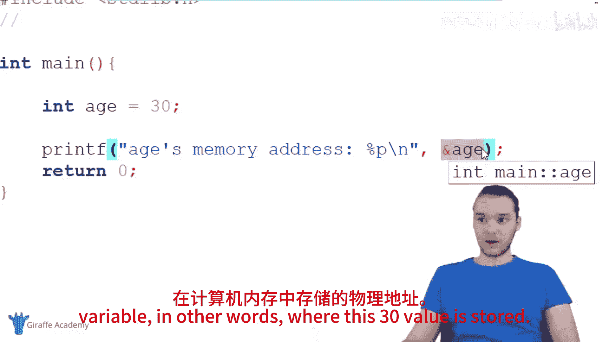
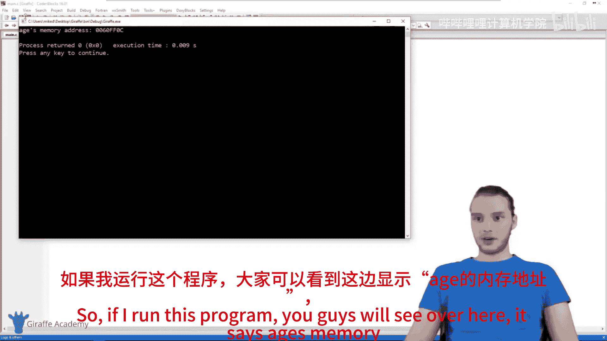
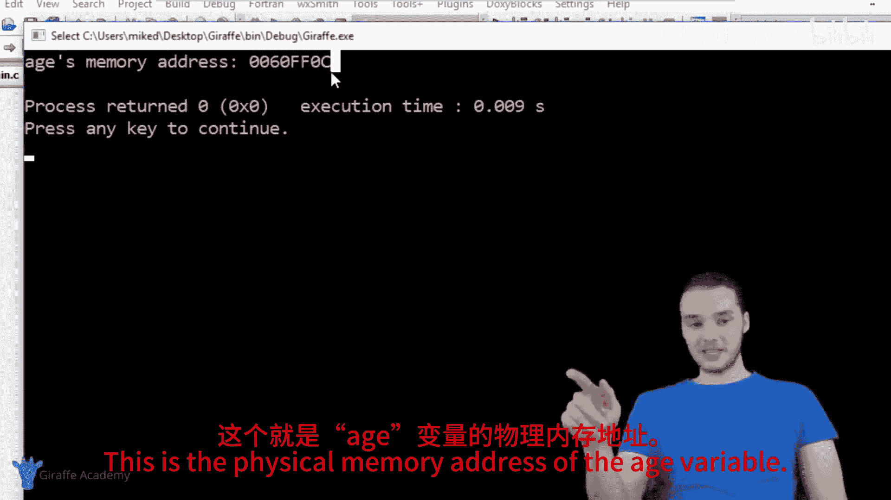
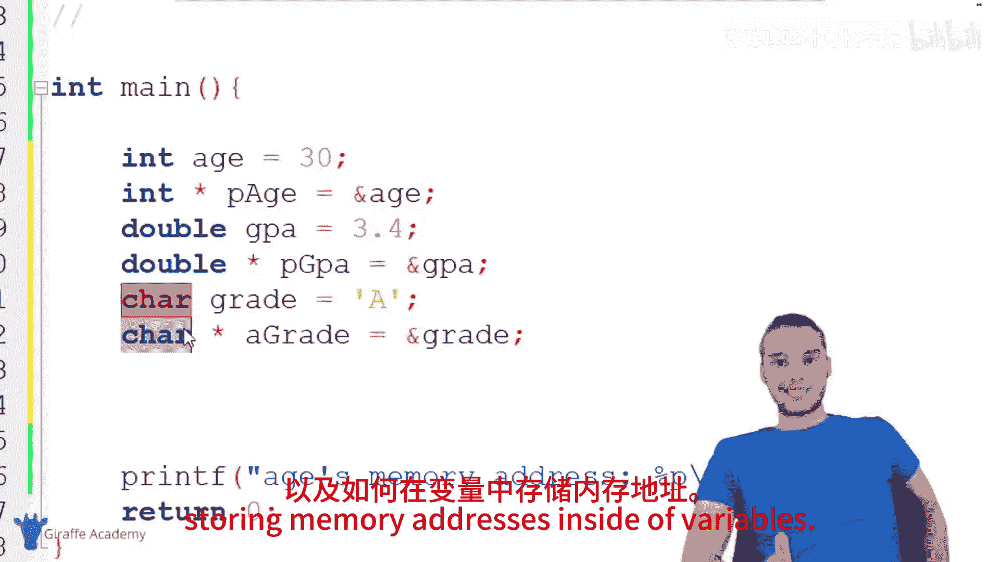
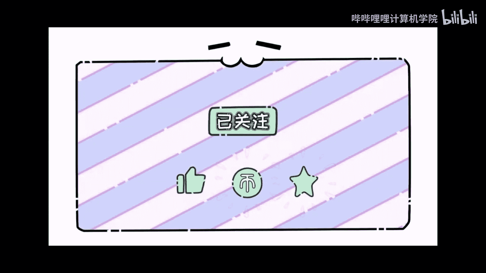

# 【油管千万订阅 freeCodeCamp】面向C语言编程初学者教程 Tutorial for Beginners in C Programmin（中英双语字幕） p27 C编程初学者教程第二十七节：指针 -BV1ug4wzBEhT_p27-

In this tutorial I want to talk to you guys about pointers in C Now a pointer is basically just a type of data that we can use inside of our programs So up until this point in the course。

 we've been using a bunch of different types of data we've been using things like integers and an integer is just a whole number we've been using things like doubles and a double is a decimal number we've been using a chas and a char is basically just a character and now I want to introduce you guys to another type of data which is called a pointer and a pointer is basically just a memory address and a memory address basically refers to a physical address inside of the memory of our computer where we're storing a value and I think pointers tend to confuse a lot of people who learn about them and this is sort of one of those topics and see that everybody dreads because it's traditionally very confusing to understand but actually pointers。

extremely simple and the problem is that they just get over complicated。

 So what I want you guys to do is I just want you guys to think of a pointer as a type of data。

 That's all it is。 It's just a type of data that we can work with in our programs。

 It doesn't have to be any more complicated than that right I can work with an integer in my program an integer is a whole number right I can work with a double in my program。

 A double is a decimal number。 I can work with a char in my program。 A char is just a character。

I can work with a pointer in my program a pointer is just a memory address， That's it。

 A pointer is just another type of data that I can use and I can work with inside of my programs and it just happens to be a memory address inside of the memory or the Ram。

In our computers。 That's， that's all it is。 It's very simple。

 People overcomplicate pointers and they don't have to be overcomplicated because it's just another type of data。

 just like an integer or a double。 But instead of being like a whole number or a decimal number。

 it's a memory address。 So hopefully that makes sense。

 And I hope that you guys don't try to overcomplicate this too much because it doesn't have to be。

 So down here in my program， I have an integer that I've created。 And it's called age。

 So I just said in age。And inside of this integer age， I'm storing a whole number。

 I'm storing an integer right，30。 And if you've been following along with this course in the last tutorial。

 we talked about memory addresses and we talked about how all of these variables are actually storing these values at physical addresses on our computer's memory。

 So down here I have this print statement and I'm just printing out ages memory address。

And I'm using this percent P。 And I'm just printing out ampersand age。

 And we talked about how this ampersand， when I put this in front of the variable。

 basically it's going to give me the physical address in memory where this variable。 In other words。

 where this 30 value is stored。 So if I run this program， you guys will see over here。

 it says ages memory address and it's this hexidadecimal number。

 This is the physical memory address of the age variable。 What did we just talk about before。

 Remember what I told you， pointers are memory address。 That's what they are。 it's a type of data。

 a pointer is a type of data in our program。 and it's a memory address right When I use this ampersand and I type out the name of a variable。

 This is giving me the memory address， right I'm able to print out the memory address。 So really。

 this is a pointer。😊。

This is a type of data in our program that is a memory address。

 just like an integer is a type of data that's a whole number and a double is a type of data。

 that's a decimal number and a char is a type of data。 that's a character。

 a pointer is a type of data that's a memory address and this right here。

 this guy right here is a pointer。 So it's just the memory address of the age variable。 That's it。

 And when I want to print out a pointer， I can use this percent P。

 and it'll allow me to print it out onto the screen and everyone's happy。

 So essentially what I'm doing here is I'm printing out a pointer when I say percent P。

 and I'm telling this print F function that I want to print out a pointer。

 and then I give it a pointer over here。 I give it a physical memory address。

 That's what a pointer is。 Now we understand and hopefully understand that a pointer is just a type of data It's just a memory address。

😊，And we can access the memory addresses of specific variables by using this ampersand and then typing out the name of the variable and that can be pretty useful Now that we understand that I want to show you guys how we can work with these pointers So over here I have an integer variable called age。

And this integer variable is storing an integer value 30。I'm going to say that one more time。

 I have an integer variable and this integer variable is storing an integer value 30。

 I could also create a double variable so I could create a double called GPA。

And inside of this double variable， I could store a double value like 3。4。

I could also create a char variable。Called grade。 and inside of this char variable。

 I can store a character， A。I could also create a pointer variable。😡。

And inside of that pointer variable， I could store a pointer Okay。

 so just like I stored a character inside of this character variable and I stored a double inside of this double variable。

 I could store a pointer inside of a pointer variable so we can actually store these pointers inside of a pointer variable。

 Now， here's where this is going get a little bit tricky。😊，When we create a pointer variable。

 we actually need a physical memory address right so when I create this integer variable。

 like I can just come up with a number right off the top of my head I can just say like 30 when I create a double variable。

 I can just store whatever number I want to store， but when we create a pointer variable remember we're going be storing a memory address。

 and I don't necessarily know any memory addresses like right off the top of my head。

 at least I don't know any meaningful memory addresses。 So when I create a pointer variable。

 what I want to do is store the memory address of a variable that's already in our program。😊。

So I'm going to say that one more time when I'm creating a pointer variable inside of that pointer variable。

 I'm going to store the memory address of another variable inside of our program。

 So let's say that I wanted to create a pointer that would store the memory address of this variable over here so that store the memory address of age。

 right。I can create a pointer just like this so I could say int and asterisk and now I'm going to give this a name。

 so I'm going to give this pointer variable， a name and remember this pointer variable is going to store the memory address of the age variable。

 And generally when you're naming a pointer you're going to start with a lowercase P。

And then you're going to type the name of the variable whose memory address you're storing in the pointer variable。

 So I'm going to say P age， right because this pointer variable is storing the physical memory address of the age variable。

 Now what I want to do is set this equal to the memory address of the age variable。

 which we can access using this ampersand， so I could say ampersand age。

So now this pointer variable is storing the memory address of the age variable。

 I'm going to do the same thing down here for this GP。

 So if I wanted to create a pointer variable that would store the memory address of the GP variable。

 I could say double asterisk and I'm just going to say P GP just like that。

 and I'm going to set this equal to the memory address of this double variable。

 which we can access using this ampersand and then the name of the variable like that。

 I'm going to do the same thing down here for this character variable。

 So I want to create a pointer variable， which is going to store the memory address of the character variable。

 So I'm just going to say char。😊，Ats。A grade。 and I'm going to set this equal to ampersan grade。

 Okay， so that's all I'm doing。 right， So now I have this integer variable。

 and I have this pointer variable， which is storing the memory location or the memory address of the age variable。

 I have this double variable， which is storing a double， and I have this pointer variable。

 which is storing a pointer， and the pointer just happens to be the memory address of the GP variable。

 I have this char variable down here。 And then I have this pointer variable。

 which is storing a pointer， which just happens to be。😊。

The physical memory address of the grade variable in our memory okay and that's basically all you need to know about pointers to get started。

 A pointer is just a type of data。 It's just a type of information that we can work with in our programs。

 It just happens to be a memory addresses right An integer is a type of data that we can work with in our programs。

 and it just happens to be a whole number。 A double is a type of data that we can work with in our programs。

 and it's a decimal number。😊，A char is a type of data that we can work with in our programs。

 and it's a character。 A pointer is a type of data that we can work with in our programs。

 and it's a memory address。 Hopefully that makes sense。

 And just like we create integer variables and double variables。

 we can also create pointer variables。 The only difference is， whenever we create a pointer variable。

 we're going to store the memory address of another variable in our program。 So。

 so you'll see over here， when I create this pointer variable， I'm using the data type。😊。

Of the variable whose address I'm storing。 So over here。

 when I'm storing the address of an integer variable， I'm saying int here。

 when I'm storing the address of a double variable， I'm saying double here。

 When I'm storing the address of a char variable， I'm saying char here。

And that's the basics of using pointers。And also creating pointer variables and storing memory addresses inside of variables。

。

