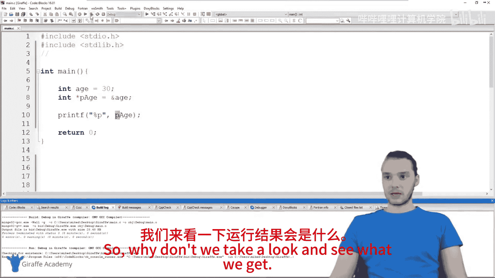
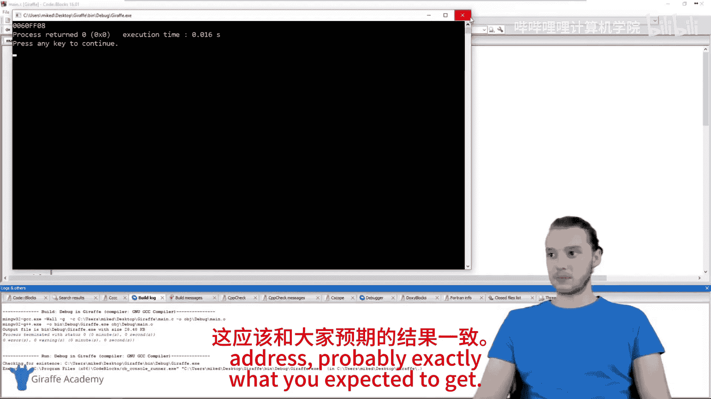
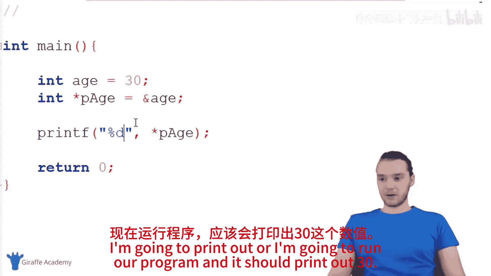
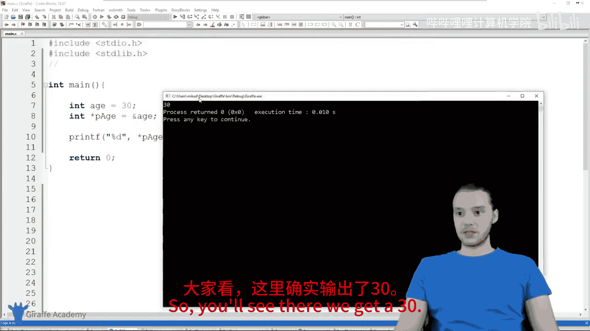
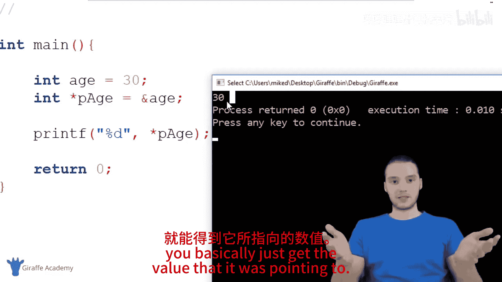
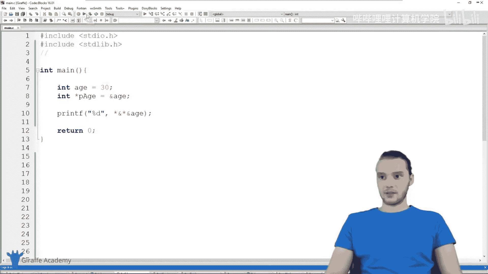
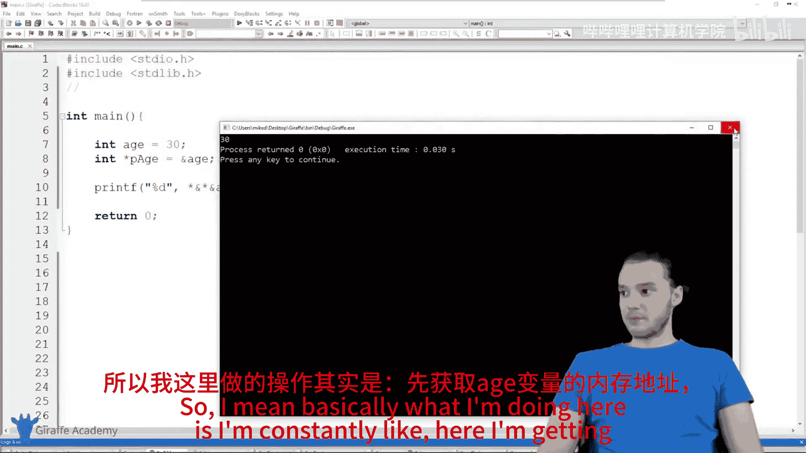
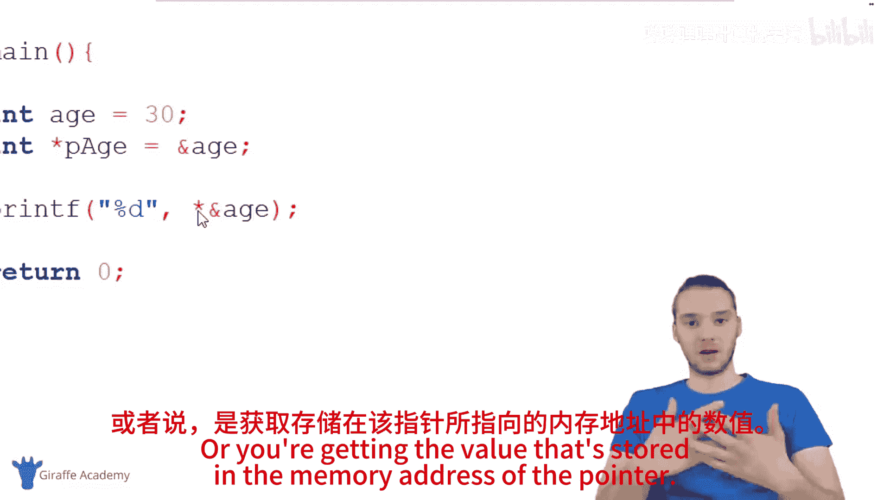
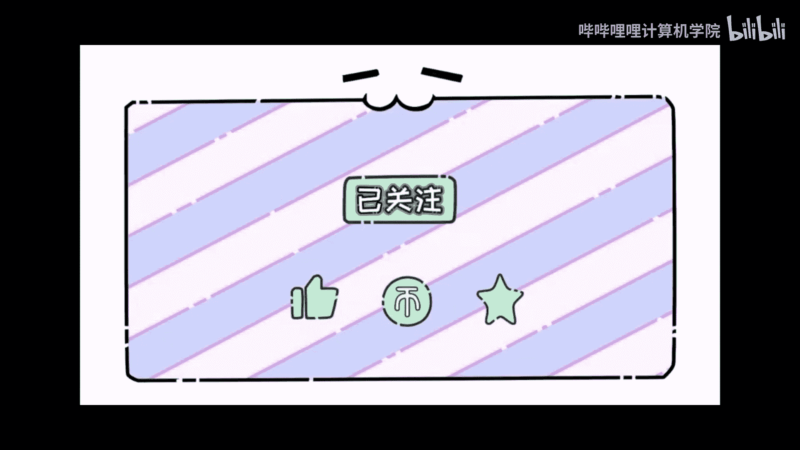

# 【油管千万订阅 freeCodeCamp】面向C语言编程初学者教程 Tutorial for Beginners in C Programmin（中英双语字幕） p28 C编程初学者教程第二十八节：取消引用指针 -BV1ug4wzBEhT_p28-

In this tutorial I want to talk to you guys about dereencing pointers in C Now a pointer is basically just a type of data that we can work with in our programs that is a memory address。

 so sometimes in our programs we're going to want to work with memory addresses we're going to want to use them in our programs and do certain things with them and those memory addresses are basically called pointers in our programs。

And when you dereference a pointer， essentially what you're doing is you're going to the memory address of that pointer and you're grabbing the piece of information from there。

 right， So all pointers are memory addresses。 And when we dereence a pointer。

 we go to that physical memory address and we get the information or we get the value that's stored inside of there。

 So I'm gonna to show you guys how we can do that and see it's actually really easy and can be pretty useful。

 So。😊，Down here I have this integer and it's an integer variable and it's storing the integer value 30。

 and over here I have a pointer variable which is storing the memory address of 30。

 so it's storing the memory address of our age variable， as you can see right here。And down here。

 I'm just printing out this pointer。 So I'm printing out P。 I'm using this percent P。

 and I'm just printing it out to the screen。 So why don't we take a look and see what we get。

 So you'll see over here， we just get this memory address probably exactly what you expected to get。

 So over here， I want to show you guys how we can dereference a pointer So this pointer variable。

 ph is storing the memory address of this age variable right So when we printed it out。

 we basically we're given the physical memory address where this number 30 was stored。

 So ph is storing the memory address of 30 It's storing the memory address where this value is。

Inside of our computer's memory。 if I want to dereference a pointer， basically。

 what I'm going to be doing is I'm going to be going to that actual physical memory address and grabbing that piece of information。

 So the way that I can dereference a pointer is by using the asterisk。

 So when I'm printing this pointer out， I can dereence it by using this asterisk。 but now over here。

 since I'm dereferencing this pointer， I need to print out a number instead of a pointer。

 because when I dereference the pointer， this is no longer a pointer。

 this is no longer a memory address。 Now this is going to be whatever was stored at the memory address。

 the pointer was pointing to。 So this is going to be an integer because this pointer variable was storing the address of an integer。

So when I dereence it。This is actually going to be an integer。

 So let me show you guys I'm going to print out or I'm going to run our program and it should print out。

30。So you'll see there we get a 30 So basically what's happening here is we're dereferencing the pH pointer variable we're dereferencing the pH pointer。

 which basically means we're going and grabbing the actual you know physical value that's stored at the memory address that the pointer was pointing to and that's why we get 30 and that's basically what dereencing is you know you have a pointer you can dereence it and you basically just get the value that it was pointing to。

It's essentially all we're doing so I want to show you guys how we could do this just normally so for example。

 I have this age variable if I just typed this out。

 if I wanted to get the address of this age variable。

 I could use this ampersand right that's basically what we did up here。

But what I could do is I could just dereence this so I can say ampersan age。

 and then I can put a asterisk here， and this is actually going to dereence that entire thing。

So now when I run my program， it's going to print out 30。

 so it's not going to print out the memory address。

 it's just going to print out 30 so you can see over here we get 30。

So I could actually do this like as many times as I want。

 and this will maybe just illustrate what's happening so I could put an ampersand here。

And now I'm going to get that memory address again。So you'll see we're getting this memory address。

And I could do the same thing， so I could dereence this one more time。And。

You'll see now we're getting that 30 value again so I mean basically what I'm doing here is I'm constantly like like here I'm getting the memory address where the age variable stored。

 then I'm dereencing it and getting the value， then I'm getting the memory address again and then I'm dereencing it again so。

Hopefully that makes sense when you dereference a pointer。

 you're basically just getting the value that that pointer is pointing to or you're getting the value that's stored in the memory address of the pointer。

。

