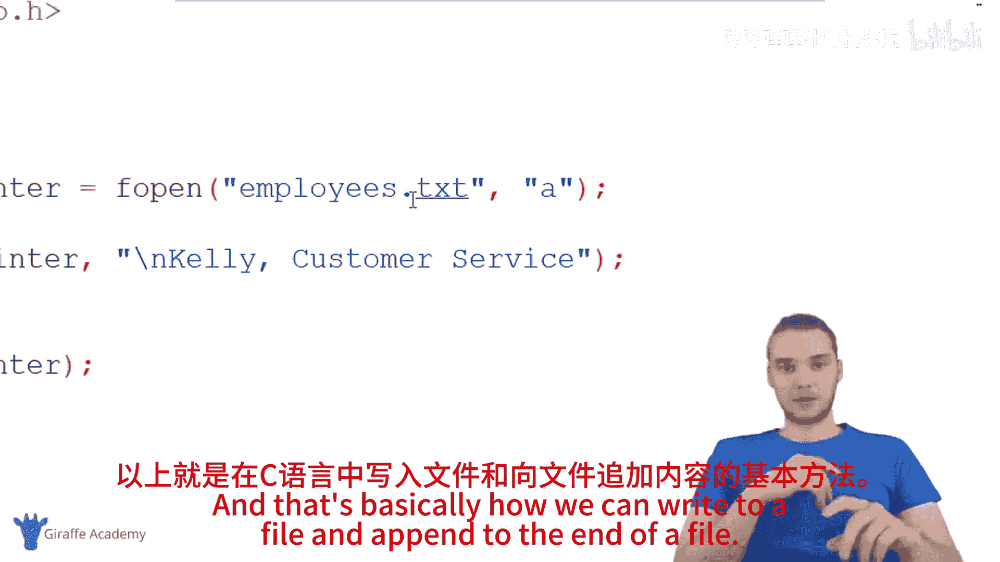

# 【油管千万订阅 freeCodeCamp】面向C语言编程初学者教程 Tutorial for Beginners in C Programmin（中英双语字幕） p29 C编程初学者教程第二十九节：写入文件 -BV1ug4wzBEhT_p29-

In this tutorial， I'm going to teach you guys how to write to files in C One of the cool things we can do in C is we can actually modify and change and also create new files。

So in this tutorial， I'll just basically show you guys how to do that。

 We'll talk about creating files， writing files and app onto files。

 So let's go ahead and do that down here in my main function。We're actually going to create a file。

 so I'm going to create a file and I'm going to store some information inside of that file and the way that we can do that is we can just type out file all in caps just like that and essentially what we're doing here is we're creating a pointer to a physical file on our machine。

😊，I'm just going to say file and I'm going to make an asterisk and I'm just going give this a name so I'm just going call this F pointer。

 and that'll just stand for file pointer and I want to set this equal to F open and F open is actually a function that's going to open a file for us。

 And so inside of these parentheses， I'm going to give this a couple different parameters。

 The first parameter is going to be the name of the file that I want to open。

 So I'm just going to call this。Employees do text and the second parameter is going to be a file mode and a file mode is basically just going to tell C what we want to do with the file that we're going open。

 And there's a bunch of different file modes。 the three most basic types are R and R stands for read。

 So if I put R in there， it'll mean we want to read the file W stands for right。

 So if I put right in there， it means I want to either create a new file or write over an existing file。

And there's also A， which stands for aend， and that means I want to append information on the file in this tutorial。

 we're going to look at W and A。So what I want to do over here is put in W。And right now。

 employees text， this file doesn't actually exist。 So what I'm going do is I'm actually going to create that file。

 We're gonna to put some information inside that file and then that file get saved onto my machine。

 And in order to do that， we're gonna need this right mode。

 So it's just gonna be a W anytime that we're opening a file and see you always want to make sure that you close the file。

 So over here I'm saying F open And down here I want to use another function called F close。

 And basically what this is gonna do is it's going to close off the file。

 So it's gonna remove the file from the memory on our computer And if we do make any changes。

 it'll kind of like save the file and everything will just be kind of like locked in。

 So you always want to make sure whenever you're working with the file that you close it and inside of this F closed function。

 we just want to pass in this F pointer。So I'm just going to say F pointer right there。

 So let's talk about what's happening here file is basically just like essentially like a data type。

 I guess， and we're creating a pointer to a physical file on our computer So if you remember a pointer is basically just a memory address right a pointer is a type of data that we can use in our program it's essentially just a memory address and this pointer is storing the memory address of this new employees do text file that we're going to create。

 So essentially what's going to happen is we're going to create this employees do text file and F pointer is going to be pointing to the memory address of that file on our computer。

So that's essentially what's happening here。And what I want to do is I actually want to write some information to this file So actually let me just show you guys really quick what's happening here So without doing anything else。

 just using this line right here when I run my program a new file called employees。

 text is going to get created So over here I'm in my little directory and if you don't specify an absolute path or like a relative path for this is's just going to create in the directory that your C files in So if I wanted to create this on my C drive I could say like see whatever and then like employees text and this will get created in my C drive but if I don't specify like an absolute path or even if I don't specify a relative path then this is just going to get created in the same directory as our C file and you'll see over here my main C file is right here it's in this folder So when I run this program。

 let's watch over here and we can see this employees。Text file get created。

 So I'm gonna run my program。 And you'll see over here that this employees file got created。

 So if I actually bring this out a little bit， you'll see it's a text document。

 it's employees dot text。 and there's0 kilobytes inside of this。

 So we haven't put any information in there。 But this file got created。

 So now let's talk about putting some info into that file。 inside this file。

 I'm basically just gonna list out a bunch of like employees that might work in an office。

 And the easiest way to write information to a file is just to say F print F And this is a special。😊。

Function in C， which actually works a lot like the print F function。

 So if you've used the print F function。 And if you're following along with this course。

 we've been using it throughout the entire course。 The print F function basically allows you to like print information out onto that console window。

 F print F is gonna allow us to essentially just write information to a file。

 I need to give this a couple parameters。 The first one is gonna be this file pointer。

 In other words， I need to tell this function。 You know， what it should be writing to。

 So I'm just gonna say。😊，F pointer。And then over here we can just give this some information so I can just use like after we put in this file pointer。

 I can just use this like I normally would the print F function so I could just print out like some employees so I could say like let's say one of the employees is Jim。

And we'll put like what they do。 So like， I could say， salesmen。And then we could say， actually。

 let's make a new line。And we'll create another employee Pam， and she is the receptionist。

 and then we can make some other employees so。So now I have three employees that I'm going to basically write out to my employees file。

 so now when I run this program。And we can go over here to this employees file。

You'll see when I open this up that we have these three lines in here。 So we have gym salesman。

 Pam receptionist and Oscar accounting。 So basically。

 I was able to create this file and write all this information in the file from down here。

 just from down here in this program。 So that's pretty cool。😊，And I want to show you guys with right。

 so when I'm using this right。This is actually going to overwrite a file。 So， for example。

 if I changed this from all this text and I just put like。

Overrid in here now when I run this program。And we open this employees text file。

 So let me reopen this。You'll see it just says overridden。

 So I've actually overridden all the text that was in there。

 and that's basically what happens when we just write to a file。

 So let's go back to what we had before。 I'm just going run this again。 so we have this text。

And you'll see now we're back with the employees， so let's say that inside of this file。

 we wanted to add an employee onto the end of it， so we wanted to add like a new employee onto this file。

 right。Well， I can use something called append and what aend is going to do is it's going to allow us to append a new line onto the end of this file or actually just append text onto the end of the file instead of sayingW I'm just going to say a and you'll notice I'm still keeping employees。

 textex here and down here inside of this F print F I'm just going to print out another employee into the file the first thing I'm going to do is print out a new line because and actually let me show you guys this in this employees file。

There actually isn't a line after this last line， so the last like position in this file is over here。

 I can't actually get onto the line below Oscar。So I'm going to want to go ahead and print a new line。

 and this will move the next employee on the next sign we could say like。

Kelly and she's gonna to work in customer service。 So now when I run my program。

 instead of overriding what was in the employees do text file， now。

 this is just going to append this new employee onto the file。 So I'll come up here run the program。

And let's open this employees file。 And you'll see now we have another entry。

 Kelly from customer service。 So when we write a file。

We either create a new file and add content onto it or we just overrite the content in the file。

 at least using this F print F function and when we append we're just app pending information onto the end of the file So just using those two things I mean you can essentially write out any file that you want and it's important to know that you can write more than just text file so I could write like an HTML file or I could write like a CSS file you could write really I mean any type of file that you'd want and that's basically how we can write to a file and append to the end of a file。

Yeah。

