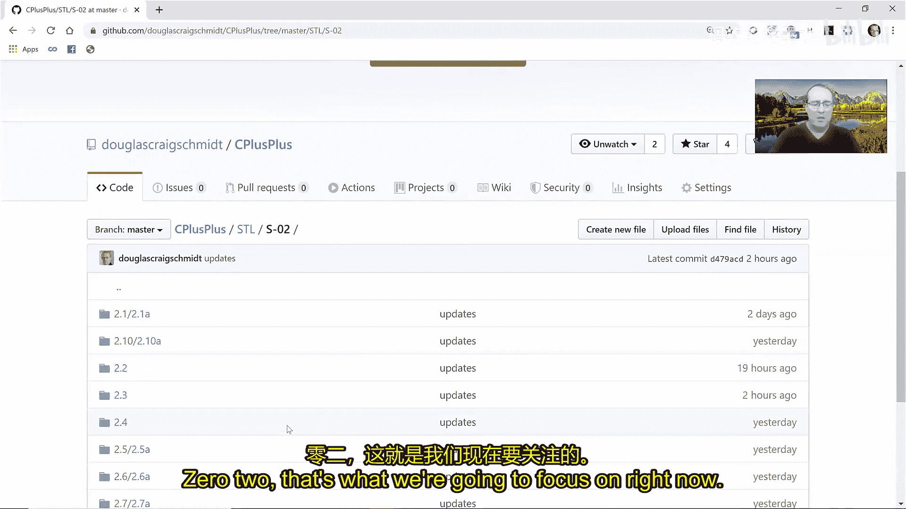
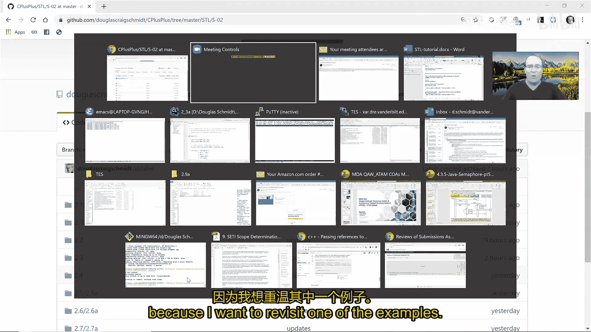
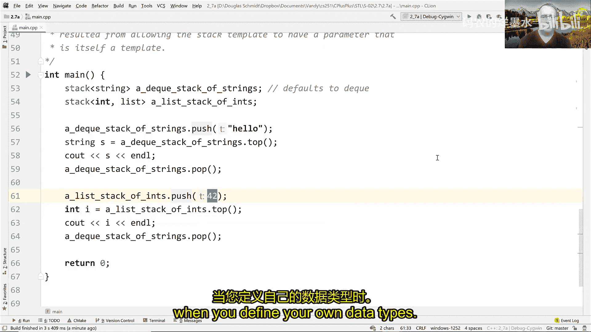

# 003：模板函数与模板类（第二部分）





## 概述

在本节课中，我们将继续学习C++标准模板库（STL）中的模板函数与模板类。我们将重点探讨如何有效地组织模板代码，并深入了解模板特化、默认模板参数以及模板模板参数等高级概念。这些知识将帮助你编写更专业、更高效的C++代码。

---

## 模板代码的组织方式

上一节我们介绍了模板的基本概念，本节中我们来看看如何有效地组织模板代码。与传统的C++代码不同，模板的编译有其特殊性，编译器需要能够访问模板的源代码。

### 分离头文件与实现

在传统的C++编程中，我们通常将类的声明放在头文件（`.h`）中，而将方法的实现放在源文件（`.cpp`）中。然而，对于模板类，这种做法需要调整。

以下是组织模板代码的一种常见方式：

1.  **头文件（`pair.h`）**：包含类的声明和模板参数。
    ```cpp
    #ifndef _PAIR_H
    #define _PAIR_H

    namespace MyP {
        template <typename T>
        class Pair {
        public:
            Pair(const T& first, const T& second);
            T max() const;
        private:
            T first_;
            T second_;
        };
    }

    #include "pair.cpp" // 注意：这里包含了实现文件
    #endif
    ```

2.  **实现文件（`pair.cpp`）**：包含类方法的定义。注意，这个文件通常被头文件包含。
    ```cpp
    #ifndef _PAIR_CPP
    #define _PAIR_CPP

    #include "pair.h"

    template <typename T>
    MyP::Pair<T>::Pair(const T& first, const T& second) : first_(first), second_(second) {}

    template <typename T>
    T MyP::Pair<T>::max() const {
        return (first_ > second_) ? first_ : second_;
    }

    #endif
    ```

**关键点**：C++编译器在实例化模板时需要看到完整的定义，因此模板的实现通常需要放在头文件中，或者通过`#include`包含进来。这种分离方式保持了代码结构的清晰。

---

## 模板特化

模板特化允许我们为特定的类型提供定制化的实现，这类似于函数模板的重载，但是作用于类级别。

### 完全特化

我们可以为特定的类型完全重写一个模板类。

假设有一个通用的`Container`模板类：
```cpp
template <typename T>
class Container {
public:
    Container(T data) : data_(data) {}
    T increase() { return ++data_; }
private:
    T data_;
};
```

我们可以为`char`类型提供一个特化版本，增加一个不同的方法：
```cpp
template <>
class Container<char> {
public:
    Container(char data) : data_(data) {}
    char uppercase() {
        if (data_ >= 'a' && data_ <= 'z') {
            data_ = data_ - 'a' + 'A';
        }
        return data_;
    }
private:
    char data_;
};
```

**使用示例**：
```cpp
Container<int> myInt(7);
Container<double> myDouble(10.5);
Container<char> myChar('j'); // 使用特化版本

cout << myInt.increase() << endl;    // 输出: 8
cout << myDouble.increase() << endl; // 输出: 11.5
cout << myChar.uppercase() << endl;  // 输出: J
// myChar.increase(); // 错误！特化版本中没有increase方法
```

**要点**：特化版本可以完全改变类的成员，它就像一个为特定类型量身定制的新类。编译器只会实例化实际被调用的成员函数，这有助于节省空间。

---

## 部分特化

部分特化允许我们为满足某些条件的类型组合提供特化版本，而不是单一的具体类型。

考虑一个有两个类型参数的模板类：
```cpp
template <typename T, typename U>
class Class {
public:
    Class() { cout << "Class<T, U>" << endl; }
};
```

我们可以创建多个部分特化版本：

1.  **当两个类型相同时**：
    ```cpp
    template <typename T>
    class Class<T, T> {
    public:
        Class() { cout << "Class<T, T>" << endl; }
    };
    ```

2.  **当第二个类型是`int`时**：
    ```cpp
    template <typename T>
    class Class<T, int> {
    public:
        Class() { cout << "Class<T, int>" << endl; }
    };
    ```

3.  **当两个类型都是指针时**：
    ```cpp
    template <typename T, typename U>
    class Class<T*, U*> {
    public:
        Class() { cout << "Class<T*, U*>" << endl; }
    };
    ```

**使用示例**：
```cpp
Class<int, double> a;   // 输出: Class<T, U>
Class<double, double> b; // 输出: Class<T, T>
Class<char, int> c;      // 输出: Class<T, int>
Class<int*, double*> d;  // 输出: Class<T*, U*>
```

**注意**：如果存在歧义（例如`Class<int, int>`既匹配`Class<T, T>`又匹配`Class<T, int>`），编译器会报错。此时需要提供一个更具体的特化版本来解决歧义。

---

## 默认模板参数与非类型模板参数

模板参数不仅仅是类型，还可以是具体的值。

### 默认模板参数

可以为模板参数指定默认值。
```cpp
template <typename T = int> // 默认类型为int
class Stack {
private:
    std::vector<T> elems;
public:
    void push(const T& elem) { elems.push_back(elem); }
    // ... 其他方法
};

Stack<double> s1; // 显式指定类型为double
Stack<> s2;       // 使用默认类型int
```

### 非类型模板参数

模板参数可以是整型值、指针或引用。
```cpp
template <typename T, int N>
class MemBlock {
private:
    T block[N] = {0}; // 使用参数N定义数组大小，并初始化为0
public:
    void set(int idx, const T& value) { block[idx] = value; }
    T get(int idx) const { return block[idx]; }
};

MemBlock<int, 5> intBlock;    // 包含5个int的数组
MemBlock<double, 15> doubleBlock; // 包含15个double的数组
// intBlock 和 MemBlock<int, 8> 是两种不同的类型，不能互换使用。
```

函数模板也可以使用非类型参数：
```cpp
template <typename T, int V>
T add(const T& n) {
    return n + V;
}
int result = add<int, 6>(10); // result = 16
```

这种机制是C++模板元编程的基础，允许在编译期进行计算。

---

## 模板模板参数

这是最强大的特性之一，它允许将一个模板本身作为参数传递给另一个模板。

我们可以定义一个`Stack`类，它接受一个容器类型作为其内部实现：
```cpp
template <typename T,
          template <typename> class Container = std::deque> // 模板模板参数，默认容器为deque
class Stack {
private:
    Container<T> elems; // 使用传入的容器模板
public:
    void push(const T& elem) { elems.push_back(elem); }
    void pop() { elems.pop_back(); }
    T top() const { return elems.back(); }
};
```

**使用示例**：
```cpp
Stack<std::string> deckStack; // 默认使用std::deque<std::string>
Stack<int, std::list> listStack; // 使用std::list<int>作为内部容器

deckStack.push("hello");
listStack.push(42);

cout << deckStack.top() << endl; // 输出: hello
cout << listStack.top() << endl; // 输出: 42
```

**实际应用**：STL中的容器适配器（如`std::stack`, `std::queue`）就大量使用了模板模板参数，使得我们可以灵活地选择底层容器。

---



## 总结

本节课中我们一起学习了C++模板的几个高级主题：
1.  **代码组织**：理解了模板代码需要与头文件一起提供的编译模型。
2.  **模板特化**：学习了如何通过完全特化和部分特化为特定类型提供定制实现，这是STL实现许多优化的关键。
3.  **模板参数**：探索了默认模板参数、非类型模板参数（如整数值）的用法。
4.  **模板模板参数**：掌握了将模板作为参数传递的强大技术，这是构建灵活、可复用组件库的基石。

这些概念是深入理解和使用C++标准模板库的核心。在接下来的课程中，我们将看到这些技术如何被应用于实际的STL组件中。