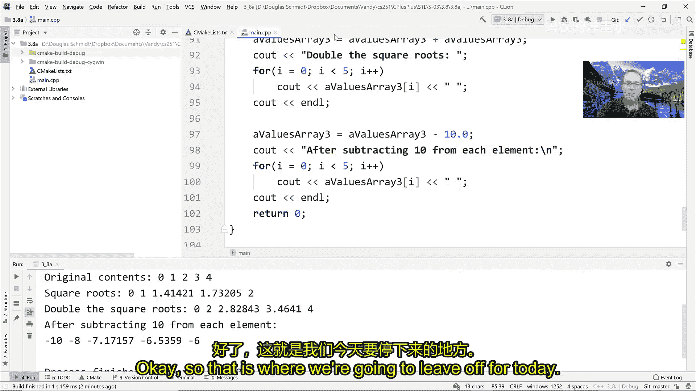

# 006：容器 part2 🚀


在本节课中，我们将继续探讨C++标准模板库的顺序容器。上一节我们介绍了最常用的`vector`，本节中我们将扩展讨论范围，涵盖`deque`和`list`，以及一些虽不严格属于STL但具有相似特性的类，如`string`、`bitset`和`valarray`。

---

## 什么是Deque？🤔

`deque`是“双端队列”的缩写。与仅支持在末尾高效添加和删除元素的`vector`不同，`deque`支持在**前端**和**后端**都进行高效的添加和删除操作。

当然，你也可以在中间位置添加或删除元素，但这并非高效操作。其底层实现是一个更复杂的数据结构，旨在能够高效地向两端增长或收缩。

`deque`和`vector`有一些共同特性：
*   可以通过位置索引访问单个元素。
*   可以按任意顺序（向前或向后）遍历元素。

它们的主要区别在于，`deque`可以高效地在**前端**添加和移除元素。

在内部实现上，`deque`和`vector`差异很大。`vector`是一块连续的内存，因此使用下标运算符访问元素非常高效。相比之下，`deque`的效率稍低，有额外的开销（尽管插入和删除操作仍是常数时间复杂度），并且其内存分配**不是连续**的。

以下是`deque`接口的概览：
```cpp
template <typename T, typename Allocator = allocator<T>>
class deque;
```
*   `T`是用于实例化`deque`模板的数据类型（如`int`、`double`等）。
*   `Allocator`用于分配内存，默认使用C++的`operator new`和`delete`。

`deque`与`vector`的大多数方法相同，但有几点不同：
*   `deque`不能像`vector`那样预留空间（`reserve`）。
*   `deque`不能检查容量（`capacity`）。
*   `deque`新增了`push_front`和`pop_front`成员函数，用于在前端高效添加和移除元素。

### 一个简单的Deque示例

以下是演示`deque`基本用法的代码：
```cpp
#include <iostream>
#include <deque>

int main() {
    std::deque<float> myDeque; // 创建一个空的float类型deque

    for (int i = 0; i < 7; ++i) {
        myDeque.push_front(i * 1.1f); // 在前端添加元素
        myDeque.push_back(i * 1.1f);  // 在后端添加元素
    }

    // 使用基于范围的for循环打印所有元素
    for (auto value : myDeque) {
        std::cout << value << ' ';
    }
    std::cout << '\n';
    return 0;
}
```
运行此代码将输出一个类似回文的序列：`6.6 5.5 4.4 3.3 2.2 1.1 0 0 1.1 2.2 3.3 4.4 5.5 6.6`。这展示了如何高效地在`deque`的前端和后端添加元素。

---

## 如何选择：Vector vs. Deque？⚖️

在选择`vector`还是`deque`时，可以参考以下经验法则：

*   **优先使用`vector`的情况**：如果你只需要随机访问，并且主要在末尾添加元素。`vector`更高效、更节省空间。如果你事先知道数据量，还可以使用`reserve`预分配内存。
*   **考虑使用`deque`的情况**：如果你的算法需要频繁在数据结构**前端**插入或删除元素。`deque`为此类操作而设计。
*   **性能注意**：`vector`的下标运算符（`[]`）或`at()`成员函数访问速度略快，因为它是非常快速的常数时间查找。`deque`的访问也是常数时间，但由于存在间接寻址，速度稍慢。
*   **内存回收**：当容器被销毁时，`vector`只需释放一整块连续内存，速度很快。而`deque`分配了多个内存块，需要逐个释放，虽然影响不大，但值得注意。

---

## Deque与迭代器 🔄

`deque`支持所谓的**随机访问迭代器**，这是STL中最高级的迭代器类型。`vector`也支持此类迭代器。随机访问迭代器本质上可以像数组指针一样进行算术运算（如`++`、`+=`、`+`、`-`等）。

以下是使用迭代器操作`deque`的示例：
```cpp
#include <iostream>
#include <deque>

int main() {
    std::deque<char> myDeque;
    for (int i = 0; i < 5; ++i) {
        myDeque.push_back('A' + i); // 添加 A, B, C, D, E
    }

    // 方法1：使用显式迭代器类型（传统方式）
    std::deque<char>::iterator it1 = myDeque.begin() + 2; // 指向第三个元素 (C)
    // 方法2：使用auto关键字（现代方式）
    auto it2 = myDeque.begin() + 3; // 指向第四个元素 (D)

    std::cout << "*it1 = " << *it1 << '\n'; // 输出 C
    std::cout << "*it2 = " << *it2 << '\n'; // 输出 D

    // 在 it1 指向的位置（C之前）插入 'X'
    myDeque.insert(it1, 'X');

    // 再次打印迭代器指向的值（注意：插入可能使迭代器失效！）
    std::cout << "After insert - *it1 = " << *it1 << '\n'; // 未定义行为，可能输出 X
    std::cout << "After insert - *it2 = " << *it2 << '\n'; // 未定义行为，可能输出 C

    return 0;
}
```
**重要警告**：对于`deque`和`vector`这类可能调整自身大小的容器，STL默认不提供“健壮的迭代器”。修改容器（如插入、删除元素）可能会使指向容器内部元素的**现有迭代器失效**。因此，在上述代码中，插入操作后使用`it1`和`it2`是**不安全的**，可能导致未定义行为（如程序崩溃或错误结果）。我们将在后续讲解迭代器时更详细地讨论这一点。

---

## 常量迭代器与按引用传递 📝

当我们需要以只读方式访问容器，并且希望避免复制开销时，可以将容器作为**常量引用**传递给函数。在函数内部，我们需要使用**常量迭代器**来遍历容器。

以下是相关示例：
```cpp
#include <iostream>
#include <deque>

// 接受一个deque的常量引用，避免复制
void printDeque(const std::deque<int>& d) {
    std::cout << "Size: " << d.size() << '\n';
    std::cout << "Contents: ";

    // 使用常量迭代器进行遍历
    for (std::deque<int>::const_iterator it = d.begin(); it != d.end(); ++it) {
        std::cout << *it << ' '; // 只能读取，不能修改*it
    }
    // 现代C++中，更简洁的方式是使用auto：
    // for (auto it = d.begin(); it != d.end(); ++it) {
    //     std::cout << *it << ' ';
    // }
    std::cout << '\n';
}

int main() {
    std::deque<int> myDeque = {1, 2, 3};
    printDeque(myDeque);
    return 0;
}
```
*   `const std::deque<int>& d`：确保函数内不会修改传入的`deque`。
*   `std::deque<int>::const_iterator`：常量迭代器，解引用后只能获得右值（用于读取），不能获得左值（用于赋值修改）。
*   `d.size()`：可以调用，因为`size()`是一个常量成员函数，它承诺不修改对象状态。

---

## Deque的Swap操作 🔄

`deque`提供了一个`swap`成员函数，用于高效地交换两个`deque`的内容。它通常只是交换内部数据结构的指针或引用，而不是深层复制所有元素，因此非常高效。

```cpp
#include <iostream>
#include <deque>

int main() {
    std::deque<char> letters;
    std::deque<char> digits;

    for (char c = 'A'; c <= 'Z'; ++c) letters.push_back(c);
    for (char c = '0'; c <= '9'; ++c) digits.push_back(c);

    std::cout << "Before swap:\n";
    std::cout << "Letters size: " << letters.size() << '\n';
    std::cout << "Digits size: " << digits.size() << '\n';

    letters.swap(digits); // 高效交换

    std::cout << "\nAfter swap:\n";
    std::cout << "Letters size: " << letters.size() << '\n'; // 现在为10
    std::cout << "Digits size: " << digits.size() << '\n';   // 现在为26

    return 0;
}
```
`swap`操作的一个重要特性是它通常被标记为`noexcept`，意味着它保证不会抛出异常。这在实现异常安全的代码时非常有用。

---

## 什么是List？🔗

`list`是另一种顺序容器，底层实现为**双向链表**。这允许我们以相同的效率从头部到尾部或从尾部到头部遍历列表。

与`vector`和`deque`相比，链表的主要优势在于：
1.  **高效的任意位置插入/删除**：一旦找到位置，只需重新安排一些指针，无需像`vector`或`deque`那样移动大量数据。
2.  **迭代器稳定性**：删除元素（除了被删除元素本身的迭代器）通常不会使指向其他元素的迭代器失效。而在`vector`/`deque`中，插入/删除可能使许多迭代器失效。
3.  **精确的内存使用**：`list`通常只分配正在使用的节点的内存，而`vector`可能会预分配更多内存以备增长。但请注意，每个链表节点需要存储指向前后节点的指针，这本身也有开销。

`list`的缺点是：
*   **不支持随机访问**：不能使用下标运算符`[]`或`at()`。要访问第n个元素，必须从头部开始逐个遍历。其迭代器类型是**双向迭代器**，只能一次前进或后退一个元素。

`list`的类声明与`deque`类似：
```cpp
template <typename T, typename Allocator = allocator<T>>
class list;
```

### List的基本示例

以下是一个简单的`list`使用示例：
```cpp
#include <iostream>
#include <list>

int main() {
    std::list<char> myList;

    for (int i = 0; i < 10; ++i) {
        myList.push_back('A' + i); // 添加 A 到 J
    }

    std::cout << "Size: " << myList.size() << '\n';
    std::cout << "Contents: ";

    // 一种遍历并清空列表的方法
    while (!myList.empty()) {
        auto it = myList.begin(); // 获取指向第一个元素的迭代器
        std::cout << *it << ' ';  // 打印该元素
        myList.pop_front();       // 移除第一个元素
    }
    std::cout << '\n';
    return 0;
}
```
输出为：`A B C D E F G H I J`。

### 在List中任意位置插入

以下示例展示了如何在`list`的任意位置高效插入元素：
```cpp
#include <iostream>
#include <list>

int main() {
    std::list<int> myList;

    myList.push_back(0);
    myList.push_front(0); // 现在列表为: 0, 0

    auto it = myList.begin();
    ++it; // 指向第二个元素（第一个0之后）
    myList.insert(it, 2); // 在第二个位置插入2，列表变为: 0, 2, 0

    myList.push_back(5);
    myList.push_back(6); // 列表变为: 0, 2, 0, 5, 6

    for (int val : myList) {
        std::cout << val << ' ';
    }
    std::cout << '\n'; // 输出: 0 2 0 5 6
    return 0;
}
```
插入操作`myList.insert(it, 2)`非常高效，因为它只涉及调整附近节点的指针。

---

## 其他类：String 🆎

`string`类虽然不是严格意义上的STL容器，但它是标准库的一部分，并且与STL容器有许多共同特性（如支持迭代器）。它被广泛用于字符串处理。

与Java不同，C++的`string`是**可变的**，你可以修改一个现有的字符串对象。

### String的基本操作

```cpp
#include <iostream>
#include <string>

int main() {
    std::string str = "Hello, World!";

    // 使用基于范围的for循环遍历字符
    for (char ch : str) {
        std::cout << ch << ' ';
    }
    std::cout << '\n';

    // 使用迭代器遍历
    for (auto it = str.begin(); it != str.end(); ++it) {
        std::cout << *it << ' ';
    }
    std::cout << '\n';

    return 0;
}
```

### 更复杂的String操作

`string`类提供了丰富的方法用于查找、替换、拼接等操作：
```cpp
#include <iostream>
#include <string>

int main() {
    const char* cstr = "Good night, Gracie";
    std::string str1(cstr);
    std::string str2("Good night, Gracie");
    std::string str3 = str2; // 复制

    // 获取子串 (从位置4开始，长度为9个字符)
    std::string str4(str2, 4, 9); // "night, Gr"

    // 查找与替换
    size_t pos = str2.find("Gracie");
    if (pos != std::string::npos) { // 如果找到了
        str2.erase(pos, 6);         // 删除"Gracie"
        str2.insert(pos, "Irene");  // 插入"Irene"
    }
    // 现在 str2 是 "Good night, Irene"

    // 字符串拼接
    str2 += "! ";
    str2 = str2 + str4; // 使用 + 运算符

    // 查找字符集合中任意字符首次出现的位置
    pos = str2.find_first_of("IE");
    if (pos != std::string::npos) {
        std::cout << "Found 'I' or 'E' at position: " << pos << '\n';
    }

    std::cout << "Final string: " << str2 << '\n';
    return 0;
}
```

---

## 其他类：Bitset 🔢

`bitset`是一个用于高效存储和操作位序列的固定大小容器。它提供了一系列重载运算符用于位操作。

```cpp
#include <iostream>
#include <bitset>

int main() {
    std::bitset<16> bits(32); // 16位bitset，初始值为32 (二进制: ...00100000)
    std::cout << "Initial: " << bits << '\n';

    bits.set(0, true);   // 将第0位设为1
    bits.set(5, false);  // 将第5位设为0
    std::cout << "After set: " << bits << '\n';

    // 循环左移2位
    bits = (bits << 2) | (bits >> (16 - 2));
    std::cout << "After rotate: " << bits << '\n';

    bits.flip(); // 所有位取反
    std::cout << "After flip: " << bits << '\n';

    if (bits.any()) {
        std::cout << "At least one bit is set.\n";
    }
    std::cout << "Count of set bits: " << bits.count() << '\n';

    // 访问特定位
    if (bits[0]) {
        std::cout << "Bit 0 is on.\n";
    }
    if (bits.test(1)) { // 与 bits[1] 类似，但进行范围检查
        std::cout << "Bit 1 is on.\n";
    }

    // 转换为整数
    unsigned long val = bits.to_ulong();
    std::cout << "As integer (+11): " << val + 11 << '\n';

    return 0;
}
```
需要注意的是，`bitset`中位的布局是实现定义的，因此将其直接映射到硬件设备寄存器可能依赖于具体实现。

---

## 其他类：Valarray 📊

`valarray`是一个用于数值计算的类，支持对整个数组进行单指令多数据风格的向量化操作（如一次性对所有元素加一个值、求平方根等）。它不提供STL风格的迭代器。

```cpp
#include <iostream>
#include <valarray>

int main() {
    std::valarray<int> v1(10);
    for (int i = 0; i < 10; ++i) {
        v1[i] = i; // 赋值 0 到 9
    }

    std::cout << "Original: ";
    for (int i = 0; i < 10; ++i) {
        std::cout << v1[i] << ' ';
    }
    std::cout << '\n';

    // 循环移位
    v1 = v1.cshift(3); // 循环左移3位
    std::cout << "After shift: ";
    for (int i = 0; i < 10; ++i) {
        std::cout << v1[i] << ' ';
    }
    std::cout << '\n';

    // 应用条件到所有元素，生成一个bool类型的valarray
    std::valarray<bool> v2 = (v1 < 5);

    std::valarray<double> v3 = {1.0, 4.0, 9.0, 16.0};
    std::cout << "Squares: ";
    for (double d : std::valarray<double>(v3)) { // 注意：需要临时对象用于范围for
        std::cout << d << ' ';
    }
    std::cout << '\n';

    v3 = std::sqrt(v3); // 对所有元素求平方根
    v3 += v3;           // 每个元素加上自身 (即乘以2)
    v3 -= 10.0;         // 每个元素减去10

    return 0;
}
```
`valarray`为需要批量数值运算的场景提供了一个有趣的抽象。

---

## 总结 📚

本节课我们一起深入学习了C++ STL中的几种顺序容器及其相关类：



1.  **Deque（双端队列）**：支持在**前端和后端**高效插入/删除，支持随机访问迭代器，但内存非连续，访问速度略慢于`vector`。
2.  **List（双向链表）**：支持在**任意位置**高效插入/删除，迭代器稳定性好，但**不支持随机访问**，只能通过双向迭代器顺序访问。
3.  **选择建议**：`vector`是最常用、默认的选择；如果需要频繁在两端操作，考虑`deque`；如果需要频繁在中间任意位置插入/删除且不关心随机访问，考虑`list`。
4.  **其他相关类**：
    *   **String**：强大的可变字符串类，支持丰富的操作和迭代器。
    *   **Bitset**：用于高效位操作的固定大小位集合。
    *   **Valarray**：用于数值计算的向量化数组。

我们还初步接触了**迭代器**的概念，看到了常量迭代器与非常量迭代器的区别，并了解到修改`deque`/`vector`可能导致迭代器失效的重要问题。

在下一讲中，我们将系统性地深入探讨**迭代器**，了解其五种不同类别（输入、输出、前向、双向、随机访问），并学习如何利用它们编写通用、高效的算法。敬请期待！