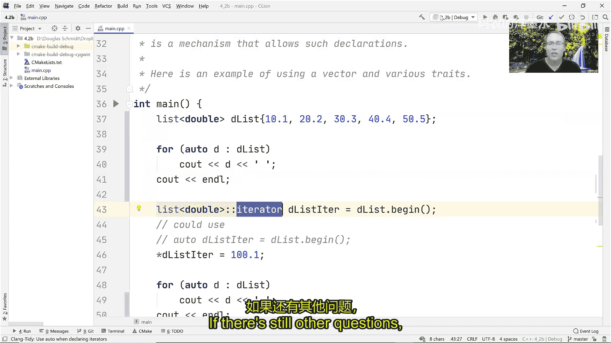

# 007：迭代器（第一部分） 🧭


在本节课中，我们将要学习C++标准模板库（STL）中一个非常核心的概念——迭代器。迭代器是连接容器与算法的桥梁，它允许我们以统一的方式遍历和操作容器中的元素。我们将从迭代器的基本概念讲起，然后重点探讨输入迭代器和输出迭代器。

## 什么是迭代器？ 🤔

上一节我们介绍了顺序容器，本节中我们来看看迭代器。在C++ STL中，迭代器是一个至关重要的概念。它基于“四人帮”（Gang of Four）的迭代器设计模式，其核心作用是允许你遍历一个元素序列。

本质上，迭代器让你能够：
1.  移动到元素范围的起始位置。
2.  前进到下一个元素。
3.  返回迭代器当前所指元素的值。
4.  检查遍历是否完成。

STL中的迭代器功能类似于C++原生内置数组的指针算术。例如，对于一个`int`数组，你可以获取指向数组起始位置的指针，然后使用`++`、`+=`、`--`、`*`（解引用）等操作来移动指针并访问元素。

STL中的迭代器分为不同的类别。今天我们将首先讨论**输入迭代器**和**输出迭代器**，而将更高级的迭代器（如前向迭代器、双向迭代器、随机访问迭代器）留到后续讨论。

大多数STL迭代器至少支持以下操作（通过重载运算符实现）：
*   **解引用** (`*`)：用于读取或写入值。
*   **递增** (`++`)：前增或后增。
*   **赋值** (`=`)。
*   **相等/不等比较** (`==`, `!=`)。

以下是不同类别迭代器支持的操作概述：
*   **双向迭代器**（通常与关联容器一起使用）：额外支持**递减** (`--`)操作。
*   **随机访问迭代器**（用于`deque`或`vector`）：支持完整的指针算术，包括 `+=`、`-=`、`+`、`-`、`[]`（下标）以及各种关系运算。

每个C++容器都提供了一组工厂方法（如`begin()`、`end()`、`rbegin()`、`rend()`）来返回与其容器类型相对应的迭代器。例如，`vector`和`deque`的`begin()`返回随机访问迭代器，而`list`、`set`、`map`的`begin()`返回双向迭代器。

迭代器是STL所基于的泛型编程范式的基石，因为它们实现了容器与算法的解耦。通常的工作流程是：从容器的工厂方法获取迭代器，然后将这些迭代器传递给算法函数，算法根据迭代器的类型执行相应的操作。

## 一个简单的例子：`copy`算法 📋

让我们从一个简单而实用的例子开始，了解输入迭代器和输出迭代器，以及`copy`算法。

以下是一个自定义的`copy`函数实现，它与STL中的实现非常相似：

```cpp
namespace MyCopy {
    template <typename InputIterator, typename OutputIterator>
    OutputIterator copy(InputIterator first, InputIterator last, OutputIterator result) {
        for (; first != last; ++first, ++result) {
            *result = *first;
        }
        return result;
    }
}
```

这个函数接受输入迭代器和输出迭代器作为模板参数。它遍历从`first`到`last`（不包括`last`）的范围，在每次循环中，它解引用`first`迭代器获取当前值，并将其存储到解引用的`result`迭代器中，然后递增两个迭代器。

### 在内置数组上使用`copy`

以下是使用该`copy`算法操作内置数组的示例：

```cpp
int a1[] = {1, 2, 3, 4, 5, 6, 7, 8, 9, 10};
size_t a1_size = sizeof(a1) / sizeof(a1[0]);
int a2[a1_size];

MyCopy::copy(a1, a1 + a1_size, a2);
```

这里，`a1`和`a1 + a1_size`是`int`指针，`a2`也是`int`指针。这本质上就是C++内置的指针算术。

### 在STL `vector`上使用`copy`

`copy`算法同样适用于STL容器，如`vector`：

```cpp
std::vector<int> v1 = {1, 2, 3, 4, 5, 6, 7, 8, 9, 10};
std::vector<int> v2(v1.size());

MyCopy::copy(v1.begin(), v1.end(), v2.begin());
```

这里，`v1.begin()`和`v1.end()`返回的是`vector`的迭代器对象。这些对象重载了`++`、`*`和`!=`等操作符，使其能够像指针一样在`vector`中移动。

这个例子展示了`copy`算法的工作原理，并且说明了STL算法既能用于内置类型（如数组），也能用于STL容器类型。

## 常量迭代器与非常量迭代器 🔒

本节我们将探讨迭代器的另一个特性：常量迭代器，并与非常量迭代器进行对比。

迭代器可以看作是一种“智能指针”，因为它们可以存储状态（例如，当前在遍历中的位置）。迭代器的基本操作仍然是`++`、`*`（解引用）以及相等性比较。

使用迭代器的典型模式是：通过`begin()`或`end()`等工厂方法获取迭代器，然后通过`++`来推进它。通常，如果不关心递增表达式的结果，建议使用迭代器的**前增** (`++it`) 而非后增 (`it++`)。

通过`*`操作可以读取值，但根据你拥有的是常量迭代器还是非常量迭代器，`*`操作所允许的行为会有所不同。

### 示例：修改与只读遍历

我们定义一个`vector<int>`并进行遍历：

```cpp
std::vector<int> v = {1, 2, 3, 4, 5, 4, 3, 2, 1};

// 使用非常量迭代器，可以修改元素
for (std::vector<int>::iterator it = v.begin(); it != v.end(); ++it) {
    std::cout << *it << " ";
    *it -= 1; // 可以修改，因为 it 是非常量迭代器
}
```

**非常量迭代器**允许你修改其指向的元素。

现在，如果我们通过一个接受常量引用的函数来打印向量，则必须使用**常量迭代器**：

```cpp
void print_const(const std::vector<int>& v) {
    // 使用常量迭代器，只能读取，不能修改
    for (std::vector<int>::const_iterator it = v.begin(); it != v.end(); ++it) {
        std::cout << *it << " ";
        // *it = 5; // 错误！不能赋值给常量迭代器解引用的结果
    }
}
```

尝试通过常量迭代器修改值是非法操作，会导致编译错误。

### 使用`auto`和基于范围的`for`循环

显式写出迭代器类型（如`std::vector<int>::const_iterator`）比较冗长。现代C++编译器可以自动推导类型，因此我们可以使用`auto`关键字：

```cpp
for (auto it = v.begin(); it != v.end(); ++it) { ... }
```

更好的方式是使用**基于范围的for循环**，它更简洁，且编译器会自动处理迭代器细节：

```cpp
for (const auto& elem : v) {
    std::cout << elem << " ";
}
```

对于非常量遍历，可以省略`const`：
```cpp
for (auto& elem : v) {
    elem -= 1; // 可以修改
}
```

这个例子演示了：
1.  非常量迭代器可用于修改容器内容。
2.  常量迭代器仅用于读取。
3.  现代C++语法（`auto`和基于范围的`for`循环）可以简化迭代器代码，但理解其背后的原理仍然很重要。

## 迭代器的特征（Traits） 🏷️

正如前面提到的，C++ STL中的每个容器都附带一些称为“特征”的元数据。这些特征提供了关于容器的信息。

常见的迭代器特征包括：
*   `iterator_category`：迭代器类别（输入、输出、前向、双向、随机访问）。
*   `value_type`：容器参数化的类型（例如`vector<int>`的`value_type`是`int`）。
*   `difference_type`：用于表示同一容器中两个迭代器距离的类型。
*   `pointer`：指向`value_type`的指针类型。
*   `reference`：`value_type`的引用类型。
*   以及这些类型的常量版本（如`const_iterator`, `const_reference`）。

泛型算法经常利用这些特征来决定其实现细节。虽然现在我们可以用`auto`来避免直接使用这些特征名，但理解它们对于深入理解STL工作机制非常有帮助。

例如，你可以这样显式使用特征：
```cpp
std::list<double> myList = {10.1, 20.2, 30.3, 40.4};
std::list<double>::iterator it = myList.begin();
std::list<double>::const_iterator cit = myList.begin();
std::list<double>::value_type val = *it; // val 的类型是 double

*it = 100.1; // 正确：非常量迭代器可修改
// *cit = 200.2; // 错误：常量迭代器不可修改
val = *cit; // 正确：常量迭代器可读取
```

## STL迭代器的优缺点 ⚖️

STL迭代器有其强大的优势，也有一些需要注意的缺点。

**优点：**
*   **统一接口**：允许以相同的方式处理所有容器。
*   **类似智能指针**：可以解引用，可以存储状态。
*   **兼容性**：既适用于用户定义的容器类（如`vector`, `set`），也适用于内置数据类型（如数组），模仿了指针算术的操作。

**缺点：**
*   **无边界检查**：与原生指针一样，迭代器默认不进行边界检查。解引用`end()`迭代器或越界访问会导致未定义行为，可能引发程序崩溃或内存错误。使用像Valgrind这样的内存检查工具可以帮助发现这类问题。
*   **类别不同**：并非所有容器都提供相同类别的迭代器。例如，`vector`和`deque`提供随机访问迭代器，而`list`和`set`提供双向迭代器。因此，并非所有算法都能与所有容器完全正交地互换使用。例如，`sort`算法需要随机访问迭代器，不能用于`list`（`list`有自己专用的`sort`成员函数）。
*   **迭代器失效**：需要小心某些操作会使迭代器失效。例如，对于`vector`，如果插入元素导致内存重新分配，那么指向旧内存的所有迭代器、指针和引用都会失效。

### 示例说明

以下代码演示了迭代器的一些潜在问题：

```cpp
// 1. 空容器上的危险迭代
std::vector<long> container; // 大小为0
auto it = container.begin();
do {
    std::cout << *it << " "; // 错误！解引用无效的迭代器
    ++it;
} while (it != container.end()); // 可能永远不会进入循环，但do-while至少执行一次

// 2. 算法与迭代器类别不匹配
std::list<long> myList;
std::sort(myList.begin(), myList.end()); // 编译错误！list的迭代器是双向的，sort需要随机访问迭代器。
```

第一个例子会导致运行时错误（如段错误），因为试图访问不存在的元素。第二个例子会在编译时报错，因为`std::sort`算法要求随机访问迭代器，而`std::list`提供的双向迭代器不支持所需的操作（如迭代器相减）。

## 总结与预告 📚

本节课中我们一起学习了C++ STL迭代器的基础知识。我们了解了迭代器是什么，它是如何作为容器和算法之间的桥梁的。我们重点探讨了输入/输出迭代器的概念，并通过`copy`算法实例进行了说明。我们还比较了常量迭代器与非常量迭代器，介绍了迭代器特征，并讨论了迭代器的优缺点。

下一节课，我们将继续深入迭代器的世界，具体内容包括：
*   **输入迭代器**：只允许读取数据。
*   **输出迭代器**：只允许写入数据。
*   **前向迭代器**：允许读取和写入数据，并且可以多次向前遍历。

我们将学习哪些算法要求至少是输入迭代器，哪些要求至少是输出迭代器或前向迭代器。这些不同的迭代器类型形成了一个基于操作的层次结构（通过模板和“鸭子类型”实现），我们将在下次课中详细探讨。



希望本节课对你理解C++ STL迭代器有所帮助！