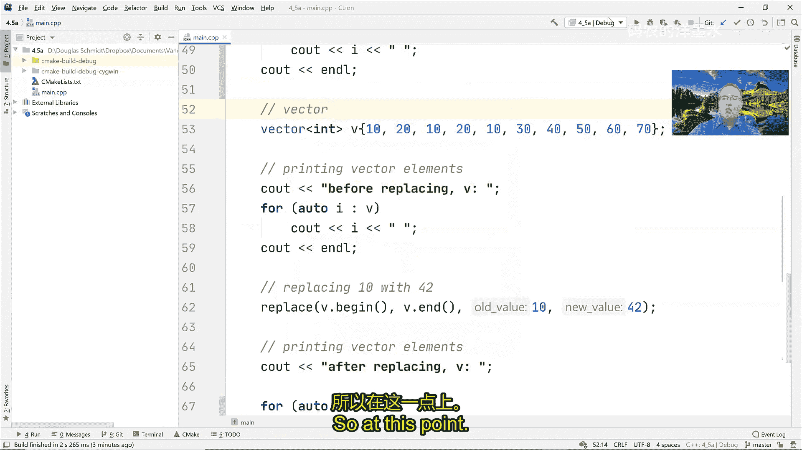

# 008：迭代器（第二部分） 🚀


在本节课中，我们将要学习迭代器的更多功能，特别是输入迭代器、输出迭代器和前向迭代器。我们将通过大量示例来展示如何在STL的上下文中应用这些功能。

## 输入迭代器 📥

上一节我们介绍了迭代器的基本概念，本节中我们来看看最简单的迭代器类型——输入迭代器。输入迭代器只能向前读取序列中的元素，并且每个元素只能被读取一次。一旦元素被读取，它就会通过迭代器的机制被返回并可用。

你可以解引用一个输入迭代器来获取它指向的值，但你不能向它赋值。因此，它只能用在赋值语句的右侧，而不能用在左侧。这被称为右值，而非左值。

以下是输入迭代器支持的操作：
*   你可以使用拷贝构造函数从另一个迭代器构造输入迭代器。
*   你可以使用赋值运算符将一个迭代器赋值给另一个。
*   你可以检查迭代器是否相等或不等，这是我们在遍历范围时确保没有到达末尾的方法。
*   你可以使用解引用运算符（`*` 或 `->`）来读取值，但不能写入。
*   你可以使用前置或后置递增运算符（`++iterator` 或 `iterator++`）。通常，在STL中，如果不需要后置递增的结果，使用前置递增会更快。

许多非修改算法使用输入迭代器，例如STL的 `find`、`find_if` 和 `count` 算法。这些算法通常返回一个指向匹配元素的输入迭代器，如果未找到，则返回结束迭代器。

让我们看一个简单的例子，它使用输入迭代器从标准输入读取整数并存储到向量中。

```cpp
#include <iostream>
#include <vector>
#include <iterator>

int main() {
    std::vector<int> v;
    std::istream_iterator<int> i(std::cin);
    std::istream_iterator<int> eof;

    while (i != eof) {
        v.push_back(*i);
        ++i;
    }
    // ... 后续处理向量 v
}
```

在这个例子中，我们使用了 `std::istream_iterator`，它是一个迭代器适配器，将I/O流（这里是 `std::cin`）转换为迭代器。然而，一个真正的STL程序员更可能这样写：

```cpp
#include <iostream>
#include <vector>
#include <iterator>
#include <algorithm>

int main() {
    std::vector<int> v;
    std::copy(std::istream_iterator<int>(std::cin),
              std::istream_iterator<int>(),
              std::back_inserter(v));
    // ... 后续处理向量 v
}
```

这里使用了 `std::copy` 算法和 `std::back_inserter` 适配器，后者将容器（向量）转换为输出迭代器。`copy` 算法从输入迭代器读取，并通过输出迭代器写入。

## 输出迭代器 📤

了解了如何读取数据后，我们来看看如何写入数据。输出迭代器与输入迭代器相反，它只能用于写入。与输入迭代器只能用于赋值语句右侧不同，输出迭代器只能用于左侧。

输出迭代器支持的操作与输入迭代器类似：构造、赋值、解引用（仅用于写入）和递增。许多STL算法接受一个输出迭代器来存储结果，例如 `copy` 和 `transform` 算法。

让我们继续上面的例子，将向量中的内容输出到标准输出。

```cpp
#include <iostream>
#include <vector>
#include <iterator>
#include <algorithm>

int main() {
    std::vector<int> v;
    // ... 从标准输入读取数据到向量 v 中（使用上面的代码）

    // 将向量 v 的内容输出到标准输出，每个元素后跟换行符
    std::copy(v.begin(), v.end(),
              std::ostream_iterator<int>(std::cout, "\n"));
}
```

这里我们使用了 `std::ostream_iterator` 适配器，它将输出流（`std::cout`）转换为迭代器。`copy` 算法从向量中读取，并通过这个输出迭代器写入到标准输出。

`std::back_inserter` 是一个函数适配器，它利用C++的参数推导能力，接收一个容器并返回一个 `back_insert_iterator` 对象。这个对象的赋值操作会调用容器的 `push_back` 方法，从而实现向容器尾部添加元素。

## 前向迭代器 🔄

现在，我们将输入和输出迭代器的功能结合起来。前向迭代器兼具两者的能力，既可以读取也可以写入。这意味着前向迭代器既可以用作左值，也可以用作右值。

前向迭代器继承了输入和输出迭代器的操作：构造、赋值、相等性比较、解引用（可读可写）和递增。普通的C风格指针在C++中也可以作为前向迭代器使用。

前向迭代器可以是常量（只读）或可变（可读可写）。一个很好的例子是STL的 `replace` 算法，它期望前向迭代器。`replace` 算法在给定范围内查找所有旧值，并将其替换为新值。

让我们看一个使用 `replace` 的例子：

```cpp
#include <iostream>
#include <vector>
#include <algorithm>

int main() {
    std::vector<int> v = {10, 20, 10, 20, 10, 30, 40, 50, 60, 70};

    std::cout << "Before: ";
    for (auto& elem : v) std::cout << elem << ' ';
    std::cout << '\n';

    // 将所有值为10的元素替换为42
    std::replace(v.begin(), v.end(), 10, 42);

    std::cout << "After: ";
    for (auto& elem : v) std::cout << elem << ' ';
    std::cout << '\n';
}
```

`replace` 算法的实现展示了前向迭代器的双重用途：它首先读取迭代器指向的值（作为输入迭代器），如果匹配旧值，则向该迭代器写入新值（作为输出迭代器）。

这种通用性也适用于内置数组，得益于C++的自动类型推导和范围`for`循环，代码同样简洁。

## 总结 📝

本节课中我们一起学习了三种基本的迭代器类别：
1.  **输入迭代器**：只能向前读取数据一次。
2.  **输出迭代器**：只能向前写入数据。
3.  **前向迭代器**：可以向前读取和写入数据，是前两者的结合。

我们看到了如何使用迭代器适配器（如 `istream_iterator`、`ostream_iterator` 和 `back_inserter`）将流和容器与STL算法（如 `copy` 和 `replace`）无缝连接。这些工具使得代码更加通用、简洁和强大。



在下一讲中，我们将探讨更强大的迭代器类型：双向迭代器和随机访问迭代器，它们提供了向后移动和随机访问的能力。之后，我们将开始学习关联容器，如 `set` 和 `map`。