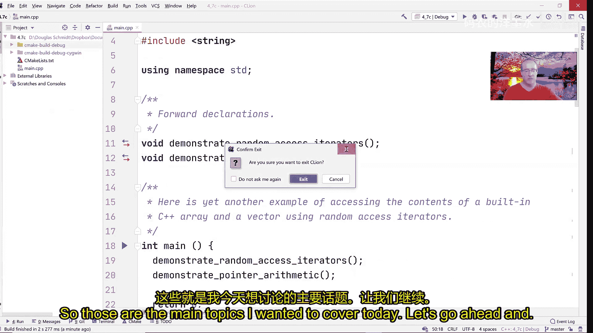

# 009：迭代器 part3


在本节课中，我们将完成对C++ STL迭代器的讨论。我们将重点介绍最后两种迭代器类型：双向迭代器和随机访问迭代器，并通过具体示例展示它们的用法和强大功能。

## 概述

在前两节课程中，我们介绍了迭代器的概述，以及输入、输出和前向迭代器。本节我们将深入探讨功能更强大的双向迭代器和随机访问迭代器，它们为容器遍历提供了更灵活和高效的操作。

## 双向迭代器

上一节我们介绍了前向迭代器，本节中我们来看看双向迭代器。双向迭代器本质上是一个前向迭代器，它拥有前向迭代器的所有方法和运算符重载，并额外增加了向后移动的能力。

一个双向迭代器可以执行以下操作：
*   复制构造。
*   赋值操作。
*   相等和不等比较。
*   解引用（左值或右值）。
*   前/后置递增 (`++`)。
*   前/后置递减 (`--`)。

除了 `forward_list` 之外，所有STL容器都提供双向迭代器或更好的迭代器（即随机访问迭代器）。

以下是使用双向迭代器的一个示例，我们将创建一个列表并反向打印其内容。

```cpp
#include <iostream>
#include <list>

int main() {
    // 创建一个初始值为1的列表
    std::list<int> myList = {1};
    // 在末尾和开头添加元素
    myList.push_back(2);
    myList.push_front(0);

    // 获取指向列表开头和“末尾之后”的迭代器
    std::list<int>::iterator first = myList.begin();
    auto last = myList.end(); // 使用auto关键字简化

    // 方法一：从后向前遍历并打印
    while (last != first) {
        --last; // 必须先递减，因为`end()`指向末尾之后的位置
        std::cout << *last << " ";
    }
    std::cout << std::endl;

    // 方法二：另一种写法
    last = myList.end();
    while (last-- != first) {
        std::cout << *last << " ";
    }
    std::cout << std::endl;

    return 0;
}
```

此代码将列表 `{0, 1, 2}` 反向打印为 `2 1 0`。关键点在于，`end()` 返回的迭代器指向容器“末尾之后”的位置，不能直接解引用，需要先递减。

## 深入示例：`emplace_back` vs `push_back`

接下来，我们通过一个更复杂的例子来展示双向迭代器，同时比较两种向容器尾部添加元素的方法：`emplace_back` 和 `push_back`。这对于理解C++11的移动语义和变参模板优化非常重要。

我们首先定义一个简化的字符串类 `SimpleString` 来观察构造和析构过程。

```cpp
// SimpleString 类定义示例（简化版）
class SimpleString {
private:
    char* str;
    size_t len;
public:
    SimpleString(); // 默认构造函数
    SimpleString(const char* s); // 转换构造函数
    SimpleString(const SimpleString& other) noexcept; // 拷贝构造函数
    SimpleString(SimpleString&& other) noexcept; // 移动构造函数
    ~SimpleString(); // 析构函数
    // ... 其他成员函数，如赋值运算符、交换函数等
};
```

现在，我们使用 `std::list<SimpleString>` 来演示两种添加方式的区别。

```cpp
#include <iostream>
#include <list>
#include "SimpleString.h"

int main() {
    std::list<SimpleString> fruits1, fruits2;

    std::cout << "Using emplace_back:\n";
    fruits1.emplace_back("Peach");
    fruits1.emplace_back("Apple");
    fruits1.emplace_back("Banana");

    std::cout << "\nUsing push_back:\n";
    fruits2.push_back("Peach");
    fruits2.push_back("Apple");
    fruits2.push_back("Banana");

    return 0;
}
```

运行此代码，观察输出会发现：
*   **`emplace_back`**：直接使用参数在容器尾部构造对象，通常只调用一次对应的构造函数。
*   **`push_back`**：首先根据参数创建一个临时 `SimpleString` 对象（调用构造函数），然后将这个临时对象“移动”或“拷贝”到容器中（可能调用移动构造函数），最后销毁临时对象（调用析构函数）。这导致了更多的函数调用。

`emplace_back` 利用了变参模板和完美转发，避免了临时对象的创建和销毁，对于非平凡类型效率更高。

## 使用算法与反向迭代器

双向迭代器使得许多标准算法得以应用。例如，`std::reverse_copy` 算法可以将一个容器的元素反向复制到另一个容器。

```cpp
#include <iostream>
#include <list>
#include <algorithm>
#include <iterator>

int main() {
    std::list<SimpleString> list = {"Peach", "Apple", "Banana"};
    std::list<SimpleString> reversedList(list.size());

    // 使用 reverse_copy 算法反向复制
    std::reverse_copy(list.begin(), list.end(), reversedList.begin());

    // 打印结果
    std::copy(reversedList.begin(), reversedList.end(),
              std::ostream_iterator<SimpleString>(std::cout, " "));
    std::cout << std::endl;

    // 另一种方法：使用反向迭代器直接复制
    std::list<SimpleString> reversedList2;
    std::copy(list.rbegin(), list.rend(), std::back_inserter(reversedList2));
    // rbegin() 返回指向最后一个元素的反向迭代器
    // rend() 返回指向第一个元素之前位置的反向迭代器

    return 0;
}
```

`rbegin()` 和 `rend()` 返回的是反向迭代器，它们透明地处理了反向遍历的逻辑，使代码更加清晰。

## 随机访问迭代器

现在，我们来看看功能最强大的迭代器类别：随机访问迭代器。它们在双向迭代器的基础上，增加了类似指针算术的功能，支持在常数时间内跳转到任意位置。

随机访问迭代器额外支持的操作包括：
*   加减复合赋值：`+=`, `-=`
*   与整数的加减：`+`, `-`
*   下标运算符：`[]`
*   迭代器相减得到距离
*   关系比较：`<`, `<=`, `>`, `>=`

`std::vector` 和 `std::deque` 提供了随机访问迭代器。

以下是一个使用随机访问迭代器跳过奇数求和的例子：

```cpp
#include <iostream>
#include <vector>

int main() {
    std::vector<int> vec = {0, 1, 2, 3, 4, 5, 6, 7, 8, 9};
    int sum = 0;

    // 使用迭代器，每次前进2步，跳过奇数
    for (auto it = vec.begin(); it != vec.end(); it += 2) {
        sum += *it;
    }
    std::cout << "Sum of even numbers (vector): " << sum << std::endl;

    // 对比：使用原生指针和数组
    int arr[] = {0, 1, 2, 3, 4, 5, 6, 7, 8, 9};
    int sum2 = 0;
    size_t arrSize = sizeof(arr) / sizeof(arr[0]);
    for (int* ptr = arr; ptr != arr + arrSize; ptr += 2) {
        sum2 += *ptr;
    }
    std::cout << "Sum of even numbers (array): " << sum2 << std::endl;

    return 0;
}
```

可以看到，随机访问迭代器的语法（`it += 2`）与指针算术（`ptr += 2`）几乎完全一致。

## 随机访问迭代器与指针算术的等价性

下面的例子进一步展示了随机访问迭代器在关系运算和算术运算上与指针的高度相似性。

```cpp
#include <iostream>
#include <vector>
#include <string>

int main() {
    // 使用 vector 和迭代器
    std::vector<std::string> vec = {"A", "B", "C", "D", "E", "F", "G", "H", "I", "J"};
    auto it = vec.begin();
    it += 5; // 移动到第6个元素（"F"）
    it[1] = "Z"; // 修改下一个元素（"G"）为 "Z"，等价于 *(it + 1) = "Z";
    it -= 5; // 移回开头

    for (; it != vec.end(); ++it) {
        std::cout << *it << " ";
    }
    std::cout << std::endl;

    // 使用原生数组和指针
    const char* arr[] = {"A", "B", "C", "D", "E", "F", "G", "H", "I", "J"};
    const char** ptr = arr;
    ptr += 5;
    // 注意：arr是const char*数组，不能像上面那样修改字符串字面量。
    // 此处仅演示指针算术的相似性。
    ptr -= 5;

    for (size_t i = 0; i < 10; ++i) {
        std::cout << arr[i] << " ";
    }
    std::cout << std::endl;

    return 0;
}
```

这个例子表明，除了容器的创建和迭代器的获取，后续使用随机访问迭代器的代码与使用指针算术的代码在形式和功能上都是相同的。

## 总结



本节课中我们一起学习了C++ STL迭代器的最后两种类型。
*   **双向迭代器**：允许向前和向后遍历（`++` 和 `--`），用于如 `std::list`、`std::set` 等容器。
*   **随机访问迭代器**：功能最强大，支持指针风格的所有算术和关系运算（如 `+`、`-`、`+=`、`<`、`[]`），用于 `std::vector` 和 `std::deque`。

我们还通过示例比较了 `emplace_back` 与 `push_back` 的效率差异，并演示了 `std::reverse_copy` 算法以及反向迭代器（`rbegin()`, `rend()`）的用法。随机访问迭代器的设计使其语法和语义与C风格指针算术高度一致，提供了极大的灵活性和性能。

至此，关于STL迭代器的核心内容已介绍完毕。从下一节课开始，我们将进入**关联容器**的学习，例如 `std::set` 和 `std::map`，它们基于红黑树实现，提供了按键快速查找和有序存储的能力。