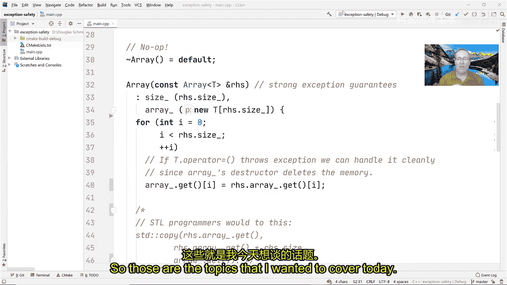

# 010：C++容器的异常安全 🛡️


在本节课中，我们将要学习C++中一个至关重要的主题：为泛型容器实现正确的异常处理和异常安全保证。尽管这并非严格意义上的STL内容，但理解它对于掌握STL的实现原理以及编写类似STL的健壮泛型容器至关重要。

## 概述

我们将通过一个自定义的简化版 `array` 类（类似于 `vector`）来逐步演示异常安全的重要性。课程将分为三个部分：首先展示一个没有异常安全保证的原始版本，然后揭示将其模板化后暴露出的内存泄漏问题，最后介绍一种强大且优雅的解决方案，它能提供强异常安全保证，且无需使用繁琐的 `try-catch` 块。

---

## 无异常安全的原始版本

我们从一个非常简单的 `array` 类开始，它仅存储字符类型。这个版本没有考虑异常情况，因为字符的复制操作不会抛出异常。

```cpp
typedef char T;

class array {
    size_t size_;
    T* array_;
public:
    array(size_t size) : size_(size), array_(new T[size]) {}
    ~array() { delete[] array_; }

    // 拷贝构造函数
    array(const array& rhs) : size_(rhs.size_), array_(new T[rhs.size_]) {
        for (size_t i = 0; i < rhs.size_; ++i) {
            array_[i] = rhs.array_[i]; // 字符复制，不会抛出异常
        }
    }

    // 赋值运算符
    array& operator=(const array& rhs) {
        if (this != &rhs) { // 检查自赋值
            T* temp = new T[rhs.size_];
            for (size_t i = 0; i < rhs.size_; ++i) {
                temp[i] = rhs.array_[i];
            }
            delete[] array_;
            array_ = temp;
            size_ = rhs.size_;
        }
        return *this;
    }
};
```

在这个版本中，由于操作对象是简单的 `char` 类型，代码运行正常，使用内存检测工具 Valgrind 检查也不会发现内存泄漏。

然而，这只是因为数据类型简单。一旦我们将其泛型化，问题就会暴露出来。

---

## 模板化版本暴露的问题

上一节我们介绍了一个安全的原始版本，但它的安全性建立在数据类型简单的基础上。本节中我们来看看将其改为模板类后会发生什么。

我们将 `typedef char T` 替换为 `template <typename T>`，使 `array` 能容纳任意类型。

```cpp
template <typename T>
class array {
    size_t size_;
    T* array_;
public:
    array(size_t size) : size_(size), array_(new T[size]) {}
    ~array() { delete[] array_; }

    // 拷贝构造函数
    array(const array& rhs) : size_(rhs.size_), array_(new T[rhs.size_]) {
        for (size_t i = 0; i < rhs.size_; ++i) {
            array_[i] = rhs.array_[i]; // 可能抛出异常！
        }
    }

    // 赋值运算符
    array& operator=(const array& rhs) {
        if (this != &rhs) {
            T* temp = new T[rhs.size_];
            for (size_t i = 0; i < rhs.size_; ++i) {
                temp[i] = rhs.array_[i]; // 可能抛出异常！
            }
            delete[] array_;
            array_ = temp;
            size_ = rhs.size_;
        }
        return *this;
    }
};
```

关键区别在于：模板类型 `T` 的赋值运算符（`array_[i] = rhs.array_[i]`）可能会抛出异常。这会带来严重问题：

1.  **在拷贝构造函数中**：如果循环复制中途抛出异常，构造函数体未完成，对象的析构函数不会被调用。这导致之前 `new T[rhs.size_]` 分配的内存无法被释放，造成内存泄漏。
2.  **在赋值运算符中**：如果在复制到 `temp` 数组时抛出异常，同样会导致 `temp` 指向的内存泄漏。即使侥幸完成复制，后续的 `delete[] array_` 也可能因对象状态不一致而出错。

为了演示这个问题，我们引入一个“捣蛋”的类：

```cpp
struct ThrowException {
    static int count;
    ThrowException& operator=(const ThrowException&) {
        if (++count > 10) throw std::out_of_range("Oops!");
        return *this;
    }
};
int ThrowException::count = 0;
```

当使用 `array<ThrowException>` 时，在第10次赋值操作后会抛出异常。运行程序并用 Valgrind 检测，会确认存在内存泄漏。这明确展示了缺乏异常安全保证的代码是脆弱的。

---

## 实现异常安全的解决方案

上一节我们看到了模板化后代码的脆弱性。本节中我们来看看如何实现强异常安全保证，同时保持代码的简洁和高效。

解决方案的核心是使用“资源获取即初始化”（RAII）惯用法和“拷贝并交换”（copy-and-swap） idiom。

### 步骤一：使用智能指针管理资源

首先，我们使用 `std::unique_ptr` 来管理动态数组，替代原始指针。`unique_ptr` 是一个RAII对象，能确保在其析构时自动释放内存。

```cpp
#include <memory>

template <typename T>
class array {
    size_t size_;
    std::unique_ptr<T[]> array_; // 使用 unique_ptr 管理数组
public:
    array(size_t size) : size_(size), array_(std::make_unique<T[]>(size)) {}
    // 无需显式定义析构函数！unique_ptr 会自动处理。
    ~array() = default;

    // 拷贝构造函数（提供弱异常保证：不泄漏内存）
    array(const array& rhs) : size_(rhs.size_), array_(std::make_unique<T[]>(rhs.size_)) {
        std::copy(&rhs.array_[0], &rhs.array_[rhs.size_], &array_[0]); // 使用 STL 算法
    }
};
```

现在，即使在拷贝构造函数的复制过程中抛出异常，由于 `array_` 是一个已完全初始化的成员对象，它的析构函数（`unique_ptr` 的析构函数）会被调用，从而释放已分配的内存。这提供了**基本的异常安全（不泄漏内存）**。

### 步骤二：使用“拷贝并交换”实现赋值运算符

接下来，我们实现赋值运算符，目标是提供**强异常安全保证**：要么操作完全成功，要么对象状态保持不变（且不泄漏内存）。

以下是实现模式：

```cpp
    // 赋值运算符（提供强异常安全保证）
    array& operator=(const array& rhs) {
        if (this != &rhs) {
            array temp(rhs); // 1. 创建右侧对象的副本（可能抛出，但安全）
            swap(temp);      // 2. 与 *this 交换状态（不会抛出）
        }                     // 3. temp 离开作用域，析构旧资源
        return *this;
    }

    // 交换函数（提供不抛出的异常安全保证）
    void swap(array& other) noexcept {
        using std::swap;
        swap(size_, other.size_);
        swap(array_, other.array_);
    }
```

这个模式的工作原理如下：
1.  **创建副本**：调用拷贝构造函数创建 `rhs` 的一个临时副本 `temp`。如果此步骤中复制元素抛出异常，异常会传播出去，但 `*this` 对象的状态完全未被触及。`temp` 对象如果已部分构造，其 `unique_ptr` 成员会确保清理资源。
2.  **交换状态**：调用 `swap` 成员函数，交换 `*this` 和 `temp` 的内部状态（`size_` 和 `array_`）。交换基本类型和 `unique_ptr` 是 `noexcept` 操作，绝不会抛出异常。
3.  **清理旧资源**：当 `temp`（现在持有 `*this` 的旧数据）在作用域结束时被销毁，其析构函数会自动释放旧的数组内存。

这种方法的优雅之处在于：
*   **强异常安全**：要么赋值成功，要么左侧对象状态完全不变。
*   **代码复用**：赋值运算符复用了拷贝构造函数和析构函数的逻辑。
*   **无 `try-catch`**：无需编写任何显式的异常处理代码，逻辑清晰。
*   **自赋值安全**：开头的检查处理了自赋值情况。

使用包含 `ThrowException` 的版本进行测试，程序虽然仍会抛出异常，但 Valgrind 确认**没有内存泄漏**，并且对象状态在异常前是完整的。

---

## 总结

本节课中我们一起学习了C++容器的异常安全保证。

1.  我们首先看到了一个简单但非泛型的版本，它由于数据类型简单而看似安全。
2.  然后，通过将其模板化，我们暴露了在复制操作可能抛出异常时，原始指针管理资源会导致**内存泄漏**和**状态损坏**的严重问题。
3.  最后，我们介绍了一种强大的解决方案组合：
    *   使用 **`std::unique_ptr`**（RAII）自动管理资源生命周期，确保内存永不泄漏，为构造函数提供了基本安全。
    *   使用 **“拷贝并交换”** idiom 实现赋值运算符，通过先构造副本再交换状态的方式，提供了**强异常安全保证**，且代码简洁高效，无需 `try-catch` 块。



掌握这些技术对于编写工业强度的C++泛型容器和任何需要管理资源的类至关重要。它使你能够构建出既健壮又优雅的代码。在接下来的课程中，我们将回归STL本身，探讨有序关联容器（如 `set`、`map` 等）的奇妙世界。