# 012：集合和多重集合 🧮

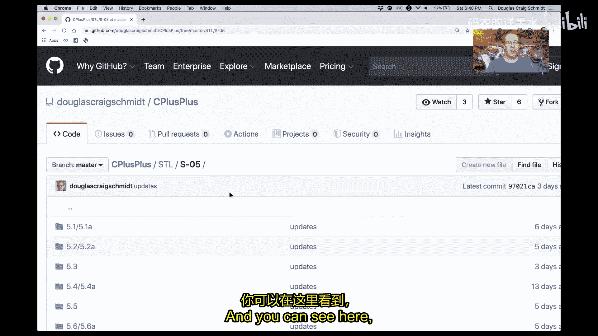

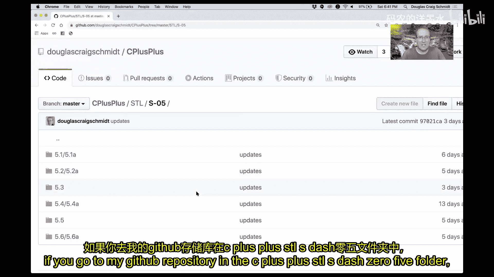

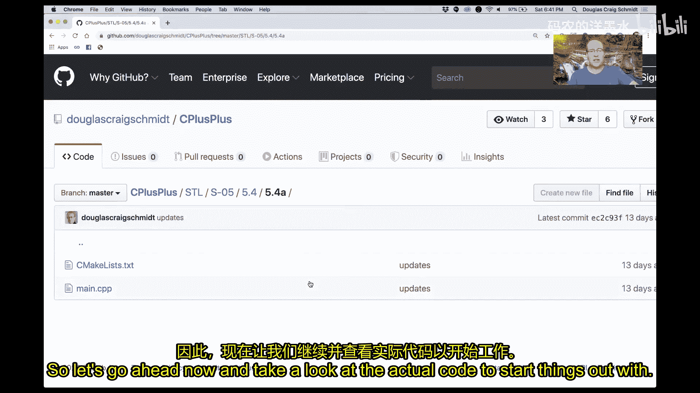

在本节课中，我们将要学习C++标准模板库中的两种重要关联容器：`set`（集合）和 `multiset`（多重集合）。集合是一种存储唯一键的有序容器，而多重集合则允许存储重复的键。我们将通过具体的代码示例来探索它们的特性、基本操作以及实际应用。

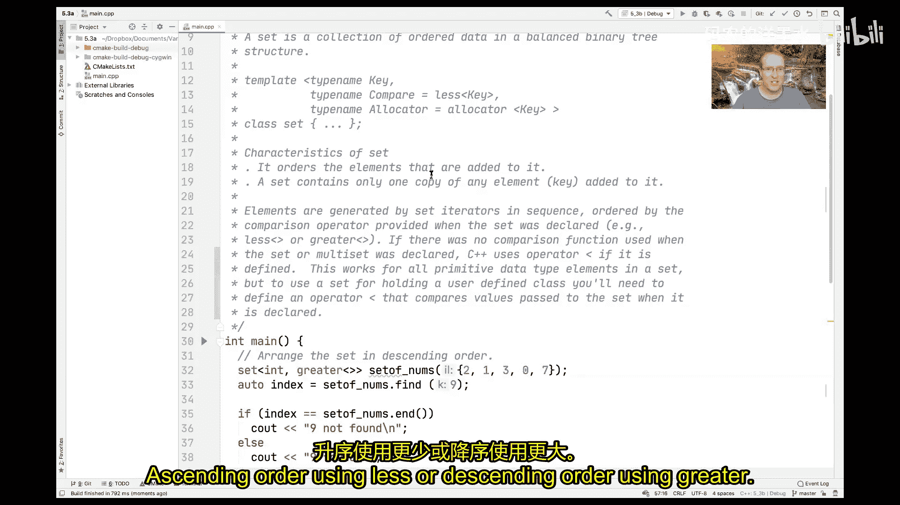

## 概述

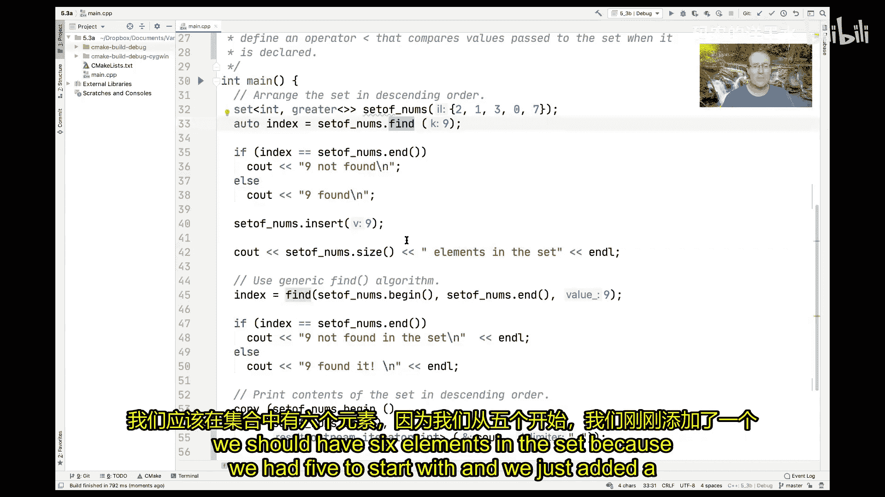

集合和多重集合是基于平衡二叉搜索树（通常是红黑树）实现的关联容器。这意味着插入、查找和删除操作的时间复杂度为 **O(log n)**，其中 **n** 是容器中元素的数量。集合保证元素的唯一性，而多重集合允许重复元素。它们默认按升序排列元素，但也可以通过自定义比较函数来改变排序方式。

## 集合的基本用法

上一节我们介绍了集合的基本概念，本节中我们来看看如何声明、初始化和使用一个 `set`。

```cpp
#include <iostream>
#include <set>
#include <algorithm>
#include <iterator>

int main() {
    // 定义一个按降序排列的整数集合
    std::set<int, std::greater<int>> numbers {2, 1, 3, 0, 7};
    // 使用 find 方法查找元素
    auto it = numbers.find(9);
    if (it == numbers.end()) {
        std::cout << "9 not found" << std::endl;
    }
    // 插入新元素
    numbers.insert(9);
    std::cout << "Size: " << numbers.size() << std::endl; // 输出 6
    // 使用通用算法 find (线性搜索，不推荐用于 set)
    it = std::find(numbers.begin(), numbers.end(), 9);
    if (it != numbers.end()) {
        std::cout << "Found 9" << std::endl;
    }
    // 打印集合内容（降序）
    std::copy(numbers.begin(), numbers.end(),
              std::ostream_iterator<int>(std::cout, " "));
    return 0;
}
```

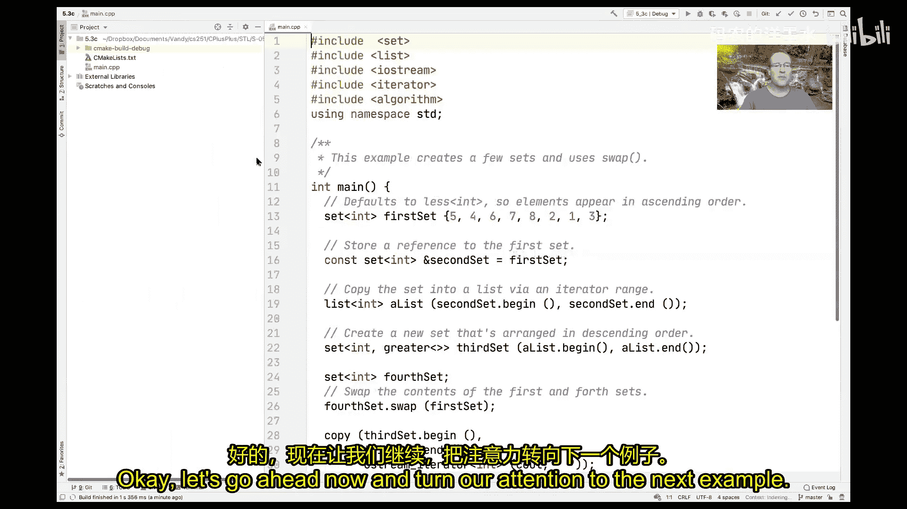

## 集合的插入操作

了解了基本用法后，本节我们来深入探讨 `set` 的 `insert` 方法及其有趣的语义。

`insert` 方法会返回一个 `pair`，其中包含一个指向插入位置（或已存在元素）的迭代器和一个布尔值，指示插入是否成功。

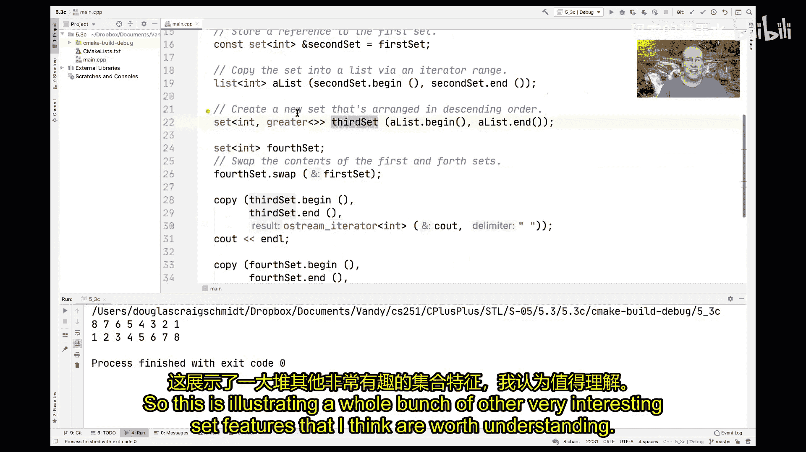

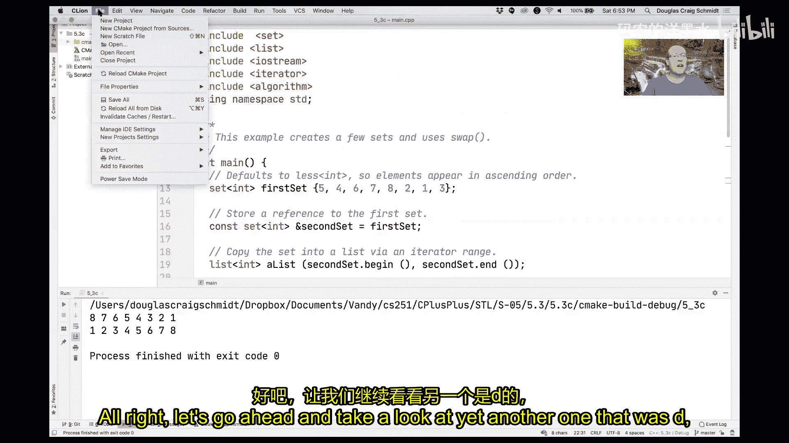

```cpp
std::set<int> mySet;
// 插入一系列元素
for (int i = 1; i <= 5; ++i) {
    mySet.insert(i * 10); // 插入 10, 20, 30, 40, 50
}
// 尝试插入重复元素
auto result = mySet.insert(20); // 插入失败
if (!result.second) {
    std::cout << "Insertion failed. Element already exists." << std::endl;
    auto hintIter = result.first; // 获取指向元素 20 的迭代器
    // 使用迭代器作为提示进行插入（可能优化插入位置）
    mySet.insert(hintIter, 25);
    mySet.insert(hintIter, 24);
    mySet.insert(hintIter, 26); // 提示可能无效，但仍会正确插入
}
// 使用初始化列表一次性插入多个元素
mySet.insert({5, 10, 15}); // 只成功插入 5 和 15
```

## 集合与其他容器的交互

集合可以方便地与其他STL容器进行数据交换和复制。以下是使用 `swap` 算法和迭代器范围进行操作的示例。

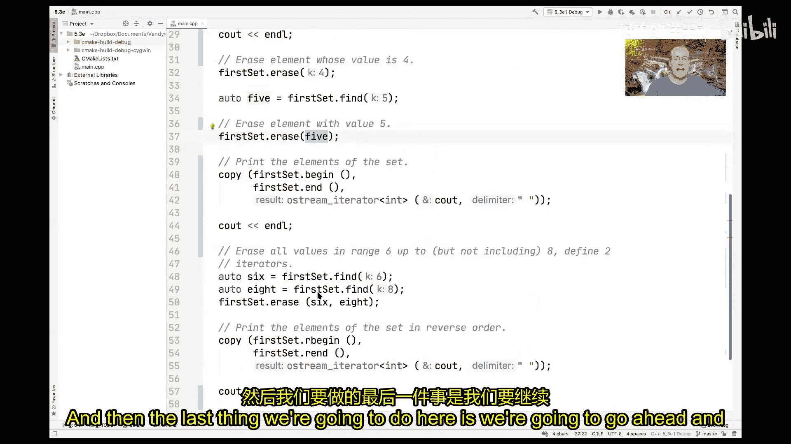

```cpp
std::set<int> firstSet = {4, 2, 6, 1, 3, 5};
const std::set<int>& secondSet = firstSet; // 常量引用，不复制
// 将集合内容复制到列表
std::list<int> myList;
std::copy(secondSet.begin(), secondSet.end(), std::back_inserter(myList));
// 使用列表迭代器范围创建降序排列的集合
std::set<int, std::greater<int>> thirdSet(myList.begin(), myList.end());
// 交换两个集合的内容
std::set<int> fourthSet;
std::swap(firstSet, fourthSet); // 高效交换内部数据
```

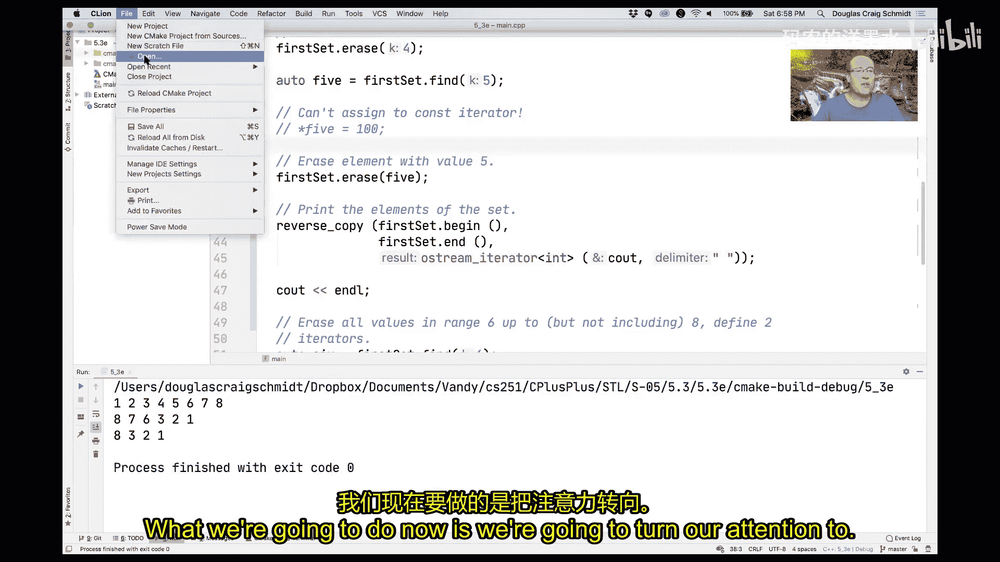

## 集合的迭代器与元素删除

集合的迭代器是常量迭代器（`const_iterator`），这意味着你不能通过它们修改元素的值，以免破坏底层树的结构。以下是关于迭代器和元素删除的示例。

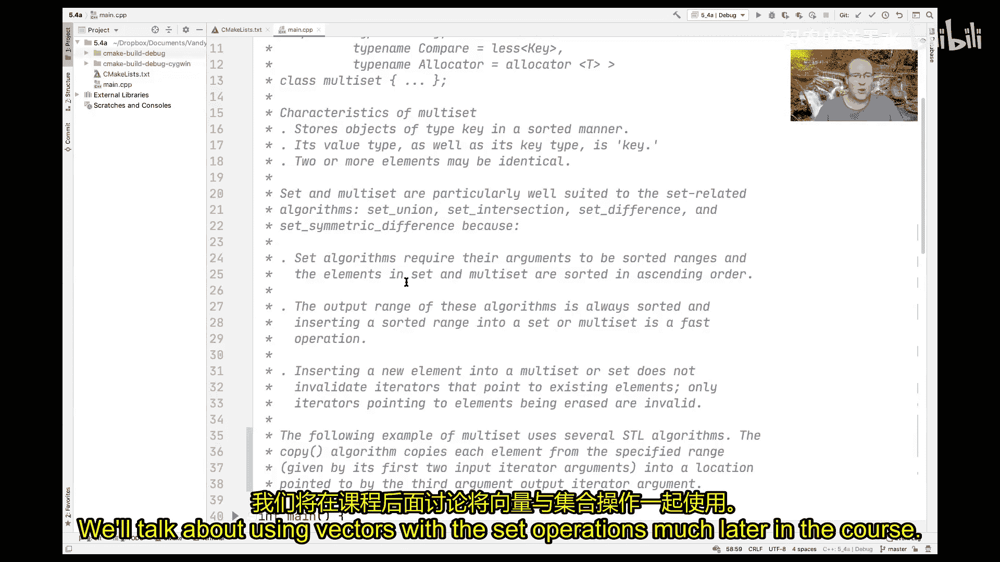

以下是删除元素的几种方法：
*   **按值删除**：`erase(key_value)`
*   **按迭代器删除**：`erase(iterator)`
*   **按范围删除**：`erase(start_iterator, end_iterator)`

```cpp
std::set<int> mySet = {1, 2, 3, 4, 5, 6, 7, 8};
// 按值删除元素 4
mySet.erase(4);
// 查找并获取元素 5 的迭代器，然后按迭代器删除
auto itFive = mySet.find(5);
if (itFive != mySet.end()) {
    mySet.erase(itFive);
}
// 按范围删除元素 [6, 8)，即删除 6 和 7
auto itSix = mySet.find(6);
auto itEight = mySet.find(8);
if (itSix != mySet.end() && itEight != mySet.end()) {
    mySet.erase(itSix, itEight); // 删除 6 和 7
}
// 使用反向迭代器打印
std::copy(mySet.rbegin(), mySet.rend(),
          std::ostream_iterator<int>(std::cout, " "));
```

## 多重集合与集合算法

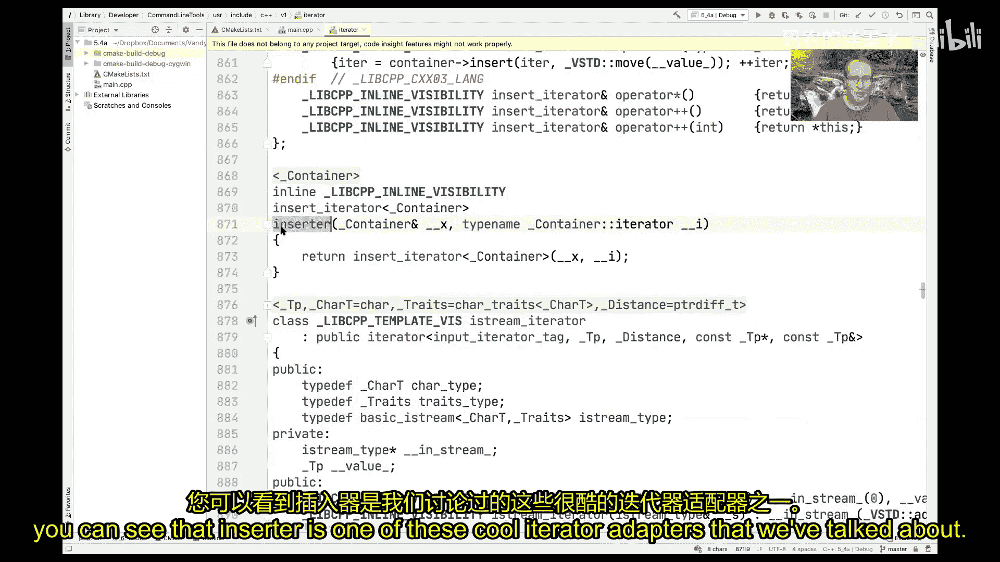

现在我们将注意力转向 `multiset`。多重集合与普通集合类似，但允许存储重复的键值。这使得它们非常适合与STL中的集合算法（如并集、交集、差集）一起使用，因为这些算法要求输入范围是已排序的。

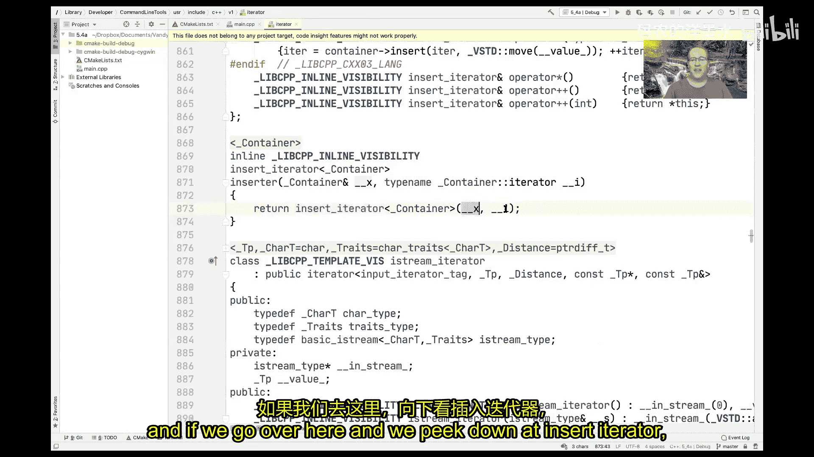

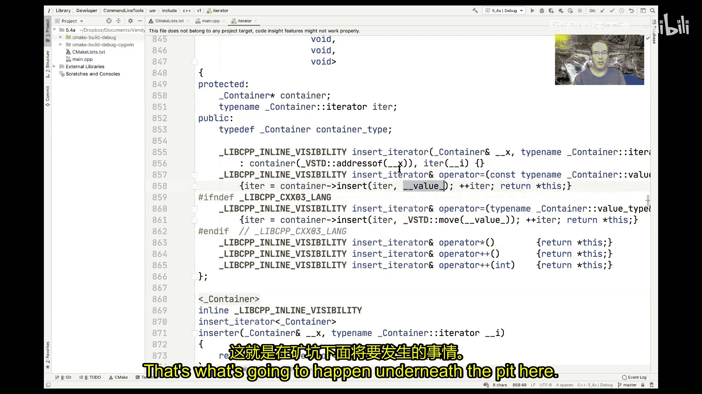

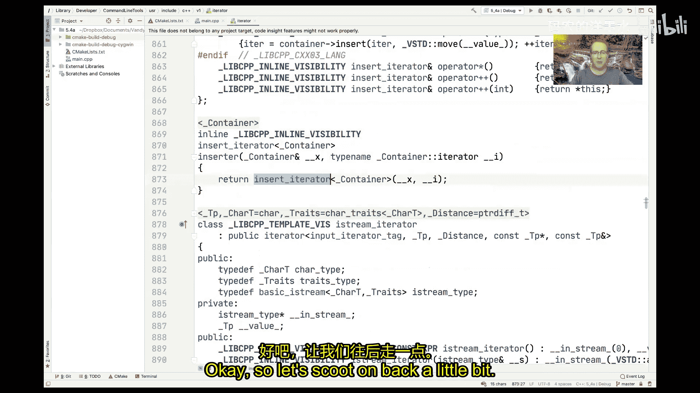

```cpp
std::multiset<int> setA = {1, 2, 3, 4, 5, 6, 5, 4, 3, 2, 1, 0};
std::multiset<int> setB = {4, 5, 6, 7, 8, 9, 10, 0, 1, 2};
// 计算并集：存在于 setA 或 setB 中的所有元素
std::set_union(setA.begin(), setA.end(),
               setB.begin(), setB.end(),
               std::ostream_iterator<int>(std::cout, " "));
std::cout << std::endl;
// 计算交集：同时存在于 setA 和 setB 中的元素
std::set_intersection(setA.begin(), setA.end(),
                      setB.begin(), setB.end(),
                      std::ostream_iterator<int>(std::cout, " "));
std::cout << std::endl;
// 计算差集：存在于 setA 但不存在于 setB 中的元素
std::multiset<int> setC;
std::set_difference(setA.begin(), setA.end(),
                    setB.begin(), setB.end(),
                    std::inserter(setC, setC.begin()));
// 使用插入迭代器将结果存入 setC
```

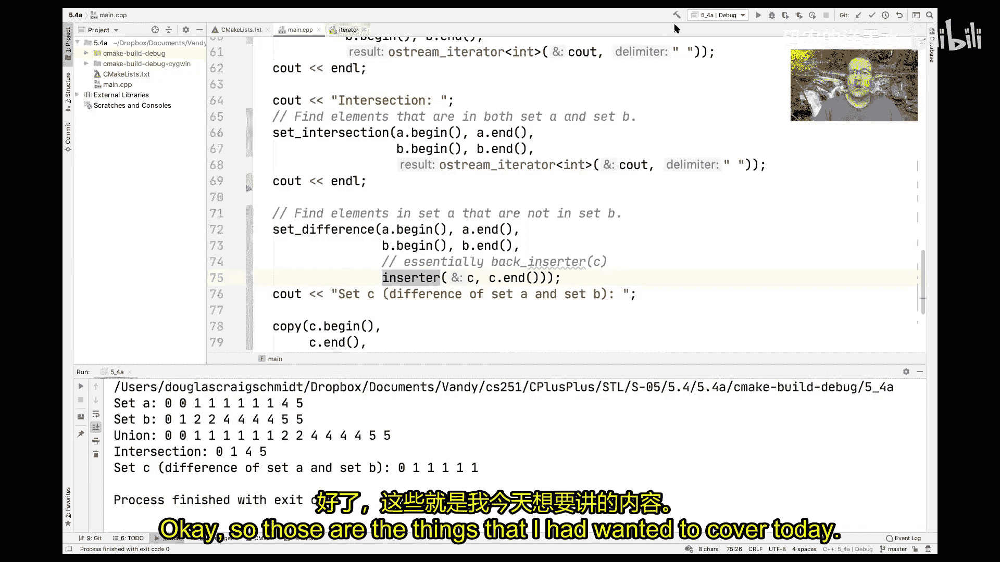

## 总结

本节课中我们一起学习了C++ STL中的 `set` 和 `multiset`。我们了解了它们基于红黑树的实现，以及因此带来的 **O(log n)** 时间复杂度。我们探讨了如何插入元素（包括使用提示迭代器进行优化）、如何查找和删除元素，以及集合迭代器的常量特性。最后，我们通过多重集合演示了如何与 `set_union`、`set_intersection` 和 `set_difference` 等强大的STL集合算法结合使用。掌握这些容器将帮助你在需要维护有序、唯一或可重复数据集合的场景下，编写出高效且清晰的代码。