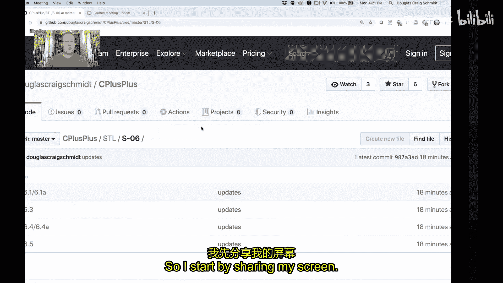
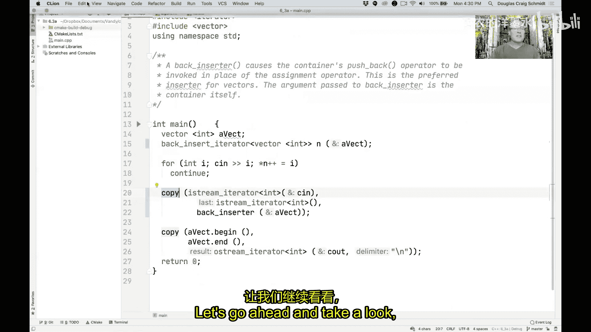
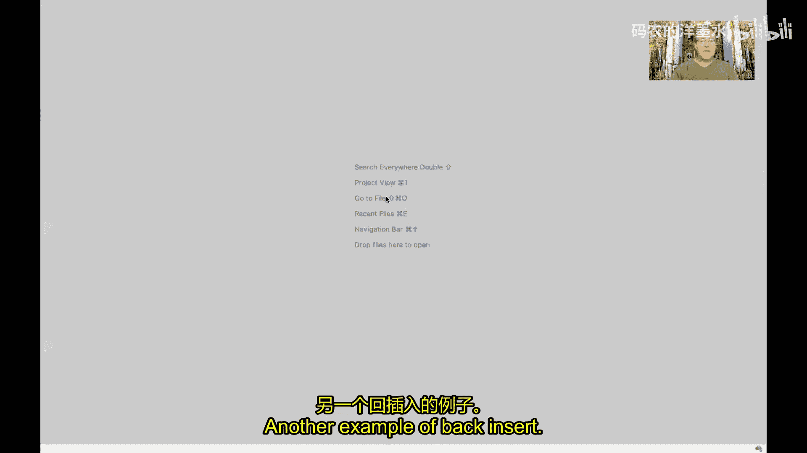
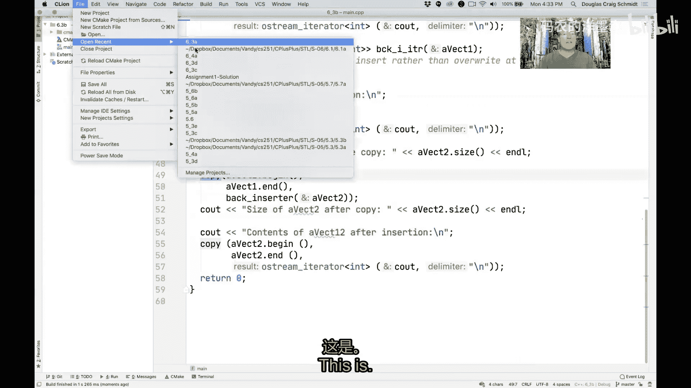
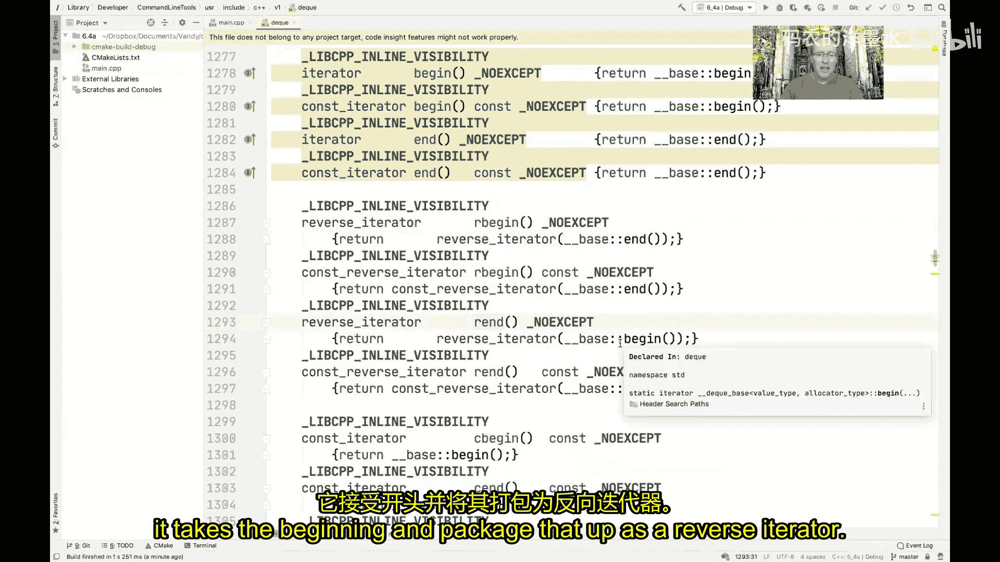
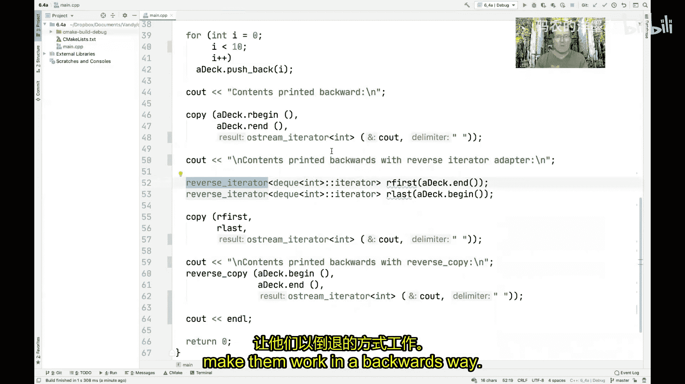

# 014：迭代器适配器 part1

## 概述




在本节课中，我们将要学习C++标准模板库中的迭代器适配器。我们已经完成了对顺序容器和关联容器的学习，也讨论了迭代器以及C++模板函数和类。现在，是时候将注意力转向迭代器适配器了。它们允许STL中的其他元素（如容器）在需要迭代器的上下文中工作。

## 什么是迭代器适配器？

迭代器适配器是一种特殊类型的迭代器，它们不仅能操作STL容器，还能调整标准容器迭代器的工作方式。

这些迭代器适配器可以将标准迭代器转换为能够反向操作的迭代器（即反向迭代器），可以在所谓的“插入模式”下工作，还可以与C++的输入/输出流进行交互。

今天，我们将重点学习如何将输入、输出、前向、双向和随机访问迭代器，使其在适配的迭代器上下文中工作。我们将聚焦于插入迭代器和反向迭代器，流迭代器将在后续课程中讨论。

## 插入迭代器

插入迭代器，也称为插入器，可以将对新值的赋值操作，更改为将该值插入到值序列中的操作，从而不会覆盖其他值。它们是输出迭代器，因为它们写入值，而不读取值。它们本质上用于重写容器的赋值运算符。我们在之前讨论`copy`算法时已经见过一些例子，但现在我们将深入探讨它们的工作原理。

以下是几种类型的插入器，它们也可以用来改变算法的工作方式，通过适配容器和其他数据结构来与它们配合。

*   **前向插入迭代器**
*   **后向插入迭代器**
*   **通用插入迭代器**

这些都是STL类或结构体。定义了一些函数来与它们配合使用，包括用于前向插入迭代器的`push_front`（适用于`deque`和`list`），用于后向插入迭代器的`push_back`（适用于`vector`、`deque`、`list`和`string`），以及用于通用插入迭代器的`insert`（这是最广泛的类别，适用于`vector`、`deque`、`list`、`map`和`set`）。

那么，我们为什么要使用这些适配器呢？原因在于，STL有许多算法，如`copy`、`unique_copy`、`copy_backward`、`remove_copy`、`replace_copy`等。这些算法都接受标记容器内开始复制位置的迭代器。它们都是输出迭代器，在复制每个元素时，会赋值并递增迭代器。因此，每次复制都需要我们保证目标容器有足够的大小来容纳被赋值的元素。

使用迭代器适配器的一个原因就是，我们可以让初始为空的容器，根据需要复制到输出迭代器的输入元素数量，动态地增长。这样，容器就可以按需扩展以存储传入的信息。

## 后向插入迭代器示例

现在，让我们开始看第一个实际例子。我们将从后向插入迭代器开始，这可能是最常用和最流行的插入器示例。它会导致底层容器的`push_back`操作被调用，以替代赋值运算符。更具体地说，当调用赋值运算符时，它最终会调用它所适配的容器的`push_back`操作。

这是为`vector`进行插入的典型方式。传递给`back_inserter`的参数是容器本身。

让我们看一个非常简单的例子。这个例子从一个名为`aVec`的整数`vector`开始，它最初没有元素。我们首先显式定义一个`back_insert_iterator`的实例，它由`vector<int>`参数化，我们称其为`n`，并将`aVec`作为其引用参数传递。

然后，我们将逐个遍历输入元素，从`cin`读取到`i`，然后通过解引用`n`，将值`i`存储进去，然后递增`n`来推进它。

```cpp
vector<int> aVec;
back_insert_iterator<vector<int>> n(aVec);
int i;
while (cin >> i) {
    *n = i;
    ++n;
}
```

当然，没有哪个自重的C++程序员会写那样的代码，他们都会写这样的代码：

```cpp
vector<int> aVec;
copy(istream_iterator<int>(cin), istream_iterator<int>(), back_inserter(aVec));
copy(aVec.begin(), aVec.end(), ostream_iterator<int>(cout, " "));
```

这段代码使用了`copy`算法。`copy`算法将使用`istream_iterator`适配器从标准输入读取，直到输入结束。在每一步，它都会调用`back_inserter`方法，将流中的元素插入到`aVec`的末尾。最后，我们将内容复制到标准输出。





`back_inserter`函数基本上封装了上面看到的`back_insert_iterator`对象，并利用了C++的类型推导功能。它接收一个容器引用作为参数，创建一个匿名的`back_insert_iterator`实例并返回它。这个对象将持有该容器的引用。

`back_insert_iterator`类实现了迭代器类，因此从中获取了各种特性。它保存了一个指向容器的指针作为受保护字段。其构造函数只是将该容器的地址存储到字段中。然后，它有一系列操作，最重要的是赋值运算符。你可以看到，它在这里做的是在容器上执行`push_back`操作。还有一些占位符方法，如解引用运算符、前递增和后递增运算符，它们基本上都是空操作，只是为了保持语法完整性。当这与像`copy`这样的算法一起使用时，算法期望有解引用和递增操作，语法上都能工作，但`back_insert_iterator`的真正价值在于其赋值运算符，它总是执行`push_back`。

## 前向插入迭代器示例

上一节我们介绍了后向插入迭代器，本节中我们来看看前向插入迭代器。后向插入器最常用于`vector`，你也可以将其用于`deque`或`list`等可以在末尾添加元素的容器。但前向插入器专为`deque`和`list`设计，不适用于`vector`，因为`vector`没有`push_front`方法，在`vector`前端插入元素效率很低，所以STL甚至没有将其作为方法之一。

让我们看一个例子。我们将创建两个`list`，因为它们可以在开头插入元素。我们创建一个列表迭代器，向列表中添加一些元素，打印列表的原始内容，然后显式定义一个前向插入迭代器。同样，这只是为了展示底层工作原理，实际上没人会这样写代码。

```cpp
list<int> aList;
for (int i = 0; i < 5; ++i) {
    aList.push_back(i);
}
cout << "Original list: ";
copy(aList.begin(), aList.end(), ostream_iterator<int>(cout, " "));
cout << endl;

front_insert_iterator<list<int>> fii(aList);
*fii = 100;
++fii;
*fii = 200;
++fii;

cout << "After insertion: ";
copy(aList.begin(), aList.end(), ostream_iterator<int>(cout, " "));
cout << endl;
```



然后我们在容器前端插入100和200。它不会覆盖前两个元素，而是插入它们。如果我们使用普通的迭代器（非适配器），那将会覆盖内容，但这次我们使用了迭代器适配器，所以它是插入，并使其出现在开头。我们打印结果，然后使用`front_inserter`进行复制，基本上以相反的顺序推入元素，然后再次打印结果。

前向插入器是一个迭代器适配器，它将元素添加到列表或双端队列的前端。将`list`改为`deque`会得到相同的结果。

## 通用插入迭代器示例

前面我们介绍了前向和后向插入迭代器，本节中我们来看看最通用的插入迭代器适配器。顾名思义，通用插入迭代器会导致容器的`insert`操作被调用。前向插入器在底层调用`push_front`方法，后向插入器调用`push_back`方法。

与`front_inserter`和`back_inserter`不同，`inserter`实际上接受两个参数：容器和一个指示插入位置的迭代器。你可以选择在开头、结尾或中间某处插入。

你可以直接从容器和一个迭代器构造一个插入迭代器。写入插入迭代器的值被插入到迭代器`it`所指向的位置之前。我们可以在需要输出迭代器的地方使用它们，特别是对于像`set`或`map`这样的数据类型，它们没有`push_back`或`push_front`操作，但确实有`insert`操作。

以下是一个为`vector`使用插入迭代器的例子。你可能并不真想这样做，因为效率不高，但这只是为了说明你可以这样做，因为底层的`vector`有`insert`操作，而它没有`push_front`能力。

```cpp
vector<int> aVec;
for (int i = 0; i < 5; ++i) {
    aVec.push_back(i);
}
cout << "Original vector: ";
copy(aVec.begin(), aVec.end(), ostream_iterator<int>(cout, " "));
cout << endl;

auto it = aVec.begin();
advance(it, 2); // 移动到第三个元素的位置（索引2）
insert_iterator<vector<int>> ii(aVec, it);
*ii = 100;
++ii;
*ii = 200;
++ii;

cout << "After insertion: ";
copy(aVec.begin(), aVec.end(), ostream_iterator<int>(cout, " "));
cout << endl;
```

我们定义了一个空向量，添加一些元素，打印原始内容。然后获取一个指向向量开头的迭代器，并将其向前移动两个元素。接着创建一个指向该容器和该迭代器的插入迭代器。我们插入这些元素而不是覆盖。然后打印结果。

原始向量内容是0, 1, 2, 3, 4。我们获取了指向位置2（第三个元素）的迭代器。当我们执行插入操作时，它们被放到了向量的中间，从而将后面的元素向下滑动。这演示了STL特性在底层是多么通用和强大。

## 反向迭代器示例

到目前为止，我们已经介绍了用于后向插入、前向插入和通用插入的迭代器适配器。现在让我们来看最后一个例子，它将阐述反向迭代器的概念。

反向迭代器可用于通过使用基于前向的算法来向后遍历集合。有两种类型的反向迭代器：反向迭代器（只能向后遍历数据）和反向双向迭代器（可以向后和向前遍历，方向与你所适配的迭代器相反）。

基本上，底层的工作原理是，我们已经定义了一堆运算符，如`++`和`--`等。对于反向迭代器，这些语义是相反的。当你调用`++`运算符时，它执行`--`；当你调用`--`运算符时，它执行`++`。底层的一切都经过精心设置，以确保在你必须使用它的方式下能正确工作。

让我们看一个例子。我们将使用我们的老朋友`deque`，向其中推入0到9的一些值。然后我们将使用`rbegin`和`rend`以相反的顺序打印`deque`。`rbegin`和`rend`返回反向迭代器。在容器上调用`rbegin`时，它会找到容器的末尾，然后将其包装在反向迭代器中。同样，调用`rend`时，它会取容器的开头并将其包装为反向迭代器。这有点像“镜像世界”的概念。一旦我们有了这些，我们就可以向后打印东西了。

```cpp
deque<int> aDeque;
for (int i = 0; i < 10; ++i) {
    aDeque.push_back(i);
}

// 使用 rbegin/rend 打印反向内容
cout << "Reverse with rbegin/rend: ";
copy(aDeque.rbegin(), aDeque.rend(), ostream_iterator<int>(cout, " "));
cout << endl;



// 显式使用反向迭代器适配器
reverse_iterator<deque<int>::iterator> rfirst(aDeque.end());
reverse_iterator<deque<int>::iterator> rlast(aDeque.begin());
cout << "Reverse with explicit adapter: ";
copy(rfirst, rlast, ostream_iterator<int>(cout, " "));
cout << endl;

// 使用 reverse_copy 算法
cout << "Reverse with reverse_copy: ";
reverse_copy(aDeque.begin(), aDeque.end(), ostream_iterator<int>(cout, " "));
cout << endl;
```

我们还将创建一个显式的反向迭代器，从末尾开始到开头。最后，我们使用`reverse_copy`算法，只使用普通的前向`begin`和`end`迭代器。运行此代码时，`deque`的原始内容（最初是0到9的升序）将被反转并以相反的顺序输出。

反向迭代器中最重要的方法是`++`和`--`。注意，在反向迭代器上调用`++`实际上执行的是`--`，而调用`--`实际上执行的是`++`。这里很酷的一点是，`*`运算符必须考虑到`end`迭代器总是超过末尾一个位置的事实，因此它实际上必须在解引用之前将迭代器递减一次。这一切都是为了确保即使反向遍历时语义也能正确工作。



你可以通过使用`rbegin`和`rend`来轻松使用反向迭代器。你也可以使用接受前向迭代器或本应向前移动的迭代器的反向算法，使它们以相反的方式工作。

## 总结

本节课中我们一起学习了迭代器适配器的概念。我们介绍了插入迭代器（包括后向、前向和通用插入器）以及反向迭代器。这些适配器是STL强大功能的关键部分，它们基于适配器模式，允许我们以各种方便的方式混合和匹配现有结构和行为，而无需编写大量额外代码。在不久的将来，我们还将介绍用于适配流的适配器、容器适配器以及与函数和函数对象相关的其他适配器。