# 016：适配容器

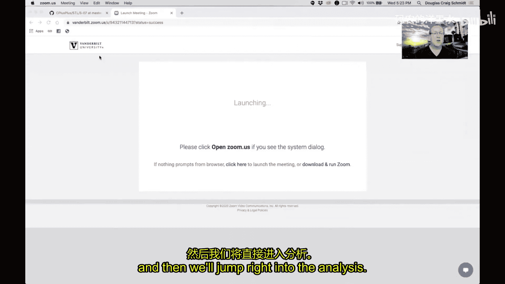

在本节课中，我们将要学习C++标准模板库中的适配容器。适配容器基于现有的STL容器（如列表、向量或双端队列），并通过熟悉的API（如栈、队列和优先队列）对其进行封装。我们将探讨栈、队列和优先队列这三种适配容器的实现原理、使用方法以及它们之间的区别。

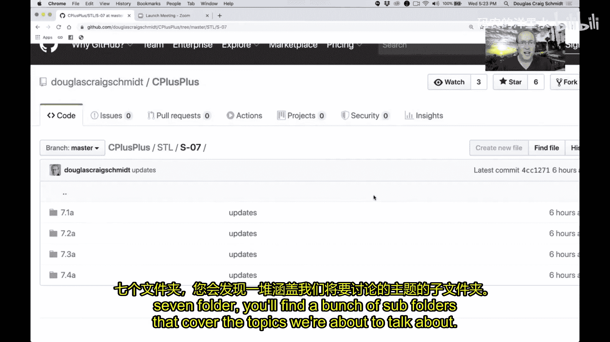

## 什么是适配容器？ 🤔

上一节我们介绍了课程概述，本节中我们来看看适配容器的基本概念。

适配容器本质上是一个类，它基于现有的类，并使用《设计模式》一书中的适配器模式来提供不同的接口。例如，作为适配容器提供的栈限制了向量或双端队列的功能，队列同样可以用来限制双端队列。

适配容器中存在的成员函数，在现有容器中可能被隐藏，或者你可以在适配容器中添加一些新方法，然后这些新方法会调用底层容器的方法。需要注意的一点是，适配容器不包含迭代器，因此无法遍历栈或队列的内容。特别是对于栈来说，这实际上很有意义，因为栈的设计初衷是以后进先出的方式使用。

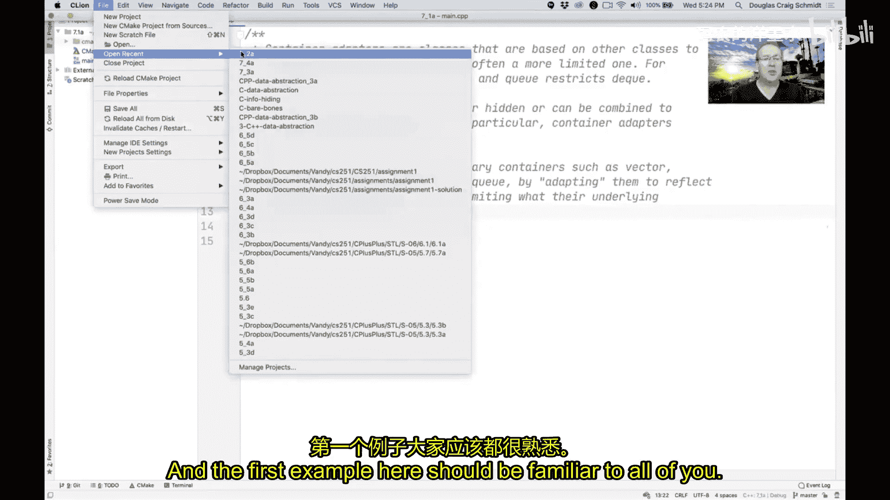

这里的期望是，你基本上是利用现有的东西，并以某种方式修改它以利用其实现，但改变其API。这确实是经典的“四人帮”适配器模式，其意图是让那些最初并非设计为协同工作的类能够一起工作。

## 栈：后进先出的典范 📚

现在，让我们开始看第一个例子，这个例子对大家来说应该很熟悉，它就是抽象数据类型——栈。

栈是一个非常适合用于此目的的选择，因为后进先出的语义可以很好地映射到各种顺序容器上，最显著的是向量，也包括双端队列和列表。出于某种奇怪的原因，栈的默认实现使用了双端队列，我从未理解这一点，但很容易更改，稍后我会展示如何更改。栈的一个好例子是自助餐厅的托盘堆，有人把托盘放在堆的顶部（这是最后放进去的），如果有人来拿托盘，他们会先拿走最上面的那个，所以是后进先出。

以下是STL中栈的典型实现方式。如果你用G++、LLVM Clang或Visual Studio查看你的实现，它可能看起来有些不同，可能更晦涩难懂，但或多或少会符合我在这里展示的内容。

你可以看到栈是一个参数化类型，它由两个参数参数化。第一个是`typename T`，所以可以是`stack<int>`、`stack<long>`、`stack<EmployeeRecord>`。第二个参数是容器的类型，默认情况下，这里我们使用双端队列。

接下来我们要讨论的是栈的构造函数，它是显式的，这意味着它不会进行隐式转换。如果你想进行转换，必须在其中放入特定的强制转换。它基本上接受一个对栈实例化所用容器的常量引用，然后将该引用存储在本地数据成员中，因此它会复制传入的内容。

然后我们有一堆其他方法，它们大多只是转发到底层容器的实现方法。你可以看到`empty`转发到容器的`empty`方法，`size`转发到容器的`size`方法。

有两个`top`方法，它们都转发到容器的`back`方法，这将给你容器末尾的最后一个元素。`top`有两个版本：一个返回非常量引用，另一个返回常量引用，并且实际上是一个常量方法。这里的这个版本，即非常量版本，可以用于赋值语句的左侧进行赋值，如果你愿意，实际上可以更改返回的值。这里的这个版本，即常量版本，只能用于右侧，这主要是为了在你拥有常量栈时使用。如果你有一个常量栈，它被赋予一组常量值，这很难想象你会怎么做，我猜你必须给它一个你将使用的容器，然后该容器将被用于内容。

还有几个`push`的变体。我这里展示的变体使用值类型（即类型`T`）的常量引用，它只是简单地执行`push_back`。你会看到还有另一个版本接受右值引用，然后还有一个名为`emplace`的版本。我们稍后会看看`emplace`和右值引用版本。在某些情况下，它们会进行一些优化以避免额外的或不必要的拷贝。

最后的方法是`pop`，正如你所看到的，`pop`会调用底层容器的`pop_back`方法，该方法将从栈中移除项目。

现在，看看`pop`与`top`的区别很有趣。`pop`移除项目但不返回它，而`top`返回项目但不移除它。这种设计是有意的。如果你看看其他语言，比如Java，它们的`pop`操作会一举移除项目并返回它。但由于C++的值语义以及需要支持强异常保证，它们将`top`和`pop`分成了两个不同的方法。当我们进一步讨论异常时，我们会更多地讨论这个问题，但简而言之，这样做的原因是：如果一个方法既从容器中移除并删除某物，又试图按值返回它，那么你就无法提供强异常保证，因为如果抛出异常，那么你就丢失了该项目，你从未收到它，而且你已经把它从底层的数据结构中取出来了。这就是为什么这样做。

以下是实际的栈实现，让我运行它，看看它做了什么，然后我们再讨论一下。

你可以看到，当你运行它时，我们基本上创建了一个字符栈，然后按顺序压入A、B、C、D。当然，它是一个栈，所以当我们在这里遍历时，当栈不为空时，我们读取顶部项目并打印它，然后弹出顶部项目，它会以相反的顺序打印，因为栈就是这样工作的。

我想在这里指出几件事。如果我们到这里点击“显示此`push`方法的实现”，你会看到这实际上使用了右值引用版本，它将执行隐式移动优化。在这种情况下有效的原因是，因为我们传入的本质上是一个字符，并且这个字符不会在该方法调用之外存在，所以我们可以将它移动到栈中。对于像这样的标量类型，这不是什么大问题，但对于实际上有构造函数和析构函数等的用户定义类或系统定义类，拥有这些优化是一个大问题。

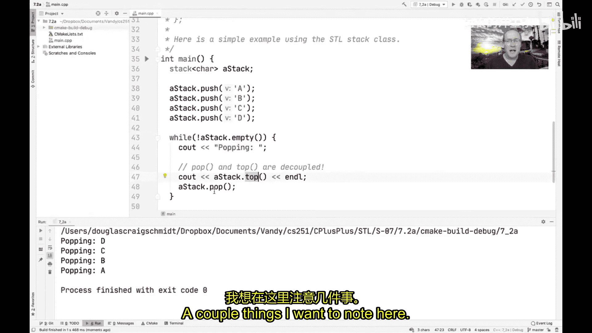

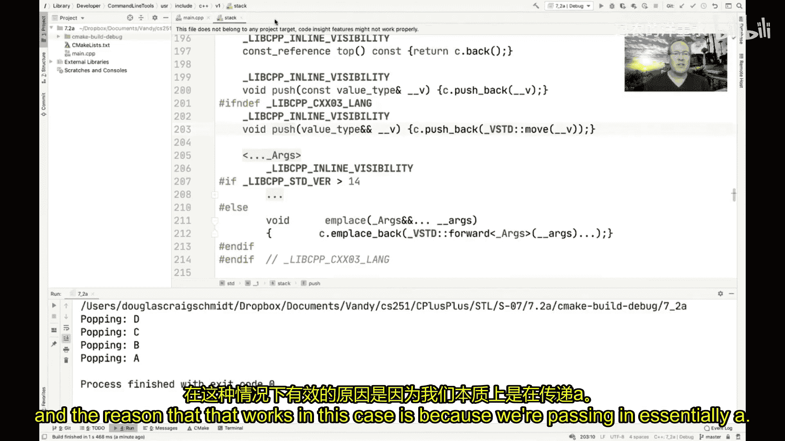

如果我们看看这个`push`操作，你会看到还有一个接受值类型常量引用的版本，在这种情况下是字符，它实际上会进行带有额外拷贝的真正`push_back`。然后还有第三个版本的方法，称为`emplace`，它执行C++中非常酷的可变参数模板转发魔法。同样，如果你有具有复杂构造函数和值语义的数据结构，`emplace`是首选。对于像这里的标量字符这样简单的东西，确实无关紧要。当我们讨论优先队列时，我会展示一些真正重要的地方，我们将使用一些不同的数据类型。

好的，这就是栈，我认为这很熟悉，可能没有太多惊喜。

## 队列：先进先出的纪律 🚶‍♂️🚶‍♀️🚶

现在让我们继续看看队列。

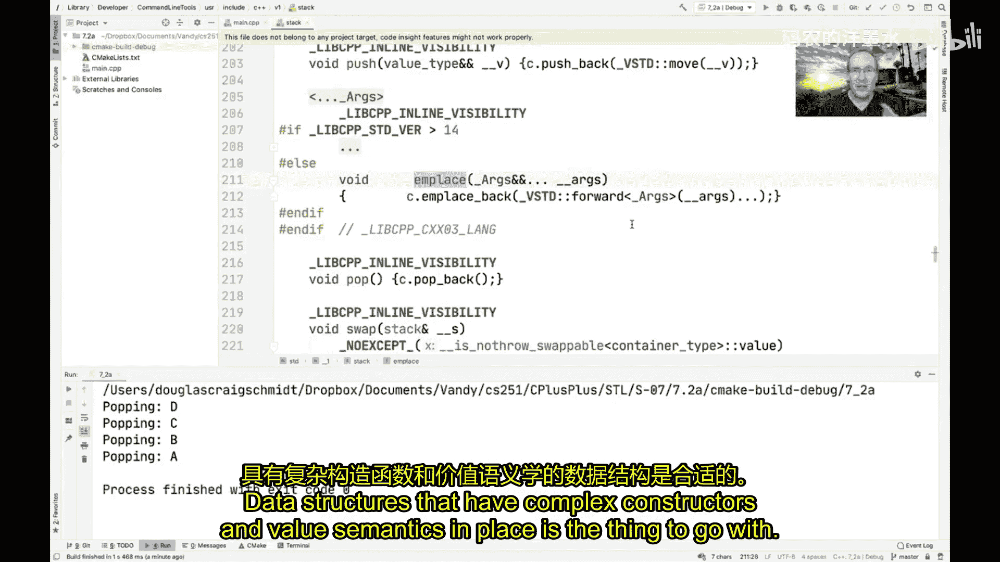

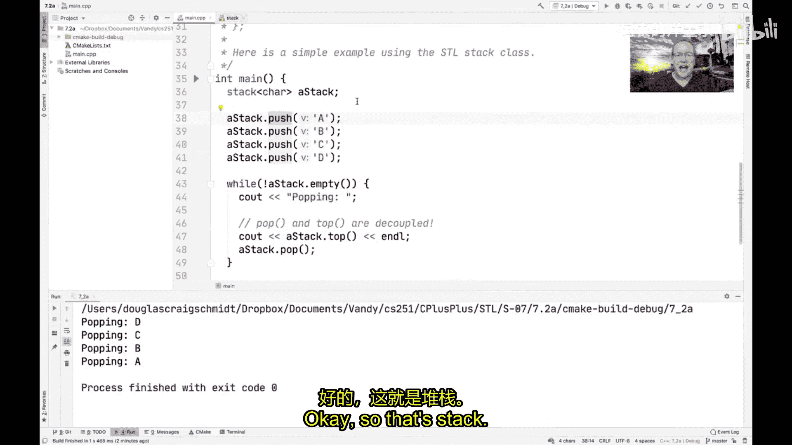

你会看到队列希望看起来也很熟悉。像栈一样，它是一种在许多数据结构课程中都会涉及的数据结构，也是人们在实践中广泛使用的东西。在实践中，人们可能使用队列比使用栈更频繁，当然这取决于你编写什么样的代码。

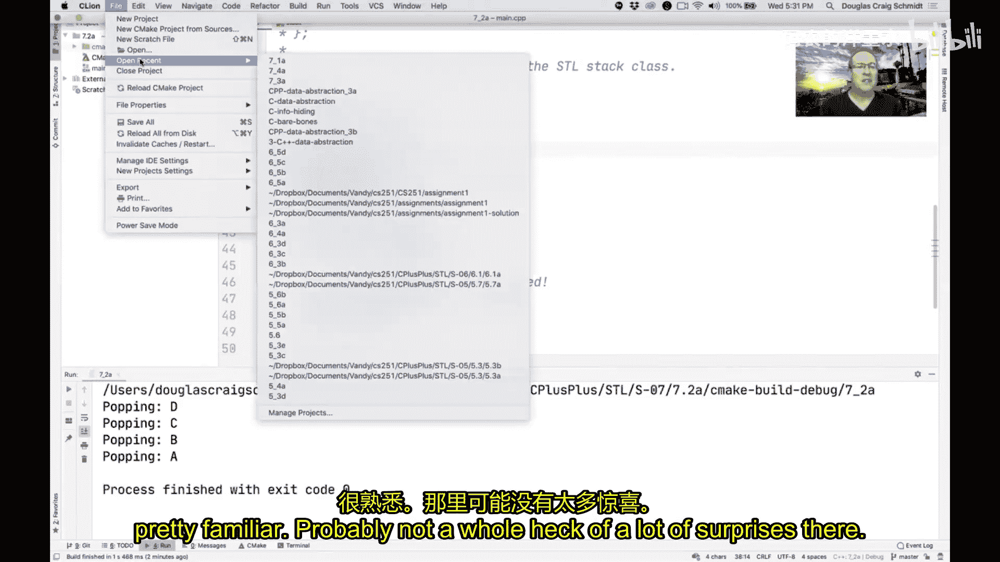

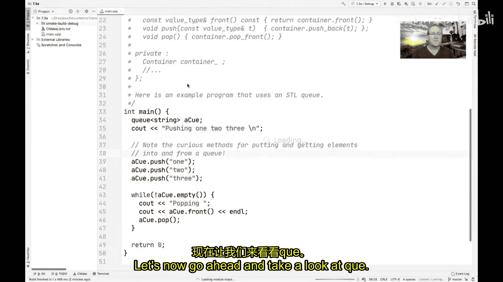

队列是一种先进先出的规则，元素在末尾插入，然后从前面移除。想象一下人们在电影院或机场排队（在那些排队的文化中，并非所有文化都排队），然后你按照先到先得或先进先出的顺序处理他们。

同样，开箱即用的队列适配容器的实现基于双端队列，但很容易将其更改为列表。我可能应该在另一个例子中向你展示这一点，我会尝试在这里展示。

以下是队列在典型实现中的样子。你有`typename T`，它可以是`int`、`double`、`EmployeeRecord`或激活记录等任何你排队的东西。和之前一样，我们也有一个容器作为第二个参数，默认为双端队列。

在下面你可以看到方法看起来非常非常相似。容器的构造函数以相同的方式工作，`empty`和`size`与之前完全相同。但与具有`top`方法的栈不同，队列有一个`front`方法，你可以看到它做的是`container.front()`，而栈的那个是`container.back()`。所以栈使用`back`，队列使用`front`。然后这里还有一些其他有趣的事情。当你对一个队列进行入队操作时，出于我认为相当奇怪的原因，你使用单词`push`。我不认为是在队列上“推”，我认为是放入队列或入队。但无论出于何种原因，STL设计者有不同的想法，他们称之为`push`。所以当你把某物推入队列时，它进入后端，但当你从队列弹出时，它从前端弹出。这就是为什么你真的需要将自己限制在像双端队列或列表这样具有高效前端弹出语义的顺序容器。

好的，这是我们的队列示例，我想向你展示如何稍微修改它。让我们继续在这里包含列表，只是为了好玩。

然后我们可以到这里，只是为了好玩，我们可以说`std::list<std::string>`。

现在我们可以将其从使用双端队列的字符串队列（这是默认值）转换为使用列表作为底层容器实现的字符串队列。

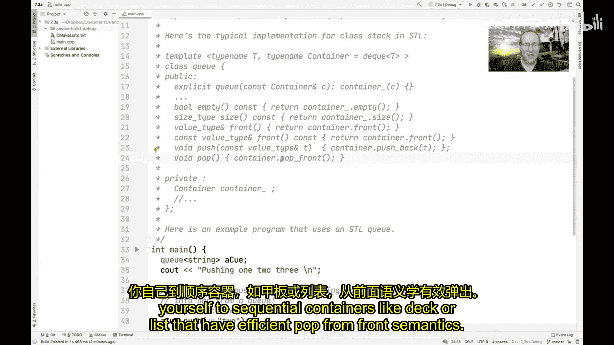

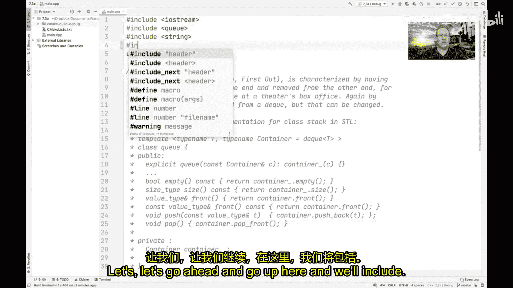

这只是表明我们可以混合搭配这些东西。它不会改变程序的行为，它实际上可能更小一些，因为列表可能比双端队列更高效，这取决于各种因素。但无论如何，你可以根据需要混合搭配它们。

所以在下面，我们继续将一些元素推入队列，然后继续移除它们。让我们运行代码，看看它做了什么。

正如你在这里看到的，我们将按顺序推入一、二、三，然后我们继续弹出项目，我们得到一、二、三，所以它以进入的顺序返回。同样，我们可以在队列不为空时循环，获取队列前端的项目，然后继续弹出队列中的项目。

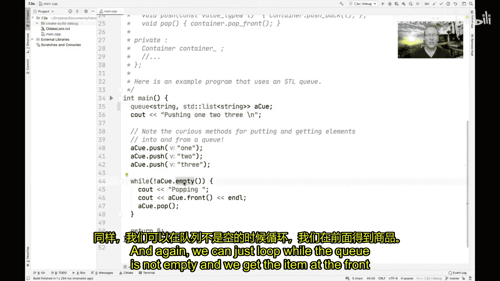

与栈一样，`push`有不同的变体，这里还有其他东西。让我们看看，我们有几个不同版本的`push`。我们在这里使用的这个是右值引用版本，还有一个使用类型`T`或值类型的常量引用的版本，然后和栈一样，还有`emplace`。

同样，当我们讨论优先队列示例时，我们将看看这些东西如何发挥作用，因为它更适合展示用于向适配容器添加内容的不同种类方法之间的区别。

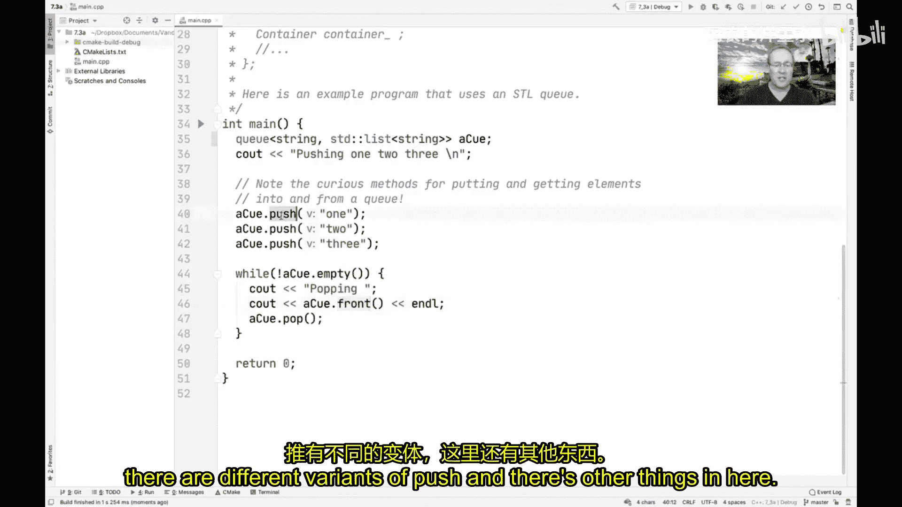

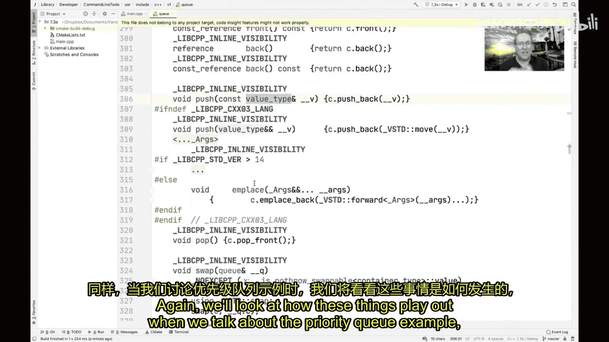

好的，这就是队列，非常有限。在实践中，我编写的很多代码可能希望使用线程安全队列或阻塞队列等。但如果你需要一个普通的、简单的数据结构，队列是你的适配数据结构选择。

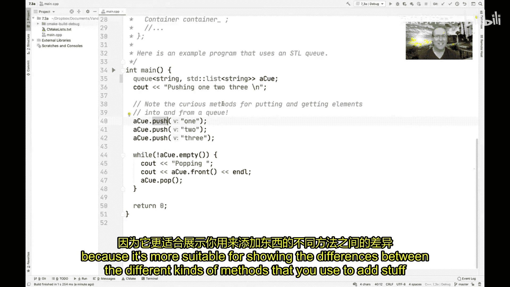

## 优先队列：按优先级排序 🏆

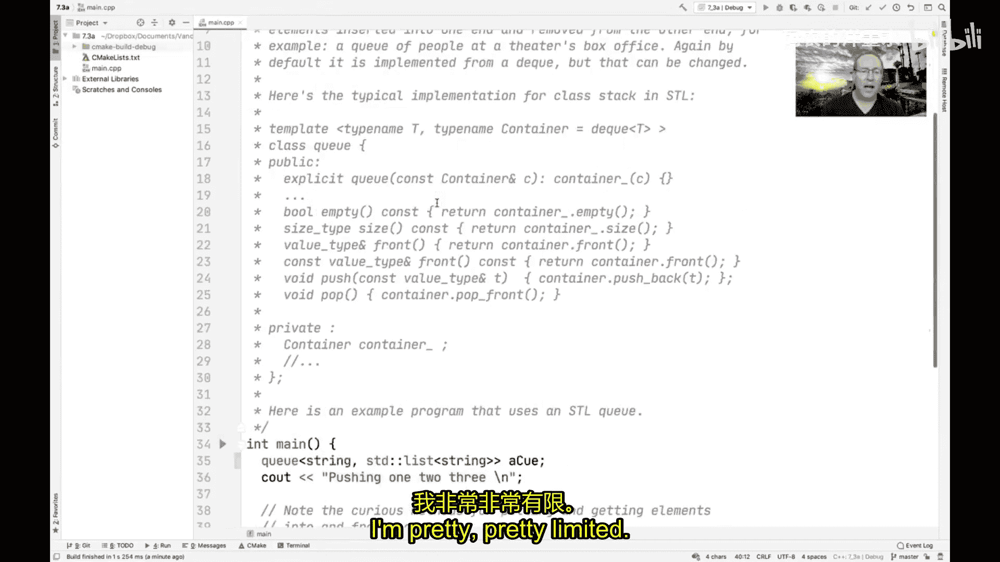

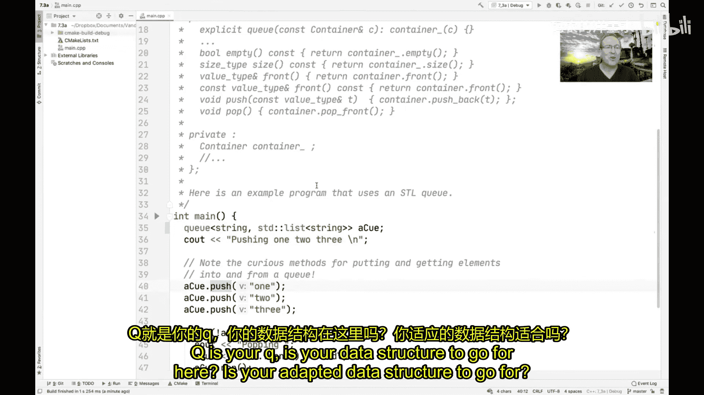

好的，今天我们要讨论的第三个也是最后一个例子是优先队列，这个比队列和栈有趣得多。原因是，对于优先队列，项目按优先级顺序存储，使得最高优先级的项目总是先于较低优先级的项目被移除。你可以控制优先级，当你用你想要的数据结构参数化你的队列（你的优先队列）时，你控制优先级的方式是，你必须确保你作为参数提供的数据结构定义了小于运算符，这将用于适当地确定优先级。

所以在这种情况下，我们将对称为“地点”的东西进行排队。这只是一个非常简单的简化示例，所以我没有把它做成一个花哨的类，它只是一个名为`place`的结构体。在结构体内部，我们有两个数据成员：一个叫做`distance`，所以它是距离（英里）；另一个是字符串，表示我们试图去的地方。所以一个地点是距离某个起点的距离。同样，不要对这个例子想得太复杂，它真的只是为了展示我们定义了一个小于操作，这真的是整个重点。然后我们这里还有一个构造函数。

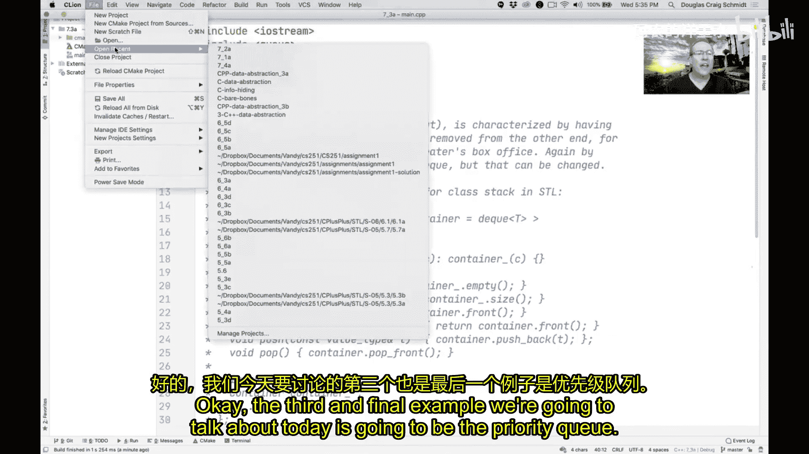

你可以看到我们有一个`ostream`插入运算符，我们将实现它。我们有一个构造函数，它继续使用基成员初始化部分来初始化`distance`和`dest`。这都很简单。这里是小于操作，这需要在你参数化优先队列的对象类型上定义，否则它不知道如何排序它们。我们稍后会讨论它实际上是如何在底层排序的。

这就是我们将要使用的数据结构。你可以在这里看到，如果我们的数据成员`distance`小于参数的`distance`（我可能应该称之为`rhs`或右手边），那么它将被认为是小于的。我们稍后会看到这在优先队列元素的比较中是如何使用的。

这里是插入运算符，它接受一个`ostream`并将一个地点放入其中，这样我们就可以很容易地打印内容。基本上我们可以说，我们的目的地距离我们的起点有这么远。

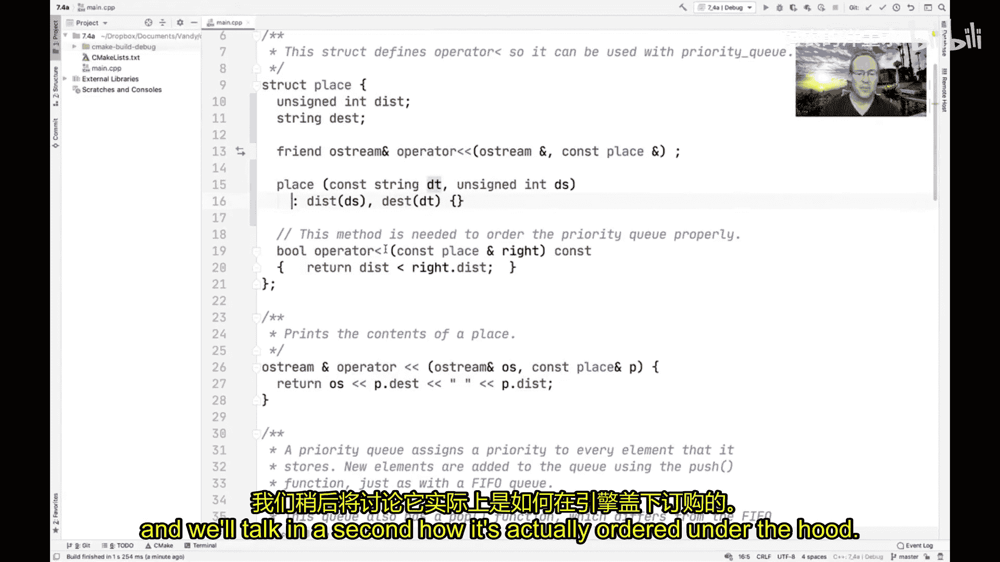

那么什么是优先队列？它基本上是一种为其存储的每个元素分配优先级的方式。新元素将使用`push`函数添加到队列中，就像我们对先进先出队列所做的那样。不同之处在于，当它推送时，它会根据其小于运算符将其放入队列中的正确位置。

它也有一个`pop`操作，就像先进先出队列一样。但它与先进先出队列的`pop`在一个关键领域不同：当你调用优先队列的`pop`时，你得到的不是存在时间最长的项目，而是优先级最高的项目。

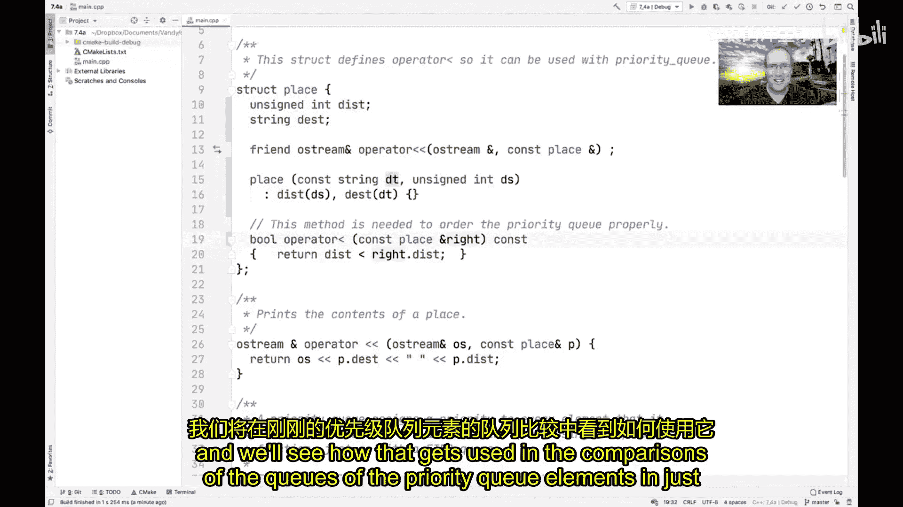

这就是使它成为优先队列的原因。当你移除某物时，你总是得到队列前端的项目，而队列前端的项目始终是优先级最高的项目。这是由规则、数据结构和用于编写优先队列的算法维护的，我们稍后会讨论这一点。

基于优先级的排队有很多很多例子。操作系统中的调度器就是一个很好的例子，它总是选择优先级最高的线程来运行。

与栈和队列有自己的头文件不同，优先队列类定义在队列头文件中，并且默认使用`less`仿函数来比较其键。

默认情况下，但你可以更改这一点。在内部，它的实现方式是使用一个已经堆化的向量。堆是一个几乎完全的部分有序二叉树，它具有这样的属性：你可以将项目插入堆中，你可以从堆中移除项目，并且你可以找到最高优先级的项目。实际上，你可以在常数时间内找到最高优先级的项目，因为它总是在堆的前端。但是你可以以基本上对数时间从堆中插入和移除项目，所以它非常高效。

以下是STL中典型优先队列实现的样子。

我们有优先队列，像以前一样由类型`T`参数化。它由一个容器参数化，因为它是一个适配容器。在这种情况下是向量，而不是双端队列。然后它还由一个比较操作参数化。

容器和比较操作都有默认值。默认值为向量，比较操作将默认为`less`，并且它将对容器的值类型执行`less`操作。所以如果你有一个容器，它是一个向量，并且我们用`place`参数化这个东西，那么值类型就是`place`。

让我们看看各种构造函数和方法等。它有一个优先队列构造函数，它接受一个比较仿函数（通过常量引用）和一个容器（通过常量引用）。就像队列和栈一样，容器部分类似，比较操作不同，比较仿函数不同，因为我们必须进行比较。然后我们有`empty`和`size`，这些和以前一样。`top`返回容器的前端。

然后你可以看到`push`和`pop`做了一些很酷的事情。所以当你把某物推入容器时，你把它加在末尾，然后它调用STL算法接口的一部分——一个名为`push_heap`的内部方法，该方法继续重新排列向量的内容，使用比较仿函数将其重新堆化。然后`pop`做类似的事情，你继续调用`pop_heap`。

然后你继续获取最后一个项目，所以它基本上移除它。

这向你展示了事物在底层是如何工作的，我们稍后会看看那段代码。

在底层，容器和比较仿函数作为私有数据成员存储。

这是我们将要使用的程序。我们将有一个由`place`参数化的优先队列（你之前见过`place`），然后我们将展示几种不同的方式（实际上是三种）将项目添加到优先队列中。然后我们将继续打印优先队列的内容，当然它会按优先级顺序出来。让我们继续运行这段代码，这样你就可以看到它做了什么。

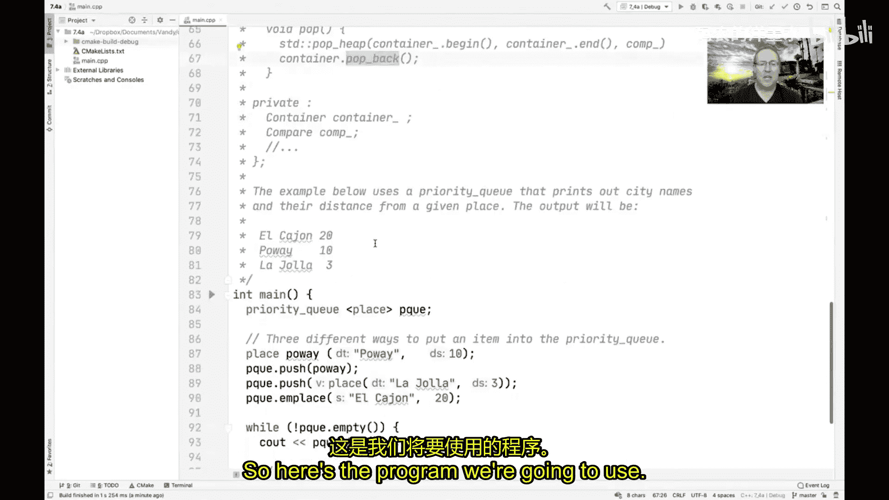

所以它继续显示，最高优先级的项目是`La Con`，距离可能是圣地亚哥20英里，`Poway`是10英里，`La Jolla`是3英里。所以你可以看出这里的优先级是如何工作的：具有最大值的项目是优先级最高的项目。所以这是一个“越大越好”的优先级系统。有时优先级是“越小越好”，但在这种情况下，是“越大越好”。

所以这基本上就是它的工作方式，它通过将这三个元素推入优先队列，然后当队列不为空时，我们打印出顶部项目并将其从优先队列中弹出。

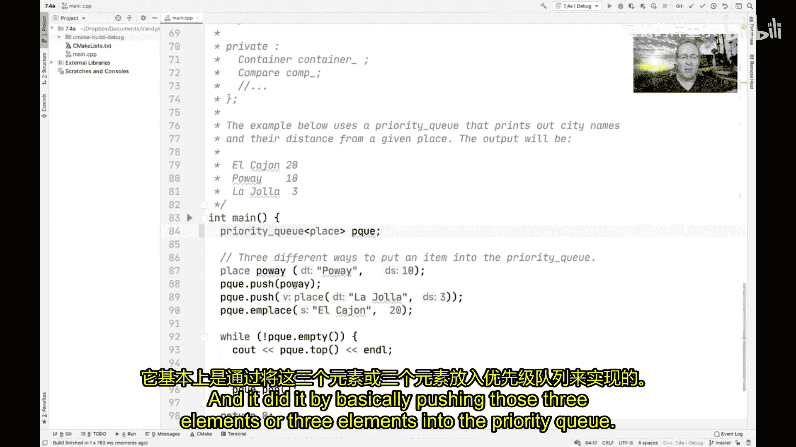

然而，我想在这里重点介绍的是将数据放入优先队列的三种不同方式。请注意，这三种不同方式也适用于我们讨论过的栈和队列。只是在那些情况下，我使用的是字符或字符串等数据结构。字符串实际上也会很有趣，但我当时使用的方式并没有真正展示这些不同功能的酷炫之处。

所以我们做的第一种方式是，我们创建一个名为`Poway`的对象，它将是一个地点，名称为`Poway`，距离值为10。然后我们继续将其推入优先队列。如果我们去看看调用了哪个`push`方法，这个推送的是一个常量引用值类型对象。所以你可以看到它将其推入容器的末尾，然后重新堆化所有内容。

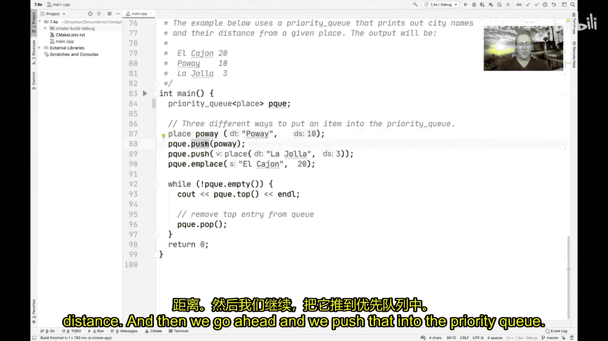

好的，它使用该版本的原因是我们实际上有一个真实的对象，并且该对象可能需要在该调用之外存在，所以我们需要维护它的值。

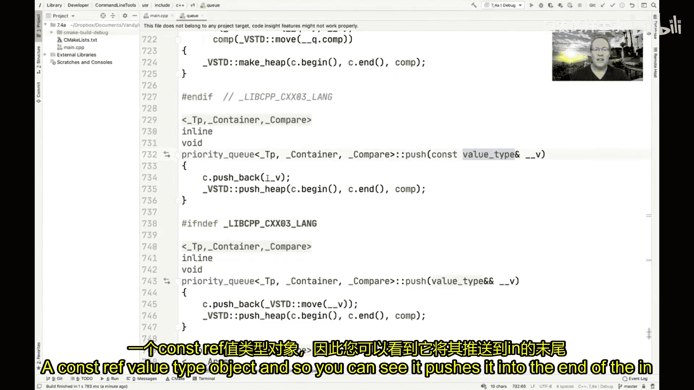

接下来我们做的是，我们继续推送一个匿名的`place`实例。所以这个对象只存在于这个方法调用期间，它不会在那之后存在，不像`Poway`，它可能在以后被使用，尽管我们后来没有使用它。

所以这个`push`，当我们用`La Jolla`调用它时。它继续使用右值引用版本的`push`，该版本在底层使用移动语义。

所以这个的移动语义版本将基本上窃取其参数的内容，留下一个空壳，但这没关系，因为它只是暂时使用。所以做这个版本的开销会更小。

第三个版本是`emplace`版本，这类似于使用右值引用的那个版本，但它甚至进一步优化了。如果你看看这个，它接受一个可变参数模板，它所做的就是调用底层容器（在这种情况下是向量）的`emplace_back`方法，并使用C++的一部分——`forward`方法以及用`...`语法传递的可变参数模板参数列表。这基本上会进行原地构造，所以没有额外的拷贝，它超级快，就内存拷贝或借用任何人的数据等方面而言。然后它继续在放入后重新堆化所有内容。

只是为了好玩，让我们看看`top`做了什么。你可以看到`top`只是返回前端，我之前告诉过你。让我们看看`top`……哦，不是`top`，是`pop`。

所以你可以看到它做的是调用`pop_heap`，它重新排列数据结构以移除当前在前端的项目，然后继续调用`pop_back`将其从底层容器中移除。所以这些是不同的实现细节。`pop`不如我们在这里看到的`push`的两个变体和`emplace`有趣。那些真的很酷，带有右值引用的`push`的第二个版本和`emplace`是使用较新的、更酷的C++模板设施和移动语义在C++后期版本中添加的功能。

好的，这些就是我今天想涵盖的主题。

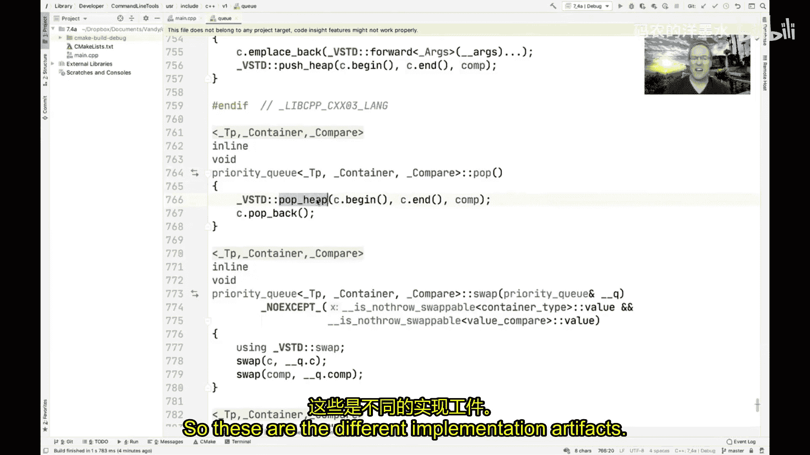

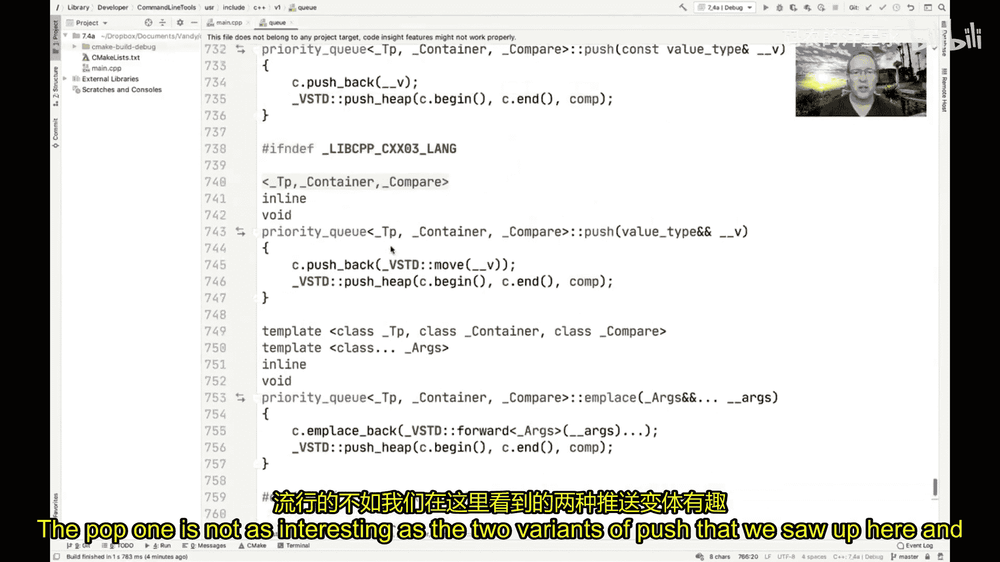

## 总结 📝

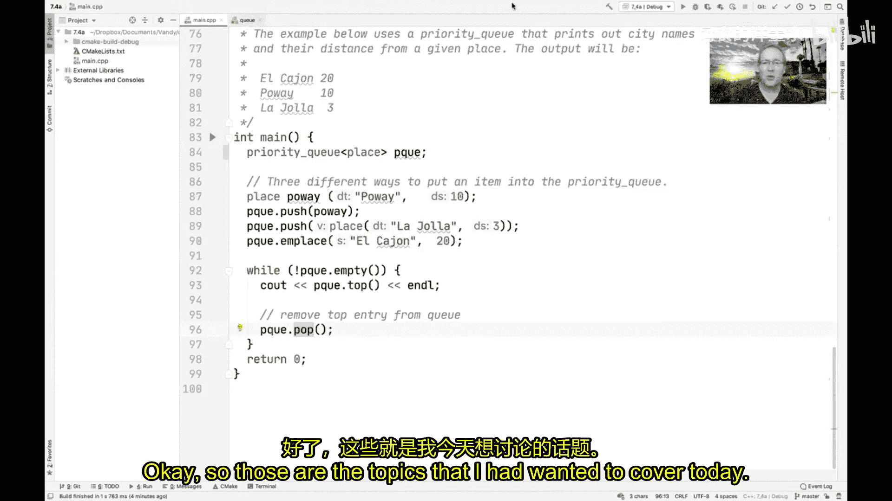

本节课中我们一起学习了C++标准模板库中的三种适配容器：栈、队列和优先队列。

*   **栈** 遵循后进先出原则，主要操作是`push`（压栈）、`pop`（弹栈）和`top`（查看栈顶）。
*   **队列** 遵循先进先出原则，主要操作是`push`（入队）、`pop`（出队）和`front`（查看队首）。
*   **优先队列** 元素按优先级排序，优先级最高的元素最先被移除。它要求元素类型支持比较（如定义`operator<`），主要操作也是`push`、`pop`和`top`。

我们还了解了向这些容器添加元素的三种高效方式：传递对象（可能拷贝）、传递右值（移动优化）和使用`emplace`（原地构造，最高效）。适配容器通过封装现有容器并提供特定接口，简化了常见数据结构的实现和使用。