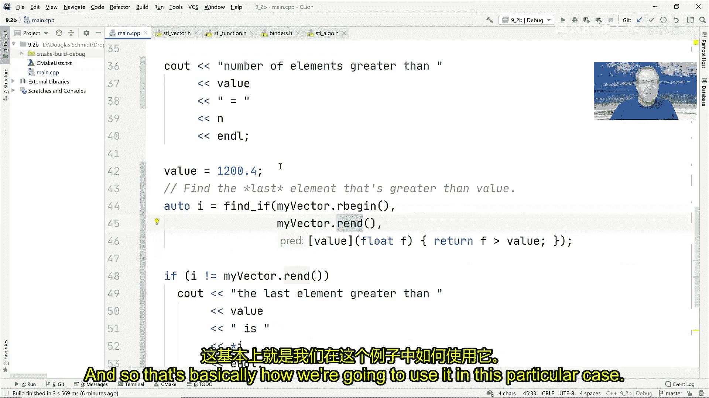

# 019：功能适配器 part1 🧩


在本节课中，我们将要学习C++标准模板库（STL）中的功能适配器。我们将从所谓的“绑定器”开始，并概述功能适配器的一般概念。

## 概述与代码位置 📂

首先，让我们看看在哪里可以找到本课相关的代码。请访问我的GitHub仓库。在`C++STLS09`文件夹中，你会找到`9.1`和`9.2`子文件夹，这些将是我们今天分析的内容。

## 什么是功能适配器？ 🤔

到目前为止，你可能已经看到C++ STL有很多适配器，比如我们讨论过的迭代器适配器和容器适配器。现在，我们将讨论功能适配器。功能适配器主要用于适配函数对象，以便它们可以执行组合和绑定操作。这样，你可以拥有更少的函数对象，重用许多已有的函数对象，并以有趣的方式绑定它们。你还可以将它们组合成所谓的链或树，使一个函数对象的输出作为下一个函数对象的输入。这为你提供了巨大的能力，可以将函数对象彼此组合、转换和操作，也可以与特定值（如常量）以及特殊函数结合使用。

功能适配器主要有三种类型：绑定器、否定器和成员函数/函数适配器。

*   **绑定器**：包括`bind1st`和`bind2nd`，这是我们马上要看的。它们通过绑定函数对象的其中一个参数（第一个或第二个）来适配函数对象。
*   **否定器**：包括`not1`和`not2`，它们通过否定函数对象的参数来适配函数对象，使`true`变为`false`，`false`变为`true`。
*   **成员函数适配器**：包括`mem_fun`、`mem_fun_ref`等，这些适配器用于允许函数对象作为类成员函数适配器使用。你可以获取指向成员函数或普通函数的指针，并以允许它们在STL算法期望使用函数对象的地方使用的方式进行适配。

在示例中，我们还会比较和对比函数对象与C++ lambda函数的使用。lambda函数允许你直接编写代码，而无需创建单独的类或重用STL函数对象库中已有的类。

## 绑定器示例：`bind1st` 与 `bind2nd` 🔗

现在，让我们看一些示例，使与绑定器相关的概念更加具体。

### 演示 `bind1st`

我们将从一个演示`bind1st`和`bind2nd`功能适配器的示例开始，并比较它们在实践中的工作原理。

以下是演示`bind1st`的代码片段：

```cpp
int numbers[] = {10, 20, 40, 30, 50, 20, 10};
int* end = numbers + sizeof(numbers) / sizeof(numbers[0]);
int count = count_if(numbers, end, bind1st(equal_to<int>(), 10));
```

我们有一个内置的整数数组`numbers`。然后，我们使用C风格指针运算计算一个指向数组末尾之后位置的指针`end`。接着，我们使用`count_if`算法。`count_if`算法遍历数组，从开始到`end`（不包括`end`），并应用`bind1st`方法来计算数组中值等于`10`的元素数量。

让我们看看其中的关键部分。`equal_to`是一个函数对象，它接受两个参数`x`和`y`，如果值相等则返回`true`，否则返回`false`。`bind1st`部分是一个模板，它接受操作类型和我们将要使用的值类型。我们传入`equal_to`操作和一个常量值`10`。`bind1st`调用`binder1st`，传入我们传入的函数以及参数类型`X`（在这种情况下是`int`）。

本质上，`bind1st`将`equal_to`方法（它接受两个参数）绑定，使得它的一个参数是我们在迭代范围中的值，另一个参数是常量`10`。`count_if`算法遍历范围，并对每个元素应用谓词（在这种情况下是我们通过`bind1st`创建的适配器）。每当谓词匹配时，计数就增加一。

重要的是，`bind1st`创建了一个函数对象，它将`equal_to`函数对象与值`10`绑定。这基本上将`equal_to`（一个二元谓词）通过绑定常量`10`转换成了一个一元谓词。然后，它返回等于`10`的值的数量。运行此代码，你会发现数组中有两个值等于`10`。

### 演示 `bind2nd`

现在，让我们看看`bind2nd`的工作原理。代码几乎相同，只是我们调用`bind2nd`而不是`bind1st`。`bind2nd`创建了一个`binder2nd`对象，它绑定函数对象的第二个参数，而不是第一个参数（这是`bind1st`使用的）。

在这个例子中，我们搜索数字`20`出现的次数。运行代码，由于数组中有两个`20`，输出显示有两个元素等于`20`。

### 对比 `bind1st` 与 `bind2nd`

此时，你可能会想，`bind1st`和`bind2nd`到底有什么不同？它们似乎每次都返回相同的结果。为了说明这两个绑定器之间的区别，让我们看一个对比示例。

首先，我们使用加法操作`plus`。我们创建一个`bind1st`对象，将加法与值`10`绑定，然后我们用`20`调用它。这本质上是将`10`加到`20`上，结果是`30`。同样，对于`bind2nd`变体，我们将`20`加到`10`上。因为加法是可交换的（`A + B = B + A`），我们不在乎顺序，所以得到相同的值。

现在，我们使用减法操作`minus`来查看差异。我们创建一个`bind1st`对象，将`minus`与`10`绑定，然后我们用`20`调用它。这将执行`10 - 20`，结果是`-10`。对于`bind2nd`对象，我们将`minus`与`10`绑定，然后用`20`调用它。这将执行`20 - 10`，结果是`10`。

现在你可以看到区别了。当你有不可交换的操作时，使用`bind1st`还是`bind2nd`会有影响。但对于可交换的操作，或者像我们在`count_if`中使用谓词检查相等性时，这并不重要。然而，如果我们检查其他关系，如大于或小于，那么使用`bind1st`还是`bind2nd`就会有所不同。

## 在STL容器中使用绑定器 📦

上一个示例侧重于在内置类型（如整数数组）的上下文中使用绑定器。下一个示例将展示相同的概念和能力，但这次我们将在STL顺序容器（如`vector`）的上下文中查看。

### 示例：`bind2nd` 与 Lambda 函数

以下示例将展示`bind2nd`（我们也可以展示`bind1st`），并演示在各种STL算法中使用C++ lambda函数代替绑定器。

我们定义一个`double`类型的`vector`，并用初始化列表初始化它。然后，我们定义一个变量`factor`。接下来，我们使用`transform`算法。`transform`将遍历`vector`的整个范围（从开始到结束），并应用一元操作。我们通过使用`bind2nd`与二元函数对象`multiplies`和我们定义的`factor`来获得这个一元操作。

结果将存储回`vector`本身。因此，我们基本上将`vector`中的所有内容乘以因子`33.333`（这是老式黑胶唱片的速度）。然后，我们打印出结果。

接下来，我们使用`count_if`算法。我们遍历已被乘法修改的`vector`，找出有多少值大于`1000.2`。我们再次使用`bind2nd`，但这次是与`greater`函数对象一起使用。这将计算有多少值大于我们指定的值变量。

最后，我们使用`find_if`算法。这次，我们将从`vector`的末尾开始，使用`rbegin`在末尾开始，然后到开头（`rend`），即我们向后迭代。为了变化，我们这次使用C++ lambda函数，而不是使用任何预定义的绑定器或算术操作（如`multiplies`）或关系操作符（如`greater`）。我们将找到范围内最后一个值大于`1200.4`的元素。

Lambda函数如下所示：我们提供传递的类型（在这种情况下是`float`，因为它是`float`的`vector`），然后我们内联编写代码：`return f > value;`。如果为`true`，则匹配它。由于我们从末尾开始搜索，我们将查看是否找到匹配项。注意，我们必须从作用域传递参数`value`到lambda的上下文中，否则它将不可见。这称为捕获子句，你可以按值或按引用捕获变量。

运行此代码，你会看到原始`vector`乘以`33.333`后的结果，然后找到大于`1000.2`的元素数量（有三个），最后向后搜索找到大于`1200.4`的最后一个元素（即`16081.65`）。

### 算法实现回顾 🔍

让我们快速回顾一下这些算法的实现：

*   **`transform`算法**：接受输入迭代器、输出迭代器和一元操作。它遍历从开始到结束的迭代器范围，对每个元素应用一元操作（在本例中是我们的绑定器），并将结果存储到输出中。
*   **`count_if`算法**：我们之前已经看过，它遍历范围并应用谓词，计算匹配的次数。
*   **`find_if`算法**：接受输入迭代器和谓词，搜索从开始到结束的范围，当谓词匹配时返回。

在这个例子中，我们使用`rbegin`工厂方法在`vector`上获取一个反向迭代器，从末尾开始，`rend`用于在到达开头时界定搜索。



## 总结 📝

本节课中，我们一起学习了C++ STL中的功能适配器，特别是绑定器（`bind1st`和`bind2nd`）。我们看到了它们如何通过绑定参数来适配二元函数对象，使其成为一元函数对象，以满足STL算法的要求。我们比较了`bind1st`和`bind2nd`在可交换和不可交换操作中的区别，并展示了在数组和STL容器（如`vector`）中使用它们的实际示例。此外，我们还介绍了使用C++ lambda函数作为替代方案，并简要回顾了相关STL算法（如`count_if`、`transform`和`find_if`）的工作原理。

绑定器非常强大，在STL中广泛使用。在接下来的课程中，我们将继续探讨否定器功能适配器，并进一步比较函数对象和lambda函数的使用场景。通常，如果你可以使用内置的STL函数对象与绑定器和否定器结合，这是一种快速的编码方式，因为它已经存在且直观。相反，如果你编写的计算不符合STL预定义函数对象的模式，尤其是那些一次性使用的场景，那么考虑使用lambda函数可能更合适。