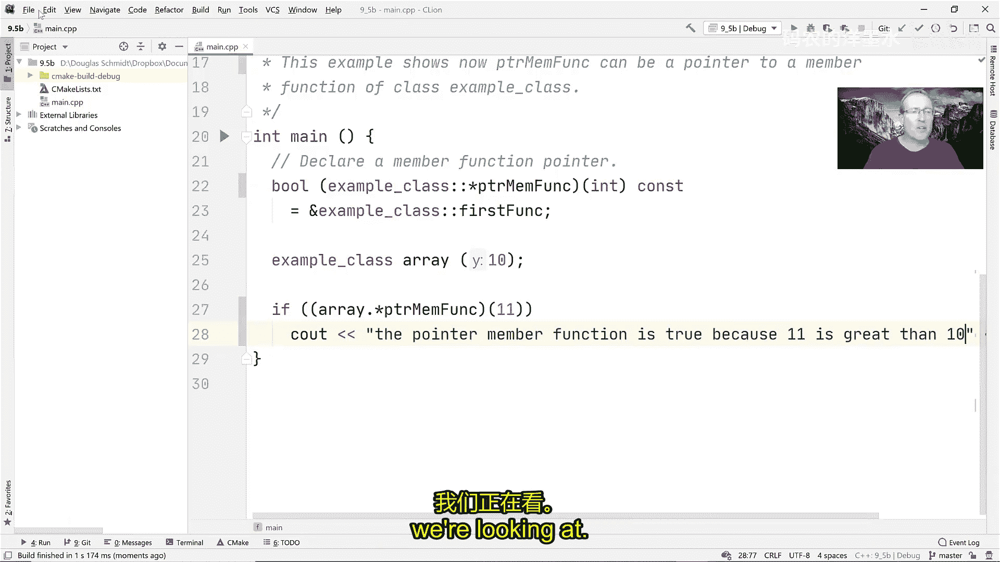
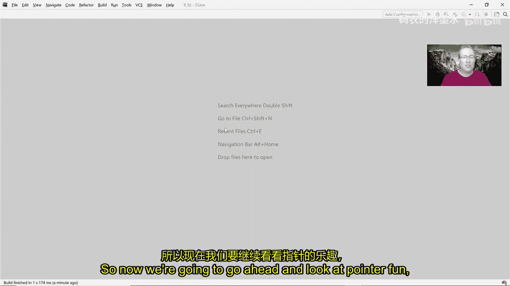
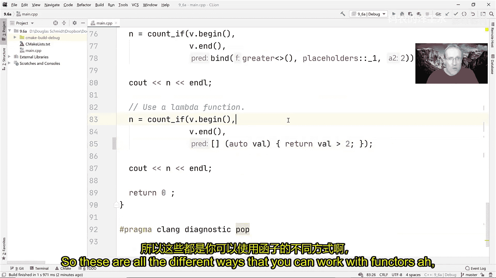

# 021：功能适配器 part3

## 概述
在本节课中，我们将结束关于功能适配器的讨论，重点介绍用于封装成员函数和常规函数的各类适配器。我们将通过具体示例，学习如何使用这些适配器，并了解现代C++中替代它们的方法。

## 代码位置
示例代码位于GitHub仓库的C++ STL S09文件夹中，具体在9.4、9.5和9.6子文件夹内。

## 成员函数适配器
上一节我们介绍了常规函数适配器，本节中我们来看看成员函数适配器。它们允许将类的成员函数作为参数传递给各种C++预定义算法。虽然前两种适配器在后续C++标准中已被弃用，但它们仍然可用。

以下是三种主要的成员函数适配器：
*   `mem_fun`
*   `mem_fun_ref`
*   `mem_fn` (或 `mem_function`)

这些适配器的基本作用是使成员函数能够在通常期望使用函数对象（仿函数）的上下文中被调用。

让我们通过一个示例来了解其用法，该示例同时展示了STL算法和C++ Lambda函数的一些应用。

首先，我们定义一个简单的包装类 `WrapInt`，它封装了一个 `int` 值。

```cpp
class WrapInt {
private:
    int value_;
public:
    WrapInt() : value_(0) {} // 默认构造函数
    explicit WrapInt(int v) : value_(v) {} // 显式构造函数
    void showVal() const { std::cout << value_ << ' '; } // 显示值
    bool isPrime() const; // 检查是否为质数
    [[nodiscard]] bool isEven() const; // 检查是否为偶数
    [[nodiscard]] bool isOdd() const; // 检查是否为奇数
};
```

注意，`isEven` 和 `isOdd` 方法使用了 `[[nodiscard]]` 属性，这意味着如果忽略其返回值，编译器会发出警告。

接下来是测试程序。我们首先创建一个包含10个 `WrapInt` 对象的向量，并用1到10初始化它们。

```cpp
std::vector<WrapInt> vec(10);
for (int i = 0; i < 10; ++i) {
    vec[i] = WrapInt(i + 1);
}
```

然后，我们使用 `for_each` 算法和 `mem_fun_ref` 适配器来打印向量的内容。

```cpp
std::for_each(vec.begin(), vec.end(), std::mem_fun_ref(&WrapInt::showVal));
```

`for_each` 算法遍历一个范围，并对每个元素调用给定的函数。`mem_fun_ref` 适配器封装了指向成员函数 `showVal` 的指针，使其能够像普通函数对象一样被调用。

接着，我们使用 `remove_if` 算法和 `mem_fun_ref` 适配器移除所有质数。

```cpp
auto new_end = std::remove_if(vec.begin(), vec.end(),
                              std::mem_fun_ref(&WrapInt::isPrime));
vec.erase(new_end, vec.end());
std::for_each(vec.begin(), vec.end(), std::mem_fun_ref(&WrapInt::showVal));
```

`remove_if` 算法遍历范围，将不满足谓词（本例中是“是质数”）的元素移动到前面，并返回一个新的“末尾”迭代器。随后我们使用向量的 `erase` 方法真正删除这些元素。

现在，我们切换到使用更现代的 `mem_fn` 适配器。我们将用它来移除所有偶数。

```cpp
vec.erase(std::remove_if(vec.begin(), vec.end(),
                         std::mem_fn(&WrapInt::isEven)),
          vec.end());
std::for_each(vec.begin(), vec.end(), std::mem_fn(&WrapInt::showVal));
```

`mem_fn` 的功能与 `mem_fun_ref` 类似，但利用了C++的新特性，是更推荐的方式。

最后，我们展示如何使用C++ Lambda函数来达到相同目的，这里用它移除所有奇数。

```cpp
// 使用Lambda移除奇数
vec.erase(std::remove_if(vec.begin(), vec.end(),
                         [](const WrapInt& w) { return w.isOdd(); }),
          vec.end());
// 使用Lambda打印结果
std::for_each(vec.begin(), vec.end(),
              [](const WrapInt& w) { w.showVal(); });
```

运行这段代码，输出结果将依次显示：原始序列、移除质数后的序列、移除偶数后的序列，以及最后移除奇数后的序列。这个示例演示了如何应用这些作用于成员函数的功能适配器。

## 指针函数适配器及其替代方案
现在让我们继续讨论这种方法的一些变体，重点是**指针函数适配器**。

这个适配器在后续C++版本中也已被弃用，但了解其工作原理有助于理解演进过程。随后，我们将展示使用绑定器（binders）或Lambda函数等新特性来实现相同功能的方法。

指针函数适配器的目的是使C风格的函数指针能够在需要向标准算法传递函数的上下文中工作。

首先，回顾一下C风格函数指针的基本用法：






```cpp
bool my_function(int i) { return i > 10; } // 普通函数
int main() {
    bool (*ptr_func)(int) = &my_function; // 定义函数指针
    bool result = ptr_func(11); // 通过指针调用函数
    // 或者 bool result = (*ptr_func)(11);
    std::cout << std::boolalpha << result << std::endl; // 输出：true
}
```

类似地，对于成员函数指针：

```cpp
class ExampleClass {
    int x_;
public:
    explicit ExampleClass(int x) : x_(x) {}
    bool first_func(int i) const { return i > x_; }
};

int main() {
    bool (ExampleClass::*ptr_mem_func)(int) const = &ExampleClass::first_func;
    ExampleClass obj(10);
    bool result = (obj.*ptr_mem_func)(11); // 通过成员函数指针调用
    std::cout << std::boolalpha << result << std::endl; // 输出：true
}
```

理解了这些概念后，我们来看 `pointer_to_unary_function` 和 `pointer_to_binary_function` 适配器（通常通过辅助函数 `ptr_fun` 使用）。下面的示例将展示包括 `ptr_fun`、`bind2nd`、`not1` 在内的多种适配器，以及C++泛型Lambda函数和 `decltype` 的用法。

这个示例使用一个存储C风格字符串指针的向量。

```cpp
std::vector<const char*> vec = {"1", "2", "3", "4", "5"};
```

我们将演示几种在该向量中搜索字符串的方法。

**第一种方法：使用 `ptr_fun`、`bind2nd` 和 `not1`。**
目标是找到字符串 `"3"`。

```cpp
auto it = std::find_if(vec.begin(), vec.end(),
    std::not1(
        std::bind2nd(
            std::ptr_fun(std::strcmp), "3"
        )
    )
);
```

这里发生了链式适配：
1.  `std::ptr_fun(std::strcmp)`：将C函数 `strcmp` 封装成一个函数对象。
2.  `std::bind2nd(..., "3")`：将第二步参数绑定为 `"3"`，创建一个一元谓词。
3.  `std::not1(...)`：对结果取反。因为 `strcmp` 在字符串相等时返回0（在C++中相当于`false`），而 `find_if` 期望谓词在匹配时返回 `true`，所以需要取反。

**第二种方法：使用现代 `std::bind` 和 `std::not_fn`。**
目标是找到字符串 `"2"`。

```cpp
using namespace std::placeholders; // 引入 _1, _2 等占位符
auto it2 = std::find_if(vec.begin(), vec.end(),
    std::not_fn(
        std::bind(std::strcmp, _1, "2")
    )
);
```
`std::bind` 直接绑定参数，无需 `ptr_fun`。`std::not_fn` 是 `not1`/`not2` 的现代替代品。

**第三种方法：使用泛型Lambda函数。**
目标是找到字符串 `"1"`。

```cpp
auto it3 = std::find_if(vec.begin(), vec.end(),
    [](const auto& s) { return !std::strcmp(s, "1"); }
);
```
Lambda函数更加直观和简洁，直接表达了比较逻辑。

这个例子强大地展示了STL的灵活性，它平等地对待内置类型（如 `const char*`）和用户定义类型。

## 编写高效仿函数的技巧
在结束功能适配器的讨论之前，我们提供一些编写高效仿函数的技巧。我们已经见过多种仿函数，有的有状态，有的无状态，参数数量也各不相同。

以下是需要记住的几点：

**1. 定义函数调用运算符：**
仿函数必须重载 `operator()`，这样才能像函数一样被调用，同时又能作为对象存储状态。

**2. 注意拷贝语义：**
许多STL算法要求其仿函数参数具有值语义（即可拷贝）。如果你的仿函数有状态，确保实现适当的深拷贝，避免浅拷贝导致的指针别名和双重释放问题。

**3. 保持状态轻量：**
最好让仿函数无状态，或者只包含少量状态。如果仿函数包含大型数组等数据，在按值传递时会产生巨大开销。

**4. 谨慎使用虚函数：**
通常，仿函数不应包含虚方法。因为按值拷贝带有虚函数表的对象会带来问题。如果确实需要多态行为，可以考虑使用“桥接模式”（Bridge Pattern），即定义一个抽象句柄，内部包含一个指向实际实现的指针，将调用转发给实现部分。

**简单示例对比：**
假设我们需要统计一个向量中大于2的元素数量。

*   **自定义仿函数：**
    ```cpp
    struct GreaterThanTwo {
        bool operator()(int x) const { return x > 2; }
    };
    int count = std::count_if(vec.begin(), vec.end(), GreaterThanTwo());
    ```



*   **使用预定义仿函数和绑定器（旧式）：**
    ```cpp
    int count = std::count_if(vec.begin(), vec.end(),
                              std::bind2nd(std::greater<int>(), 2));
    ```

*   **使用 `std::bind`（较现代）：**
    ```cpp
    using namespace std::placeholders;
    int count = std::count_if(vec.begin(), vec.end(),
                              std::bind(std::greater<int>(), _1, 2));
    ```

*   **使用Lambda表达式（最推荐）：**
    ```cpp
    int count = std::count_if(vec.begin(), vec.end(),
                              [](const auto& val) { return val > 2; });
    // 或者更泛化：
    int count = std::count_if(vec.begin(), vec.end(),
                              [threshold = 2](const auto& val) { return val > threshold; });
    ```

## 总结
本节课中我们一起学习了功能适配器的最后一部分内容。我们回顾了成员函数适配器（`mem_fun_ref`, `mem_fn`）的用法，探讨了已被弃用但仍有教育意义的指针函数适配器（`ptr_fun`），并重点介绍了其现代替代方案，如 `std::bind` 和 Lambda 表达式。最后，我们讨论了编写高效、安全仿函数的一些最佳实践。

至此，我们完成了对C++ STL中**适配器**部分的全面介绍，包括容器适配器、迭代器适配器和功能适配器。从下一节课开始，我们将进入STL的最后一个主要组成部分：**算法**。我们将对算法进行分类，并深入研究各类算法的具体应用，其中很多算法（如 `transform`, `find_if`, `count` 等）我们已经在前面的例子中接触过，接下来的学习将帮助我们更系统地掌握它们。